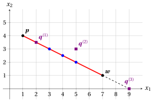
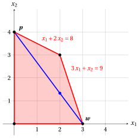
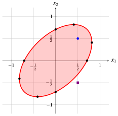
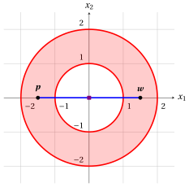
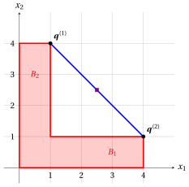

# Exercises · Convex sets

**Exercises · Chapter 1** · each solution opens with a click · [:material-book-open-variant: Chapter 1: Convex sets](../preliminaries/01-convex-sets.md) · [:material-file-pdf-box: Exercises, volume 1 (PDF)](../pdf/exercises-1-preliminaries.pdf)

!!! esercizio "Exercise 1.1: Convex sets (E1)"

    Consider the following two points in $\R^2$:

    $$
    {\boldsymbol p}=\begin{pmatrix} 1 \\[0.3ex] 4 \end{pmatrix}
    \qquad \text{and} \qquad
    {\boldsymbol w}=\begin{pmatrix} 7 \\[0.3ex] 1 \end{pmatrix}
    $$

    and the following three points in $\R^2$:

    $$
    {\boldsymbol q}^{(1)}=\begin{pmatrix} 2 \\[0.3ex] \frac{7}{2} \end{pmatrix},
    \qquad
    {\boldsymbol q}^{(2)}=\begin{pmatrix} 5 \\[0.3ex] 3 \end{pmatrix}
    \qquad \text{and} \qquad
    {\boldsymbol q}^{(3)}=\begin{pmatrix} 9 \\[0.3ex] 0 \end{pmatrix}.
    $$

    **Questions**

    1. Compute the convex combinations of ${\boldsymbol p}$ and ${\boldsymbol w}$ with $\lambda = \frac{1}{3}$, $\lambda=\frac{1}{2}$ and $\lambda=\frac{2}{3}$.

    2. Draw the points ${\boldsymbol p}$ and ${\boldsymbol w}$, the three convex combinations and the set of all convex combinations of ${\boldsymbol p}$ and ${\boldsymbol w}$.

    3. Determine which of the points ${\boldsymbol q}^{(1)}$, ${\boldsymbol q}^{(2)}$ and ${\boldsymbol q}^{(3)}$ are convex combinations of ${\boldsymbol p}$ and ${\boldsymbol w}$.

??? soluzione "Solution"

    1. For every $\lambda \in [0,1]$, the convex combination of ${\boldsymbol p}$ and ${\boldsymbol w}$ with the scalar $\lambda$ is the point:

        $$
        \lambda \begin{pmatrix} 1 \\[0.3ex] 4 \end{pmatrix} + (1-\lambda) \begin{pmatrix} 7 \\[0.3ex] 1 \end{pmatrix}
        =
        \begin{pmatrix} \lambda + 7 - 7\lambda \\[0.3ex] 4\lambda + 1 - \lambda \end{pmatrix}
        =
        \begin{pmatrix} 7 - 6\lambda \\[0.3ex] 1 + 3\lambda \end{pmatrix}.
        $$

        Therefore, we have:

        \begin{align*}
        \lambda = \frac{1}{3}: &\qquad
        \begin{pmatrix} \frac{1}{3}\cdot 1 + \frac{2}{3}\cdot 7 \\[1.2ex] \frac{1}{3}\cdot 4 + \frac{2}{3}\cdot 1 \end{pmatrix}
        = \begin{pmatrix} 5 \\[0.3ex] 2 \end{pmatrix}\\[2ex]
        \lambda = \frac{1}{2}: &\qquad
        \begin{pmatrix} \frac{1}{2}\cdot 1 + \frac{1}{2}\cdot 7 \\[1.2ex] \frac{1}{2}\cdot 4 + \frac{1}{2}\cdot 1 \end{pmatrix}
        = \begin{pmatrix} 4 \\[0.3ex] \frac{5}{2} \end{pmatrix}\\[2ex]
        \lambda = \frac{2}{3}: &\qquad
        \begin{pmatrix} \frac{2}{3}\cdot 1 + \frac{1}{3}\cdot 7 \\[1.2ex] \frac{2}{3}\cdot 4 + \frac{1}{3}\cdot 1 \end{pmatrix}
        = \begin{pmatrix} 3 \\[0.3ex] 3 \end{pmatrix}
        \end{align*}

    2. The set of all convex combinations of ${\boldsymbol p}$ and ${\boldsymbol w}$ is the segment joining the two points (red). The three convex combinations of the previous question are the blue points: with $\lambda=\frac{1}{3}$ the point is closer to ${\boldsymbol w}$, with $\lambda=\frac{2}{3}$ it is closer to ${\boldsymbol p}$.

        { .fig .ovale loading=lazy style="width:50%" }

    3. A point ${\boldsymbol q} \in \R^2$ is a convex combination of ${\boldsymbol p}$ and ${\boldsymbol w}$ if and only if there exists $\lambda \in [0,1]$ such that

        $$
        \begin{pmatrix} 7 - 6\lambda \\[0.3ex] 1 + 3\lambda \end{pmatrix} = \begin{pmatrix} q_1 \\[0.3ex] q_2 \end{pmatrix}.
        $$

        The first equation gives $\lambda = \frac{7-q_1}{6}$; then we check the second equation and the condition $\lambda \in [0,1]$.

        - For ${\boldsymbol q}^{(1)}$, the first equation gives $\lambda = \frac{7-2}{6}=\frac{5}{6}$ and the second equation holds: $1 + 3 \cdot \frac{5}{6} = \frac{7}{2}$. Since $\frac{5}{6} \in [0,1]$, the point ${\boldsymbol q}^{(1)}$ is the convex combination of ${\boldsymbol p}$ and ${\boldsymbol w}$ with $\lambda = \frac{5}{6}$.

        - For ${\boldsymbol q}^{(2)}$, the first equation gives $\lambda = \frac{7-5}{6}=\frac{1}{3}$, but $1 + 3 \cdot \frac{1}{3} = 2 \neq 3$. The point ${\boldsymbol q}^{(2)}$ is not even on the line through ${\boldsymbol p}$ and ${\boldsymbol w}$: it is not a convex combination of ${\boldsymbol p}$ and ${\boldsymbol w}$.

        - For ${\boldsymbol q}^{(3)}$, the first equation gives $\lambda = \frac{7-9}{6}=-\frac{1}{3}$ and the second equation holds: $1 + 3 \cdot \big(-\frac{1}{3}\big) = 0$. The point ${\boldsymbol q}^{(3)}$ is on the line through ${\boldsymbol p}$ and ${\boldsymbol w}$ (dashed in the figure), but $-\frac{1}{3} \notin [0,1]$: it is not a convex combination of ${\boldsymbol p}$ and ${\boldsymbol w}$.

!!! esercizio "Exercise 1.2: Convex sets (E2)"

    Consider the following three points in $\R^2$:

    $$
    {\boldsymbol p}^{(1)}=\begin{pmatrix} 1 \\[0.3ex] 1 \end{pmatrix},
    \qquad
    {\boldsymbol p}^{(2)}=\begin{pmatrix} 7 \\[0.3ex] 2 \end{pmatrix}
    \qquad \text{and} \qquad
    {\boldsymbol p}^{(3)}=\begin{pmatrix} 3 \\[0.3ex] 6 \end{pmatrix}
    $$

    and the following two points in $\R^2$:

    $$
    {\boldsymbol q}^{(1)}=\begin{pmatrix} 3 \\[0.3ex] 4 \end{pmatrix}
    \qquad \text{and} \qquad
    {\boldsymbol q}^{(2)}=\begin{pmatrix} 6 \\[0.3ex] 5 \end{pmatrix}.
    $$

    **Questions**

    1. Compute the convex combination of ${\boldsymbol p}^{(1)}$, ${\boldsymbol p}^{(2)}$ and ${\boldsymbol p}^{(3)}$ with $\lambda_1 = \frac{1}{2}$, $\lambda_2=\frac{1}{4}$ and $\lambda_3=\frac{1}{4}$.

    2. Compute the convex combination of ${\boldsymbol p}^{(1)}$, ${\boldsymbol p}^{(2)}$ and ${\boldsymbol p}^{(3)}$ with $\lambda_1 = \lambda_2=\lambda_3=\frac{1}{3}$.

    3. Show that ${\boldsymbol q}^{(1)}$ is a convex combination of ${\boldsymbol p}^{(1)}$, ${\boldsymbol p}^{(2)}$ and ${\boldsymbol p}^{(3)}$, and find the scalars.

    4. Show that ${\boldsymbol q}^{(2)}$ is not a convex combination of ${\boldsymbol p}^{(1)}$, ${\boldsymbol p}^{(2)}$ and ${\boldsymbol p}^{(3)}$.

    5. Draw the convex hull of ${\boldsymbol p}^{(1)}$, ${\boldsymbol p}^{(2)}$ and ${\boldsymbol p}^{(3)}$ and all the points of the previous questions.

??? soluzione "Solution"

    1. The convex combination with $\lambda_1 = \frac{1}{2}$, $\lambda_2=\frac{1}{4}$ and $\lambda_3=\frac{1}{4}$ (non-negative scalars with sum $1$) is the point:

        $$
        \frac{1}{2}\begin{pmatrix} 1 \\[0.3ex] 1 \end{pmatrix}
        +\frac{1}{4}\begin{pmatrix} 7 \\[0.3ex] 2 \end{pmatrix}
        +\frac{1}{4}\begin{pmatrix} 3 \\[0.3ex] 6 \end{pmatrix}
        =
        \begin{pmatrix} \frac{1}{2}+\frac{7}{4}+\frac{3}{4} \\[1.2ex] \frac{1}{2}+\frac{1}{2}+\frac{3}{2} \end{pmatrix}
        =
        \begin{pmatrix} 3 \\[0.3ex] \frac{5}{2} \end{pmatrix}.
        $$

    2. The convex combination with $\lambda_1 = \lambda_2=\lambda_3=\frac{1}{3}$ (non-negative scalars with sum $1$) is the point:

        $$
        \frac{1}{3}\begin{pmatrix} 1 \\[0.3ex] 1 \end{pmatrix}
        +\frac{1}{3}\begin{pmatrix} 7 \\[0.3ex] 2 \end{pmatrix}
        +\frac{1}{3}\begin{pmatrix} 3 \\[0.3ex] 6 \end{pmatrix}
        =
        \begin{pmatrix} \frac{1+7+3}{3} \\[1.2ex] \frac{1+2+6}{3} \end{pmatrix}
        =
        \begin{pmatrix} \frac{11}{3} \\[0.6ex] 3 \end{pmatrix}.
        $$

    3. A point ${\boldsymbol q} \in \R^2$ is a convex combination of the three points if and only if there exist $\lambda_1,\lambda_2,\lambda_3 \ge 0$ such that

        $$
        \left\{ \begin{array}{rcl}
        \lambda_1 + \lambda_2 + \lambda_3 & = & 1\\[1ex]
        \lambda_1 + 7\,\lambda_2 + 3\,\lambda_3 & = & q_1\\[1ex]
        \lambda_1 + 2\,\lambda_2 + 6\,\lambda_3 & = & q_2
        \end{array} \right.
        $$

        Substituting $\lambda_1 = 1 - \lambda_2 - \lambda_3$ in the last two equations, we obtain the system

        $$
        \left\{ \begin{array}{rcl}
        6\,\lambda_2 + 2\,\lambda_3 & = & q_1 - 1\\[1ex]
        \lambda_2 + 5\,\lambda_3 & = & q_2 - 1
        \end{array} \right.
        $$

        whose determinant is $6 \cdot 5 - 2 \cdot 1 = 28 \neq 0$: the scalars are unique. For ${\boldsymbol q}^{(1)}$ we have $q_1 - 1 = 2$ and $q_2 - 1 = 3$, hence

        $$
        \lambda_2 = \frac{2 \cdot 5 - 2 \cdot 3}{28} = \frac{1}{7},
        \qquad
        \lambda_3 = \frac{6 \cdot 3 - 2 \cdot 1}{28} = \frac{4}{7},
        \qquad
        \lambda_1 = 1 - \frac{1}{7} - \frac{4}{7} = \frac{2}{7}.
        $$

        The three scalars are non-negative and their sum is $1$, so ${\boldsymbol q}^{(1)}$ is a convex combination of the three points:

        $$
        \frac{2}{7}\begin{pmatrix} 1 \\[0.3ex] 1 \end{pmatrix}
        +\frac{1}{7}\begin{pmatrix} 7 \\[0.3ex] 2 \end{pmatrix}
        +\frac{4}{7}\begin{pmatrix} 3 \\[0.3ex] 6 \end{pmatrix}
        =
        \begin{pmatrix} \frac{2+7+12}{7} \\[1.2ex] \frac{2+2+24}{7} \end{pmatrix}
        =
        \begin{pmatrix} 3 \\[0.3ex] 4 \end{pmatrix}.
        $$

    4. For ${\boldsymbol q}^{(2)}$ we have $q_1 - 1 = 5$ and $q_2 - 1 = 4$, hence

        $$
        \lambda_2 = \frac{5 \cdot 5 - 2 \cdot 4}{28} = \frac{17}{28},
        \qquad
        \lambda_3 = \frac{6 \cdot 4 - 5 \cdot 1}{28} = \frac{19}{28},
        \qquad
        \lambda_1 = 1 - \frac{17}{28} - \frac{19}{28} = -\frac{2}{7}.
        $$

        These are the only scalars with sum $1$ that give ${\boldsymbol q}^{(2)}$, and $\lambda_1 < 0$: the point ${\boldsymbol q}^{(2)}$ is not a convex combination of the three points.

    5. The convex hull of the three points is the triangle with vertices ${\boldsymbol p}^{(1)}$, ${\boldsymbol p}^{(2)}$ and ${\boldsymbol p}^{(3)}$ (red). The points of the first two questions are blue, ${\boldsymbol q}^{(1)}$ (inside the triangle) and ${\boldsymbol q}^{(2)}$ (outside the triangle) are violet.

        { .fig .ovale loading=lazy style="width:50%" }

!!! esercizio "Exercise 1.3: Convex sets (E3)"

    Consider the following set:

    $$
    F=\left\{~ \begin{pmatrix} x_1 \\[0.3ex] x_2 \end{pmatrix} \in \R^2:~~ x_1 + 2\,x_2 \le 8,~~ 3\,x_1 + x_2 \le 9,~~ x_1 \ge 0,~~ x_2 \ge 0 ~\right\}
    $$

    and the following two points in $F$ and scalar:

    $$
    {\boldsymbol q}^{(1)}=\begin{pmatrix} 0 \\[0.3ex] 4 \end{pmatrix},
    \qquad
    {\boldsymbol q}^{(2)}=\begin{pmatrix} 3 \\[0.3ex] 0 \end{pmatrix}
    \qquad \text{and} \qquad
    \lambda = \frac{1}{3}.
    $$

    **Questions**

    1. Prove that $F$ is a convex set.

    2. Find the vertices of $F$ and draw the set.

    3. Compute the convex combination of ${\boldsymbol q}^{(1)}$ and ${\boldsymbol q}^{(2)}$ with the scalar $\lambda$ and verify that it belongs to $F$.

??? soluzione "Solution"

    1. Each of the four inequalities that define $F$ has the form $a_1\,x_1 + a_2\,x_2 \le b$, with

        $$
        (a_1,a_2,b) \in \big\{\,(1,2,8),~(3,1,9),~(-1,0,0),~(0,-1,0)\,\big\}
        $$

        (the last two are $x_1 \ge 0$ and $x_2 \ge 0$). For every pair of points ${\boldsymbol p}, {\boldsymbol w} \in F$ and every $\lambda \in [0,1]$, for each of the four inequalities we have:

        \begin{align*}
        & a_1\,\big(\lambda p_1 + (1-\lambda) w_1\big) + a_2\,\big(\lambda p_2 + (1-\lambda) w_2\big) \\[2ex]
        &\quad = \lambda\,(a_1\,p_1 + a_2\,p_2) + (1-\lambda)\,(a_1\,w_1 + a_2\,w_2) \\[2ex]
        &\quad \le \lambda\, b + (1-\lambda)\, b \\[1ex]
        &\qquad\quad (\text{since } {\boldsymbol p}, {\boldsymbol w} \in F,~ \lambda \ge 0 \text{ and } 1-\lambda \ge 0)\\[2ex]
        &\quad = b
        \end{align*}

        Therefore, $\lambda {\boldsymbol p} + (1-\lambda){\boldsymbol w} \in F$, and the set is convex.

        The same computation shows that each of the four sets defined by one inequality (a half-plane) is convex: $F$ is their intersection, which is convex since the intersection of convex sets is convex (chapter «Convex sets»).

    2. The vertices of $F$ are the origin, the points where the lines $x_1 + 2\,x_2 = 8$ and $3\,x_1 + x_2 = 9$ meet the axes inside $F$, namely $\begin{pmatrix} 0 \\[0.3ex] 4 \end{pmatrix}$ and $\begin{pmatrix} 3 \\[0.3ex] 0 \end{pmatrix}$, and the intersection point of the two lines:

        \begin{equation*}
        \left\{ \begin{array}{ll}
        x_1 + 2\,x_2  & = 8\\[2ex]
        3\,x_1 + x_2  & = 9
        \end{array} \right.
        ~~\Longrightarrow~~
        \begin{pmatrix}
        x_1 \\[0.5ex]
        x_2
        \end{pmatrix} = \begin{pmatrix}
        \frac{8 \cdot 1 - 2 \cdot 9}{1 \cdot 1 - 2 \cdot 3} \\[2ex]
        \frac{1 \cdot 9  - 8 \cdot 3}{1 \cdot 1 - 2 \cdot 3}
        \end{pmatrix}
        = \begin{pmatrix}
        2 \\[0.5ex]
        3
        \end{pmatrix}
        \end{equation*}

        The set $F$ is the quadrilateral with vertices $\begin{pmatrix} 0 \\[0.3ex] 0 \end{pmatrix}$, $\begin{pmatrix} 3 \\[0.3ex] 0 \end{pmatrix}$, $\begin{pmatrix} 2 \\[0.3ex] 3 \end{pmatrix}$ and $\begin{pmatrix} 0 \\[0.3ex] 4 \end{pmatrix}$ (red). The figure also shows the segment joining ${\boldsymbol q}^{(1)}$ and ${\boldsymbol q}^{(2)}$ (blue) and the convex combination of the next question.

        { .fig .ovale loading=lazy style="width:50%" }

    3. The convex combination of ${\boldsymbol q}^{(1)}$ and ${\boldsymbol q}^{(2)}$ with $\lambda = \frac{1}{3}$ is the point:

        $$
        \frac{1}{3}\begin{pmatrix} 0 \\[0.3ex] 4 \end{pmatrix} + \frac{2}{3}\begin{pmatrix} 3 \\[0.3ex] 0 \end{pmatrix}
        = \begin{pmatrix} 2 \\[0.3ex] \frac{4}{3} \end{pmatrix}.
        $$

        It belongs to $F$, as guaranteed by the first question:

        $$
        2 + 2 \cdot \frac{4}{3} = \frac{14}{3} \le 8,
        \qquad
        3 \cdot 2 + \frac{4}{3} = \frac{22}{3} \le 9,
        \qquad
        2 \ge 0,
        \qquad
        \frac{4}{3} \ge 0.
        $$

!!! esercizio "Exercise 1.4: Convex sets (E4)"

    Consider the following symmetric matrix

    $$
    {\boldsymbol Q}=\begin{pmatrix}
    2 & -1\\[1ex]
    -1 & 2
    \end{pmatrix}
    $$

    and the following set:

    $$
    F=\left\{~ {\boldsymbol x} \in \R^2:~~
    \underbrace{\sqrt{\sum_{i=1}^2 \sum_{j=1}^2 q_{ij}\;x_i\;x_j} }_{\sqrt{{\boldsymbol x }' \; {\boldsymbol Q} \; {\boldsymbol x}}}  \le 1  ~\right\}.
    $$

    **Questions**

    1. Show that ${\boldsymbol x}' \, {\boldsymbol Q} \, {\boldsymbol x} = x_1^2 + (x_1 - x_2)^2 + x_2^2$ for every ${\boldsymbol x} \in \R^2$.

    2. Prove that $F$ is a convex set.

    3. Determine whether the points $\begin{pmatrix} \frac{1}{2} \\[0.6ex] \frac{1}{2} \end{pmatrix}$ and $\begin{pmatrix} \frac{1}{2} \\[0.6ex] -\frac{1}{2} \end{pmatrix}$ belong to $F$.

    4. Draw the set $F$.

??? soluzione "Solution"

    1. For every ${\boldsymbol x} \in \R^2$ we have:

        \begin{align*}
        & \begin{pmatrix} x_1 & x_2 \end{pmatrix} \begin{pmatrix} 2 & -1 \\[1ex] -1 & 2 \end{pmatrix} \begin{pmatrix} x_1 \\[1ex] x_2 \end{pmatrix} \\[2ex]
        &\quad = (2\,x_1-x_2)\,x_1 + (-x_1+2\,x_2)\, x_2  \\[2ex]
        &\quad = 2\,x_1^2 - 2\,x_1\,x_2 + 2\,x_2^2  \\[2ex]
        &\quad = x_1^2+ \big(x_1^2 - 2\,x_1\,x_2 + x_2^2\big) + x_2^2  \\[2ex]
        &\quad = x_1^2 + (x_1-x_2)^2 + x_2^2 .
        \end{align*}

        Therefore, for every ${\boldsymbol x} \in \R^2$, the number $\sqrt{{\boldsymbol x}' \, {\boldsymbol Q} \, {\boldsymbol x}}$ is the Euclidean norm of a vector of $\R^3$:

        $$
        \sqrt{{\boldsymbol x}' \, {\boldsymbol Q} \, {\boldsymbol x}} = \big\| {\boldsymbol u}({\boldsymbol x}) \big\|_2,
        \qquad \text{where} \qquad
        {\boldsymbol u}({\boldsymbol x}) = \begin{pmatrix} x_1 \\[0.3ex] x_1 - x_2 \\[0.3ex] x_2 \end{pmatrix} \in \R^3 .
        $$

        The vector ${\boldsymbol u}({\boldsymbol x})$ depends linearly on ${\boldsymbol x}$: for every ${\boldsymbol p}, {\boldsymbol w} \in \R^2$ and every $\lambda \in [0,1]$, we have ${\boldsymbol u}\big(\lambda {\boldsymbol p} + (1-\lambda){\boldsymbol w}\big) = \lambda\, {\boldsymbol u}({\boldsymbol p}) + (1-\lambda)\, {\boldsymbol u}({\boldsymbol w})$.

    2. For every pair of points ${\boldsymbol p}, {\boldsymbol w} \in F$ and every $\lambda \in [0,1]$, we have:

        \begin{align*}
        & \sqrt{\big(\lambda {\boldsymbol p} + (1-\lambda){\boldsymbol w}\big)' \, {\boldsymbol Q} \, \big(\lambda {\boldsymbol p} + (1-\lambda){\boldsymbol w}\big)} \\[2ex]
        &\quad = \big\| \lambda\, {\boldsymbol u}({\boldsymbol p}) + (1-\lambda)\, {\boldsymbol u}({\boldsymbol w}) \big\|_2 \\[1ex]
        &\qquad\quad \text{(by the first question)}\\[2ex]
        &\quad \le \big\| \lambda\, {\boldsymbol u}({\boldsymbol p}) \big\|_2 + \big\| (1-\lambda)\, {\boldsymbol u}({\boldsymbol w}) \big\|_2 \\[1ex]
        &\qquad\quad \text{(by the triangle inequality)}\\[2ex]
        &\quad = |\lambda| \; \| {\boldsymbol u}({\boldsymbol p}) \|_2 + |1-\lambda| \; \| {\boldsymbol u}({\boldsymbol w}) \|_2 \\[1ex]
        &\qquad\quad \text{(by the absolute homogeneity)}\\[2ex]
        &\quad = \lambda \; \| {\boldsymbol u}({\boldsymbol p}) \|_2 + (1-\lambda) \; \| {\boldsymbol u}({\boldsymbol w}) \|_2 \\[1ex]
        &\qquad\quad (\text{since } \lambda \ge 0 \text{ and } 1-\lambda \ge 0)\\[2ex]
        &\quad = \lambda \, \sqrt{{\boldsymbol p}' \, {\boldsymbol Q} \, {\boldsymbol p}} + (1-\lambda) \, \sqrt{{\boldsymbol w}' \, {\boldsymbol Q} \, {\boldsymbol w}} \\[1ex]
        &\qquad\quad \text{(by the first question)}\\[2ex]
        &\quad \le \lambda \cdot 1 + (1-\lambda) \cdot 1 \\[1ex]
        &\qquad\quad (\text{since } {\boldsymbol p}, {\boldsymbol w} \in F,~ \lambda \ge 0 \text{ and } 1-\lambda \ge 0)\\[2ex]
        &\quad = 1
        \end{align*}

        Therefore, $\lambda {\boldsymbol p} + (1-\lambda){\boldsymbol w} \in F$, and the set is convex.

    3. We have:

        \begin{align*}
        \begin{pmatrix} \frac{1}{2} \\[0.6ex] \frac{1}{2} \end{pmatrix}:&\qquad
        \left(\frac{1}{2}\right)^2 + \left(\frac{1}{2} - \frac{1}{2}\right)^2 + \left(\frac{1}{2}\right)^2 = \frac{1}{2} \le 1
        \quad \Longrightarrow \quad \text{it is in } F, \\[2ex]
        \begin{pmatrix} \frac{1}{2} \\[0.6ex] -\frac{1}{2} \end{pmatrix}:&\qquad
        \left(\frac{1}{2}\right)^2 + \left(\frac{1}{2} + \frac{1}{2}\right)^2 + \left(-\frac{1}{2}\right)^2 = \frac{3}{2} > 1
        \quad \Longrightarrow \quad \text{it is not in } F.
        \end{align*}

        (Since the square root is increasing, $\sqrt{{\boldsymbol x}' \, {\boldsymbol Q} \, {\boldsymbol x}} \le 1$ if and only if ${\boldsymbol x}' \, {\boldsymbol Q} \, {\boldsymbol x} \le 1$.)

    4. The boundary of $F$ is given by the points with

        $$
        2\,x_1^2 - 2\,x_1\,x_2 + 2\,x_2^2 = 1.
        $$

        We express $x_2$ as a function of $x_1$. Writing the previous equation as

        $$
        2\,x_2^2 - 2\,x_1\,x_2 + (2\,x_1^2-1)=0,
        $$

        with $a=2$, $b=- 2\,x_1$ and $c=2\,x_1^2-1$ we have $x_2= \frac{-b \pm \sqrt{b^2 - 4 a c}}{2 a}$, hence:

        \begin{align*}
        x_2
        &= \frac{2\,x_1  \pm \sqrt{ 4\,x_1^2  - 8\,\big(2\,x_1^2-1\big)}}{4}
        = \frac{ 2\,x_1  \pm \sqrt{ 8 - 12\,x_1^2}}{4}
        = \frac{ x_1  \pm \sqrt{  2  - 3\,x_1^2 }}{2}.
        \end{align*}

        These values exist if and only if

        $$
        2  - 3\,x_1^2 \ge 0
        ~~~\Longleftrightarrow~~~
        x_1 \in \left[-\sqrt{\frac{2}{3}},\sqrt{\frac{2}{3}} \right].
        $$

        Some reference points of the boundary:

        - if $x_2=0$, then $2\,x_1^2=1$, so $x_1=\pm\frac{1}{\sqrt{2}}$; if $x_1=0$, then $2\,x_2^2=1$, so $x_2=\pm\frac{1}{\sqrt{2}}$;

        - if $x_1=\pm\sqrt{\frac{2}{3}}$, then $2-3\,x_1^2=0$ and $x_2=\frac{x_1}{2}=\pm\frac{1}{\sqrt{6}}$; in the same way, if $x_2=\pm\sqrt{\frac{2}{3}}$, then $x_1=\pm\frac{1}{\sqrt{6}}$.

        The set $F$ is the region inside (and on the boundary of) an ellipse whose axes are the lines $x_2 = x_1$ and $x_2 = -x_1$ (red). The figure shows the reference points (black), the point $\big(\frac{1}{2},\frac{1}{2}\big)$ that belongs to $F$ (blue) and the point $\big(\frac{1}{2},-\frac{1}{2}\big)$ that does not belong to $F$ (violet).

        { .fig .ovale loading=lazy style="width:50%" }

!!! esercizio "Exercise 1.5: Convex sets (E5)"

    Consider the following sets:

    \begin{align*}
    A &= \left\{~ \begin{pmatrix} x_1 \\[0.3ex] x_2 \end{pmatrix} \in \R^2:~~ 1 \le x_1^2 + x_2^2 \le 4 ~\right\},\\[2ex]
    B_1 &= \left\{~ \begin{pmatrix} x_1 \\[0.3ex] x_2 \end{pmatrix} \in \R^2:~~ 0 \le x_1 \le 4,~~ 0 \le x_2 \le 1 ~\right\},\\[2ex]
    B_2 &= \left\{~ \begin{pmatrix} x_1 \\[0.3ex] x_2 \end{pmatrix} \in \R^2:~~ 0 \le x_1 \le 1,~~ 0 \le x_2 \le 4 ~\right\}
    \qquad \text{and} \qquad
    B = B_1 \cup B_2 .
    \end{align*}

    **Questions**

    1. Draw the sets $A$ and $B$.

    2. Show that $A$ is not a convex set.

    3. Prove that $B_1$ and $B_2$ are convex sets.

    4. Show that $B$ is not a convex set.

??? soluzione "Solution"

    1. The set $A$ is the ring between the circle of radius $1$ and the circle of radius $2$ centered at the origin (red, left). The set $B$ is the L-shaped union of the rectangles $B_1$ and $B_2$ (red, right). The figures also show the segments used in the next questions (blue), whose midpoint (violet) does not belong to the set.

        { .fig .ovale loading=lazy style="width:50%" }

        { .fig .ovale loading=lazy style="width:50%" }

    2. To show that a set is not convex, it is enough to find two points of the set and one scalar $\lambda \in [0,1]$ whose convex combination does not belong to the set. Take

        $$
        {\boldsymbol q}^{(1)}=\begin{pmatrix} -\frac{3}{2} \\[0.6ex] 0 \end{pmatrix},
        \qquad
        {\boldsymbol q}^{(2)}=\begin{pmatrix} \frac{3}{2} \\[0.6ex] 0 \end{pmatrix}
        \qquad \text{and} \qquad
        \lambda = \frac{1}{2}.
        $$

        Both points belong to $A$, since $\big(\pm\frac{3}{2}\big)^2 + 0^2 = \frac{9}{4} \in [1,4]$. Their convex combination is

        $$
        \frac{1}{2}\begin{pmatrix} -\frac{3}{2} \\[0.6ex] 0 \end{pmatrix} + \frac{1}{2}\begin{pmatrix} \frac{3}{2} \\[0.6ex] 0 \end{pmatrix} = \begin{pmatrix} 0 \\[0.3ex] 0 \end{pmatrix},
        \qquad \text{with} \qquad 0^2 + 0^2 = 0 < 1 .
        $$

        The convex combination does not belong to $A$: the set $A$ is not convex.

    3. Let $k \in \{1,2\}$. The set $B_k$ is defined by the bounds $0 \le x_1 \le u_1$ and $0 \le x_2 \le u_2$, with $(u_1,u_2) = (4,1)$ for $B_1$ and $(u_1,u_2) = (1,4)$ for $B_2$. For every pair of points ${\boldsymbol p}, {\boldsymbol w} \in B_k$ and every $\lambda \in [0,1]$, for each coordinate $i \in \{1,2\}$ we have:

        \begin{align*}
        \lambda p_i + (1-\lambda) w_i
        &\in \big[\,\lambda \cdot 0 + (1-\lambda) \cdot 0,~~ \lambda\, u_i + (1-\lambda)\, u_i\,\big] \\[1ex]
        &\qquad\quad (\text{since } p_i, w_i \in [0,u_i],~ \lambda \ge 0 \text{ and } 1-\lambda \ge 0)\\[2ex]
        &= [\,0,~u_i\,]
        \end{align*}

        Therefore, $\lambda {\boldsymbol p} + (1-\lambda){\boldsymbol w} \in B_k$, and the set $B_k$ is convex.

    4. Take

        $$
        {\boldsymbol q}^{(1)}=\begin{pmatrix} 1 \\[0.3ex] 4 \end{pmatrix} \in B_2,
        \qquad
        {\boldsymbol q}^{(2)}=\begin{pmatrix} 4 \\[0.3ex] 1 \end{pmatrix} \in B_1
        \qquad \text{and} \qquad
        \lambda = \frac{1}{2}.
        $$

        Both points belong to $B$. Their convex combination is

        $$
        \frac{1}{2}\begin{pmatrix} 1 \\[0.3ex] 4 \end{pmatrix} + \frac{1}{2}\begin{pmatrix} 4 \\[0.3ex] 1 \end{pmatrix} = \begin{pmatrix} \frac{5}{2} \\[0.6ex] \frac{5}{2} \end{pmatrix},
        $$

        which does not belong to $B_1$ (since $x_2 = \frac{5}{2} > 1$) nor to $B_2$ (since $x_1 = \frac{5}{2} > 1$), hence it does not belong to $B$: the set $B$ is not convex.

        The intersection of convex sets is always convex (chapter «Convex sets»), while the union of two convex sets, as $B = B_1 \cup B_2$, may not be convex.
