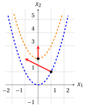

# Exercises · Functions of several variables

**Exercises · Chapter 2** · each solution opens with a click · [:material-book-open-variant: Chapter 2: Functions of several variables](../preliminaries/02-functions-several-variables.md) · [:material-file-pdf-box: Exercises, volume 1 (PDF)](../pdf/exercises-1-preliminaries.pdf)

!!! esercizio "Exercise 2.1: Functions of several variables (E1)"

    Consider the following real-valued function:

    $$
    f: \R^2 \rightarrow \R,~~ f: \begin{pmatrix} x_1 \\ x_2 \end{pmatrix} \mapsto x_1^3 + 2\,x_1 x_2^2 - 3\,x_2
    $$

    **Questions**

    1. Compute the value of the function at the points $\begin{pmatrix} 1 \\ 1 \end{pmatrix}$ and $\begin{pmatrix} -1 \\ 2 \end{pmatrix}$.

    2. Compute the gradient of the function and evaluate it at the two points.

    3. Compute the Hessian of the function and evaluate it at the two points.

??? soluzione "Solution"

    1. Substituting the coordinates of the points:

        \begin{align*}
        f\left(\begin{pmatrix} 1 \\ 1 \end{pmatrix}\right) &= 1^3 + 2 \cdot 1 \cdot 1^2 - 3 \cdot 1 = 1 + 2 - 3 = 0 \\[2ex]
        f\left(\begin{pmatrix} -1 \\ 2 \end{pmatrix}\right) &= (-1)^3 + 2 \cdot (-1) \cdot 2^2 - 3 \cdot 2 = -1 - 8 - 6 = -15
        \end{align*}

    2. The partial derivatives are $\frac{\partial f(\boldsymbol x)}{\partial x_1} = 3\,x_1^2 + 2\,x_2^2$ and $\frac{\partial f(\boldsymbol x)}{\partial x_2} = 4\,x_1 x_2 - 3$, so the gradient is:

        $$
        \nabla f\left(\begin{pmatrix} x_1 \\ x_2 \end{pmatrix}\right) =
        \begin{pmatrix} 3\,x_1^2 + 2\,x_2^2 \\[1ex] 4\,x_1 x_2 - 3 \end{pmatrix}
        $$

        At the two points:

        $$
        \nabla f\left(\begin{pmatrix} 1 \\ 1 \end{pmatrix}\right) = \begin{pmatrix} 3 + 2 \\ 4 - 3 \end{pmatrix} = \begin{pmatrix} 5 \\ 1 \end{pmatrix},
        \qquad
        \nabla f\left(\begin{pmatrix} -1 \\ 2 \end{pmatrix}\right) = \begin{pmatrix} 3 + 8 \\ -8 - 3 \end{pmatrix} = \begin{pmatrix} 11 \\ -11 \end{pmatrix}
        $$

    3. Differentiating the two partial derivatives once more:

        $$
        \nabla^2 f\left(\begin{pmatrix} x_1 \\ x_2 \end{pmatrix}\right) =
        \begin{pmatrix} 6\,x_1 & 4\,x_2 \\[1ex] 4\,x_2 & 4\,x_1 \end{pmatrix}
        $$

        which is a symmetric matrix depending on the point. At the two points:

        $$
        \nabla^2 f\left(\begin{pmatrix} 1 \\ 1 \end{pmatrix}\right) = \begin{pmatrix} 6 & 4 \\ 4 & 4 \end{pmatrix},
        \qquad
        \nabla^2 f\left(\begin{pmatrix} -1 \\ 2 \end{pmatrix}\right) = \begin{pmatrix} -6 & 8 \\ 8 & -4 \end{pmatrix}
        $$

!!! esercizio "Exercise 2.2: Functions of several variables (E2)"

    Consider the following real-valued function:

    $$
    f: \R^2 \rightarrow \R,~~ f: \begin{pmatrix} x_1 \\ x_2 \end{pmatrix} \mapsto x_1^4 - 2\,x_1^2 x_2 + x_2^2
    $$

    **Questions**

    1. Show that $f({\boldsymbol x}) = (x_1^2 - x_2)^2$.

    2. Compute the gradient and the Hessian of the function.

    3. Evaluate the gradient and the Hessian at the points $\begin{pmatrix} 1 \\ 1 \end{pmatrix}$ and $\begin{pmatrix} 1 \\ 0 \end{pmatrix}$.

    4. Find all the points at which the gradient is the zero vector, and the value of the function at these points.

??? soluzione "Solution"

    1. Expanding the square:

        $$
        (x_1^2 - x_2)^2 = x_1^4 - 2\,x_1^2 x_2 + x_2^2 = f({\boldsymbol x})
        $$

    2. The partial derivatives are $\frac{\partial f(\boldsymbol x)}{\partial x_1} = 4\,x_1^3 - 4\,x_1 x_2$ and $\frac{\partial f(\boldsymbol x)}{\partial x_2} = -2\,x_1^2 + 2\,x_2$, so:

        $$
        \nabla f\left(\begin{pmatrix} x_1 \\ x_2 \end{pmatrix}\right) =
        \begin{pmatrix} 4\,x_1^3 - 4\,x_1 x_2 \\[1ex] -2\,x_1^2 + 2\,x_2 \end{pmatrix}
        =
        \begin{pmatrix} 4\,x_1\,(x_1^2 - x_2) \\[1ex] -2\,(x_1^2 - x_2) \end{pmatrix}
        $$

        and

        $$
        \nabla^2 f\left(\begin{pmatrix} x_1 \\ x_2 \end{pmatrix}\right) =
        \begin{pmatrix} 12\,x_1^2 - 4\,x_2 & -4\,x_1 \\[1ex] -4\,x_1 & 2 \end{pmatrix}
        $$

    3. At the point $\begin{pmatrix} 1 \\ 1 \end{pmatrix}$ we have $x_1^2 - x_2 = 0$, and:

        $$
        \nabla f\left(\begin{pmatrix} 1 \\ 1 \end{pmatrix}\right) = \begin{pmatrix} 0 \\ 0 \end{pmatrix},
        \qquad
        \nabla^2 f\left(\begin{pmatrix} 1 \\ 1 \end{pmatrix}\right) = \begin{pmatrix} 12 - 4 & -4 \\ -4 & 2 \end{pmatrix} = \begin{pmatrix} 8 & -4 \\ -4 & 2 \end{pmatrix}
        $$

        At the point $\begin{pmatrix} 1 \\ 0 \end{pmatrix}$ we have $x_1^2 - x_2 = 1$, and:

        $$
        \nabla f\left(\begin{pmatrix} 1 \\ 0 \end{pmatrix}\right) = \begin{pmatrix} 4 \cdot 1 \cdot 1 \\ -2 \cdot 1 \end{pmatrix} = \begin{pmatrix} 4 \\ -2 \end{pmatrix},
        \qquad
        \nabla^2 f\left(\begin{pmatrix} 1 \\ 0 \end{pmatrix}\right) = \begin{pmatrix} 12 & -4 \\ -4 & 2 \end{pmatrix}
        $$

    4. The second component of the gradient is zero if and only if $x_2 = x_1^2$, and in this case also the first component $4\,x_1\,(x_1^2 - x_2)$ is zero. Therefore, the gradient is the zero vector at all the points of the parabola:

        $$
        \left\{~\begin{pmatrix} x_1 \\ x_2 \end{pmatrix} \in \R^2:~ x_2 = x_1^2 ~\right\}
        $$

        (for example $\begin{pmatrix} 0 \\ 0 \end{pmatrix}$, $\begin{pmatrix} 1 \\ 1 \end{pmatrix}$ and $\begin{pmatrix} -1 \\ 1 \end{pmatrix}$), which is an infinite set of points. At all these points the value of the function is $f({\boldsymbol x}) = (x_1^2 - x_2)^2 = 0$: this parabola is the level set $L(0)$ of the function.

!!! esercizio "Exercise 2.3: Functions of several variables (E3)"

    Consider the following real-valued function of three variables:

    $$
    f: \R^3 \rightarrow \R,~~ f: \begin{pmatrix} x_1 \\ x_2 \\ x_3 \end{pmatrix} \mapsto x_1^2 x_3 + x_2 x_3^2 - 2\,x_1 x_2 + x_3
    $$

    **Questions**

    1. Compute the value of the function at the points $\begin{pmatrix} 1 \\ 0 \\ 2 \end{pmatrix}$ and $\begin{pmatrix} 0 \\ 1 \\ -1 \end{pmatrix}$.

    2. Compute the gradient of the function and evaluate it at the two points.

    3. Compute the Hessian of the function and evaluate it at the two points.

??? soluzione "Solution"

    1. Substituting the coordinates of the points:

        \begin{align*}
        f\left(\begin{pmatrix} 1 \\ 0 \\ 2 \end{pmatrix}\right) &= 1^2 \cdot 2 + 0 \cdot 2^2 - 2 \cdot 1 \cdot 0 + 2 = 2 + 0 - 0 + 2 = 4 \\[2ex]
        f\left(\begin{pmatrix} 0 \\ 1 \\ -1 \end{pmatrix}\right) &= 0^2 \cdot (-1) + 1 \cdot (-1)^2 - 2 \cdot 0 \cdot 1 + (-1) = 0 + 1 - 0 - 1 = 0
        \end{align*}

    2. The three partial derivatives are:

        $$
        \frac{\partial f(\boldsymbol x)}{\partial x_1} = 2\,x_1 x_3 - 2\,x_2, \qquad
        \frac{\partial f(\boldsymbol x)}{\partial x_2} = x_3^2 - 2\,x_1, \qquad
        \frac{\partial f(\boldsymbol x)}{\partial x_3} = x_1^2 + 2\,x_2 x_3 + 1
        $$

        so the gradient is:

        $$
        \nabla f\left(\begin{pmatrix} x_1 \\ x_2 \\ x_3 \end{pmatrix}\right) =
        \begin{pmatrix} 2\,x_1 x_3 - 2\,x_2 \\[1ex] x_3^2 - 2\,x_1 \\[1ex] x_1^2 + 2\,x_2 x_3 + 1 \end{pmatrix}
        $$

        At the two points:

        $$
        \nabla f\left(\begin{pmatrix} 1 \\ 0 \\ 2 \end{pmatrix}\right) = \begin{pmatrix} 4 - 0 \\ 4 - 2 \\ 1 + 0 + 1 \end{pmatrix} = \begin{pmatrix} 4 \\ 2 \\ 2 \end{pmatrix},
        \qquad
        \nabla f\left(\begin{pmatrix} 0 \\ 1 \\ -1 \end{pmatrix}\right) = \begin{pmatrix} 0 - 2 \\ 1 - 0 \\ 0 - 2 + 1 \end{pmatrix} = \begin{pmatrix} -2 \\ 1 \\ -1 \end{pmatrix}
        $$

    3. Differentiating each partial derivative with respect to $x_1$, $x_2$ and $x_3$:

        $$
        \nabla^2 f\left(\begin{pmatrix} x_1 \\ x_2 \\ x_3 \end{pmatrix}\right) =
        \begin{pmatrix} 2\,x_3 & -2 & 2\,x_1 \\[1ex] -2 & 0 & 2\,x_3 \\[1ex] 2\,x_1 & 2\,x_3 & 2\,x_2 \end{pmatrix}
        $$

        which is a symmetric matrix depending on the point. At the two points:

        $$
        \nabla^2 f\left(\begin{pmatrix} 1 \\ 0 \\ 2 \end{pmatrix}\right) = \begin{pmatrix} 4 & -2 & 2 \\ -2 & 0 & 4 \\ 2 & 4 & 0 \end{pmatrix},
        \qquad
        \nabla^2 f\left(\begin{pmatrix} 0 \\ 1 \\ -1 \end{pmatrix}\right) = \begin{pmatrix} -2 & -2 & 0 \\ -2 & 0 & -2 \\ 0 & -2 & 2 \end{pmatrix}
        $$

!!! esercizio "Exercise 2.4: Functions of several variables (E4)"

    Consider the following real-valued function:

    $$
    f: \R^2 \rightarrow \R,~~ f: \begin{pmatrix} x_1 \\ x_2 \end{pmatrix} \mapsto x_2 - x_1^2
    $$

    **Questions**

    1. Compute the gradient and the Hessian of the function.

    2. Describe the level sets $L(k)$ of the function for every $k \in \R$.

    3. Evaluate the gradient at the point $\begin{pmatrix} 1 \\ 1 \end{pmatrix}$ of the level set $L(0)$ and at the point $\begin{pmatrix} 0 \\ 2 \end{pmatrix}$ of the level set $L(2)$.

    4. Draw the level sets $L(0)$ and $L(2)$ and the two gradients of the previous question, and verify that each gradient is perpendicular to the level set through its point.

??? soluzione "Solution"

    1. The partial derivatives are $\frac{\partial f(\boldsymbol x)}{\partial x_1} = -2\,x_1$ and $\frac{\partial f(\boldsymbol x)}{\partial x_2} = 1$, so:

        $$
        \nabla f\left(\begin{pmatrix} x_1 \\ x_2 \end{pmatrix}\right) =
        \begin{pmatrix} -2\,x_1 \\[1ex] 1 \end{pmatrix},
        \qquad
        \nabla^2 f\left(\begin{pmatrix} x_1 \\ x_2 \end{pmatrix}\right) =
        \begin{pmatrix} -2 & 0 \\[1ex] 0 & 0 \end{pmatrix}
        $$

        The Hessian is constant. The second component of the gradient is always $1$, so the gradient is never the zero vector.

    2. For every $k \in \R$:

        $$
        L(k) = \left\{~\begin{pmatrix} x_1 \\ x_2 \end{pmatrix} \in \R^2:~ x_2 - x_1^2 = k ~\right\}
        = \left\{~\begin{pmatrix} x_1 \\ x_2 \end{pmatrix} \in \R^2:~ x_2 = x_1^2 + k ~\right\}
        $$

        Every level set is a parabola with vertex $\begin{pmatrix} 0 \\ k \end{pmatrix}$, obtained by translating the parabola $x_2 = x_1^2$ vertically by $k$.

    3. The point $\begin{pmatrix} 1 \\ 1 \end{pmatrix}$ belongs to $L(0)$ since $1 - 1^2 = 0$, and the point $\begin{pmatrix} 0 \\ 2 \end{pmatrix}$ belongs to $L(2)$ since $2 - 0^2 = 2$. The gradients are:

        $$
        \nabla f\left(\begin{pmatrix} 1 \\ 1 \end{pmatrix}\right) = \begin{pmatrix} -2 \\ 1 \end{pmatrix},
        \qquad
        \nabla f\left(\begin{pmatrix} 0 \\ 2 \end{pmatrix}\right) = \begin{pmatrix} 0 \\ 1 \end{pmatrix}
        $$

    4. We draw the two level sets with the gradients, and then we verify the perpendicularity with the tangent directions.

        <strong>Graphical solution:</strong> the figure shows the level sets $L(0)$ (in blue) and $L(2)$ (in orange) and the two gradients (in red), drawn from their points:

        { .fig .ovale loading=lazy style="width:50%" }

        The tangent direction of a level set $x_2 = x_1^2 + k$ at a point with first coordinate $x_1$ is $\begin{pmatrix} 1 \\ 2\,x_1 \end{pmatrix}$ (the derivative of $x_1^2 + k$ is $2\,x_1$):

        - at $\begin{pmatrix} 1 \\ 1 \end{pmatrix}$ the tangent direction is $\begin{pmatrix} 1 \\ 2 \end{pmatrix}$ and $\begin{pmatrix} -2 & 1 \end{pmatrix} \begin{pmatrix} 1 \\ 2 \end{pmatrix} = -2 + 2 = 0$;

        - at $\begin{pmatrix} 0 \\ 2 \end{pmatrix}$ the tangent direction is $\begin{pmatrix} 1 \\ 0 \end{pmatrix}$ and $\begin{pmatrix} 0 & 1 \end{pmatrix} \begin{pmatrix} 1 \\ 0 \end{pmatrix} = 0$.

        Therefore, both gradients are perpendicular to the level set through their point, and they point toward the level sets with larger values of $k$.
