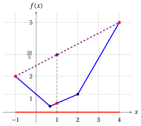
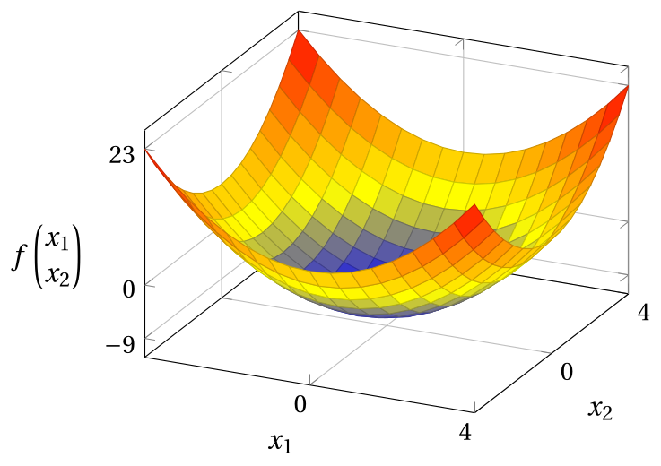
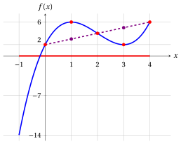

# Exercises · Convex and concave functions

**Exercises · Chapter 3** · each solution opens with a click · [:material-book-open-variant: Chapter 3: Convex and concave functions](../preliminaries/03-convex-concave-functions.md) · [:material-file-pdf-box: Exercises, volume 1 (PDF)](../pdf/exercises-1-preliminaries.pdf)

In the exercises of this chapter convexity and concavity are proved only with the definitions of the chapter «Convex and concave functions», using the following two inequalities.

!!! nota ""

    For every $a,b\in\R$ and every $\lambda\in[0,1]$, we have:

    \begin{align*}
    (\lambda a+(1-\lambda)b)^2
    &= \lambda^2 a^2+2\lambda(1-\lambda)ab+(1-\lambda)^2b^2 \\[1ex]
    &= \lambda a^2+(1-\lambda)b^2-\lambda(1-\lambda)a^2+2\lambda(1-\lambda)ab-\lambda(1-\lambda)b^2 \\[1ex]
    &= \lambda a^2+(1-\lambda)b^2-\lambda(1-\lambda)(a^2-2ab+b^2) \\[1ex]
    &= \lambda a^2+(1-\lambda)b^2-\underbrace {\lambda(1-\lambda)(a-b)^2}_{\ge 0} \\[1ex]
    &\le \lambda a^2+(1-\lambda)b^2 \quad (\text{since } \lambda \ge 0,~ 1-\lambda \ge 0 \text{ and } (a-b)^2 \ge 0)
    \end{align*}

!!! nota ""

    For every ${\boldsymbol u}, {\boldsymbol v} \in \R^n$ and every $\alpha \in \R$, the Euclidean norm $\|{\boldsymbol u}\|_2 = \sqrt{u_1^2+u_2^2+\cdots+u_n^2}$ satisfies:

    \begin{align*}
    \|{\boldsymbol u}+{\boldsymbol v}\|_2 &\le \|{\boldsymbol u}\|_2+\|{\boldsymbol v}\|_2
    && \text{(triangle inequality)}\\[1ex]
    \|\alpha\,{\boldsymbol u}\|_2 &= |\alpha|\;\|{\boldsymbol u}\|_2
    && \text{(absolute homogeneity)}
    \end{align*}

!!! esercizio "Exercise 3.1: Convex and concave functions (E1)"

    Consider the following real-valued functions:

    $$
    f: \R \rightarrow \R,~~ f: x \mapsto x^2 - 4x + 5
    \qquad \text{and} \qquad
    g: \R \rightarrow \R,~~ g: x \mapsto -x^2 + 4x - 5
    $$

    and the following two points of $\R$ and scalar:

    $$
    p = -1, \qquad w = 4 \qquad \text{and} \qquad \lambda = \frac{2}{5}.
    $$

    **Questions**

    1. Prove that the function $f$ is convex in its domain.

    2. Compute both sides of the inequality of the definition of convex function for $f$ with the given $p$, $w$ and $\lambda$.

    3. Draw the graph of $f$, the points $\big(p,f(p)\big)$ and $\big(w,f(w)\big)$ and the segment joining them.

    4. Prove that the function $g$ is concave in its domain.

??? soluzione "Solution"

    1. For every $x \in \R$ we have $f(x) = (x-2)^2 + 1$. For every pair of points $p, w \in \R$ and every $\lambda \in [0,1]$, we have:

        \begin{align*}
        f\big(\lambda p+(1-\lambda)w\big)
        &= \big(\lambda p+(1-\lambda)w-2\big)^2 + 1 \\[2ex]
        &= \big(\lambda (p-2)+(1-\lambda)(w-2)\big)^2 + 1 \\[2ex]
        &\le \lambda (p-2)^2+(1-\lambda)(w-2)^2 + 1 \\[1ex]
        &\qquad \text{(since } (\lambda a+(1-\lambda)b)^2\le \lambda a^2+(1-\lambda)b^2\text{)} \\[2ex]
        &= \lambda\,\big((p-2)^2+1\big)+(1-\lambda)\,\big((w-2)^2+1\big) \\[2ex]
        &= \lambda f(p)+(1-\lambda)f(w)
        \end{align*}

        Therefore,

        $$
        f\big(\lambda p + (1-\lambda) w\big) \le \lambda f(p) + (1-\lambda) f(w)
        $$

        By nature, the domain $\R$ is a convex set. Accordingly, the function is convex in its domain.

    2. With $p=-1$, $w=4$ and $\lambda=\frac{2}{5}$ we have

        $$
        \lambda p + (1-\lambda) w = \frac{2}{5}\cdot(-1) + \frac{3}{5}\cdot 4 = 2,
        \qquad
        f(-1) = 10,
        \qquad
        f(4) = 5,
        $$

        and the two sides of the inequality are:

        $$
        f(2) = 1 \;\le\; \frac{2}{5}\, f(-1) + \frac{3}{5}\, f(4) = \frac{2}{5}\cdot 10 + \frac{3}{5}\cdot 5 = 7 .
        $$

    3. In the figure, the segment joining $\big(p,f(p)\big)$ and $\big(w,f(w)\big)$ (violet) lies above the graph of $f$ (blue). The red point is $\big(2, f(2)\big)$ and the violet point is $\big(2, \frac{2}{5} f(p) + \frac{3}{5} f(w)\big)$.

        { .fig .ovale loading=lazy style="width:50%" }

    4. For every $x \in \R$ we have $g(x) = -(x-2)^2 - 1$. For every pair of points $p, w \in \R$ and every $\lambda \in [0,1]$, we have:

        \begin{align*}
        g\big(\lambda p+(1-\lambda)w\big)
        &= -\big(\lambda (p-2)+(1-\lambda)(w-2)\big)^2 - 1 \\[2ex]
        &\ge -\lambda (p-2)^2-(1-\lambda)(w-2)^2 - 1 \\[1ex]
        &\qquad \text{(since } (\lambda a+(1-\lambda)b)^2\le \lambda a^2+(1-\lambda)b^2\text{)} \\[2ex]
        &= \lambda\,\big(-(p-2)^2-1\big)+(1-\lambda)\,\big(-(w-2)^2-1\big) \\[2ex]
        &= \lambda g(p)+(1-\lambda)g(w)
        \end{align*}

        Therefore,

        $$
        g\big(\lambda p + (1-\lambda) w\big) \ge \lambda g(p) + (1-\lambda) g(w)
        $$

        By nature, the domain $\R$ is a convex set. Accordingly, the function is concave in its domain.

        The same conclusion follows from the first question, since $g = -f$ (chapter «Convex and concave functions»: $f$ is convex if and only if $-f$ is concave).

!!! esercizio "Exercise 3.2: Convex and concave functions (E2)"

    Consider the following real-valued function:

    $$
    f: [-1,4] \rightarrow \R,~~ f: x \mapsto \max\Big\{\, 1-x,~ \frac{1}{2}\,x,~ 2x-3 \,\Big\}
    $$

    and the following two points of $[-1,4]$ and scalar:

    $$
    p = -1, \qquad w = 4 \qquad \text{and} \qquad \lambda = \frac{3}{5}.
    $$

    **Questions**

    1. Compute $f(-1)$, $f\big(\frac{2}{3}\big)$, $f(2)$ and $f(4)$, and draw the graph of the function.

    2. Prove that the function is convex in its domain.

    3. Compute both sides of the inequality of the definition of convex function with the given $p$, $w$ and $\lambda$.

    4. Show that the function is not concave in its domain.

??? soluzione "Solution"

    1. We have:

        \begin{align*}
        f(-1) &= \max\Big\{\, 2,~ -\frac{1}{2},~ -5 \,\Big\} = 2, &
        f\Big(\frac{2}{3}\Big) &= \max\Big\{\, \frac{1}{3},~ \frac{1}{3},~ -\frac{5}{3} \,\Big\} = \frac{1}{3},\\[2ex]
        f(2) &= \max\big\{\, -1,~ 1,~ 1 \,\big\} = 1, &
        f(4) &= \max\big\{\, -3,~ 2,~ 5 \,\big\} = 5 .
        \end{align*}

        The lines $1-x$ and $\frac{1}{2}x$ meet at $x=\frac{2}{3}$, and the lines $\frac{1}{2}x$ and $2x-3$ meet at $x=2$. The graph of $f$ (blue) is made of three segments: $f(x) = 1-x$ on $\big[-1,\frac{2}{3}\big]$, $f(x)=\frac{1}{2}x$ on $\big[\frac{2}{3},2\big]$ and $f(x)=2x-3$ on $[2,4]$. The domain is red; the violet segment and the points are those of the third question.

        { .fig .ovale loading=lazy style="width:50%" }

    2. For every $x \in [-1,4]$, $f(x)$ is the largest of the three values $h_1(x) = 1-x$, $h_2(x)=\frac{1}{2}x$ and $h_3(x)=2x-3$, and each of them has the form $h_k(x) = a_k\,x + b_k$. For every pair of points $p, w \in [-1,4]$ and every $\lambda \in [0,1]$, we have:

        \begin{align*}
        f\big(\lambda p+(1-\lambda)w\big)
        &= h_k\big(\lambda p+(1-\lambda)w\big) \\[1ex]
        &\qquad \text{(for an index $k \in \{1,2,3\}$ attaining the maximum)} \\[2ex]
        &= a_k\,\big(\lambda p+(1-\lambda)w\big) + b_k \\[2ex]
        &= \lambda\,(a_k\,p + b_k) + (1-\lambda)\,(a_k\,w + b_k) \\[1ex]
        &\qquad (\text{since } \lambda + (1-\lambda) = 1) \\[2ex]
        &\le \lambda f(p)+(1-\lambda)f(w)\\[1ex]
        &\qquad (\text{since } a_k\,p + b_k \le f(p),~ a_k\,w + b_k \le f(w),~ \lambda, 1-\lambda \ge 0)
        \end{align*}

        Therefore,

        $$
        f\big(\lambda p + (1-\lambda) w\big) \le \lambda f(p) + (1-\lambda) f(w)
        $$

        The domain $[-1,4]$ is an interval, hence a convex set. Accordingly, the function is convex in its domain.

        The same conclusion follows from the property «the maximum of convex functions is convex» (chapter «Convex and concave functions»), since $h_1$, $h_2$ and $h_3$ are linear.

    3. With $p=-1$, $w=4$ and $\lambda=\frac{3}{5}$ we have

        $$
        \lambda p + (1-\lambda) w = \frac{3}{5}\cdot(-1) + \frac{2}{5}\cdot 4 = 1,
        \qquad
        f(1) = \max\Big\{\, 0,~ \frac{1}{2},~ -1 \,\Big\} = \frac{1}{2},
        $$

        and the two sides of the inequality are:

        $$
        f(1) = \frac{1}{2} \;\le\; \frac{3}{5}\, f(-1) + \frac{2}{5}\, f(4) = \frac{3}{5}\cdot 2 + \frac{2}{5}\cdot 5 = \frac{16}{5} .
        $$

    4. The function is concave if $f\big(\lambda p + (1-\lambda) w\big) \ge \lambda f(p) + (1-\lambda) f(w)$ for every $p, w$ in the domain and every $\lambda \in [0,1]$. With the points and the scalar of the previous question we have

        $$
        f(1) = \frac{1}{2} \;<\; \frac{16}{5} = \frac{3}{5}\, f(-1) + \frac{2}{5}\, f(4):
        $$

        the inequality of the definition of concave function does not hold, so the function is not concave in its domain.

!!! esercizio "Exercise 3.3: Convex and concave functions (E3)"

    Consider the following real-valued functions:

    $$
    f: \R^2 \rightarrow \R,~~ f: \begin{pmatrix} x_1 \\ x_2 \end{pmatrix} \mapsto
    \underbrace{x_1^2 + x_2^2 - 9}_{\left\| \begin{pmatrix} x_1 \\ x_2 \end{pmatrix} \right\|_2^2 - 9}
    $$

    and

    $$
    g: \R^2 \rightarrow \R,~~ g: \begin{pmatrix} x_1 \\ x_2 \end{pmatrix} \mapsto
    \left\| \begin{pmatrix} x_1 \\ x_2 \end{pmatrix} - \begin{pmatrix} 2 \\ 2 \end{pmatrix} \right\|_2 + 1 .
    $$

    **Questions**

    1. Prove that the function $f$ is convex in its domain.

    2. Prove that the function $g$ is convex in its domain.

    3. Prove that the set $\big\{\, {\boldsymbol x} \in \R^2 : x_1^2 + x_2^2 \le 9 \,\big\}$ is convex.

    4. Draw the graph of the function $f$.

??? soluzione "Solution"

    1. For every pair of points ${\boldsymbol p}, {\boldsymbol w} \in \R^2$ and every $\lambda \in [0,1]$, we have:

        \begin{align*}
        f\big(\lambda {\boldsymbol p}+(1-\lambda){\boldsymbol w}\big)
        &= \big(\lambda p_1+(1-\lambda)w_1\big)^2 + \big(\lambda p_2+(1-\lambda)w_2\big)^2 - 9 \\[2ex]
        &\le \lambda p_1^2+(1-\lambda)w_1^2 + \lambda p_2^2+(1-\lambda)w_2^2 - 9 \\[1ex]
        &\qquad \text{(since } (\lambda a+(1-\lambda)b)^2\le \lambda a^2+(1-\lambda)b^2\text{)} \\[2ex]
        &= \lambda\,\big(p_1^2+p_2^2-9\big)+(1-\lambda)\,\big(w_1^2+w_2^2-9\big) \\[2ex]
        &= \lambda f({\boldsymbol p})+(1-\lambda)f({\boldsymbol w})
        \end{align*}

        Therefore,

        $$
        f\big(\lambda {\boldsymbol p} + (1-\lambda){\boldsymbol w}\big) \le \lambda f({\boldsymbol p}) + (1-\lambda) f({\boldsymbol w})
        $$

        By nature, the domain $\R^2$ is a convex set. Accordingly, the function is convex in its domain.

    2. Let ${\boldsymbol c} = \begin{pmatrix} 2 \\ 2 \end{pmatrix}$. For every pair of points ${\boldsymbol p}, {\boldsymbol w} \in \R^2$ and every $\lambda \in [0,1]$, we have:

        \begin{align*}
        g\big(\lambda {\boldsymbol p}+(1-\lambda){\boldsymbol w}\big)
        &= \big\| \lambda {\boldsymbol p}+(1-\lambda){\boldsymbol w} - {\boldsymbol c} \big\|_2 + 1 \\[2ex]
        &= \big\| \lambda ({\boldsymbol p}-{\boldsymbol c})+(1-\lambda)({\boldsymbol w} - {\boldsymbol c}) \big\|_2 + 1 \\[2ex]
        &\le \big\| \lambda ({\boldsymbol p}-{\boldsymbol c}) \big\|_2 + \big\| (1-\lambda)({\boldsymbol w} - {\boldsymbol c}) \big\|_2 + 1 \\[1ex]
        &\qquad \text{(by the triangle inequality)} \\[2ex]
        &= |\lambda| \; \| {\boldsymbol p}-{\boldsymbol c} \|_2 + |1-\lambda| \; \| {\boldsymbol w} - {\boldsymbol c} \|_2 + 1 \\[1ex]
        &\qquad \text{(by the absolute homogeneity)} \\[2ex]
        &= \lambda \; \| {\boldsymbol p}-{\boldsymbol c} \|_2 + (1-\lambda) \; \| {\boldsymbol w} - {\boldsymbol c} \|_2 + 1 \\[1ex]
        &\qquad (\text{since } \lambda \ge 0 \text{ and } 1-\lambda \ge 0) \\[2ex]
        &= \lambda\,\big(\| {\boldsymbol p}-{\boldsymbol c} \|_2 + 1\big)+(1-\lambda)\,\big(\| {\boldsymbol w}-{\boldsymbol c} \|_2 + 1\big) \\[2ex]
        &= \lambda g({\boldsymbol p})+(1-\lambda)g({\boldsymbol w})
        \end{align*}

        Therefore,

        $$
        g\big(\lambda {\boldsymbol p} + (1-\lambda){\boldsymbol w}\big) \le \lambda g({\boldsymbol p}) + (1-\lambda) g({\boldsymbol w})
        $$

        By nature, the domain $\R^2$ is a convex set. Accordingly, the function is convex in its domain.

    3. The set is $\big\{\, {\boldsymbol x} \in \R^2 : f({\boldsymbol x}) \le 0 \,\big\}$. For every pair of points ${\boldsymbol p}$ and ${\boldsymbol w}$ in the set and for every $\lambda \in [0,1]$, we have:

        \begin{align*}
        f\big(\lambda {\boldsymbol p}+(1-\lambda){\boldsymbol w}\big)
        &\le \lambda f({\boldsymbol p})+(1-\lambda)f({\boldsymbol w}) \\[1ex]
        &\qquad \text{(by the first question)} \\[2ex]
        &\le \lambda \cdot 0 + (1-\lambda) \cdot 0 \\[1ex]
        &\qquad (\text{since } f({\boldsymbol p}) \le 0,~ f({\boldsymbol w}) \le 0,~ \lambda \ge 0 \text{ and } 1-\lambda \ge 0) \\[2ex]
        &= 0
        \end{align*}

        Therefore,

        $$
        f\big(\lambda {\boldsymbol p} + (1-\lambda){\boldsymbol w}\big) \le 0
        $$

        Accordingly, $\lambda {\boldsymbol p} + (1-\lambda){\boldsymbol w}$ belongs to the set and the set is convex. It is the disk of radius $3$ centered at the origin.

    4. This is the graph of the function $f$ in the domain $\begin{pmatrix} x_1 \\ x_2 \end{pmatrix} \in [-4,4] \times [-4,4]$; its lowest point is $\big(0,0,f(0,0)\big) = (0,0,-9)$.

        { .fig .ovale loading=lazy style="width:59%" }

!!! esercizio "Exercise 3.4: Convex and concave functions (E4)"

    Consider the following real-valued functions:

    $$
    f: \R^2 \rightarrow \R,~~ f: \begin{pmatrix} x_1 \\ x_2 \end{pmatrix} \mapsto
    \underbrace{x_1 + x_2 - 1}_{\begin{pmatrix} 1 & 1 \end{pmatrix} \begin{pmatrix} x_1 \\ x_2 \end{pmatrix} - 1}
    $$

    and

    $$
    g: \R^2 \rightarrow \R,~~ g: \begin{pmatrix} x_1 \\ x_2 \end{pmatrix} \mapsto
    \min\big\{\, x_1 + x_2 - 1,~ 2 - x_1 \,\big\}
    $$

    and the following two points of $\R^2$ and scalar:

    $$
    {\boldsymbol p}=\begin{pmatrix} 0 \\[0.3ex] 0 \end{pmatrix},
    \qquad
    {\boldsymbol w}=\begin{pmatrix} 4 \\[0.3ex] 2 \end{pmatrix}
    \qquad \text{and} \qquad
    \lambda = \frac{1}{2}.
    $$

    **Questions**

    1. Prove that the function $f$ is both convex and concave in its domain.

    2. Draw the graph of the function $f$.

    3. Prove that the function $g$ is concave in its domain.

    4. Compute both sides of the inequality of the definition of concave function for $g$ with the given ${\boldsymbol p}$, ${\boldsymbol w}$ and $\lambda$, and show that $g$ is not convex in its domain.

??? soluzione "Solution"

    1. For every pair of points ${\boldsymbol p}, {\boldsymbol w} \in \R^2$ and every $\lambda \in [0,1]$, we have:

        \begin{align*}
        f\big(\lambda {\boldsymbol p}+(1-\lambda){\boldsymbol w}\big)
        &= \big(\lambda p_1+(1-\lambda)w_1\big) + \big(\lambda p_2+(1-\lambda)w_2\big) - \big(\lambda + (1-\lambda)\big) \\[2ex]
        &= \lambda\,\big(p_1+p_2-1\big)+(1-\lambda)\,\big(w_1+w_2-1\big) \\[2ex]
        &= \lambda f({\boldsymbol p})+(1-\lambda)f({\boldsymbol w})
        \end{align*}

        Therefore, the inequalities of both definitions hold (with equality):

        $$
        f\big(\lambda {\boldsymbol p} + (1-\lambda){\boldsymbol w}\big) \le \lambda f({\boldsymbol p}) + (1-\lambda) f({\boldsymbol w})
        $$

        and

        $$
        f\big(\lambda {\boldsymbol p} + (1-\lambda){\boldsymbol w}\big) \ge \lambda f({\boldsymbol p}) + (1-\lambda) f({\boldsymbol w})
        $$

        By nature, the domain $\R^2$ is a convex set. Accordingly, the function is both convex and concave in its domain.

    2. This is the graph of the function $f$ in the domain $\begin{pmatrix} x_1 \\ x_2 \end{pmatrix} \in [-4,4] \times [-4,4]$: a plane.

        { .fig .ovale loading=lazy style="width:59%" }

    3. For every ${\boldsymbol x} \in \R^2$, $g({\boldsymbol x})$ is the smallest of the two values $h_1({\boldsymbol x}) = x_1 + x_2 - 1$ and $h_2({\boldsymbol x}) = 2 - x_1$; as shown for $f$ in the first question, each of them satisfies $h_k\big(\lambda {\boldsymbol p}+(1-\lambda){\boldsymbol w}\big) = \lambda h_k({\boldsymbol p}) + (1-\lambda) h_k({\boldsymbol w})$. For every pair of points ${\boldsymbol p}, {\boldsymbol w} \in \R^2$ and every $\lambda \in [0,1]$, we have:

        \begin{align*}
        g\big(\lambda {\boldsymbol p}+(1-\lambda){\boldsymbol w}\big)
        &= h_k\big(\lambda {\boldsymbol p}+(1-\lambda){\boldsymbol w}\big) \\[1ex]
        &\qquad \text{(for an index $k \in \{1,2\}$ attaining the minimum)} \\[2ex]
        &= \lambda\, h_k({\boldsymbol p}) + (1-\lambda)\, h_k({\boldsymbol w}) \\[1ex]
        &\qquad \text{(as shown for $f$ in the first question)} \\[2ex]
        &\ge \lambda g({\boldsymbol p})+(1-\lambda)g({\boldsymbol w}) \\[1ex]
        &\qquad (\text{since } h_k({\boldsymbol p}) \ge g({\boldsymbol p}),~ h_k({\boldsymbol w}) \ge g({\boldsymbol w}),~ \lambda, 1-\lambda \ge 0)
        \end{align*}

        Therefore,

        $$
        g\big(\lambda {\boldsymbol p} + (1-\lambda){\boldsymbol w}\big) \ge \lambda g({\boldsymbol p}) + (1-\lambda) g({\boldsymbol w})
        $$

        By nature, the domain $\R^2$ is a convex set. Accordingly, the function is concave in its domain.

        The same conclusion follows from the property «the minimum of concave functions is concave» (chapter «Convex and concave functions»), since $h_1$ and $h_2$ are linear.

    4. With ${\boldsymbol p}=\begin{pmatrix} 0 \\ 0 \end{pmatrix}$, ${\boldsymbol w}=\begin{pmatrix} 4 \\ 2 \end{pmatrix}$ and $\lambda=\frac{1}{2}$ we have

        $$
        \lambda {\boldsymbol p} + (1-\lambda) {\boldsymbol w} = \begin{pmatrix} 2 \\ 1 \end{pmatrix},
        \qquad
        g({\boldsymbol p}) = \min\{-1,\, 2\} = -1,
        \qquad
        g({\boldsymbol w}) = \min\{5,\, -2\} = -2,
        $$

        and the two sides of the inequality are:

        $$
        g\begin{pmatrix} 2 \\ 1 \end{pmatrix} = \min\{2,\, 0\} = 0 \;\ge\; \frac{1}{2}\, g({\boldsymbol p}) + \frac{1}{2}\, g({\boldsymbol w}) = \frac{1}{2}\cdot (-1) + \frac{1}{2}\cdot (-2) = -\frac{3}{2} .
        $$

        Since $0 > -\frac{3}{2}$, the inequality of the definition of convex function does not hold for these points and this scalar: the function $g$ is not convex in its domain.

!!! esercizio "Exercise 3.5: Convex and concave functions (E5)"

    Given $a,b \in \R$ with $a<b$, consider the following real-valued function:

    $$
    f: [a,b] \rightarrow \R,~~ f: x \mapsto 2 + 9x - 6x^2 + x^3
    $$

    whose domain is the interval $[a,b]$.

    **Questions**

    1. Prove that for every $p, w \in \R$ and every $\lambda \in [0,1]$, with $m = \lambda p + (1-\lambda) w$, we have

        $$
        \lambda f(p) + (1-\lambda) f(w) - f(m) = \lambda (1-\lambda) (p-w)^2 \, (p + w + m - 6).
        $$

    2. Prove that with $a=2$ and $b=4$ the function is convex.

    3. Prove that with $a=-1$ and $b=2$ the function is concave.

    4. Show that with $a=-1$ and $b=4$ the function is neither convex nor concave.

    5. Draw the graph of the function with $a=-1$ and $b=4$.

??? soluzione "Solution"

    1. For every $p, w \in \R$ and every $\lambda \in [0,1]$, let $d = p - w$, so that $p = w + d$ and $m = w + \lambda d$. We have:

        \begin{align*}
        \lambda f(p) + (1-\lambda) f(w) - f(m)
        &= 2\,\big(\lambda + (1-\lambda) - 1\big) + 9\,\big(\lambda p + (1-\lambda) w - m\big) \\
        &\qquad - 6\,\big(\lambda p^2 + (1-\lambda) w^2 - m^2\big) \\
        &\qquad + \lambda p^3 + (1-\lambda) w^3 - m^3 \\[2ex]
        &= - 6\,\big(\lambda p^2 + (1-\lambda) w^2 - m^2\big) \\
        &\qquad + \lambda p^3 + (1-\lambda) w^3 - m^3 \\[1ex]
        &\qquad (\text{since } \lambda + (1-\lambda) = 1 \\
        &\qquad\quad \text{and } m = \lambda p + (1-\lambda) w) \\[2ex]
        &= - 6\,\bigl(\lambda w^2 + 2\lambda w d + \lambda d^2 + (1-\lambda) w^2 \\
        &\qquad - w^2 - 2\lambda w d - \lambda^2 d^2\bigr) \\
        &\qquad + \lambda\,\big(w^3 + 3w^2 d + 3 w d^2 + d^3\big) + (1-\lambda)\,w^3 \\
        &\qquad - \big(w^3 + 3\lambda w^2 d + 3\lambda^2 w d^2 + \lambda^3 d^3\big) \\[1ex]
        &\qquad (\text{expanding the powers, since } p = w + d \\
        &\qquad\quad \text{and } m = w + \lambda d) \\[2ex]
        &= - 6\,(\lambda - \lambda^2)\, d^2 + 3\,(\lambda - \lambda^2)\, w\, d^2 + (\lambda - \lambda^3)\, d^3 \\[2ex]
        &= \lambda(1-\lambda)\, d^2\, \big(3w + (1+\lambda)\, d - 6\big) \\[2ex]
        &= \lambda(1-\lambda)\, d^2\, (p + w + m - 6) \\[1ex]
        &\qquad (\text{since } 3w + (1+\lambda)\,d = (w+d) + w + (w + \lambda d) \\
        &\qquad\quad = p + w + m) \\[2ex]
        &= \lambda (1-\lambda) (p-w)^2 \, (p + w + m - 6)
        \end{align*}

    2. For every pair of points $p, w \in [2,4]$ and every $\lambda \in [0,1]$, with $m = \lambda p + (1-\lambda) w \in [2,4]$, we have:

        \begin{align*}
        f\big(\lambda p+(1-\lambda)w\big)
        &= \lambda f(p)+(1-\lambda)f(w) - \lambda (1-\lambda) (p-w)^2 \, (p + w + m - 6) \\[1ex]
        &\qquad \text{(by question 1)} \\[2ex]
        &\le \lambda f(p)+(1-\lambda)f(w)\\[1ex]
        &\qquad (\text{since } \lambda (1-\lambda) (p-w)^2 \ge 0,~ p, w, m \ge 2)
        \end{align*}

        Therefore,

        $$
        f\big(\lambda p + (1-\lambda) w\big) \le \lambda f(p) + (1-\lambda) f(w)
        $$

        The domain $[2,4]$ is an interval, hence a convex set. Accordingly, the function is convex in its domain.

    3. For every pair of points $p, w \in [-1,2]$ and every $\lambda \in [0,1]$, with $m = \lambda p + (1-\lambda) w \in [-1,2]$, we have:

        \begin{align*}
        f\big(\lambda p+(1-\lambda)w\big)
        &= \lambda f(p)+(1-\lambda)f(w) - \lambda (1-\lambda) (p-w)^2 \, (p + w + m - 6) \\[1ex]
        &\qquad \text{(by question 1)} \\[2ex]
        &\ge \lambda f(p)+(1-\lambda)f(w) \\[1ex]
        &\qquad (\text{since } \lambda (1-\lambda) (p-w)^2 \ge 0,~ p, w, m \le 2)
        \end{align*}

        Therefore,

        $$
        f\big(\lambda p + (1-\lambda) w\big) \ge \lambda f(p) + (1-\lambda) f(w)
        $$

        The domain $[-1,2]$ is an interval, hence a convex set. Accordingly, the function is concave in its domain.

    4. We have $f(0)=2$, $f(1)=6$, $f(2)=4$, $f(3)=2$ and $f(4)=6$.

        - With $p=0$, $w=2$ and $\lambda=\frac{1}{2}$ we have $\lambda p + (1-\lambda) w = 1$ and

            $$
            f(1) = 6 \;>\; \frac{1}{2}\, f(0) + \frac{1}{2}\, f(2) = \frac{1}{2}\cdot 2 + \frac{1}{2}\cdot 4 = 3:
            $$

            the inequality of the definition of convex function does not hold, so the function is not convex in $[-1,4]$.

        - With $p=2$, $w=4$ and $\lambda=\frac{1}{2}$ we have $\lambda p + (1-\lambda) w = 3$ and

            $$
            f(3) = 2 \;<\; \frac{1}{2}\, f(2) + \frac{1}{2}\, f(4) = \frac{1}{2}\cdot 4 + \frac{1}{2}\cdot 6 = 5:
            $$

            the inequality of the definition of concave function does not hold, so the function is not concave in $[-1,4]$.

        The two differences agree with the first question: $\frac{1}{4}\cdot 4 \cdot (0+2+1-6) = -3 = 3 - 6$ and $\frac{1}{4}\cdot 4 \cdot (2+4+3-6) = 3 = 5 - 2$.

    5. This is the graph of the function (blue) in the domain $[-1,4]$ (red), with $f(-1) = -14$. The violet segments join the points of the previous question: the first one lies below the graph (on $[-1,2]$ the function is concave), the second one lies above the graph (on $[2,4]$ the function is convex).

        { .fig .ovale loading=lazy style="width:50%" }
