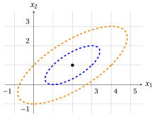

# Exercises · Quadratic functions

**Exercises · Chapter 4** · each solution opens with a click · [:material-book-open-variant: Chapter 4: Quadratic functions](../preliminaries/04-quadratic-functions.md) · [:material-file-pdf-box: Exercises, volume 1 (PDF)](../pdf/exercises-1-preliminaries.pdf)

In the exercises of this chapter, convexity is proved only with the definition of convex function of the chapter «Convex and concave functions»: the quadratic function is written as a sum of squares of linear functions, and the inequality

$$
\big(\lambda a+(1-\lambda)b\big)^2 \le \lambda a^2+(1-\lambda)b^2, \qquad \forall a,b\in\R,~ \forall \lambda\in[0,1]
$$

of the same chapter is applied to each square.

!!! esercizio "Exercise 4.1: Quadratic functions (E1)"

    Consider the following real-valued function:

    $$
    f: \R^2 \rightarrow \R,~~ f: \begin{pmatrix} x_1 \\ x_2 \end{pmatrix} \mapsto x_1^2 + 2\,x_1 x_2 + 5\,x_2^2
    $$

    **Questions**

    1. Write the function in the matrix form $f({\boldsymbol x}) = {\boldsymbol x}' {\boldsymbol Q} \; {\boldsymbol x}$ with a symmetric matrix ${\boldsymbol Q}$.

    2. Show that the non-symmetric matrix $\begin{pmatrix} 1 & 6 \\ -4 & 5 \end{pmatrix}$ defines the same function, and that replacing each off-diagonal pair with its average gives the matrix ${\boldsymbol Q}$ of the first question.

    3. Compute the gradient and the Hessian of the function, and the gradient at the points $\begin{pmatrix} 1 \\ 1 \end{pmatrix}$ and $\begin{pmatrix} -1 \\ 2 \end{pmatrix}$.

    4. Show that $f({\boldsymbol x}) = (x_1 + x_2)^2 + 4\,x_2^2$ and prove, from the definition, that the function is convex in its domain.

    5. Draw the graph of the function.

??? soluzione "Solution"

    1. The coefficient $2$ of $x_1 x_2$ is split equally between the two off-diagonal entries:

        $$
        f\left(\begin{pmatrix} x_1 \\ x_2 \end{pmatrix}\right) =
        \begin{pmatrix} x_1 & x_2 \end{pmatrix}
        \underbrace{\begin{pmatrix} 1 & 1 \\ 1 & 5 \end{pmatrix}}_{{\boldsymbol Q}}
        \begin{pmatrix} x_1 \\ x_2 \end{pmatrix}
        = x_1^2 + x_1 x_2 + x_2 x_1 + 5\,x_2^2 = x_1^2 + 2\,x_1 x_2 + 5\,x_2^2
        $$

    2. With the non-symmetric matrix we have:

        $$
        \begin{pmatrix} x_1 & x_2 \end{pmatrix}
        \begin{pmatrix} 1 & 6 \\ -4 & 5 \end{pmatrix}
        \begin{pmatrix} x_1 \\ x_2 \end{pmatrix}
        = x_1^2 + 6\,x_1 x_2 - 4\,x_2 x_1 + 5\,x_2^2 = x_1^2 + 2\,x_1 x_2 + 5\,x_2^2
        $$

        which is the same function. Replacing the off-diagonal pair with its average:

        $$
        \begin{pmatrix} 1 & \frac{6+(-4)}{2} \\[1ex] \frac{6+(-4)}{2} & 5 \end{pmatrix}
        = \begin{pmatrix} 1 & 1 \\ 1 & 5 \end{pmatrix} = {\boldsymbol Q}
        $$

    3. The gradient is $2\,{\boldsymbol Q}\,{\boldsymbol x}$ and the Hessian is $2\,{\boldsymbol Q}$:

        $$
        \nabla f\left(\begin{pmatrix} x_1 \\ x_2 \end{pmatrix}\right) =
        \begin{pmatrix} 2\,x_1 + 2\,x_2 \\[0.5ex] 2\,x_1 + 10\,x_2 \end{pmatrix},
        \qquad
        \nabla^2 f\left(\begin{pmatrix} x_1 \\ x_2 \end{pmatrix}\right) =
        \begin{pmatrix} 2 & 2 \\ 2 & 10 \end{pmatrix}
        $$

        At the two points:

        $$
        \nabla f\left(\begin{pmatrix} 1 \\ 1 \end{pmatrix}\right) = \begin{pmatrix} 4 \\ 12 \end{pmatrix},
        \qquad
        \nabla f\left(\begin{pmatrix} -1 \\ 2 \end{pmatrix}\right) = \begin{pmatrix} -2 + 4 \\ -2 + 20 \end{pmatrix} = \begin{pmatrix} 2 \\ 18 \end{pmatrix}
        $$

    4. Expanding the square:

        $$
        (x_1 + x_2)^2 + 4\,x_2^2 = x_1^2 + 2\,x_1 x_2 + x_2^2 + 4\,x_2^2 = x_1^2 + 2\,x_1 x_2 + 5\,x_2^2 = f({\boldsymbol x})
        $$

        To prove that the function is convex in its domain, we observe that for every pair of points ${\boldsymbol p}, {\boldsymbol w} \in \R^2$ and every $\lambda \in [0,1]$, we have:

        \begin{align*}
        & f\big(\lambda {\boldsymbol p}+(1-\lambda){\boldsymbol w}\big) \\[2ex]
        &\quad = \big(\lambda p_1+(1-\lambda)w_1 + \lambda p_2+(1-\lambda)w_2\big)^2 + 4\,\big(\lambda p_2+(1-\lambda)w_2\big)^2 \\[2ex]
        &\quad = \big(\lambda (p_1+p_2)+(1-\lambda)(w_1+w_2)\big)^2 + 4\,\big(\lambda p_2+(1-\lambda)w_2\big)^2 \\[2ex]
        &\quad \le \lambda (p_1+p_2)^2+(1-\lambda)(w_1+w_2)^2 + 4\,\big(\lambda p_2^2+(1-\lambda)w_2^2\big) \\[1ex]
        &\qquad \text{(since } (\lambda a+(1-\lambda)b)^2\le \lambda a^2+(1-\lambda)b^2\text{, twice)} \\[2ex]
        &\quad = \lambda\,\big((p_1+p_2)^2+4\,p_2^2\big)+(1-\lambda)\,\big((w_1+w_2)^2+4\,w_2^2\big) \\[2ex]
        &\quad = \lambda f({\boldsymbol p})+(1-\lambda)f({\boldsymbol w})
        \end{align*}

        Therefore,

        $$
        f(\lambda {\boldsymbol p} + (1-\lambda){\boldsymbol w})
        \le
        \lambda f({\boldsymbol p}) + (1-\lambda) f({\boldsymbol w})
        $$

        By nature, the domain $\R^2$ is a convex set. Accordingly, the function is convex in its domain.

    5. This is the graph of the function in the domain $\begin{pmatrix} x_1 \\ x_2 \end{pmatrix} \in [-2,2] \times [-2,2]$; its lowest point is $\big(0,0,f(0,0)\big) = (0,0,0)$ and its highest points are at $(2,2)$ and $(-2,-2)$, where $f = 32$.

        { .fig .ovale loading=lazy style="width:59%" }

!!! esercizio "Exercise 4.2: Quadratic functions (E2)"

    Consider the following real-valued function:

    $$
    f: \R^2 \rightarrow \R,~~ f: \begin{pmatrix} x_1 \\ x_2 \end{pmatrix} \mapsto x_1^2 + 2\,x_2^2
    $$

    **Questions**

    1. Write the function in the matrix form $f({\boldsymbol x}) = {\boldsymbol x}' {\boldsymbol Q} \; {\boldsymbol x}$ with a symmetric matrix ${\boldsymbol Q}$.

    2. Compute the gradient of the function and its value at the four points $\begin{pmatrix} 1 \\ 1 \end{pmatrix}$, $\begin{pmatrix} -1 \\ 1 \end{pmatrix}$, $\begin{pmatrix} -1 \\ -1 \end{pmatrix}$ and $\begin{pmatrix} 1 \\ -1 \end{pmatrix}$.

    3. Describe the level sets of the function for $k=3$ and $k=12$ (with their intersections with the axes) and draw them, together with the gradients of the previous question applied at their points.

    4. Prove, from the definition, that the function is convex in its domain.

??? soluzione "Solution"

    1. The function has no term $x_1 x_2$, so the off-diagonal entries are zero:

        $$
        f\left(\begin{pmatrix} x_1 \\ x_2 \end{pmatrix}\right) =
        \begin{pmatrix} x_1 & x_2 \end{pmatrix}
        \underbrace{\begin{pmatrix} 1 & 0 \\ 0 & 2 \end{pmatrix}}_{{\boldsymbol Q}}
        \begin{pmatrix} x_1 \\ x_2 \end{pmatrix}
        = x_1^2 + 2\,x_2^2
        $$

    2. The gradient is $2\,{\boldsymbol Q}\,{\boldsymbol x}$:

        $$
        \nabla f\left(\begin{pmatrix} x_1 \\ x_2 \end{pmatrix}\right) =
        \begin{pmatrix} 2\,x_1 \\[0.5ex] 4\,x_2 \end{pmatrix}
        $$

        At the four points:

        \begin{align*}
        \nabla f\left(\begin{pmatrix} 1 \\ 1 \end{pmatrix}\right) &= \begin{pmatrix} 2 \\ 4 \end{pmatrix}, &
        \nabla f\left(\begin{pmatrix} -1 \\ 1 \end{pmatrix}\right) &= \begin{pmatrix} -2 \\ 4 \end{pmatrix}, \\[1ex]
        \nabla f\left(\begin{pmatrix} -1 \\ -1 \end{pmatrix}\right) &= \begin{pmatrix} -2 \\ -4 \end{pmatrix}, &
        \nabla f\left(\begin{pmatrix} 1 \\ -1 \end{pmatrix}\right) &= \begin{pmatrix} 2 \\ -4 \end{pmatrix}
        \end{align*}

    3. The level set for $k=3$ is the ellipse $x_1^2 + 2\,x_2^2 = 3$, which meets the $x_1$-axis at $x_1 = \pm\sqrt{3}$ and the $x_2$-axis at $x_2 = \pm\sqrt{3/2}$; it contains the four points of the previous question, since $1 + 2 = 3$. The level set for $k=12$ is the ellipse $x_1^2 + 2\,x_2^2 = 12$, which meets the $x_1$-axis at $x_1 = \pm\sqrt{12} = \pm 2\sqrt{3}$ and the $x_2$-axis at $x_2 = \pm\sqrt{6}$; it contains the four points $\begin{pmatrix} \pm 2 \\ \pm 2 \end{pmatrix}$, since $4 + 8 = 12$. In the figure, the level set $k=3$ is blue, the level set $k=12$ is orange and the gradients at the four points of the level set $k=3$ are blue arrows: each gradient is perpendicular to the level set.

        { .fig .ovale loading=lazy style="width:65%" }

    4. To prove that the function is convex in its domain, we observe that for every pair of points ${\boldsymbol p}, {\boldsymbol w} \in \R^2$ and every $\lambda \in [0,1]$, we have:

        \begin{align*}
        f\big(\lambda {\boldsymbol p}+(1-\lambda){\boldsymbol w}\big)
        &= \big(\lambda p_1+(1-\lambda)w_1\big)^2 + 2\,\big(\lambda p_2+(1-\lambda)w_2\big)^2 \\[2ex]
        &\le \lambda p_1^2+(1-\lambda)w_1^2 + 2\,\big(\lambda p_2^2+(1-\lambda)w_2^2\big) \\[1ex]
        &\qquad \text{(since } (\lambda a+(1-\lambda)b)^2\le \lambda a^2+(1-\lambda)b^2\text{, twice)} \\[2ex]
        &= \lambda\,\big(p_1^2+2\,p_2^2\big)+(1-\lambda)\,\big(w_1^2+2\,w_2^2\big) \\[2ex]
        &= \lambda f({\boldsymbol p})+(1-\lambda)f({\boldsymbol w})
        \end{align*}

        Therefore,

        $$
        f(\lambda {\boldsymbol p} + (1-\lambda){\boldsymbol w})
        \le
        \lambda f({\boldsymbol p}) + (1-\lambda) f({\boldsymbol w})
        $$

        By nature, the domain $\R^2$ is a convex set. Accordingly, the function is convex in its domain.

!!! esercizio "Exercise 4.3: Quadratic functions (E3)"

    Consider the following real-valued function:

    $$
    g: \R^2 \rightarrow \R,~~ g: \begin{pmatrix} x_1 \\ x_2 \end{pmatrix} \mapsto x_1^2 - 2\,x_1 x_2 + 2\,x_2^2 - 2\,x_1 + 4
    $$

    **Questions**

    1. Write the function in the form $g({\boldsymbol x}) = {\boldsymbol x}' {\boldsymbol Q} \; {\boldsymbol x} + {\boldsymbol c}' {\boldsymbol x} + d$ with a symmetric matrix ${\boldsymbol Q}$, a vector ${\boldsymbol c}$ and a scalar $d$.

    2. Compute the gradient of the function and the point at which the gradient is the zero vector.

    3. Show that $g({\boldsymbol x}) = (x_1 - x_2 - 1)^2 + (x_2 - 1)^2 + 2$ and deduce that $g({\boldsymbol x}) \ge 2$ for every ${\boldsymbol x} \in \R^2$, with equality only at the point of the previous question.

    4. Describe the level sets of the function for $k=3$ and $k=6$ and draw them.

    5. Prove, from the definition, that the function is convex in its domain.

??? soluzione "Solution"

    1. The coefficient $-2$ of $x_1 x_2$ is split equally between the two off-diagonal entries, and the linear part is $-2\,x_1 + 0\,x_2$:

        $$
        {\boldsymbol Q} = \begin{pmatrix} 1 & -1 \\ -1 & 2 \end{pmatrix}, \qquad
        {\boldsymbol c} = \begin{pmatrix} -2 \\ 0 \end{pmatrix}, \qquad
        d = 4
        $$

        Indeed:

        $$
        \begin{pmatrix} x_1 & x_2 \end{pmatrix}
        \begin{pmatrix} 1 & -1 \\ -1 & 2 \end{pmatrix}
        \begin{pmatrix} x_1 \\ x_2 \end{pmatrix}
        + \begin{pmatrix} -2 & 0 \end{pmatrix} \begin{pmatrix} x_1 \\ x_2 \end{pmatrix} + 4
        = x_1^2 - 2\,x_1 x_2 + 2\,x_2^2 - 2\,x_1 + 4
        $$

    2. The gradient is $2\,{\boldsymbol Q}\,{\boldsymbol x} + {\boldsymbol c}$:

        $$
        \nabla g\left(\begin{pmatrix} x_1 \\ x_2 \end{pmatrix}\right) =
        \begin{pmatrix} 2\,x_1 - 2\,x_2 - 2 \\[0.5ex] -2\,x_1 + 4\,x_2 \end{pmatrix}
        $$

        The gradient is the zero vector when:

        $$
        \left\{
        \begin{array}{rcl}
        2\,x_1 - 2\,x_2 - 2 &=& 0 \\[0.5ex]
        -2\,x_1 + 4\,x_2 &=& 0
        \end{array}
        \right.
        $$

        From the second equation $x_1 = 2\,x_2$; substituting in the first, $4\,x_2 - 2\,x_2 - 2 = 0$, that is $x_2 = 1$ and $x_1 = 2$. The point is $\begin{pmatrix} 2 \\ 1 \end{pmatrix}$.

    3. Expanding the squares:

        \begin{align*}
        & (x_1 - x_2 - 1)^2 + (x_2 - 1)^2 + 2 \\[2ex]
        &\quad = x_1^2 + x_2^2 + 1 - 2\,x_1 x_2 - 2\,x_1 + 2\,x_2 + x_2^2 - 2\,x_2 + 1 + 2 \\[2ex]
        &\quad = x_1^2 - 2\,x_1 x_2 + 2\,x_2^2 - 2\,x_1 + 4 = g({\boldsymbol x})
        \end{align*}

        Since the two squares are nonnegative, $g({\boldsymbol x}) \ge 2$ for every ${\boldsymbol x} \in \R^2$. The equality holds only if both squares are zero, that is $x_2 = 1$ and $x_1 = x_2 + 1 = 2$: the point $\begin{pmatrix} 2 \\ 1 \end{pmatrix}$ of the previous question, where $g = 2$.

    4. By the previous question, the level set for $k=3$ is

        $$
        \left\{ {\boldsymbol x} \in \R^2 : (x_1 - x_2 - 1)^2 + (x_2 - 1)^2 = 1 \right\}
        $$

        an ellipse centered at $\begin{pmatrix} 2 \\ 1 \end{pmatrix}$ that contains, for instance, the points $\begin{pmatrix} 3 \\ 1 \end{pmatrix}$, $\begin{pmatrix} 1 \\ 1 \end{pmatrix}$, $\begin{pmatrix} 3 \\ 2 \end{pmatrix}$ and $\begin{pmatrix} 1 \\ 0 \end{pmatrix}$. The level set for $k=6$ is

        $$
        \left\{ {\boldsymbol x} \in \R^2 : (x_1 - x_2 - 1)^2 + (x_2 - 1)^2 = 4 \right\}
        $$

        an ellipse with the same center that contains, for instance, the points $\begin{pmatrix} 4 \\ 1 \end{pmatrix}$, $\begin{pmatrix} 0 \\ 1 \end{pmatrix}$, $\begin{pmatrix} 4 \\ 3 \end{pmatrix}$ and $\begin{pmatrix} 0 \\ -1 \end{pmatrix}$. In the figure, the level set $k=3$ is blue, the level set $k=6$ is orange and the center $\begin{pmatrix} 2 \\ 1 \end{pmatrix}$ is black.

        { .fig .ovale loading=lazy style="width:65%" }

    5. To prove that the function is convex in its domain, we observe that for every pair of points ${\boldsymbol p}, {\boldsymbol w} \in \R^2$ and every $\lambda \in [0,1]$, we have:

        \begin{align*}
        & g\big(\lambda {\boldsymbol p}+(1-\lambda){\boldsymbol w}\big) \\[2ex]
        &\quad = \big(\lambda p_1+(1-\lambda)w_1 - \lambda p_2-(1-\lambda)w_2 - 1\big)^2 + \big(\lambda p_2+(1-\lambda)w_2 - 1\big)^2 + 2 \\[2ex]
        &\quad = \big(\lambda (p_1-p_2-1)+(1-\lambda)(w_1-w_2-1)\big)^2 + \big(\lambda (p_2-1)+(1-\lambda)(w_2-1)\big)^2 + 2 \\[1ex]
        &\qquad (\text{since } \lambda + (1-\lambda) = 1) \\[2ex]
        &\quad \le \lambda (p_1-p_2-1)^2+(1-\lambda)(w_1-w_2-1)^2 + \lambda (p_2-1)^2+(1-\lambda)(w_2-1)^2 + 2 \\[1ex]
        &\qquad \text{(since } (\lambda a+(1-\lambda)b)^2\le \lambda a^2+(1-\lambda)b^2\text{, twice)} \\[2ex]
        &\quad = \lambda\,\big((p_1-p_2-1)^2+(p_2-1)^2+2\big)+(1-\lambda)\,\big((w_1-w_2-1)^2+(w_2-1)^2+2\big) \\[1ex]
        &\qquad (\text{since } \lambda + (1-\lambda) = 1) \\[2ex]
        &\quad = \lambda g({\boldsymbol p})+(1-\lambda)g({\boldsymbol w})
        \end{align*}

        Therefore,

        $$
        g(\lambda {\boldsymbol p} + (1-\lambda){\boldsymbol w})
        \le
        \lambda g({\boldsymbol p}) + (1-\lambda) g({\boldsymbol w})
        $$

        By nature, the domain $\R^2$ is a convex set. Accordingly, the function is convex in its domain.

!!! esercizio "Exercise 4.4: Quadratic functions (E4)"

    Consider the following real-valued functions:

    $$
    f: \R^3 \rightarrow \R,~~ f: \begin{pmatrix} x_1 \\ x_2 \\ x_3 \end{pmatrix} \mapsto
    \begin{pmatrix} x_1 & x_2 & x_3 \end{pmatrix}
    \begin{pmatrix} 1 & 4 & 0 \\ -2 & 2 & -6 \\ 0 & 4 & 3 \end{pmatrix}
    \begin{pmatrix} x_1 \\ x_2 \\ x_3 \end{pmatrix}
    $$

    and

    $$
    h: \R^2 \rightarrow \R,~~ h: \begin{pmatrix} x_1 \\ x_2 \end{pmatrix} \mapsto x_1^2 + 4\,x_1 x_2 + x_2^2
    $$

    **Questions**

    1. Find the symmetric matrix ${\boldsymbol Q}$ that defines the same function $f$, and write $f$ as a polynomial in $x_1, x_2, x_3$.

    2. Compute the gradient and the Hessian of $f$, and the gradient at the point $\begin{pmatrix} 1 \\ -1 \\ 1 \end{pmatrix}$.

    3. Show that $f({\boldsymbol x}) = (x_1 + x_2)^2 + (x_2 - x_3)^2 + 2\,x_3^2$ and prove, from the definition, that $f$ is convex in its domain.

    4. Write $h$ in the matrix form with a symmetric matrix and show that $h$ is not convex in its domain, by finding two points and a value of $\lambda$ for which the inequality of the definition of convex function does not hold.

??? soluzione "Solution"

    1. Replacing each off-diagonal pair with its average:

        $$
        {\boldsymbol Q} =
        \begin{pmatrix}
        1 & \frac{4+(-2)}{2} & 0 \\[1ex]
        \frac{4+(-2)}{2} & 2 & \frac{-6+4}{2} \\[1ex]
        0 & \frac{-6+4}{2} & 3
        \end{pmatrix}
        =
        \begin{pmatrix}
        1 & 1 & 0 \\
        1 & 2 & -1 \\
        0 & -1 & 3
        \end{pmatrix}
        $$

        and the function is:

        \begin{align*}
        f({\boldsymbol x})
        &= x_1^2 + x_1x_2 + x_2x_1 + 2\,x_2^2 - x_2x_3 - x_3x_2 + 3\,x_3^2 \\[2ex]
        &= x_1^2 + 2\,x_2^2 + 3\,x_3^2 + 2\,x_1x_2 - 2\,x_2x_3
        \end{align*}

    2. The gradient is $2\,{\boldsymbol Q}\,{\boldsymbol x}$ and the Hessian is $2\,{\boldsymbol Q}$:

        $$
        \nabla f({\boldsymbol x}) =
        \begin{pmatrix} 2\,x_1 + 2\,x_2 \\[0.5ex] 2\,x_1 + 4\,x_2 - 2\,x_3 \\[0.5ex] -2\,x_2 + 6\,x_3 \end{pmatrix},
        \qquad
        \nabla^2 f({\boldsymbol x}) =
        \begin{pmatrix} 2 & 2 & 0 \\ 2 & 4 & -2 \\ 0 & -2 & 6 \end{pmatrix}
        $$

        At the point:

        $$
        \nabla f\left(\begin{pmatrix} 1 \\ -1 \\ 1 \end{pmatrix}\right) = \begin{pmatrix} 2 - 2 \\ 2 - 4 - 2 \\ 2 + 6 \end{pmatrix} = \begin{pmatrix} 0 \\ -4 \\ 8 \end{pmatrix}
        $$

    3. Expanding the squares:

        \begin{align*}
        & (x_1 + x_2)^2 + (x_2 - x_3)^2 + 2\,x_3^2 \\[2ex]
        &\quad = x_1^2 + 2\,x_1x_2 + x_2^2 + x_2^2 - 2\,x_2x_3 + x_3^2 + 2\,x_3^2 \\[2ex]
        &\quad = x_1^2 + 2\,x_2^2 + 3\,x_3^2 + 2\,x_1x_2 - 2\,x_2x_3 = f({\boldsymbol x})
        \end{align*}

        To prove that the function is convex in its domain, we observe that for every pair of points ${\boldsymbol p}, {\boldsymbol w} \in \R^3$ and every $\lambda \in [0,1]$, we have:

        \begin{align*}
        & f\big(\lambda {\boldsymbol p}+(1-\lambda){\boldsymbol w}\big) \\[2ex]
        &\quad = \big(\lambda (p_1+p_2)+(1-\lambda)(w_1+w_2)\big)^2 + \big(\lambda (p_2-p_3)+(1-\lambda)(w_2-w_3)\big)^2 \\[1ex]
        &\qquad + 2\,\big(\lambda p_3+(1-\lambda)w_3\big)^2 \\[2ex]
        &\quad \le \lambda (p_1+p_2)^2+(1-\lambda)(w_1+w_2)^2 + \lambda (p_2-p_3)^2+(1-\lambda)(w_2-w_3)^2 \\[1ex]
        &\qquad + 2\,\big(\lambda p_3^2+(1-\lambda)w_3^2\big) \\[1ex]
        &\qquad \text{(since } (\lambda a+(1-\lambda)b)^2\le \lambda a^2+(1-\lambda)b^2\text{, three times)} \\[2ex]
        &\quad = \lambda\,\big((p_1+p_2)^2+(p_2-p_3)^2+2\,p_3^2\big) \\[1ex]
        &\qquad +(1-\lambda)\,\big((w_1+w_2)^2+(w_2-w_3)^2+2\,w_3^2\big) \\[2ex]
        &\quad = \lambda f({\boldsymbol p})+(1-\lambda)f({\boldsymbol w})
        \end{align*}

        Therefore,

        $$
        f(\lambda {\boldsymbol p} + (1-\lambda){\boldsymbol w})
        \le
        \lambda f({\boldsymbol p}) + (1-\lambda) f({\boldsymbol w})
        $$

        By nature, the domain $\R^3$ is a convex set. Accordingly, the function is convex in its domain.

    4. The coefficient $4$ of $x_1 x_2$ is split equally between the two off-diagonal entries:

        $$
        h\left(\begin{pmatrix} x_1 \\ x_2 \end{pmatrix}\right) =
        \begin{pmatrix} x_1 & x_2 \end{pmatrix}
        \begin{pmatrix} 1 & 2 \\ 2 & 1 \end{pmatrix}
        \begin{pmatrix} x_1 \\ x_2 \end{pmatrix}
        $$

        With ${\boldsymbol p} = \begin{pmatrix} 1 \\ -1 \end{pmatrix}$, ${\boldsymbol w} = \begin{pmatrix} -1 \\ 1 \end{pmatrix}$ and $\lambda = \frac{1}{2}$, we have $\frac{1}{2}\,{\boldsymbol p} + \frac{1}{2}\,{\boldsymbol w} = \begin{pmatrix} 0 \\ 0 \end{pmatrix}$ and:

        $$
        h({\boldsymbol p}) = 1 - 4 + 1 = -2, \qquad h({\boldsymbol w}) = 1 - 4 + 1 = -2, \qquad h\left(\begin{pmatrix} 0 \\ 0 \end{pmatrix}\right) = 0
        $$

        Therefore,

        $$
        h\left(\frac{1}{2}\,{\boldsymbol p} + \frac{1}{2}\,{\boldsymbol w}\right) = 0 ~>~ -2 = \frac{1}{2}\,h({\boldsymbol p}) + \frac{1}{2}\,h({\boldsymbol w})
        $$

        The inequality of the definition does not hold, so the function $h$ is not convex in its domain. In agreement with the chapter, the matrix $\begin{pmatrix} 1 & 2 \\ 2 & 1 \end{pmatrix}$ is not positive semidefinite, since $h({\boldsymbol p}) = -2 < 0$.
