# Exercises · Optimization problems

**Exercises · Chapter 5** · each solution opens with a click · [:material-book-open-variant: Chapter 5](../problems/05-optimization-problems.md) · [:material-file-pdf-box: Exercises, volume 2 (PDF)](../pdf/exercises-2-optimization-problems.pdf)

## Problems in one variable

!!! esercizio "Exercise 5.1: Optimization problem (E1)"

    Consider the following objective function and feasible region:

    $$
    f:\R \to \R,~ f: x \mapsto |x - 1|
    \qquad \text{and} \qquad
    F=\{\, x \in \R : -1 \le x \le 3 \,\} = [-1,3].
    $$

    **Questions**

    1. Write the associated optimization problems in minimization and maximization forms.

    2. Draw the graph of the objective function over the feasible region.

    3. Find all optimal solutions and the optimal value for both forms.

??? soluzione "Solution"

    1. The associated optimization problems in minimization and maximization forms are:

        \begin{equation*}
        \min \bigg\{\, |x - 1| \ \text{ subject to } -1 \le x \le 3 \,\bigg\}
        \end{equation*}

        \begin{equation*}
        \max \bigg\{\, |x - 1| \ \text{ subject to } -1 \le x \le 3 \,\bigg\}
        \end{equation*}

    2. The graph of the objective function over the feasible region is red; the feasible region is the red part of the $x$-axis and the optimal solutions are marked in blue. The graph is made of two segments, which meet at the point $(1,0)$.

        { .fig .ovale loading=lazy style="width:50%" }

    3. The feasible region is the interval $F=[-1,3]$. The objective function is $f(x) = 1 - x$ for $x \le 1$ and $f(x) = x - 1$ for $x \ge 1$: it is not linear, its graph is made of two segments.

        - For the minimization form, since $f(x) = |x-1| \ge 0 = f(1)$ for every feasible $x$, and $|x-1| = 0$ only for $x = 1$, the unique optimal solution and the optimal value are:

            $$
            \tilde{\boldsymbol x}(P) = \left(1\right)
            \quad \text{and} \quad
            z(P) = 0.
            $$

        - For the maximization form, for every feasible $x$ we have $-2 \le x - 1 \le 2$ and then $f(x) = |x-1| \le 2$, with $|x-1| = 2$ only for $x=-1$ and $x=3$. The problem has <strong>two</strong> optimal solutions and the optimal value is:

            $$
            \argmax \big\{\, |x - 1| \ \text{ subject to } -1 \le x \le 3 \,\big\} = \{-1,\,3\}
            \quad \text{and} \quad
            z(P) = 2.
            $$

!!! esercizio "Exercise 5.2: Optimization problem (E2)"

    Consider the following objective function and feasible region:

    $$
    f:\R \to \R,~ f: x \mapsto -x^2 + 4x + 1
    \qquad \text{and} \qquad
    F=\{\, x \in \R : 0 \le x \le 5 \,\} = [0,5].
    $$

    **Questions**

    1. Write the associated optimization problems in minimization and maximization forms.

    2. Draw the graph of the objective function over the feasible region.

    3. Find all optimal solutions and the optimal value for both forms.

??? soluzione "Solution"

    1. The associated optimization problems in minimization and maximization forms are:

        \begin{equation*}
        \min \bigg\{\, -x^2 + 4x + 1 \ \text{ subject to } 0 \le x \le 5 \,\bigg\}
        \end{equation*}

        \begin{equation*}
        \max \bigg\{\, -x^2 + 4x + 1 \ \text{ subject to } 0 \le x \le 5 \,\bigg\}
        \end{equation*}

    2. The graph of the objective function over the feasible region is red; the feasible region is the red part of the $x$-axis and the optimal solutions are marked in blue. Since $f$ takes negative values, the $x$-axis is drawn at the bottom of the figure; the horizontal grid line at height $0$ is the line $f(x)=0$.

        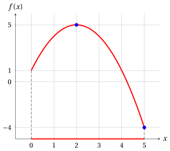{ .fig .ovale loading=lazy style="width:50%" }

    3. Completing the square, the objective function can be written as

        $$
        f(x) = -x^2 + 4x + 1 = 5 - (x^2 - 4x + 4) = 5 - (x-2)^2 .
        $$

        - For the minimization form, for every feasible $x$ we have $-2 \le x - 2 \le 3$ and then $(x-2)^2 \le 9$, with $(x-2)^2 = 9$ only for $x=5$ (the other solution $x=-1$ is not feasible). Therefore $f(x) = 5 - (x-2)^2 \ge -4 = f(5)$ and the unique optimal solution and the optimal value are:

            $$
            \tilde{\boldsymbol x}(P) = \left(5\right)
            \quad \text{and} \quad
            z(P) = -4.
            $$

        - For the maximization form, since $(x-2)^2 \ge 0$, we have $f(x) = 5 - (x-2)^2 \le 5 = f(2)$ for every feasible $x$, with equality only for $x=2$. The unique optimal solution and the optimal value are:

            $$
            \tilde{\boldsymbol x}(P) = \left(2\right)
            \quad \text{and} \quad
            z(P) = 5.
            $$

        The value at the other endpoint of the feasible region, $f(0) = 1$, is neither the minimum nor the maximum.

!!! esercizio "Exercise 5.3: Optimization problem (E3)"

    Consider the following objective function and feasible region:

    $$
    f:\R \to \R,~ f: x \mapsto |x-1| + |x+1|
    \qquad \text{and} \qquad
    F=\{\, x \in \R : -3 \le x \le 2 \,\} = [-3,2].
    $$

    **Questions**

    1. Write the associated optimization problems in minimization and maximization forms.

    2. Draw the graph of the objective function over the feasible region.

    3. Find all optimal solutions and the optimal value for both forms.

??? soluzione "Solution"

    1. The associated optimization problems in minimization and maximization forms are:

        \begin{equation*}
        \min \bigg\{\, |x-1| + |x+1| \ \text{ subject to } -3 \le x \le 2 \,\bigg\}
        \end{equation*}

        \begin{equation*}
        \max \bigg\{\, |x-1| + |x+1| \ \text{ subject to } -3 \le x \le 2 \,\bigg\}
        \end{equation*}

    2. The graph of the objective function over the feasible region is red; the feasible region is the red part of the $x$-axis and the optimal solutions are marked in blue. Removing the absolute values on each interval, the objective function is

        $$
        f(x) = \begin{cases} -2x & \text{if } x \le -1,\\ 2 & \text{if } -1 \le x \le 1,\\ 2x & \text{if } x \ge 1, \end{cases}
        $$

        and its graph is made of three segments.

        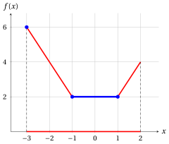{ .fig .ovale loading=lazy style="width:50%" }

    3. The feasible region is the interval $F=[-3,2]$.

        - For the minimization form, by the triangle inequality,

            $$
            f(x) = |1-x| + |x+1| \ge |(1-x) + (x+1)| = 2 \qquad \forall x \in \R .
            $$

            For $-1 \le x \le 1$ we have $f(x) = (1-x) + (x+1) = 2$, while $f(x) = -2x > 2$ for $x < -1$ and $f(x) = 2x > 2$ for $x > 1$. The problem has <strong>infinitely many</strong> optimal solutions (the blue segment) and the optimal value is:

            $$
            \argmin \big\{\, |x-1| + |x+1| \ \text{ subject to } -3 \le x \le 2 \,\big\} = [-1,1]
            \quad \text{and} \quad
            z(P) = 2.
            $$

        - For the maximization form, we compare the three pieces: for $-3 \le x \le -1$ we have $f(x) = -2x \le 6$, with equality only for $x=-3$; for $-1 \le x \le 1$ we have $f(x) = 2$; for $1 \le x \le 2$ we have $f(x) = 2x \le 4$. The unique optimal solution and the optimal value are:

            $$
            \tilde{\boldsymbol x}(P) = \left(-3\right)
            \quad \text{and} \quad
            z(P) = 6.
            $$

!!! esercizio "Exercise 5.4: Optimization problem (E4)"

    Consider the following objective function and feasible region:

    $$
    f:\R \to \R,~ f: x \mapsto x^2 - 4x + 5
    \qquad \text{and} \qquad
    F=\{\, x \in \R : x \ge 0 \,\} = [0,+\infty).
    $$

    **Questions**

    1. Write the associated optimization problems in minimization and maximization forms.

    2. Draw the graph of the objective function over the feasible region.

    3. Find all optimal solutions and the optimal value for both forms, or explain why they do not exist.

??? soluzione "Solution"

    1. The associated optimization problems in minimization and maximization forms are:

        \begin{equation*}
        \min \bigg\{\, x^2 - 4x + 5 \ \text{ subject to } x \ge 0 \,\bigg\}
        \end{equation*}

        \begin{equation*}
        \max \bigg\{\, x^2 - 4x + 5 \ \text{ subject to } x \ge 0 \,\bigg\}
        \end{equation*}

    2. The graph of the objective function over the feasible region is red; the feasible region is the red part of the $x$-axis and the optimal solutions are marked in blue. The feasible region is a half-line: the graph continues upward on the right of the figure.

        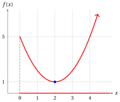{ .fig .ovale loading=lazy style="width:50%" }

    3. Completing the square, the objective function can be written as

        $$
        f(x) = x^2 - 4x + 5 = (x-2)^2 + 1 .
        $$

        - For the minimization form, since $(x-2)^2 \ge 0$, we have $f(x) \ge 1 = f(2)$ for every feasible $x$, with equality only for $x=2$. The unique optimal solution and the optimal value are:

            $$
            \tilde{\boldsymbol x}(P) = \left(2\right)
            \quad \text{and} \quad
            z(P) = 1.
            $$

        - For the maximization form, the objective function increases indefinitely: for every value $M \ge 0$, the point $x = M+3$ is feasible and

            $$
            f(M+3) = (M+1)^2 + 1 > M .
            $$

            Therefore no feasible solution can be optimal: the problem is <strong>unbounded</strong> and

            $$
            z(P) = +\infty .
            $$

!!! esercizio "Exercise 5.5: Optimization problem (E5)"

    Consider the following objective function and feasible region:

    $$
    f:\R \to \R,~ f: x \mapsto x^2 + 1
    \qquad \text{and} \qquad
    F=\{\, x \in \R : x \ge 3,~ x^2 \le 4 \,\}.
    $$

    **Questions**

    1. Write the associated optimization problems in minimization and maximization forms.

    2. Draw on the $x$-axis the set of points that satisfy each constraint.

    3. Find all optimal solutions and the optimal value for both forms, or explain why they do not exist.

??? soluzione "Solution"

    1. The associated optimization problems in minimization and maximization forms are:

        \begin{equation*}
        \min \bigg\{\, x^2 + 1 \ \text{ subject to } x \ge 3,~ x^2 \le 4 \,\bigg\}
        \end{equation*}

        \begin{equation*}
        \max \bigg\{\, x^2 + 1 \ \text{ subject to } x \ge 3,~ x^2 \le 4 \,\bigg\}
        \end{equation*}

    2. The constraint $x^2 \le 4$ is satisfied exactly by the points of the interval $[-2,2]$ (violet), since $x^2 \le 4$ if and only if $|x| \le 2$. The constraint $x \ge 3$ is satisfied by the points of the half-line $[3,+\infty)$ (orange). The two sets have no point in common.

        { .fig .ovale loading=lazy style="width:50%" }

    3. Every point with $x \ge 3$ has $x^2 \ge 9 > 4$, so it violates the second constraint: no point satisfies both constraints and the feasible region is empty,

        $$
        F = \{\, x \in \R : x \ge 3 \,\} \cap [-2,2] = \emptyset .
        $$

        Both the minimization and the maximization form are <strong>infeasible</strong>: they have no feasible solution, hence no optimal solution, and $z(P)$ is not defined. The objective function plays no role: the same holds for every objective function with this feasible region.

!!! esercizio "Exercise 5.6: Optimization problem (E6)"

    Consider the following objective function and feasible region:

    $$
    f:\R \to \R,~ f: x \mapsto x^2 - 2x + 2
    \qquad \text{and} \qquad
    F=\{\, x \in \R : -1 \le x < 1 \,\} = [-1,1).
    $$

    **Questions**

    1. Write the associated optimization problems in minimization and maximization forms.

    2. Draw the graph of the objective function over the feasible region.

    3. Find all optimal solutions and the optimal value for both forms, or explain why they do not exist.

??? soluzione "Solution"

    1. The associated optimization problems in minimization and maximization forms are:

        \begin{equation*}
        \min \bigg\{\, x^2 - 2x + 2 \ \text{ subject to } -1 \le x < 1 \,\bigg\}
        \end{equation*}

        \begin{equation*}
        \max \bigg\{\, x^2 - 2x + 2 \ \text{ subject to } -1 \le x < 1 \,\bigg\}
        \end{equation*}

    2. The graph of the objective function over the feasible region is red; the feasible region is the red part of the $x$-axis and the optimal solutions are marked in blue. The point $x=1$ does not belong to the feasible region (empty circles).

        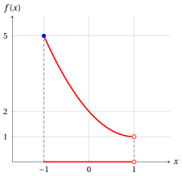{ .fig .ovale loading=lazy style="width:50%" }

    3. Completing the square, the objective function can be written as

        $$
        f(x) = x^2 - 2x + 2 = (x-1)^2 + 1 .
        $$

        - For the minimization form, since $x \neq 1$ for every feasible $x$, we have $f(x) = (x-1)^2 + 1 > 1$; on the other hand, the values of $f$ get as close to $1$ as we want: for example $f\big(1-\frac{1}{k}\big) = 1 + \frac{1}{k^2}$ for every integer $k \ge 1$. The infimum of $f$ over $F$ is $1$, but no feasible solution is optimal: for every $x \in F$, the point $\frac{x+1}{2}$ is feasible (it lies between $x$ and $1$) and

            $$
            f\Big(\frac{x+1}{2}\Big) = \Big(\frac{x-1}{2}\Big)^2 + 1 = \frac{(x-1)^2}{4} + 1 < (x-1)^2 + 1 = f(x).
            $$

            The problem has an <strong>unattainable infimum</strong>: there is no optimal solution and $z(P)$ is not defined.

        - For the maximization form, for every feasible $x$ we have $-2 \le x - 1 < 0$ and then $(x-1)^2 \le 4$, with equality only for $x=-1$. Therefore $f(x) \le 5 = f(-1)$ and the unique optimal solution and the optimal value are:

            $$
            \tilde{\boldsymbol x}(P) = \left(-1\right)
            \quad \text{and} \quad
            z(P) = 5.
            $$

!!! esercizio "Exercise 5.7: Optimization problem (E7)"

    Consider the following objective function and feasible region:

    $$
    f:\R \to \R,~ f: x \mapsto x^3 - 3x^2 - 9x + 5
    \qquad \text{and} \qquad
    F=\{\, x \in \R : -2 \le x \le 5 \,\} = [-2,5].
    $$

    **Questions**

    1. Write the associated optimization problems in minimization and maximization forms.

    2. Draw the graph of the objective function over the feasible region.

    3. Find all optimal solutions and the optimal value for both forms.

    4. Prove that $x=-2$ is a point of local minimum of $f$ in $F$, but not a point of (global) minimum.

??? soluzione "Solution"

    1. The associated optimization problems in minimization and maximization forms are:

        \begin{equation*}
        \min \bigg\{\, x^3 - 3x^2 - 9x + 5 \ \text{ subject to } -2 \le x \le 5 \,\bigg\}
        \end{equation*}

        \begin{equation*}
        \max \bigg\{\, x^3 - 3x^2 - 9x + 5 \ \text{ subject to } -2 \le x \le 5 \,\bigg\}
        \end{equation*}

    2. The graph of the objective function over the feasible region is red; the feasible region is the red part of the $x$-axis and the optimal solutions are marked in blue. The point of local minimum that is not a point of global minimum is violet. Since $f$ takes negative values, the $x$-axis is drawn at the bottom of the figure.

        { .fig .ovale loading=lazy style="width:50%" }

    3. We compare $f$ with the candidate optimal values using the following factorizations, which can be checked by expanding the products:

        \begin{align*}
        f(x) + 22 &= x^3 - 3x^2 - 9x + 27 = (x-3)^2\,(x+3),\\
        f(x) - 10 &= x^3 - 3x^2 - 9x - 5 = (x+1)^2\,(x-5).
        \end{align*}

        - For the minimization form, for every feasible $x$ we have $x + 3 \ge 1 > 0$ and $(x-3)^2 \ge 0$, so $f(x) + 22 \ge 0$, that is $f(x) \ge -22 = f(3)$, with equality only for $x=3$. The unique optimal solution and the optimal value are:

            $$
            \tilde{\boldsymbol x}(P) = \left(3\right)
            \quad \text{and} \quad
            z(P) = -22.
            $$

        - For the maximization form, for every feasible $x$ we have $x - 5 \le 0$ and $(x+1)^2 \ge 0$, so $f(x) - 10 \le 0$, that is $f(x) \le 10$, with equality only for $x=-1$ and $x=5$. The problem has <strong>two</strong> optimal solutions and the optimal value is:

            $$
            \argmax \big\{\, x^3 - 3x^2 - 9x + 5 \ \text{ subject to } -2 \le x \le 5 \,\big\} = \{-1,\,5\}
            $$

            and

            $$
            z(P) = 10.
            $$

    4. We have $f(-2) = -8 - 12 + 18 + 5 = 3$ and

        $$
        f(x) - 3 = x^3 - 3x^2 - 9x + 2 = (x+2)\,(x^2 - 5x + 1).
        $$

        In the spherical $\delta$-neighborhood $N\big((-2),1\big)$ we have $N\big((-2),1\big) \cap [-2,5] = [-2,-1)$. For every $x \in [-2,-1)$ we have $x + 2 \ge 0$ and, since $x^2 \ge 1$ and $-5x > 5$, $x^2 - 5x + 1 > 7 > 0$. Therefore

        $$
        f(-2) = 3 ~\le~ f(x), \qquad \forall x \in N\big((-2),1\big) \cap [-2,5] = [-2,-1),
        $$

        and $x=-2$ is a point of local minimum of $f$ in $F$, with local minimum $3$. It is not a point of (global) minimum, since $f(3) = -22 < 3 = f(-2)$: an optimization method that only looks at the points close to $x=-2$ would miss the optimal solution of the minimization form.

!!! esercizio "Exercise 5.8: Optimization problem (E9)"

    Consider the following linear objective function and feasible region:

    $$
    f:\R \to \R,~ f: x \mapsto x - 1
    \qquad \text{and} \qquad
    F=\{\, x \in \R : 0 \le x < 3 \,\} = [0,3).
    $$

    **Questions**

    1. Write the associated optimization problems in minimization and maximization forms.

    2. Draw the graph of the objective function over the feasible region.

    3. Find all optimal solutions and the optimal value for both forms.

??? soluzione "Solution"

    1. The associated optimization problems in minimization and maximization forms are:

        \begin{equation*}
        \min \bigg\{\, x - 1 \ \text{ subject to } 0 \le x < 3 \,\bigg\}
        \end{equation*}

        \begin{equation*}
        \max \bigg\{\, x - 1 \ \text{ subject to } 0 \le x < 3 \,\bigg\}
        \end{equation*}

    2. The graph of the objective function over the feasible region is red; the feasible region is the red part of the $x$-axis and the optimal solutions are marked in blue. The point $x=3$ does not belong to the feasible region: the empty circles mark the excluded endpoint of the feasible region and of the graph.

        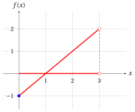{ .fig .ovale loading=lazy style="width:50%" }

    3. The feasible region is the interval $F=[0,3)$, which contains $0$ but not $3$, and the linear function $f$ is strictly increasing.

        - For the minimization form, since for every feasible $x$ we have $x \ge 0$ and then $f(x) = x - 1 \ge -1 = f(0)$, the unique optimal solution and the optimal value are:

            $$
            \tilde{\boldsymbol x}(P) = \left(0\right)
            \quad \text{and} \quad
            z(P) = -1.
            $$

        - For the maximization form, for every feasible $x$ we have $x < 3$ and then $f(x) = x - 1 < 2$; moreover, for every feasible $x$ the point $\frac{x+3}{2}$ is feasible and

            $$
            f\Big(\frac{x+3}{2}\Big) = \frac{x+1}{2} > x - 1 = f(x),
            $$

            so no feasible point is optimal, while $f(x)$ gets as close as we want to $2$ when $x$ gets close to $3$. The problem has an <strong>unattainable supremum</strong>: $\sup\{\, f(x) : x \in F \,\} = 2$ is not attained, there is no optimal solution and

            $$
            \argmax \big\{\, x - 1 \ \text{ subject to } 0 \le x < 3 \,\big\} = \emptyset
            \quad \text{and} \quad
            z(P) \text{ is not defined}.
            $$

!!! esercizio "Exercise 5.9: Optimization problem (E10)"

    Consider the following function:

    $$
    f:[-1,4] \to \R,~ f: x \mapsto 2 + 9x - 6x^2 + x^3.
    $$

    **Questions**

    1. Prove, using the definition, that the point $(3)$ is a point of local minimum of $f$ in $[-1,4]$.

    2. Prove, using the definition, that the point $(1)$ is a point of local maximum of $f$ in $[-1,4]$.

    3. Find all the points of (global) minimum and maximum of $f$ in $[-1,4]$, that is, the optimal solutions of the optimization problems $\min\{\, f(x) \text{ subject to } -1 \le x \le 4 \,\}$ and $\max\{\, f(x) \text{ subject to } -1 \le x \le 4 \,\}$.

    4. Draw the graph of the function.

??? soluzione "Solution"

    1. We have $f(3) = 2 + 27 - 54 + 27 = 2$ and

        $$
        f(x) - f(3) = x^3 - 6x^2 + 9x = x\,(x-3)^2.
        $$

        We use the spherical $\delta$-neighborhood $N\big((3),\frac{1}{2}\big)$, for which $N\big((3),\frac{1}{2}\big) \cap [-1,4] = \big(\frac{5}{2},\frac{7}{2}\big)$. For every $x$ in this interval we have $x > 0$ and $(x-3)^2 \ge 0$, so $f(x) - f(3) \ge 0$. Therefore,

        $$
        f(3) = 2 ~\le~ f(x), \qquad \forall x \in N\Big((3),\frac{1}{2}\Big) \cap [-1,4] = \Big(\frac{5}{2},\frac{7}{2}\Big),
        $$

        and $x=3$ is a point of local minimum of $f$ in $[-1,4]$, with local minimum $2$.

    2. We have $f(1) = 2 + 9 - 6 + 1 = 6$ and

        $$
        f(x) - f(1) = x^3 - 6x^2 + 9x - 4 = (x-4)\,(x-1)^2.
        $$

        We use the spherical $\delta$-neighborhood $N\big((1),\frac{1}{2}\big)$, for which $N\big((1),\frac{1}{2}\big) \cap [-1,4] = \big(\frac{1}{2},\frac{3}{2}\big)$. For every $x$ in this interval we have $x - 4 < 0$ and $(x-1)^2 \ge 0$, so $f(x) - f(1) \le 0$. Therefore,

        $$
        f(1) = 6 ~\ge~ f(x), \qquad \forall x \in N\Big((1),\frac{1}{2}\Big) \cap [-1,4] = \Big(\frac{1}{2},\frac{3}{2}\Big),
        $$

        and $x=1$ is a point of local maximum of $f$ in $[-1,4]$, with local maximum $6$.

    3. We study the minimum and the maximum separately.

        - <strong>Minimum.</strong> We have $f(-1) = 2 - 9 - 6 - 1 = -14$ and

            $$
            f(x) + 14 = x^3 - 6x^2 + 9x + 16 = (x+1)\,(x^2 - 7x + 16) = (x+1)\left(\Big(x-\frac{7}{2}\Big)^2 + \frac{15}{4}\right).
            $$

            For every $x \in [-1,4]$ we have $x + 1 \ge 0$, and the second factor is positive, so $f(x) \ge -14 = f(-1)$, with equality only for $x=-1$. The unique point of minimum is $x=-1$ and the minimum is $-14$. The point of local minimum $x=3$ is not a point of (global) minimum, since $f(-1) = -14 < 2 = f(3)$.

        - <strong>Maximum.</strong> The factorization of the second question holds for every $x$: for every $x \in [-1,4]$ we have $x - 4 \le 0$, so $f(x) - 6 = (x-4)(x-1)^2 \le 0$, with equality only for $x=1$ and $x=4$. The function has <strong>two</strong> points of maximum and the maximum is $6$:

            $$
            \argmax \big\{\, f(x) \ \text{ subject to } -1 \le x \le 4 \,\big\} = \{1,\,4\}.
            $$

            The point of local maximum $x=1$ is also a point of (global) maximum.

    4. The graph of the function is red; the domain is the red part of the $x$-axis, the points of (global) minimum and maximum are blue and the points of local minimum or maximum that are not global are violet. Since $f$ takes negative values, the $x$-axis is drawn at the bottom of the figure.

        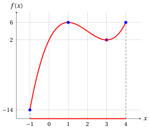{ .fig .ovale loading=lazy style="width:50%" }

!!! esercizio "Exercise 5.10: Optimization problem (E11)"

    Consider the following function:

    $$
    f:[0,4] \to \R,~ f: x \mapsto 5 + 54x - 2x^3.
    $$

    **Questions**

    1. Prove, using the definition, that the point $(3)$ is a point of local maximum of $f$ in $[0,4]$.

    2. Prove, using the definition, that the point $(4)$ is a point of local minimum of $f$ in $[0,4]$.

    3. Find all the points of (global) minimum and maximum of $f$ in $[0,4]$, that is, the optimal solutions of the optimization problems $\min\{\, f(x) \text{ subject to } 0 \le x \le 4 \,\}$ and $\max\{\, f(x) \text{ subject to } 0 \le x \le 4 \,\}$.

    4. Draw the graph of the function.

??? soluzione "Solution"

    1. We have $f(3) = 5 + 162 - 54 = 113$ and

        $$
        f(3) - f(x) = 2x^3 - 54x + 108 = 2\,(x-3)^2\,(x+6).
        $$

        We use the spherical $\delta$-neighborhood $N\big((3),1\big)$, for which $N\big((3),1\big) \cap [0,4] = (2,4)$. For every $x$ in this interval we have $x + 6 > 0$ and $(x-3)^2 \ge 0$, so $f(3) - f(x) \ge 0$. Therefore,

        $$
        f(3) = 113 ~\ge~ f(x), \qquad \forall x \in N\big((3),1\big) \cap [0,4] = (2,4),
        $$

        and $x=3$ is a point of local maximum of $f$ in $[0,4]$, with local maximum $113$.

    2. We have $f(4) = 5 + 216 - 128 = 93$ and

        $$
        f(x) - f(4) = -2x^3 + 54x - 88 = -2\,(x-4)\,(x^2 + 4x - 11).
        $$

        We use the spherical $\delta$-neighborhood $N\big((4),\frac{1}{2}\big)$, for which $N\big((4),\frac{1}{2}\big) \cap [0,4] = \big(\frac{7}{2},4\big]$. For every $x$ in this interval we have $x - 4 \le 0$ and, since $x > \frac{7}{2}$,

        $$
        x^2 + 4x - 11 > \frac{49}{4} + 14 - 11 = \frac{61}{4} > 0,
        $$

        so $f(x) - f(4) = -2\,(x-4)\,(x^2+4x-11) \ge 0$. Therefore,

        $$
        f(4) = 93 ~\le~ f(x), \qquad \forall x \in N\Big((4),\frac{1}{2}\Big) \cap [0,4] = \Big(\frac{7}{2},4\Big],
        $$

        and $x=4$ is a point of local minimum of $f$ in $[0,4]$, with local minimum $93$.

    3. We study the minimum and the maximum separately.

        - <strong>Maximum.</strong> The factorization of the first question holds for every $x$: for every $x \in [0,4]$ we have $x + 6 > 0$, so $f(3) - f(x) = 2(x-3)^2(x+6) \ge 0$, with equality only for $x=3$. The unique point of maximum is $x=3$ and the maximum is $113$: the point of local maximum is also a point of (global) maximum.

        - <strong>Minimum.</strong> We have $f(0) = 5$ and

            $$
            f(x) - 5 = 54x - 2x^3 = 2x\,(27 - x^2).
            $$

            For every $x \in [0,4]$ we have $x \ge 0$ and $x^2 \le 16 < 27$, so $f(x) \ge 5 = f(0)$, with equality only for $x=0$. The unique point of minimum is $x=0$ and the minimum is $5$. The point of local minimum $x=4$ is not a point of (global) minimum, since $f(0) = 5 < 93 = f(4)$.

    4. The graph of the function is red; the domain is the red part of the $x$-axis, the points of (global) minimum and maximum are blue and the points of local minimum or maximum that are not global are violet.

        { .fig .ovale loading=lazy style="width:50%" }

!!! esercizio "Exercise 5.11: Optimization problem (E12)"

    Consider the following function:

    $$
    f:[-2,3] \to \R,~ f: x \mapsto 1 - 12x - 3x^2 + 2x^3.
    $$

    **Questions**

    1. Prove, using the definition, that the point $(-1)$ is a point of local maximum of $f$ in $[-2,3]$.

    2. Prove, using the definition, that the point $(2)$ is a point of local minimum of $f$ in $[-2,3]$.

    3. Find all the points of (global) minimum and maximum of $f$ in $[-2,3]$, that is, the optimal solutions of the optimization problems $\min\{\, f(x) \text{ subject to } -2 \le x \le 3 \,\}$ and $\max\{\, f(x) \text{ subject to } -2 \le x \le 3 \,\}$.

    4. Draw the graph of the function.

??? soluzione "Solution"

    1. We have $f(-1) = 1 + 12 - 3 - 2 = 8$ and

        $$
        f(x) - f(-1) = 2x^3 - 3x^2 - 12x - 7 = (x+1)^2\,(2x-7).
        $$

        We use the spherical $\delta$-neighborhood $N\big((-1),1\big)$, for which $N\big((-1),1\big) \cap [-2,3] = (-2,0)$. For every $x$ in this interval we have $2x - 7 < 0$ and $(x+1)^2 \ge 0$, so $f(x) - f(-1) \le 0$. Therefore,

        $$
        f(-1) = 8 ~\ge~ f(x), \qquad \forall x \in N\big((-1),1\big) \cap [-2,3] = (-2,0),
        $$

        and $x=-1$ is a point of local maximum of $f$ in $[-2,3]$, with local maximum $8$.

    2. We have $f(2) = 1 - 24 - 12 + 16 = -19$ and

        $$
        f(x) - f(2) = 2x^3 - 3x^2 - 12x + 20 = (x-2)^2\,(2x+5).
        $$

        We use the spherical $\delta$-neighborhood $N\big((2),1\big)$, for which $N\big((2),1\big) \cap [-2,3] = (1,3)$. For every $x$ in this interval we have $2x + 5 > 0$ and $(x-2)^2 \ge 0$, so $f(x) - f(2) \ge 0$. Therefore,

        $$
        f(2) = -19 ~\le~ f(x), \qquad \forall x \in N\big((2),1\big) \cap [-2,3] = (1,3),
        $$

        and $x=2$ is a point of local minimum of $f$ in $[-2,3]$, with local minimum $-19$.

    3. The two factorizations hold for every $x$, and every $x \in [-2,3]$ satisfies $2x - 7 \le -1 < 0$ and $2x + 5 \ge 1 > 0$. Then, for every $x \in [-2,3]$,

        $$
        f(x) - 8 = (x+1)^2\,(2x-7) \le 0
        \qquad \text{and} \qquad
        f(x) + 19 = (x-2)^2\,(2x+5) \ge 0,
        $$

        with equality only for $x=-1$ and only for $x=2$, respectively. The unique point of maximum is $x=-1$, with maximum $8$, and the unique point of minimum is $x=2$, with minimum $-19$: both points of the first two questions are global optima.

    4. The graph of the function is red; the domain is the red part of the $x$-axis, the points of (global) minimum and maximum are blue. Since $f$ takes negative values, the $x$-axis is drawn at the bottom of the figure. At the endpoints we have $f(-2) = -3$ and $f(3) = -8$.

        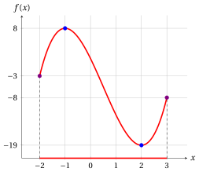{ .fig .ovale loading=lazy style="width:50%" }

!!! esercizio "Exercise 5.12: Optimization problem (E13)"

    Consider the following function:

    $$
    f:[-2,3] \to \R,~ f: x \mapsto 3 - 2x^2 + x^4.
    $$

    **Questions**

    1. Prove, using the definition, that the point $(-1)$ is a point of local minimum of $f$ in $[-2,3]$.

    2. Prove, using the definition, that the point $(0)$ is a point of local maximum of $f$ in $[-2,3]$.

    3. Prove, using the definition, that the point $(1)$ is a point of local minimum of $f$ in $[-2,3]$.

    4. Find all the points of (global) minimum and maximum of $f$ in $[-2,3]$, that is, the optimal solutions of the optimization problems $\min\{\, f(x) \text{ subject to } -2 \le x \le 3 \,\}$ and $\max\{\, f(x) \text{ subject to } -2 \le x \le 3 \,\}$.

    5. Draw the graph of the function in the interval $[-2,2]$.

??? soluzione "Solution"

    1. We have $f(-1) = 3 - 2 + 1 = 2$ and

        $$
        f(x) - f(-1) = x^4 - 2x^2 + 1 = (x^2-1)^2 \ge 0, \qquad \forall x \in \R.
        $$

        In particular, for the spherical $\delta$-neighborhood $N\big((-1),\frac{1}{2}\big)$ we have

        $$
        f(-1) = 2 ~\le~ f(x), \qquad \forall x \in N\Big((-1),\frac{1}{2}\Big) \cap [-2,3] = \Big(-\frac{3}{2},-\frac{1}{2}\Big),
        $$

        and $x=-1$ is a point of local minimum of $f$ in $[-2,3]$, with local minimum $2$.

    2. We have $f(0) = 3$ and

        $$
        f(x) - f(0) = x^4 - 2x^2 = x^2\,(x^2-2).
        $$

        We use the spherical $\delta$-neighborhood $N\big((0),\frac{1}{2}\big)$, for which $N\big((0),\frac{1}{2}\big) \cap [-2,3] = {\big(-\frac{1}{2},\frac{1}{2}\big)}$. For every $x$ in this interval we have $x^2 < \frac{1}{4} < 2$, so $f(x) - f(0) \le 0$. Therefore,

        $$
        f(0) = 3 ~\ge~ f(x), \qquad \forall x \in N\Big((0),\frac{1}{2}\Big) \cap [-2,3] = \Big(-\frac{1}{2},\frac{1}{2}\Big),
        $$

        and $x=0$ is a point of local maximum of $f$ in $[-2,3]$, with local maximum $3$.

    3. We have $f(1) = 2$ and, as in the first question, $f(x) - f(1) = (x^2-1)^2 \ge 0$ for every $x \in \R$. In particular,

        $$
        f(1) = 2 ~\le~ f(x), \qquad \forall x \in N\Big((1),\frac{1}{2}\Big) \cap [-2,3] = \Big(\frac{1}{2},\frac{3}{2}\Big),
        $$

        and $x=1$ is a point of local minimum of $f$ in $[-2,3]$, with local minimum $2$.

    4. We study the minimum and the maximum separately.

        - <strong>Minimum.</strong> For every $x \in [-2,3]$ we have $f(x) - 2 = (x^2-1)^2 \ge 0$, with equality only for $x=-1$ and $x=1$. The function has <strong>two</strong> points of minimum and the minimum is $2$:

            $$
            \argmin \big\{\, f(x) \ \text{ subject to } -2 \le x \le 3 \,\big\} = \{-1,\,1\}.
            $$

        - <strong>Maximum.</strong> We have $f(3) = 3 - 18 + 81 = 66$ and

            $$
            66 - f(x) = 63 + 2x^2 - x^4 = (9 - x^2)\,(x^2 + 7).
            $$

            For every $x \in [-2,3]$ we have $x^2 \le 9$, so $f(x) \le 66 = f(3)$, with equality only for $x=3$ (the value $x=-3$ is not in the domain). The unique point of maximum is $x=3$ and the maximum is $66$. The point of local maximum $x=0$ is not a point of (global) maximum, since $f(0) = 3 < 66 = f(3)$.

    5. The graph of the function in the interval $[-2,2]$ is red and the interval $[-2,2]$, which is a part of the domain, is the red part of the $x$-axis; the points of (global) minimum are blue and the point of local maximum that is not global is violet. The point of maximum $x=3$, with $f(3)=66$, is outside the figure.

        { .fig .ovale loading=lazy style="width:50%" }

!!! esercizio "Exercise 5.13: Optimization problem (E14)"

    Consider the following function:

    $$
    f:[0,5] \to \R,~ f: x \mapsto x^3 - 9x^2 + 24x - 10.
    $$

    **Questions**

    1. Prove, using the definition, that the point $(2)$ is a point of local maximum of $f$ in $[0,5]$.

    2. Prove, using the definition, that the point $(4)$ is a point of local minimum of $f$ in $[0,5]$.

    3. Find all the points of (global) minimum and maximum of $f$ in $[0,5]$, that is, the optimal solutions of the optimization problems $\min\{\, f(x) \text{ subject to } 0 \le x \le 5 \,\}$ and $\max\{\, f(x) \text{ subject to } 0 \le x \le 5 \,\}$.

    4. Draw the graph of the function.

??? soluzione "Solution"

    1. We have $f(2) = 8 - 36 + 48 - 10 = 10$ and

        $$
        f(x) - f(2) = x^3 - 9x^2 + 24x - 20 = (x-2)^2\,(x-5).
        $$

        We use the spherical $\delta$-neighborhood $N\big((2),1\big)$, for which $N\big((2),1\big) \cap [0,5] = (1,3)$. For every $x$ in this interval we have $x - 5 < 0$ and $(x-2)^2 \ge 0$, so $f(x) - f(2) \le 0$. Therefore,

        $$
        f(2) = 10 ~\ge~ f(x), \qquad \forall x \in N\big((2),1\big) \cap [0,5] = (1,3),
        $$

        and $x=2$ is a point of local maximum of $f$ in $[0,5]$, with local maximum $10$.

    2. We have $f(4) = 64 - 144 + 96 - 10 = 6$ and

        $$
        f(x) - f(4) = x^3 - 9x^2 + 24x - 16 = (x-4)^2\,(x-1).
        $$

        We use the spherical $\delta$-neighborhood $N\big((4),1\big)$, for which $N\big((4),1\big) \cap [0,5] = (3,5)$. For every $x$ in this interval we have $x - 1 > 0$ and $(x-4)^2 \ge 0$, so $f(x) - f(4) \ge 0$. Therefore,

        $$
        f(4) = 6 ~\le~ f(x), \qquad \forall x \in N\big((4),1\big) \cap [0,5] = (3,5),
        $$

        and $x=4$ is a point of local minimum of $f$ in $[0,5]$, with local minimum $6$.

    3. We study the minimum and the maximum separately.

        - <strong>Maximum.</strong> The factorization of the first question holds for every $x$: for every $x \in [0,5]$ we have $x - 5 \le 0$, so $f(x) - 10 = (x-2)^2(x-5) \le 0$, with equality only for $x=2$ and $x=5$. The function has <strong>two</strong> points of maximum and the maximum is $10$:

            $$
            \argmax \big\{\, f(x) \ \text{ subject to } 0 \le x \le 5 \,\big\} = \{2,\,5\}.
            $$

            The point of local maximum $x=2$ is also a point of (global) maximum.

        - <strong>Minimum.</strong> We have $f(0) = -10$ and

            $$
            f(x) + 10 = x^3 - 9x^2 + 24x = x\,(x^2 - 9x + 24) = x\left(\Big(x-\frac{9}{2}\Big)^2 + \frac{15}{4}\right).
            $$

            For every $x \in [0,5]$ we have $x \ge 0$, and the second factor is positive, so $f(x) \ge -10 = f(0)$, with equality only for $x=0$. The unique point of minimum is $x=0$ and the minimum is $-10$. The point of local minimum $x=4$ is not a point of (global) minimum, since $f(0) = -10 < 6 = f(4)$.

    4. The graph of the function is red; the domain is the red part of the $x$-axis, the points of (global) minimum and maximum are blue and the points of local minimum or maximum that are not global are violet. Since $f$ takes negative values, the $x$-axis is drawn at the bottom of the figure.

        { .fig .ovale loading=lazy style="width:50%" }

!!! esercizio "Exercise 5.14: Optimization problem (E15)"

    Consider the following function:

    $$
    f:[-1,3] \to \R,~ f: x \mapsto 2x^3 - 3x^2 - 12x + 5.
    $$

    **Questions**

    1. Prove, using the definition, that the point $(-1)$ is a point of local maximum of $f$ in $[-1,3]$.

    2. Prove, using the definition, that the point $(2)$ is a point of local minimum of $f$ in $[-1,3]$.

    3. Find all the points of (global) minimum and maximum of $f$ in $[-1,3]$, that is, the optimal solutions of the optimization problems $\min\{\, f(x) \text{ subject to } -1 \le x \le 3 \,\}$ and $\max\{\, f(x) \text{ subject to } -1 \le x \le 3 \,\}$.

    4. Draw the graph of the function.

??? soluzione "Solution"

    1. We have $f(-1) = -2 - 3 + 12 + 5 = 12$ and

        $$
        f(x) - f(-1) = 2x^3 - 3x^2 - 12x - 7 = (x+1)^2\,(2x-7).
        $$

        We use the spherical $\delta$-neighborhood $N\big((-1),\frac{1}{2}\big) = \big(-\frac{3}{2},-\frac{1}{2}\big)$. The point $x=-1$ is the left endpoint of the domain, so only the points on its right are considered: $N\big((-1),\frac{1}{2}\big) \cap [-1,3] = \big[-1,-\frac{1}{2}\big)$. For every $x$ in this interval we have $2x - 7 < 0$ and $(x+1)^2 \ge 0$, so $f(x) - f(-1) \le 0$. Therefore,

        $$
        f(-1) = 12 ~\ge~ f(x), \qquad \forall x \in N\Big((-1),\frac{1}{2}\Big) \cap [-1,3] = \Big[-1,-\frac{1}{2}\Big),
        $$

        and $x=-1$ is a point of local maximum of $f$ in $[-1,3]$, with local maximum $12$.

    2. We have $f(2) = 16 - 12 - 24 + 5 = -15$ and

        $$
        f(x) - f(2) = 2x^3 - 3x^2 - 12x + 20 = (x-2)^2\,(2x+5).
        $$

        We use the spherical $\delta$-neighborhood $N\big((2),\frac{1}{2}\big)$, for which $N\big((2),\frac{1}{2}\big) \cap [-1,3] = \big(\frac{3}{2},\frac{5}{2}\big)$. For every $x$ in this interval we have $2x + 5 > 0$ and $(x-2)^2 \ge 0$, so $f(x) - f(2) \ge 0$. Therefore,

        $$
        f(2) = -15 ~\le~ f(x), \qquad \forall x \in N\Big((2),\frac{1}{2}\Big) \cap [-1,3] = \Big(\frac{3}{2},\frac{5}{2}\Big),
        $$

        and $x=2$ is a point of local minimum of $f$ in $[-1,3]$, with local minimum $-15$.

    3. The two factorizations hold for every $x$, and every $x \in [-1,3]$ satisfies $2x - 7 \le -1 < 0$ and $2x + 5 \ge 3 > 0$. Then, for every $x \in [-1,3]$,

        $$
        f(x) - 12 = (x+1)^2\,(2x-7) \le 0
        \qquad \text{and} \qquad
        f(x) + 15 = (x-2)^2\,(2x+5) \ge 0,
        $$

        with equality only for $x=-1$ and only for $x=2$, respectively. The unique point of maximum is $x=-1$, with maximum $12$, and the unique point of minimum is $x=2$, with minimum $-15$: both points of the first two questions are global optima.

    4. The graph of the function is red; the domain is the red part of the $x$-axis, the points of (global) minimum and maximum are blue. Since $f$ takes negative values, the $x$-axis is drawn at the bottom of the figure. At the right endpoint we have $f(3) = -4$.

        { .fig .ovale loading=lazy style="width:50%" }

## Problems in two variables

!!! esercizio "Exercise 5.15: Optimization problem (E8)"

    Consider the following objective function of two variables and feasible region:

    $$
    f:\R^2 \to \R,~ f: \begin{pmatrix}x_1\\x_2\end{pmatrix} \mapsto (x_1 - x_2)^2
    $$

    and

    $$
    F=\{\, \boldsymbol x \in \R^2 : 0 \le x_1 \le 2,~ 0 \le x_2 \le 2 \,\} = [0,2]\times[0,2].
    $$

    **Questions**

    1. Write the associated optimization problems in minimization and maximization forms.

    2. Draw the feasible region and the level curves of the objective function with values $0$, $1$ and $4$.

    3. Find all optimal solutions and the optimal value for both forms.

??? soluzione "Solution"

    1. The associated optimization problems in minimization and maximization forms are:

        \begin{equation*}
        \min \bigg\{\, (x_1 - x_2)^2 \ \text{ subject to } 0 \le x_1 \le 2,~ 0 \le x_2 \le 2 \,\bigg\}
        \end{equation*}

        \begin{equation*}
        \max \bigg\{\, (x_1 - x_2)^2 \ \text{ subject to } 0 \le x_1 \le 2,~ 0 \le x_2 \le 2 \,\bigg\}
        \end{equation*}

    2. The feasible region is the red square. Since $f(\boldsymbol x) = c$ if and only if $x_1 - x_2 = \sqrt{c}$ or $x_1 - x_2 = -\sqrt{c}$, the level curves are straight lines parallel to the line $x_1 = x_2$: the level curve with value $0$ is the line $x_1 = x_2$, the one with value $1$ is made of the two lines $x_1 - x_2 = \pm 1$ (dashed), and the one with value $4$ is made of the two lines $x_1 - x_2 = \pm 2$, which touch the square only at its corners $(2,0)$ and $(0,2)$. The optimal solutions are blue.

        { .fig .ovale loading=lazy style="width:50%" }

    3. The feasible region is the square $F=[0,2]\times[0,2]$.

        - For the minimization form, $f(\boldsymbol x) = (x_1 - x_2)^2 \ge 0$ for every feasible $\boldsymbol x$, with equality exactly when $x_1 = x_2$. The problem has <strong>infinitely many</strong> optimal solutions (the blue diagonal of the square) and the optimal value is:

            $$
            \argmin \big\{\, (x_1 - x_2)^2 \ \text{ subject to } \boldsymbol x \in F \,\big\} = \left\{ \begin{pmatrix} t\\ t \end{pmatrix} : 0 \le t \le 2 \right\}
            \quad \text{and} \quad
            z(P) = 0.
            $$

        - For the maximization form, for every feasible $\boldsymbol x$ we have $0 \le x_1 \le 2$ and $-2 \le -x_2 \le 0$, so $-2 \le x_1 - x_2 \le 2$ and $f(\boldsymbol x) \le 4$. The equality $x_1 - x_2 = 2$ holds only for $x_1 = 2$ and $x_2 = 0$, and $x_1 - x_2 = -2$ only for $x_1 = 0$ and $x_2 = 2$. The problem has <strong>two</strong> optimal solutions and the optimal value is:

            $$
            \argmax \big\{\, (x_1 - x_2)^2 \ \text{ subject to } \boldsymbol x \in F \,\big\} = \left\{ \begin{pmatrix} 2\\ 0 \end{pmatrix},\, \begin{pmatrix} 0\\ 2 \end{pmatrix} \right\}
            \quad \text{and} \quad
            z(P) = 4.
            $$

!!! esercizio "Exercise 5.16: Optimization problem (E16)"

    Consider the following function:

    $$
    f: D \to \R,~ f: \begin{pmatrix}x_1\\x_2\end{pmatrix} \mapsto x_1 + x_2,
    \qquad \text{with} \qquad
    D = [-2,2]\times[-2,2].
    $$

    **Questions**

    1. Prove, using the definition, that the point $\begin{pmatrix}-2\\-2\end{pmatrix}$ is the unique point of minimum of $f$ in $D$.

    2. Prove, using the definition, that the point $\begin{pmatrix}2\\2\end{pmatrix}$ is the unique point of maximum of $f$ in $D$.

    3. Draw the graph of the function in the domain $D$.

??? soluzione "Solution"

    1. For every $\begin{pmatrix}x_1\\x_2\end{pmatrix}\in D$ we have $x_1 \ge -2$ and $x_2 \ge -2$. Therefore,

        $$
        f\!\left(\begin{pmatrix}x_1\\x_2\end{pmatrix}\right)
        = x_1 + x_2
        \ge -2 + (-2)
        = -4
        = f\!\left(\begin{pmatrix}-2\\-2\end{pmatrix}\right),
        $$

        with equality only for $x_1 = x_2 = -2$. Accordingly,

        $$
        f\!\left(\begin{pmatrix}-2\\-2\end{pmatrix}\right)
        ~\le~
        f\!\left(\begin{pmatrix}x_1\\x_2\end{pmatrix}\right),
        \qquad
        \forall \begin{pmatrix}x_1\\x_2\end{pmatrix}\in D,
        $$

        and $\begin{pmatrix}-2\\-2\end{pmatrix}$ is the unique point of minimum of $f$ in $D$, with minimum $-4$.

    2. For every $\begin{pmatrix}x_1\\x_2\end{pmatrix}\in D$ we have $x_1 \le 2$ and $x_2 \le 2$. Therefore,

        $$
        f\!\left(\begin{pmatrix}x_1\\x_2\end{pmatrix}\right)
        = x_1 + x_2
        \le 2 + 2
        = 4
        = f\!\left(\begin{pmatrix}2\\2\end{pmatrix}\right),
        $$

        with equality only for $x_1 = x_2 = 2$, and $\begin{pmatrix}2\\2\end{pmatrix}$ is the unique point of maximum of $f$ in $D$, with maximum $4$.

    3. The graph of the function is the surface over the domain $D$, which is the red square drawn on the bottom plane; the points of the graph corresponding to the point of minimum and to the point of maximum are blue, with a dashed segment that joins them to the bottom plane.

        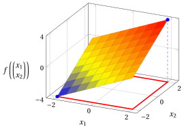{ .fig .ovale loading=lazy style="width:59%" }

!!! esercizio "Exercise 5.17: Optimization problem (E17)"

    Consider the following function:

    $$
    f: D \to \R,~ f: \begin{pmatrix}x_1\\x_2\end{pmatrix} \mapsto (x_1-2)^2 + (x_2-2)^2 + 1,
    \qquad \text{with} \qquad
    D = [-4,4]\times[-4,4].
    $$

    **Questions**

    1. Prove, using the definition, that the point $\begin{pmatrix}2\\2\end{pmatrix}$ is a point of local minimum of $f$ in $D$.

    2. Prove that $\begin{pmatrix}2\\2\end{pmatrix}$ is also the unique point of (global) minimum of $f$ in $D$, and find all the points of maximum of $f$ in $D$.

    3. Draw the graph of the function in the domain $D$.

??? soluzione "Solution"

    1. We have $f\!\left(\begin{pmatrix}2\\2\end{pmatrix}\right)= 1$. We use the spherical $\delta$-neighborhood $N\!\left(\begin{pmatrix}2\\2\end{pmatrix},1\right)$: for every $\begin{pmatrix}x_1\\x_2\end{pmatrix}$ in it,

        $$
        f\!\left(\begin{pmatrix}x_1\\x_2\end{pmatrix}\right)-f\!\left(\begin{pmatrix}2\\2\end{pmatrix}\right)
        = (x_1-2)^2 + (x_2-2)^2 \ge 0.
        $$

        Therefore,

        $$
        f\!\left(\begin{pmatrix}2\\2\end{pmatrix}\right) ~\le~ f\!\left(\begin{pmatrix}x_1\\x_2\end{pmatrix}\right),
        \qquad
        \forall \begin{pmatrix}x_1\\x_2\end{pmatrix}\in N\!\left(\begin{pmatrix}2\\2\end{pmatrix},1\right)\cap D,
        $$

        and $\begin{pmatrix}2\\2\end{pmatrix}$ is a point of local minimum of $f$ in $D$, with local minimum $1$.

    2. We study the minimum and the maximum separately.

        - <strong>Minimum.</strong> The inequality $f\!\left(\begin{pmatrix}x_1\\x_2\end{pmatrix}\right)-f\!\left(\begin{pmatrix}2\\2\end{pmatrix}\right)= (x_1-2)^2 + (x_2-2)^2 \ge 0$ holds for every $\begin{pmatrix}x_1\\x_2\end{pmatrix}\in D$, not only in the neighborhood, with equality only for $x_1 = x_2 = 2$. The point $\begin{pmatrix}2\\2\end{pmatrix}$ is the unique point of minimum of $f$ in $D$ and the minimum is $1$.

        - <strong>Maximum.</strong> For every $\begin{pmatrix}x_1\\x_2\end{pmatrix}\in D$ we have $-6 \le x_1 - 2 \le 2$ and $-6 \le x_2 - 2 \le 2$, so $(x_1-2)^2 \le 36$ and $(x_2-2)^2 \le 36$, with equality only for $x_1 = -4$ and $x_2 = -4$, respectively. Therefore,

            $$
            f\!\left(\begin{pmatrix}x_1\\x_2\end{pmatrix}\right)\le 36 + 36 + 1 = 73 = f\!\left(\begin{pmatrix}-4\\-4\end{pmatrix}\right),
            $$

            and $\begin{pmatrix}-4\\-4\end{pmatrix}$ is the unique point of maximum of $f$ in $D$, with maximum $73$.

    3. The graph of the function is the surface over the domain $D$, which is the red square drawn on the bottom plane; the points of the graph corresponding to the point of minimum and to the point of maximum are blue, with a dashed segment that joins them to the bottom plane.

        { .fig .ovale loading=lazy style="width:59%" }

!!! esercizio "Exercise 5.18: Optimization problem (E18)"

    Consider the following function:

    $$
    f: D \to \R,~ f: \begin{pmatrix}x_1\\x_2\end{pmatrix} \mapsto x_1^2 + x_2^2 + 2 - \frac{1}{10}\big(x_1^4 + x_2^4\big),
    \qquad \text{with} \qquad
    D = [-4,4]\times[-4,4].
    $$

    **Questions**

    1. Prove, using the definition, that the point $\begin{pmatrix}0\\0\end{pmatrix}$ is a point of local minimum of $f$ in $D$.

    2. Prove that $\begin{pmatrix}0\\0\end{pmatrix}$ is not a point of (global) minimum of $f$ in $D$, and find all the points of minimum of $f$ in $D$, that is, the optimal solutions of the optimization problem $\min\{\, f({\boldsymbol x}) \text{ subject to } {\boldsymbol x} \in D \,\}$.

    3. Draw the graph of the function in the domain $D$.

??? soluzione "Solution"

    1. We have $f\!\left(\begin{pmatrix}0\\0\end{pmatrix}\right)= 2$. We use the spherical $\delta$-neighborhood $N\!\left(\begin{pmatrix}0\\0\end{pmatrix},2\right)$: for every $\begin{pmatrix}x_1\\x_2\end{pmatrix}$ in it we have $x_1^2 \le x_1^2 + x_2^2 < 4$ and $x_2^2 < 4$, hence

        $$
        1-\frac{x_1^2}{10} > 1-\frac{4}{10} = \frac{3}{5} > 0
        \qquad \text{and} \qquad
        1-\frac{x_2^2}{10} > \frac{3}{5} > 0,
        $$

        and then

        $$
        f\!\left(\begin{pmatrix}x_1\\x_2\end{pmatrix}\right)-f\!\left(\begin{pmatrix}0\\0\end{pmatrix}\right)
        = x_1^2\left(1-\frac{x_1^2}{10}\right) + x_2^2\left(1-\frac{x_2^2}{10}\right) \ge 0.
        $$

        Therefore,

        $$
        f\!\left(\begin{pmatrix}0\\0\end{pmatrix}\right) ~\le~ f\!\left(\begin{pmatrix}x_1\\x_2\end{pmatrix}\right),
        \qquad
        \forall \begin{pmatrix}x_1\\x_2\end{pmatrix}\in N\!\left(\begin{pmatrix}0\\0\end{pmatrix},2\right)\cap D,
        $$

        and $\begin{pmatrix}0\\0\end{pmatrix}$ is a point of local minimum of $f$ in $D$, with local minimum $2$.

    2. We write $f$ as a sum of two functions of one variable:

        $$
        f\!\left(\begin{pmatrix}x_1\\x_2\end{pmatrix}\right)= 2 + g(x_1) + g(x_2),
        \qquad \text{with} \qquad
        g(t) = t^2 - \frac{t^4}{10}.
        $$

        We have $g(4) = 16 - \frac{256}{10} = -\frac{48}{5}$ and

        $$
        g(t) + \frac{48}{5} = \frac{-t^4 + 10t^2 + 96}{10} = \frac{(16-t^2)\,(t^2+6)}{10}.
        $$

        For every $t \in [-4,4]$ we have $t^2 \le 16$, so $g(t) \ge -\frac{48}{5}$, with equality only for $t=-4$ and $t=4$. Therefore, for every $\begin{pmatrix}x_1\\x_2\end{pmatrix}\in D$,

        $$
        f\!\left(\begin{pmatrix}x_1\\x_2\end{pmatrix}\right)\ge 2 - \frac{48}{5} - \frac{48}{5} = -\frac{86}{5},
        $$

        with equality only when both $x_1$ and $x_2$ are equal to $-4$ or $4$. The function has <strong>four</strong> points of minimum, the corners of $D$, and the minimum is $-\frac{86}{5}$:

        $$
        \argmin \big\{\, f({\boldsymbol x}) \ \text{ subject to } {\boldsymbol x} \in D \,\big\}
        = \left\{ \begin{pmatrix}-4\\-4\end{pmatrix},\begin{pmatrix}-4\\4\end{pmatrix},\begin{pmatrix}4\\-4\end{pmatrix},\begin{pmatrix}4\\4\end{pmatrix} \right\}.
        $$

        The point of local minimum $\begin{pmatrix}0\\0\end{pmatrix}$ is not a point of (global) minimum, since $-\frac{86}{5} < 2$.

    3. The graph of the function is the surface over the domain $D$, which is the red square drawn on the bottom plane; the points of the graph corresponding to the four points of minimum are blue and the point corresponding to the point of local minimum that is not global is violet, with a dashed segment that joins them to the bottom plane.

        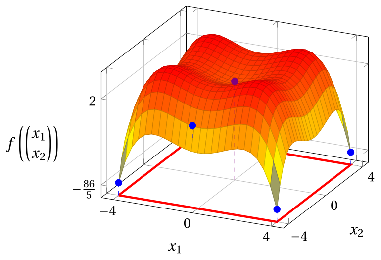{ .fig .ovale loading=lazy style="width:59%" }

!!! esercizio "Exercise 5.19: Optimization problem (E19)"

    Consider the following function:

    $$
    f: D \to \R,~ f: \begin{pmatrix}x_1\\x_2\end{pmatrix} \mapsto x_1^2 + x_2^2 - \frac{1}{2}x_1^2 x_2^2,
    \qquad \text{with} \qquad
    D = [-3,3]\times[-3,3].
    $$

    **Questions**

    1. Prove, using the definition, that the point $\begin{pmatrix}0\\0\end{pmatrix}$ is a point of local minimum of $f$ in $D$.

    2. Prove that $\begin{pmatrix}0\\0\end{pmatrix}$ is not a point of (global) minimum of $f$ in $D$, and find all the points of minimum of $f$ in $D$, that is, the optimal solutions of the optimization problem $\min\{\, f({\boldsymbol x}) \text{ subject to } {\boldsymbol x} \in D \,\}$.

    3. Draw the graph of the function in the domain $D$.

??? soluzione "Solution"

    1. We have $f\!\left(\begin{pmatrix}0\\0\end{pmatrix}\right)= 0$. We use the spherical $\delta$-neighborhood $N\!\left(\begin{pmatrix}0\\0\end{pmatrix},1\right)$: for every $\begin{pmatrix}x_1\\x_2\end{pmatrix}$ in it we have $x_2^2 \le x_1^2 + x_2^2 < 1$, hence $1-\dfrac{x_2^2}{2} > \dfrac{1}{2}$, and then

        $$
        f\!\left(\begin{pmatrix}x_1\\x_2\end{pmatrix}\right)-f\!\left(\begin{pmatrix}0\\0\end{pmatrix}\right)
        = x_1^2\left(1-\frac{x_2^2}{2}\right)+x_2^2
        \ge \frac{1}{2}x_1^2 + x_2^2 \ge 0.
        $$

        Therefore,

        $$
        f\!\left(\begin{pmatrix}0\\0\end{pmatrix}\right) ~\le~ f\!\left(\begin{pmatrix}x_1\\x_2\end{pmatrix}\right),
        \qquad
        \forall \begin{pmatrix}x_1\\x_2\end{pmatrix}\in N\!\left(\begin{pmatrix}0\\0\end{pmatrix},1\right)\cap D,
        $$

        and $\begin{pmatrix}0\\0\end{pmatrix}$ is a point of local minimum of $f$ in $D$, with local minimum $0$.

    2. We have $f\!\left(\begin{pmatrix}3\\3\end{pmatrix}\right)= 9 + 9 - \frac{81}{2} = -\frac{45}{2} < 0$, so $\begin{pmatrix}0\\0\end{pmatrix}$ is not a point of (global) minimum. To find the points of minimum, we write

        $$
        f\!\left(\begin{pmatrix}x_1\\x_2\end{pmatrix}\right)= 2 - \frac{1}{2}\,u\,v,
        \qquad \text{with} \qquad
        u = x_1^2 - 2 \quad \text{and} \quad v = x_2^2 - 2.
        $$

        For every $\begin{pmatrix}x_1\\x_2\end{pmatrix}\in D$ we have $0 \le x_1^2 \le 9$ and $0 \le x_2^2 \le 9$, so $-2 \le u \le 7$ and $-2 \le v \le 7$. Then:

        - if $u \ge 0$ and $v \ge 0$, we have $u\,v \le 7 \cdot 7 = 49$, with equality only for $u = v = 7$;

        - if $u$ and $v$ have opposite signs, we have $u\,v \le 0$;

        - if $u < 0$ and $v < 0$, we have $u\,v = |u|\,|v| \le 2 \cdot 2 = 4$.

        In all cases $u\,v \le 49$, so $f({\boldsymbol x}) \ge 2 - \frac{49}{2} = -\frac{45}{2}$, with equality only for $x_1^2 = x_2^2 = 9$. The function has <strong>four</strong> points of minimum, the corners of $D$, and the minimum is $-\frac{45}{2}$:

        $$
        \argmin \big\{\, f({\boldsymbol x}) \ \text{ subject to } {\boldsymbol x} \in D \,\big\}
        = \left\{ \begin{pmatrix}-3\\-3\end{pmatrix},\begin{pmatrix}-3\\3\end{pmatrix},\begin{pmatrix}3\\-3\end{pmatrix},\begin{pmatrix}3\\3\end{pmatrix} \right\}.
        $$

    3. The graph of the function is the surface over the domain $D$, which is the red square drawn on the bottom plane; the points of the graph corresponding to the four points of minimum are blue and the point corresponding to the point of local minimum that is not global is violet, with a dashed segment that joins them to the bottom plane.

        { .fig .ovale loading=lazy style="width:59%" }

!!! esercizio "Exercise 5.20: Optimization problem (E20)"

    Consider the following function:

    $$
    f: D \to \R,~ f: \begin{pmatrix}x_1\\x_2\end{pmatrix} \mapsto x_1^2 + x_2^2 - x_1^3,
    \qquad \text{with} \qquad
    D = [-2,4]\times[-2,4].
    $$

    **Questions**

    1. Prove, using the definition, that the point $\begin{pmatrix}0\\0\end{pmatrix}$ is a point of local minimum of $f$ in $D$.

    2. Prove that $\begin{pmatrix}0\\0\end{pmatrix}$ is not a point of (global) minimum of $f$ in $D$, and find all the points of minimum of $f$ in $D$, that is, the optimal solutions of the optimization problem $\min\{\, f({\boldsymbol x}) \text{ subject to } {\boldsymbol x} \in D \,\}$.

    3. Draw the graph of the function in the domain $D$.

??? soluzione "Solution"

    1. We have $f\!\left(\begin{pmatrix}0\\0\end{pmatrix}\right)= 0$. We use the spherical $\delta$-neighborhood $N\!\left(\begin{pmatrix}0\\0\end{pmatrix},\frac{1}{2}\right)$: for every $\begin{pmatrix}x_1\\x_2\end{pmatrix}$ in it we have $|x_1| < \frac{1}{2}$, hence $1 - x_1 > \frac{1}{2}$, and then

        $$
        f\!\left(\begin{pmatrix}x_1\\x_2\end{pmatrix}\right)-f\!\left(\begin{pmatrix}0\\0\end{pmatrix}\right)
        = x_1^2\,(1-x_1)+x_2^2
        \ge \frac{1}{2}x_1^2 + x_2^2 \ge 0.
        $$

        Therefore,

        $$
        f\!\left(\begin{pmatrix}0\\0\end{pmatrix}\right) ~\le~ f\!\left(\begin{pmatrix}x_1\\x_2\end{pmatrix}\right),
        \qquad
        \forall \begin{pmatrix}x_1\\x_2\end{pmatrix}\in N\!\left(\begin{pmatrix}0\\0\end{pmatrix},\frac{1}{2}\right)\cap D,
        $$

        and $\begin{pmatrix}0\\0\end{pmatrix}$ is a point of local minimum of $f$ in $D$, with local minimum $0$.

    2. We have $f\!\left(\begin{pmatrix}4\\0\end{pmatrix}\right)= 16 - 64 = -48 < 0$, so $\begin{pmatrix}0\\0\end{pmatrix}$ is not a point of (global) minimum. Moreover,

        $$
        f\!\left(\begin{pmatrix}x_1\\x_2\end{pmatrix}\right)+ 48 = \big(48 + x_1^2 - x_1^3\big) + x_2^2 = (4 - x_1)\,\big(x_1^2 + 3x_1 + 12\big) + x_2^2,
        $$

        where $x_1^2 + 3x_1 + 12 = \big(x_1 + \frac{3}{2}\big)^2 + \frac{39}{4} > 0$. For every $\begin{pmatrix}x_1\\x_2\end{pmatrix}\in D$ we have $4 - x_1 \ge 0$, so $f({\boldsymbol x}) \ge -48$, with equality only for $x_1 = 4$ and $x_2 = 0$. The point $\begin{pmatrix}4\\0\end{pmatrix}$ is the unique point of minimum of $f$ in $D$ and the minimum is $-48$.

    3. The graph of the function is the surface over the domain $D$, which is the red square drawn on the bottom plane; the point of the graph corresponding to the point of minimum is blue and the point corresponding to the point of local minimum that is not global is violet, with a dashed segment that joins them to the bottom plane.

        { .fig .ovale loading=lazy style="width:59%" }

!!! esercizio "Exercise 5.21: Optimization problem (E21)"

    Consider the following function:

    $$
    f: D \to \R,~ f: \begin{pmatrix}x_1\\x_2\end{pmatrix} \mapsto x_1^2 + x_2^2 + 1 - x_1 x_2^2,
    \qquad \text{with} \qquad
    D = [-1,5]\times[-3,3].
    $$

    **Questions**

    1. Prove, using the definition, that the point $\begin{pmatrix}0\\0\end{pmatrix}$ is a point of local minimum of $f$ in $D$.

    2. Prove that $\begin{pmatrix}0\\0\end{pmatrix}$ is not a point of (global) minimum of $f$ in $D$, and find all the points of minimum of $f$ in $D$, that is, the optimal solutions of the optimization problem $\min\{\, f({\boldsymbol x}) \text{ subject to } {\boldsymbol x} \in D \,\}$.

    3. Draw the graph of the function in the domain $D$.

??? soluzione "Solution"

    1. We have $f\!\left(\begin{pmatrix}0\\0\end{pmatrix}\right)= 1$. We use the spherical $\delta$-neighborhood $N\!\left(\begin{pmatrix}0\\0\end{pmatrix},\frac{1}{2}\right)$: for every $\begin{pmatrix}x_1\\x_2\end{pmatrix}$ in it we have $|x_1| < \frac{1}{2}$, hence $1 - x_1 > \frac{1}{2}$, and then

        $$
        f\!\left(\begin{pmatrix}x_1\\x_2\end{pmatrix}\right)-f\!\left(\begin{pmatrix}0\\0\end{pmatrix}\right)
        = x_1^2 + x_2^2\,(1-x_1)
        \ge x_1^2 + \frac{1}{2}x_2^2 \ge 0.
        $$

        Therefore,

        $$
        f\!\left(\begin{pmatrix}0\\0\end{pmatrix}\right) ~\le~ f\!\left(\begin{pmatrix}x_1\\x_2\end{pmatrix}\right),
        \qquad
        \forall \begin{pmatrix}x_1\\x_2\end{pmatrix}\in N\!\left(\begin{pmatrix}0\\0\end{pmatrix},\frac{1}{2}\right)\cap D,
        $$

        and $\begin{pmatrix}0\\0\end{pmatrix}$ is a point of local minimum of $f$ in $D$, with local minimum $1$.

    2. We have $f\!\left(\begin{pmatrix}5\\3\end{pmatrix}\right)= 25 + 9 + 1 - 45 = -10 < 1$, so $\begin{pmatrix}0\\0\end{pmatrix}$ is not a point of (global) minimum. To find the points of minimum, we check by expanding the products that

        $$
        f\!\left(\begin{pmatrix}x_1\\x_2\end{pmatrix}\right)+ \frac{41}{4} = \Big(x_1 - \frac{9}{2}\Big)^2 + (x_1 - 1)\,(9 - x_2^2).
        $$

        For every $\begin{pmatrix}x_1\\x_2\end{pmatrix}\in D$ we have $0 \le 9 - x_2^2 \le 9$, and:

        - if $x_1 \ge 1$, both terms are nonnegative, so $f({\boldsymbol x}) + \frac{41}{4} \ge 0$, with equality only for $x_1 = \frac{9}{2}$ and $x_2^2 = 9$;

        - if $x_1 < 1$, we have $x_1 - 1 < 0$ and then $(x_1 - 1)(9 - x_2^2) \ge 9\,(x_1 - 1)$, so

            $$
            f({\boldsymbol x}) + \frac{41}{4} \ge \Big(x_1 - \frac{9}{2}\Big)^2 + 9\,(x_1 - 1) = x_1^2 + \frac{45}{4} > 0.
            $$

        The function has <strong>two</strong> points of minimum and the minimum is $-\frac{41}{4}$:

        $$
        \argmin \big\{\, f({\boldsymbol x}) \ \text{ subject to } {\boldsymbol x} \in D \,\big\}
        = \left\{ \begin{pmatrix}\frac{9}{2}\\-3\end{pmatrix},\begin{pmatrix}\frac{9}{2}\\3\end{pmatrix} \right\}.
        $$

    3. The graph of the function is the surface over the domain $D$, which is the red square drawn on the bottom plane; the points of the graph corresponding to the two points of minimum are blue and the point corresponding to the point of local minimum that is not global is violet, with a dashed segment that joins them to the bottom plane.

        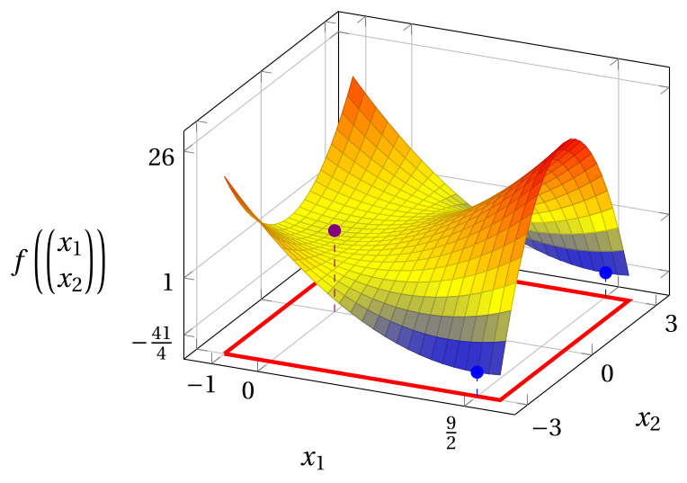{ .fig .ovale loading=lazy style="width:59%" }

!!! esercizio "Exercise 5.22: Optimization problem (E22)"

    Consider the following function:

    $$
    f: D \to \R,~ f: \begin{pmatrix}x_1\\x_2\end{pmatrix} \mapsto -(x_1-2)^2 - (x_2-2)^2 + 5,
    \qquad \text{with} \qquad
    D = [-4,4]\times[-4,4].
    $$

    **Questions**

    1. Prove, using the definition, that the point $\begin{pmatrix}2\\2\end{pmatrix}$ is a point of local maximum of $f$ in $D$.

    2. Prove that $\begin{pmatrix}2\\2\end{pmatrix}$ is also the unique point of (global) maximum of $f$ in $D$, and find all the points of minimum of $f$ in $D$.

    3. Draw the graph of the function in the domain $D$.

??? soluzione "Solution"

    1. We have $f\!\left(\begin{pmatrix}2\\2\end{pmatrix}\right)= 5$. We use the spherical $\delta$-neighborhood $N\!\left(\begin{pmatrix}2\\2\end{pmatrix},1\right)$: for every $\begin{pmatrix}x_1\\x_2\end{pmatrix}$ in it,

        $$
        f\!\left(\begin{pmatrix}x_1\\x_2\end{pmatrix}\right)-f\!\left(\begin{pmatrix}2\\2\end{pmatrix}\right)
        = -\big((x_1-2)^2 + (x_2-2)^2\big) \le 0.
        $$

        Therefore,

        $$
        f\!\left(\begin{pmatrix}2\\2\end{pmatrix}\right) ~\ge~ f\!\left(\begin{pmatrix}x_1\\x_2\end{pmatrix}\right),
        \qquad
        \forall \begin{pmatrix}x_1\\x_2\end{pmatrix}\in N\!\left(\begin{pmatrix}2\\2\end{pmatrix},1\right)\cap D,
        $$

        and $\begin{pmatrix}2\\2\end{pmatrix}$ is a point of local maximum of $f$ in $D$, with local maximum $5$.

    2. We study the minimum and the maximum separately.

        - <strong>Maximum.</strong> The inequality $f\!\left(\begin{pmatrix}x_1\\x_2\end{pmatrix}\right)-f\!\left(\begin{pmatrix}2\\2\end{pmatrix}\right)= -\big((x_1-2)^2 + (x_2-2)^2\big) \le 0$ holds for every $\begin{pmatrix}x_1\\x_2\end{pmatrix}\in D$, not only in the neighborhood, with equality only for $x_1 = x_2 = 2$. The point $\begin{pmatrix}2\\2\end{pmatrix}$ is the unique point of maximum of $f$ in $D$ and the maximum is $5$.

        - <strong>Minimum.</strong> For every $\begin{pmatrix}x_1\\x_2\end{pmatrix}\in D$ we have $-6 \le x_1 - 2 \le 2$ and $-6 \le x_2 - 2 \le 2$, so $(x_1-2)^2 \le 36$ and $(x_2-2)^2 \le 36$, with equality only for $x_1 = -4$ and $x_2 = -4$, respectively. Therefore,

            $$
            f\!\left(\begin{pmatrix}x_1\\x_2\end{pmatrix}\right)\ge -36 - 36 + 5 = -67 = f\!\left(\begin{pmatrix}-4\\-4\end{pmatrix}\right),
            $$

            and $\begin{pmatrix}-4\\-4\end{pmatrix}$ is the unique point of minimum of $f$ in $D$, with minimum $-67$.

    3. The graph of the function is the surface over the domain $D$, which is the red square drawn on the bottom plane; the points of the graph corresponding to the point of maximum and to the point of minimum are blue, with a dashed segment that joins them to the bottom plane.

        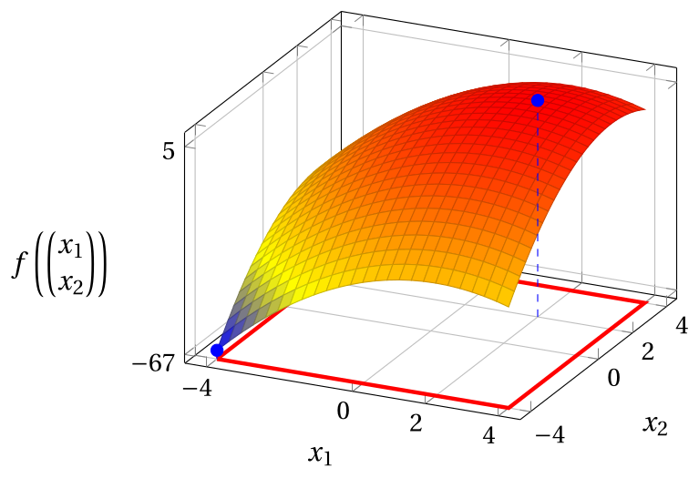{ .fig .ovale loading=lazy style="width:59%" }

!!! esercizio "Exercise 5.23: Optimization problem (E23)"

    Consider the following function:

    $$
    f: D \to \R,~ f: \begin{pmatrix}x_1\\x_2\end{pmatrix} \mapsto -x_1^2 - x_2^2 + 2 + \frac{1}{10}\big(x_1^4 + x_2^4\big),
    \qquad \text{with} \qquad
    D = [-4,4]\times[-4,4].
    $$

    **Questions**

    1. Prove, using the definition, that the point $\begin{pmatrix}0\\0\end{pmatrix}$ is a point of local maximum of $f$ in $D$.

    2. Prove that $\begin{pmatrix}0\\0\end{pmatrix}$ is not a point of (global) maximum of $f$ in $D$, and find all the points of maximum of $f$ in $D$, that is, the optimal solutions of the optimization problem $\max\{\, f({\boldsymbol x}) \text{ subject to } {\boldsymbol x} \in D \,\}$.

    3. Draw the graph of the function in the domain $D$.

??? soluzione "Solution"

    1. We have $f\!\left(\begin{pmatrix}0\\0\end{pmatrix}\right)= 2$. We use the spherical $\delta$-neighborhood $N\!\left(\begin{pmatrix}0\\0\end{pmatrix},1\right)$: for every $\begin{pmatrix}x_1\\x_2\end{pmatrix}$ in it we have $|x_1| < 1$ and $|x_2| < 1$, hence $x_1^4 \le x_1^2$ and $x_2^4 \le x_2^2$, and then

        $$
        f\!\left(\begin{pmatrix}x_1\\x_2\end{pmatrix}\right)
        \le 2 - (x_1^2+x_2^2) + \frac{1}{10}(x_1^2+x_2^2)
        = 2 - \frac{9}{10}(x_1^2+x_2^2)
        \le 2 = f\!\left(\begin{pmatrix}0\\0\end{pmatrix}\right).
        $$

        Therefore,

        $$
        f\!\left(\begin{pmatrix}0\\0\end{pmatrix}\right) ~\ge~ f\!\left(\begin{pmatrix}x_1\\x_2\end{pmatrix}\right),
        \qquad
        \forall \begin{pmatrix}x_1\\x_2\end{pmatrix}\in N\!\left(\begin{pmatrix}0\\0\end{pmatrix},1\right)\cap D,
        $$

        and $\begin{pmatrix}0\\0\end{pmatrix}$ is a point of local maximum of $f$ in $D$, with local maximum $2$.

    2. We write $f$ as a sum of two functions of one variable:

        $$
        f\!\left(\begin{pmatrix}x_1\\x_2\end{pmatrix}\right)= 2 - g(x_1) - g(x_2),
        \qquad \text{with} \qquad
        g(t) = t^2 - \frac{t^4}{10}.
        $$

        We have $g(4) = 16 - \frac{256}{10} = -\frac{48}{5}$ and

        $$
        g(t) + \frac{48}{5} = \frac{-t^4 + 10t^2 + 96}{10} = \frac{(16-t^2)\,(t^2+6)}{10}.
        $$

        For every $t \in [-4,4]$ we have $t^2 \le 16$, so $g(t) \ge -\frac{48}{5}$, with equality only for $t=-4$ and $t=4$. Therefore, for every $\begin{pmatrix}x_1\\x_2\end{pmatrix}\in D$,

        $$
        f\!\left(\begin{pmatrix}x_1\\x_2\end{pmatrix}\right)\le 2 + \frac{48}{5} + \frac{48}{5} = \frac{106}{5},
        $$

        with equality only when both $x_1$ and $x_2$ are equal to $-4$ or $4$. The function has <strong>four</strong> points of maximum, the corners of $D$, and the maximum is $\frac{106}{5}$:

        $$
        \argmax \big\{\, f({\boldsymbol x}) \ \text{ subject to } {\boldsymbol x} \in D \,\big\}
        = \left\{ \begin{pmatrix}-4\\-4\end{pmatrix},\begin{pmatrix}-4\\4\end{pmatrix},\begin{pmatrix}4\\-4\end{pmatrix},\begin{pmatrix}4\\4\end{pmatrix} \right\}.
        $$

        The point of local maximum $\begin{pmatrix}0\\0\end{pmatrix}$ is not a point of (global) maximum, since $2 < \frac{106}{5}$.

    3. The graph of the function is the surface over the domain $D$, which is the red square drawn on the bottom plane; the points of the graph corresponding to the four points of maximum are blue and the point corresponding to the point of local maximum that is not global is violet, with a dashed segment that joins them to the bottom plane.

        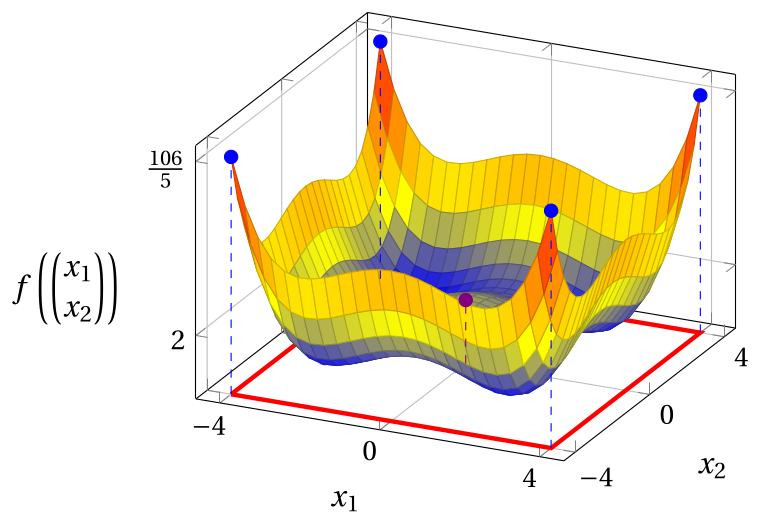{ .fig .ovale loading=lazy style="width:59%" }

!!! esercizio "Exercise 5.24: Optimization problem (E24)"

    Consider the following function:

    $$
    f: D \to \R,~ f: \begin{pmatrix}x_1\\x_2\end{pmatrix} \mapsto -x_1^2 - x_2^2 + \frac{1}{2}x_1^2 x_2^2,
    \qquad \text{with} \qquad
    D = [-4,4]\times[-4,4].
    $$

    **Questions**

    1. Prove, using the definition, that the point $\begin{pmatrix}0\\0\end{pmatrix}$ is a point of local maximum of $f$ in $D$.

    2. Prove that $\begin{pmatrix}0\\0\end{pmatrix}$ is not a point of (global) maximum of $f$ in $D$, and find all the points of maximum of $f$ in $D$, that is, the optimal solutions of the optimization problem $\max\{\, f({\boldsymbol x}) \text{ subject to } {\boldsymbol x} \in D \,\}$.

    3. Draw the graph of the function in the domain $D$.

??? soluzione "Solution"

    1. We have $f\!\left(\begin{pmatrix}0\\0\end{pmatrix}\right)= 0$. We use the spherical $\delta$-neighborhood $N\!\left(\begin{pmatrix}0\\0\end{pmatrix},1\right)$: for every $\begin{pmatrix}x_1\\x_2\end{pmatrix}$ in it we have $x_2^2 \le x_1^2 + x_2^2 < 1$, hence $1-\dfrac{x_2^2}{2} > \dfrac{1}{2}$, and then

        $$
        f\!\left(\begin{pmatrix}x_1\\x_2\end{pmatrix}\right)-f\!\left(\begin{pmatrix}0\\0\end{pmatrix}\right)
        = -x_2^2 - x_1^2\left(1-\frac{x_2^2}{2}\right)
        \le -x_2^2 - \frac{1}{2}x_1^2 \le 0.
        $$

        Therefore,

        $$
        f\!\left(\begin{pmatrix}0\\0\end{pmatrix}\right) ~\ge~ f\!\left(\begin{pmatrix}x_1\\x_2\end{pmatrix}\right),
        \qquad
        \forall \begin{pmatrix}x_1\\x_2\end{pmatrix}\in N\!\left(\begin{pmatrix}0\\0\end{pmatrix},1\right)\cap D,
        $$

        and $\begin{pmatrix}0\\0\end{pmatrix}$ is a point of local maximum of $f$ in $D$, with local maximum $0$.

    2. We have $f\!\left(\begin{pmatrix}4\\4\end{pmatrix}\right)= -16 - 16 + 128 = 96 > 0$, so $\begin{pmatrix}0\\0\end{pmatrix}$ is not a point of (global) maximum. To find the points of maximum, we write

        $$
        f\!\left(\begin{pmatrix}x_1\\x_2\end{pmatrix}\right)= \frac{1}{2}\,u\,v - 2,
        \qquad \text{with} \qquad
        u = x_1^2 - 2 \quad \text{and} \quad v = x_2^2 - 2.
        $$

        For every $\begin{pmatrix}x_1\\x_2\end{pmatrix}\in D$ we have $0 \le x_1^2 \le 16$ and $0 \le x_2^2 \le 16$, so $-2 \le u \le 14$ and $-2 \le v \le 14$. Then:

        - if $u \ge 0$ and $v \ge 0$, we have $u\,v \le 14 \cdot 14 = 196$, with equality only for $u = v = 14$;

        - if $u$ and $v$ have opposite signs, we have $u\,v \le 0$;

        - if $u < 0$ and $v < 0$, we have $u\,v = |u|\,|v| \le 2 \cdot 2 = 4$.

        In all cases $u\,v \le 196$, so $f({\boldsymbol x}) \le 98 - 2 = 96$, with equality only for $x_1^2 = x_2^2 = 16$. The function has <strong>four</strong> points of maximum, the corners of $D$, and the maximum is $96$:

        $$
        \argmax \big\{\, f({\boldsymbol x}) \ \text{ subject to } {\boldsymbol x} \in D \,\big\}
        = \left\{ \begin{pmatrix}-4\\-4\end{pmatrix},\begin{pmatrix}-4\\4\end{pmatrix},\begin{pmatrix}4\\-4\end{pmatrix},\begin{pmatrix}4\\4\end{pmatrix} \right\}.
        $$

    3. The graph of the function is the surface over the domain $D$, which is the red square drawn on the bottom plane; the points of the graph corresponding to the four points of maximum are blue and the point corresponding to the point of local maximum that is not global is violet, with a dashed segment that joins them to the bottom plane.

        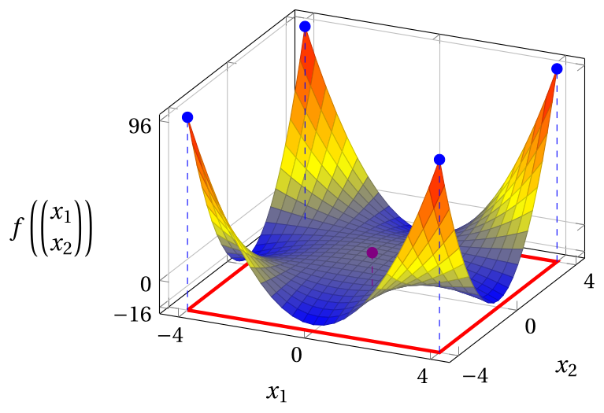{ .fig .ovale loading=lazy style="width:59%" }

!!! esercizio "Exercise 5.25: Optimization problem (E25)"

    Consider the following function:

    $$
    f: D \to \R,~ f: \begin{pmatrix}x_1\\x_2\end{pmatrix} \mapsto -x_1^2 - x_2^2 + x_1^3,
    \qquad \text{with} \qquad
    D = [-3,3]\times[-3,3].
    $$

    **Questions**

    1. Prove, using the definition, that the point $\begin{pmatrix}0\\0\end{pmatrix}$ is a point of local maximum of $f$ in $D$.

    2. Prove that $\begin{pmatrix}0\\0\end{pmatrix}$ is not a point of (global) maximum of $f$ in $D$, and find all the points of maximum of $f$ in $D$, that is, the optimal solutions of the optimization problem $\max\{\, f({\boldsymbol x}) \text{ subject to } {\boldsymbol x} \in D \,\}$.

    3. Draw the graph of the function in the domain $D$.

??? soluzione "Solution"

    1. We have $f\!\left(\begin{pmatrix}0\\0\end{pmatrix}\right)= 0$. We use the spherical $\delta$-neighborhood $N\!\left(\begin{pmatrix}0\\0\end{pmatrix},\frac{1}{2}\right)$: for every $\begin{pmatrix}x_1\\x_2\end{pmatrix}$ in it we have $|x_1| < \frac{1}{2}$, hence

        $$
        x_1^3 = x_1 \cdot x_1^2 \le |x_1|\,x_1^2 \le \frac{1}{2}\,x_1^2,
        $$

        and then

        $$
        f\!\left(\begin{pmatrix}x_1\\x_2\end{pmatrix}\right)-f\!\left(\begin{pmatrix}0\\0\end{pmatrix}\right)
        = -x_1^2 - x_2^2 + x_1^3
        \le -x_1^2 - x_2^2 + \frac{1}{2}x_1^2
        = -\frac{1}{2}x_1^2 - x_2^2 \le 0.
        $$

        Therefore,

        $$
        f\!\left(\begin{pmatrix}0\\0\end{pmatrix}\right) ~\ge~ f\!\left(\begin{pmatrix}x_1\\x_2\end{pmatrix}\right),
        \qquad
        \forall \begin{pmatrix}x_1\\x_2\end{pmatrix}\in N\!\left(\begin{pmatrix}0\\0\end{pmatrix},\frac{1}{2}\right)\cap D,
        $$

        and $\begin{pmatrix}0\\0\end{pmatrix}$ is a point of local maximum of $f$ in $D$, with local maximum $0$.

    2. We have $f\!\left(\begin{pmatrix}3\\0\end{pmatrix}\right)= -9 + 27 = 18 > 0$, so $\begin{pmatrix}0\\0\end{pmatrix}$ is not a point of (global) maximum. Moreover, for every $\begin{pmatrix}x_1\\x_2\end{pmatrix}\in D$ we have $-x_2^2 \le 0$ and

        $$
        18 - \big(x_1^3 - x_1^2\big) = (3 - x_1)\,\big(x_1^2 + 2x_1 + 6\big) = (3 - x_1)\,\big((x_1+1)^2 + 5\big) \ge 0,
        $$

        since $x_1 \le 3$. Therefore,

        $$
        f\!\left(\begin{pmatrix}x_1\\x_2\end{pmatrix}\right)= \big(x_1^3 - x_1^2\big) - x_2^2 \le 18,
        $$

        with equality only for $x_1 = 3$ and $x_2 = 0$. The point $\begin{pmatrix}3\\0\end{pmatrix}$ is the unique point of maximum of $f$ in $D$ and the maximum is $18$.

    3. The graph of the function is the surface over the domain $D$, which is the red square drawn on the bottom plane; the point of the graph corresponding to the point of maximum is blue and the point corresponding to the point of local maximum that is not global is violet, with a dashed segment that joins them to the bottom plane.

        { .fig .ovale loading=lazy style="width:59%" }

!!! esercizio "Exercise 5.26: Optimization problem (E26)"

    Consider the following function:

    $$
    f: D \to \R,~ f: \begin{pmatrix}x_1\\x_2\end{pmatrix} \mapsto -x_1^2 - x_2^2 - 1 + x_1 x_2^2,
    \qquad \text{with} \qquad
    D = [-3,3]\times[-3,3].
    $$

    **Questions**

    1. Prove, using the definition, that the point $\begin{pmatrix}0\\0\end{pmatrix}$ is a point of local maximum of $f$ in $D$.

    2. Prove that $\begin{pmatrix}0\\0\end{pmatrix}$ is not a point of (global) maximum of $f$ in $D$, and find all the points of maximum of $f$ in $D$, that is, the optimal solutions of the optimization problem $\max\{\, f({\boldsymbol x}) \text{ subject to } {\boldsymbol x} \in D \,\}$.

    3. Draw the graph of the function in the domain $D$.

??? soluzione "Solution"

    1. We have $f\!\left(\begin{pmatrix}0\\0\end{pmatrix}\right)= -1$. We use the spherical $\delta$-neighborhood $N\!\left(\begin{pmatrix}0\\0\end{pmatrix},\frac{1}{2}\right)$: for every $\begin{pmatrix}x_1\\x_2\end{pmatrix}$ in it we have $|x_1| < \frac{1}{2}$, hence

        $$
        x_1 x_2^2 \le |x_1|\,x_2^2 \le \frac{1}{2}\,x_2^2,
        $$

        and then

        $$
        f\!\left(\begin{pmatrix}x_1\\x_2\end{pmatrix}\right)-f\!\left(\begin{pmatrix}0\\0\end{pmatrix}\right)
        = -x_1^2 - x_2^2 + x_1 x_2^2
        \le -x_1^2 - x_2^2 + \frac{1}{2}x_2^2
        = -x_1^2 - \frac{1}{2}x_2^2 \le 0.
        $$

        Therefore,

        $$
        f\!\left(\begin{pmatrix}0\\0\end{pmatrix}\right) ~\ge~ f\!\left(\begin{pmatrix}x_1\\x_2\end{pmatrix}\right),
        \qquad
        \forall \begin{pmatrix}x_1\\x_2\end{pmatrix}\in N\!\left(\begin{pmatrix}0\\0\end{pmatrix},\frac{1}{2}\right)\cap D,
        $$

        and $\begin{pmatrix}0\\0\end{pmatrix}$ is a point of local maximum of $f$ in $D$, with local maximum $-1$.

    2. We have $f\!\left(\begin{pmatrix}3\\3\end{pmatrix}\right)= -9 - 9 - 1 + 27 = 8 > -1$, so $\begin{pmatrix}0\\0\end{pmatrix}$ is not a point of (global) maximum. To find the points of maximum, we write

        $$
        f\!\left(\begin{pmatrix}x_1\\x_2\end{pmatrix}\right)= -x_1^2 - 1 + (x_1 - 1)\,x_2^2,
        $$

        and we observe that $0 \le x_2^2 \le 9$ for every $\begin{pmatrix}x_1\\x_2\end{pmatrix}\in D$:

        - if $x_1 \le 1$, we have $(x_1 - 1)\,x_2^2 \le 0$, so $f({\boldsymbol x}) \le -x_1^2 - 1 \le -1 < 8$;

        - if $x_1 > 1$, we have $(x_1 - 1)\,x_2^2 \le 9\,(x_1 - 1)$, with equality only for $x_2^2 = 9$, so

            $$
            f({\boldsymbol x}) \le -x_1^2 + 9x_1 - 10 = 8 - (x_1 - 3)(x_1 - 6) \le 8,
            $$

            since $x_1 \le 3$ gives $(x_1 - 3)(x_1 - 6) \ge 0$, with equality only for $x_1 = 3$.

        The function has <strong>two</strong> points of maximum and the maximum is $8$:

        $$
        \argmax \big\{\, f({\boldsymbol x}) \ \text{ subject to } {\boldsymbol x} \in D \,\big\}
        = \left\{ \begin{pmatrix}3\\-3\end{pmatrix},\begin{pmatrix}3\\3\end{pmatrix} \right\}.
        $$

    3. The graph of the function is the surface over the domain $D$, which is the red square drawn on the bottom plane; the points of the graph corresponding to the two points of maximum are blue and the point corresponding to the point of local maximum that is not global is violet, with a dashed segment that joins them to the bottom plane.

        { .fig .ovale loading=lazy style="width:59%" }
