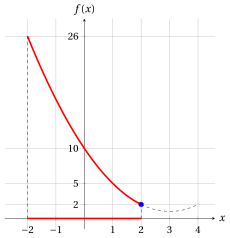
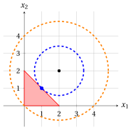
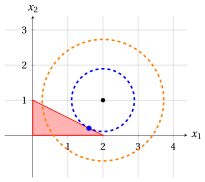

# Exercises · Convex and concave optimization problems

**Exercises · Chapter 6** · each solution opens with a click · [:material-book-open-variant: Chapter 6: Convex and concave optimization problems](../problems/06-convex-concave-problems.md) · [:material-file-pdf-box: Exercises, volume 2 (PDF)](../pdf/exercises-2-optimization-problems.pdf)

## Problems in one variable

In the exercises of this chapter, convexity and concavity of the objective functions are proved only with the definitions of the chapter «Convex and concave functions», using the inequality

$$
\big(\lambda a+(1-\lambda)b\big)^2 \le \lambda a^2+(1-\lambda)b^2, \qquad \forall a,b\in\R,~ \forall \lambda\in[0,1]
$$

of the same chapter. The feasible regions are described by constraints $g_i({\boldsymbol x}) \le 0$: when every function $g_i$ is convex, the feasible region is a convex set, by the property of the sets defined by convex functions of the chapter «Convex and concave functions».

!!! esercizio "Exercise 6.1: Convex and concave optimization problems (E1)"

    Consider the following optimization problem:

    $$
    \min \bigg\{\, (x-3)^2 + 1 \ \text{ subject to } \ x^2 - 4 \le 0 \,\bigg\}
    $$

    with objective function $f:\R \to \R,~ f: x \mapsto (x-3)^2+1$ and feasible region $F = \{\, x \in \R : x^2 - 4 \le 0 \,\}$.

    **Questions**

    1. Prove that the function $g:\R \to \R,~ g: x \mapsto x^2 - 4$ is convex in its domain, deduce that the feasible region is a convex set and describe it as an interval.

    2. Prove that the objective function is convex in its domain, and deduce that the problem is a convex minimization problem.

    3. Draw the graph of the objective function over the feasible region.

    4. Prove that the point $x=2$ is a point of local minimum, and deduce the optimal solution and the optimal value of the problem.

??? soluzione "Solution"

    1. To prove that the function $g$ is convex in its domain, we observe that for every pair of points $p,w\in\R$ and every $\lambda\in[0,1]$, we have:

        \begin{align*}
        g\big(\lambda p+(1-\lambda)w\big)
        &= \big(\lambda p+(1-\lambda)w\big)^2 - \lambda\,4 - (1-\lambda)\,4 \\[1ex]
        &\qquad (\text{since } \lambda + (1-\lambda) = 1) \\[2ex]
        &\le \lambda p^2+(1-\lambda)w^2 - \lambda\,4 - (1-\lambda)\,4 \\[1ex]
        &\qquad \text{(since } \big(\lambda a+(1-\lambda)b\big)^2\le \lambda a^2+(1-\lambda)b^2\text{)} \\[2ex]
        &= \lambda\,(p^2-4)+(1-\lambda)\,(w^2-4) \\[2ex]
        &= \lambda\, g(p)+(1-\lambda)\, g(w)
        \end{align*}

        Therefore,

        $$
        g\big(\lambda p + (1-\lambda) w\big) \le \lambda\, g(p) + (1-\lambda)\, g(w)
        $$

        By nature, the domain $\R$ is a convex set. Accordingly, the function $g$ is convex in its domain.

        The feasible region $F = \{\, x \in \R : g(x) \le 0 \,\}$ is defined by a constraint with a convex function, so it is a convex set. Since $x^2 - 4 = (x-2)(x+2) \le 0$ if and only if $-2 \le x \le 2$, the feasible region is the interval $F = [-2,2]$.

    2. To prove that the objective function is convex in its domain, we observe that for every pair of points $p,w\in\R$ and every $\lambda\in[0,1]$, we have:

        \begin{align*}
        f\big(\lambda p+(1-\lambda)w\big)
        &= \big(\lambda (p-3)+(1-\lambda)(w-3)\big)^2 + \lambda + (1-\lambda) \\[1ex]
        &\qquad (\text{since } \lambda + (1-\lambda) = 1) \\[2ex]
        &\le \lambda (p-3)^2+(1-\lambda)(w-3)^2 + \lambda + (1-\lambda) \\[1ex]
        &\qquad \text{(since } \big(\lambda a+(1-\lambda)b\big)^2\le \lambda a^2+(1-\lambda)b^2\text{)} \\[2ex]
        &= \lambda \big((p-3)^2+1\big)+(1-\lambda)\big((w-3)^2+1\big) \\[2ex]
        &= \lambda f(p)+(1-\lambda)f(w)
        \end{align*}

        Therefore,

        $$
        f\big(\lambda p + (1-\lambda) w\big) \le \lambda f(p) + (1-\lambda) f(w)
        $$

        By nature, the domain $\R$ is a convex set. Accordingly, the function is convex in its domain, and in particular over the convex feasible region $F$: the problem is a convex minimization problem.

    3. We have $f(-2) = 26$, $f(0) = 10$, $f(1) = 5$ and $f(2) = 2$. The graph of the objective function over the feasible region is red, the feasible region is the red part of the $x$-axis and the optimal solution of the last question is blue; the dashed part of the graph lies outside the feasible region, and its lowest point $x=3$ is not feasible.

        { .fig .ovale loading=lazy style="width:50%" }

    4. In the neighborhood $N\big((2),1\big) = (1,3)$, the feasible points are those of $N\big((2),1\big) \cap F = (1,2]$. For every such point we have $-2 < x-3 \le -1$, then $(x-3)^2 \ge 1$ and

        $$
        f(x) = (x-3)^2+1 \ge 2 = f(2), \qquad \forall x \in N\big((2),1\big) \cap F = (1,2].
        $$

        The point $x=2$ is a point of local minimum. Since the problem is a convex minimization problem, by the proposition «local minima of convex minimization problems» of the chapter «Convex and concave optimization problems», the point $x=2$ is also a point of minimum. The optimal solution and the optimal value are:

        $$
        \tilde{\boldsymbol x}(P) = (2)
        \qquad \text{and} \qquad
        z(P) = f(2) = 2.
        $$

        The optimal solution lies on the boundary of the feasible region: the point $x=3$, where the objective function attains its smallest value $1$ over $\R$, is not feasible.

!!! esercizio "Exercise 6.2: Convex and concave optimization problems (E3)"

    Consider the following objective function and feasible region:

    $$
    f:\R \to \R,~ f: x \mapsto 3 - (x-1)^2
    \qquad \text{and} \qquad
    F = \{\, x \in \R : -1 \le x \le 4 \,\} = [-1,4],
    $$

    and the associated optimization problems in minimization and maximization forms:

    \begin{gather*}
    \min \bigg\{\, 3 - (x-1)^2 \ \text{ subject to } \ -1 \le x \le 4 \,\bigg\}
    \\[1ex] \text{and} \\[1ex]
    \max \bigg\{\, 3 - (x-1)^2 \ \text{ subject to } \ -1 \le x \le 4 \,\bigg\}
    \end{gather*}

    **Questions**

    1. Prove that the objective function is concave in its domain and that it is not convex over $F$, using the points $p=-1$, $w=3$ and the scalar $\lambda=\frac{1}{2}$. Is the minimization problem a convex minimization problem?

    2. Draw the graph of the objective function over the feasible region.

    3. Prove that $x=-1$ is a point of local minimum, but not a point of minimum. Find the optimal solution and the optimal value of the minimization problem.

    4. Explain why the previous question does not contradict the proposition «local minima of convex minimization problems».

    5. Prove that $x=1$ is a point of local maximum, and deduce the optimal solution and the optimal value of the maximization problem.

??? soluzione "Solution"

    1. To prove that the function is concave in its domain, we observe that for every pair of points $p,w\in\R$ and every $\lambda\in[0,1]$, we have:

        \begin{align*}
        f\big(\lambda p+(1-\lambda)w\big)
        &= \lambda\,3 + (1-\lambda)\,3 - \big(\lambda (p-1)+(1-\lambda)(w-1)\big)^2 \\[1ex]
        &\qquad (\text{since } \lambda + (1-\lambda) = 1) \\[2ex]
        &\ge \lambda\,3 + (1-\lambda)\,3 - \lambda (p-1)^2-(1-\lambda)(w-1)^2 \\[1ex]
        &\qquad \text{(since } \big(\lambda a+(1-\lambda)b\big)^2\le \lambda a^2+(1-\lambda)b^2\text{,} \\
        &\qquad \phantom{\text{(}}\text{and $-1$ reverses the inequality)} \\[2ex]
        &= \lambda \big(3-(p-1)^2\big)+(1-\lambda)\big(3-(w-1)^2\big) \\[2ex]
        &= \lambda f(p)+(1-\lambda)f(w)
        \end{align*}

        Therefore,

        $$
        f\big(\lambda p + (1-\lambda) w\big) \ge \lambda f(p) + (1-\lambda) f(w)
        $$

        By nature, the domain $\R$ is a convex set. Accordingly, the function is concave in its domain.

        With $p=-1$, $w=3$ and $\lambda=\frac{1}{2}$, both points belong to $F$, $\lambda p + (1-\lambda) w = 1$ and

        $$
        f(1) = 3 \;>\; -1 = \frac{1}{2}\, f(-1) + \frac{1}{2}\, f(3) = \frac{1}{2}\cdot(-1) + \frac{1}{2}\cdot(-1):
        $$

        the inequality of the definition of convex function does not hold, and the objective function is not convex over $F$. The minimization problem is <strong>not</strong> a convex minimization problem, although its feasible region is convex.

    2. We have $f(-1) = -1$, $f(1) = 3$, $f(3) = -1$ and $f(4) = -6$. The graph of the objective function over the feasible region is red and the feasible region is the red part of the $x$-axis; the optimal solutions of the two problems are blue and the point of local minimum that is not a point of minimum is violet.

        { .fig .ovale loading=lazy style="width:50%" }

    3. In the neighborhood $N\big((-1),1\big) = (-2,0)$, the feasible points are those of $N\big((-1),1\big) \cap F = [-1,0)$. For every such point we have $-2 \le x-1 < -1$, then $(x-1)^2 \le 4$ and

        $$
        f(x) = 3-(x-1)^2 \ge -1 = f(-1), \qquad \forall x \in N\big((-1),1\big) \cap F = [-1,0).
        $$

        The point $x=-1$ is a point of local minimum. It is not a point of minimum, since $4 \in F$ and $f(4) = -6 < -1 = f(-1)$.

        For every $x \in F$ we have $-2 \le x-1 \le 3$, then $(x-1)^2 \le 9$ and $f(x) = 3-(x-1)^2 \ge -6 = f(4)$, with equality only if $x-1 = 3$, that is, $x=4$ (the value $x-1=-3$ is not feasible). The unique optimal solution and the optimal value of the minimization problem are:

        $$
        \tilde{\boldsymbol x}(P) = (4)
        \qquad \text{and} \qquad
        z(P) = -6.
        $$

    4. The proposition «local minima of convex minimization problems» of the chapter «Convex and concave optimization problems» requires an objective function convex over the feasible region. By the first question, the objective function is not convex over $F$: the minimization problem is not a convex minimization problem, and one of its points of local minimum is not a point of minimum. A method that only explores the points close to $x=-1$ stops at the point of local minimum $x=-1$, with local minimum $f(-1) = -1$, while the optimal value is $-6$.

    5. In the neighborhood $N\big((1),1\big) = (0,2)$, all points are feasible and

        $$
        f(x) = 3-(x-1)^2 \le 3 = f(1), \qquad \forall x \in N\big((1),1\big) \cap F = (0,2).
        $$

        The point $x=1$ is a point of local maximum. By the first question, the objective function is concave over the convex feasible region $F$, and the maximization problem is a concave maximization problem. By the corollary «local maxima of concave maximization problems» of the chapter «Convex and concave optimization problems», the point $x=1$ is also a point of maximum, and the optimal solution and the optimal value of the maximization problem are:

        $$
        \tilde{\boldsymbol x}(P) = (1)
        \qquad \text{and} \qquad
        z(P) = 3.
        $$

## Problems in two variables

!!! esercizio "Exercise 6.3: Convex and concave optimization problems (E2)"

    Consider the following optimization problem:

    $$
    \min \bigg\{\, (x_1-2)^2 + (x_2-2)^2 \ \text{ subject to } \ x_1 + x_2 \le 2,~ x_1 \ge 0,~ x_2 \ge 0 \,\bigg\}
    $$

    with objective function $f:\R^2 \to \R,~ f: {\boldsymbol x} \mapsto (x_1-2)^2 + (x_2-2)^2$ and feasible region $F$.

    **Questions**

    1. Prove that the feasible region is a convex set.

    2. Prove that the objective function is convex in its domain, and deduce that the problem is a convex minimization problem.

    3. Describe the level sets of the objective function for $k=2$ and $k=8$, and draw them together with the feasible region.

    4. Prove that ${\boldsymbol x} = \begin{pmatrix} 1 \\ 1 \end{pmatrix}$ is the unique optimal solution and compute the optimal value.

    5. Does the problem have a point of local minimum different from $\begin{pmatrix} 1 \\ 1 \end{pmatrix}$?

??? soluzione "Solution"

    1. The feasible region is the set of the points that satisfy the three constraints

        $$
        g_1({\boldsymbol x}) = x_1 + x_2 - 2 \le 0, \qquad g_2({\boldsymbol x}) = -x_1 \le 0, \qquad g_3({\boldsymbol x}) = -x_2 \le 0 .
        $$

        Each function $g_i$ is linear, and it is convex, since the definition holds with equality: for every pair of points ${\boldsymbol p}, {\boldsymbol w} \in \R^2$ and every $\lambda \in [0,1]$, we have

        $$
        g_1\big(\lambda {\boldsymbol p}+(1-\lambda){\boldsymbol w}\big) = \lambda\,(p_1+p_2-2) + (1-\lambda)\,(w_1+w_2-2) = \lambda\, g_1({\boldsymbol p}) + (1-\lambda)\, g_1({\boldsymbol w}),
        $$

        and in the same way for $g_2$ and $g_3$. The feasible region is defined by constraints with convex functions, so it is a convex set: it is the triangle with vertices $\begin{pmatrix} 0 \\ 0 \end{pmatrix}$, $\begin{pmatrix} 2 \\ 0 \end{pmatrix}$ and $\begin{pmatrix} 0 \\ 2 \end{pmatrix}$, intersection of three half-planes.

    2. To prove that the objective function is convex in its domain, we observe that for every pair of points ${\boldsymbol p}, {\boldsymbol w} \in \R^2$ and every $\lambda \in [0,1]$, we have:

        \begin{align*}
        f\big(\lambda {\boldsymbol p}+(1-\lambda){\boldsymbol w}\big)
        &= \big(\lambda (p_1-2)+(1-\lambda)(w_1-2)\big)^2 \\
        &\qquad + \big(\lambda (p_2-2)+(1-\lambda)(w_2-2)\big)^2 \\[1ex]
        &\qquad (\text{since } \lambda + (1-\lambda) = 1) \\[2ex]
        &\le \lambda (p_1-2)^2+(1-\lambda)(w_1-2)^2 + \lambda (p_2-2)^2+(1-\lambda)(w_2-2)^2 \\[1ex]
        &\qquad \text{(since } \big(\lambda a+(1-\lambda)b\big)^2\le \lambda a^2+(1-\lambda)b^2\text{,} \\
        &\qquad \phantom{\text{(}}\text{twice)} \\[2ex]
        &= \lambda \big((p_1-2)^2+(p_2-2)^2\big)+(1-\lambda)\big((w_1-2)^2+(w_2-2)^2\big) \\[2ex]
        &= \lambda f({\boldsymbol p})+(1-\lambda)f({\boldsymbol w})
        \end{align*}

        Therefore,

        $$
        f\big(\lambda {\boldsymbol p} + (1-\lambda) {\boldsymbol w}\big) \le \lambda f({\boldsymbol p}) + (1-\lambda) f({\boldsymbol w})
        $$

        By nature, the domain $\R^2$ is a convex set. Accordingly, the function is convex in its domain, and in particular over the convex feasible region $F$: the problem is a convex minimization problem.

    3. The level set for $k$ is the set of the points with $(x_1-2)^2 + (x_2-2)^2 = k$, that is, the circle centered at $\begin{pmatrix} 2 \\ 2 \end{pmatrix}$ with radius $\sqrt{k}$. For $k=2$, the radius is $\sqrt{2}$ and the circle passes through $\begin{pmatrix} 1 \\ 1 \end{pmatrix}$, since $1+1=2$; for $k=8$, the radius is $2\sqrt{2}$ and the circle passes through $\begin{pmatrix} 0 \\ 0 \end{pmatrix}$, since $4+4=8$. In the figure, the feasible region is red, the level set $k=2$ is blue, the level set $k=8$ is orange and the optimal solution of the next question is blue: the circle $k=2$ touches the feasible region only at this point.

        { .fig .ovale loading=lazy style="width:50%" }

    4. For every feasible point ${\boldsymbol x}$, let $a = x_1 - 2$ and $b = x_2 - 2$. Since $x_1 + x_2 \le 2$, we have $a + b = x_1 + x_2 - 4 \le -2$, and then $(a+b)^2 \ge 4$. Moreover, $2\,(a^2+b^2) - (a+b)^2 = (a-b)^2 \ge 0$. Therefore:

        $$
        f({\boldsymbol x}) = a^2 + b^2 \ge \frac{(a+b)^2}{2} \ge \frac{4}{2} = 2 = f\left(\begin{pmatrix} 1 \\ 1 \end{pmatrix}\right), \qquad \forall {\boldsymbol x} \in F,
        $$

        and the point $\begin{pmatrix} 1 \\ 1 \end{pmatrix}$ is feasible, since $1+1 = 2$. Equality holds only if $a = b$ and $a + b = -2$, that is, $a=b=-1$ and ${\boldsymbol x} = \begin{pmatrix} 1 \\ 1 \end{pmatrix}$. The unique optimal solution and the optimal value are:

        $$
        \tilde{\boldsymbol x}(P) = \begin{pmatrix} 1 \\ 1 \end{pmatrix}
        \qquad \text{and} \qquad
        z(P) = 2.
        $$

    5. No. The problem is a convex minimization problem: by the proposition «local minima of convex minimization problems» of the chapter «Convex and concave optimization problems», every point of local minimum is a point of minimum, that is, an optimal solution, and the optimal solution is unique.

!!! esercizio "Exercise 6.4: Convex and concave optimization problems (E4)"

    Consider the following optimization problem:

    $$
    \max \bigg\{\, 4\,x_1 + 2\,x_2 - x_1^2 - x_2^2 \ \text{ subject to } \ x_1 + 2\,x_2 \le 2,~ x_1 \ge 0,~ x_2 \ge 0 \,\bigg\}
    $$

    with objective function $f:\R^2 \to \R,~ f: {\boldsymbol x} \mapsto 4\,x_1 + 2\,x_2 - x_1^2 - x_2^2$ and feasible region $F$.

    **Questions**

    1. Complete the squares to write the objective function as $f({\boldsymbol x}) = c - (x_1-\alpha_1)^2 - (x_2-\alpha_2)^2$, with $c, \alpha_1, \alpha_2 \in \R$.

    2. Prove that the feasible region is a convex set and that the objective function is concave in its domain. What kind of problem is it?

    3. Describe the level sets of the objective function for $k=2$ and $k=\frac{21}{5}$, and draw them together with the feasible region.

    4. Prove that ${\boldsymbol x} = \begin{pmatrix} 8/5 \\ 1/5 \end{pmatrix}$ is the unique optimal solution and compute the optimal value.

    5. Does the problem have a point of local maximum different from $\begin{pmatrix} 8/5 \\ 1/5 \end{pmatrix}$?

??? soluzione "Solution"

    1. Since $x_1^2 - 4\,x_1 = (x_1-2)^2 - 4$ and $x_2^2 - 2\,x_2 = (x_2-1)^2 - 1$, we have:

        $$
        f({\boldsymbol x}) = -\big(x_1^2 - 4\,x_1\big) - \big(x_2^2 - 2\,x_2\big) = 5 - (x_1-2)^2 - (x_2-1)^2,
        $$

        that is, $c = 5$, $\alpha_1 = 2$ and $\alpha_2 = 1$. The objective function is at most $5$, and equals $5$ only at $\begin{pmatrix} 2 \\ 1 \end{pmatrix}$, which is not feasible, since $2 + 2\cdot 1 = 4 > 2$.

    2. The feasible region is the set of the points that satisfy the three constraints

        $$
        g_1({\boldsymbol x}) = x_1 + 2\,x_2 - 2 \le 0, \qquad g_2({\boldsymbol x}) = -x_1 \le 0, \qquad g_3({\boldsymbol x}) = -x_2 \le 0 .
        $$

        Each function $g_i$ is linear, and it is convex, since the definition holds with equality: for every pair of points ${\boldsymbol p}, {\boldsymbol w} \in \R^2$ and every $\lambda \in [0,1]$, we have

        $$
        g_1\big(\lambda {\boldsymbol p}+(1-\lambda){\boldsymbol w}\big) = \lambda\,(p_1+2\,p_2-2) + (1-\lambda)\,(w_1+2\,w_2-2) = \lambda\, g_1({\boldsymbol p}) + (1-\lambda)\, g_1({\boldsymbol w}),
        $$

        and in the same way for $g_2$ and $g_3$. The feasible region is defined by constraints with convex functions, so it is a convex set: it is the triangle with vertices $\begin{pmatrix} 0 \\ 0 \end{pmatrix}$, $\begin{pmatrix} 2 \\ 0 \end{pmatrix}$ and $\begin{pmatrix} 0 \\ 1 \end{pmatrix}$.

        To prove that the objective function is concave in its domain, we observe that for every pair of points ${\boldsymbol p}, {\boldsymbol w} \in \R^2$ and every $\lambda \in [0,1]$, we have:

        \begin{align*}
        f\big(\lambda {\boldsymbol p}+(1-\lambda){\boldsymbol w}\big)
        &= \lambda\,5 + (1-\lambda)\,5 - \big(\lambda (p_1-2)+(1-\lambda)(w_1-2)\big)^2 \\
        &\qquad - \big(\lambda (p_2-1)+(1-\lambda)(w_2-1)\big)^2 \\[1ex]
        &\qquad (\text{since } \lambda + (1-\lambda) = 1) \\[2ex]
        &\ge \lambda\,5 + (1-\lambda)\,5 - \lambda (p_1-2)^2-(1-\lambda)(w_1-2)^2 \\
        &\qquad - \lambda (p_2-1)^2-(1-\lambda)(w_2-1)^2 \\[1ex]
        &\qquad \text{(since } \big(\lambda a+(1-\lambda)b\big)^2\le \lambda a^2+(1-\lambda)b^2\text{, twice,} \\
        &\qquad \phantom{\text{(}}\text{and $-1$ reverses the inequality)} \\[2ex]
        &= \lambda \big(5-(p_1-2)^2-(p_2-1)^2\big) \\
        &\qquad +(1-\lambda)\big(5-(w_1-2)^2-(w_2-1)^2\big) \\[2ex]
        &= \lambda f({\boldsymbol p})+(1-\lambda)f({\boldsymbol w})
        \end{align*}

        Therefore,

        $$
        f\big(\lambda {\boldsymbol p} + (1-\lambda) {\boldsymbol w}\big) \ge \lambda f({\boldsymbol p}) + (1-\lambda) f({\boldsymbol w})
        $$

        By nature, the domain $\R^2$ is a convex set. Accordingly, the function is concave in its domain, and in particular over the convex feasible region $F$: the problem is a <strong>concave maximization problem</strong>.

    3. The level set for $k < 5$ is the set of the points with $(x_1-2)^2 + (x_2-1)^2 = 5-k$, that is, the circle centered at $\begin{pmatrix} 2 \\ 1 \end{pmatrix}$ with radius $\sqrt{5-k}$. For $k=2$, the radius is $\sqrt{3}$; for $k=\frac{21}{5}$, the radius is $\sqrt{\frac{4}{5}} = \frac{2}{\sqrt{5}}$ and the circle passes through $\begin{pmatrix} 8/5 \\ 1/5 \end{pmatrix}$, since $\big(\frac{2}{5}\big)^2 + \big(\frac{4}{5}\big)^2 = \frac{4}{5}$. In the figure, the feasible region is red, the level set $k=2$ is orange, the level set $k=\frac{21}{5}$ is blue and the optimal solution of the next question is blue: the circle $k=\frac{21}{5}$ touches the feasible region only at this point, on the side $x_1 + 2\,x_2 = 2$.

        { .fig .ovale loading=lazy style="width:50%" }

    4. For every feasible point ${\boldsymbol x}$, let $a = x_1 - 2$ and $b = x_2 - 1$, so that $f({\boldsymbol x}) = 5 - (a^2+b^2)$. Since $x_1 + 2\,x_2 \le 2$, we have $a + 2\,b = x_1 + 2\,x_2 - 4 \le -2$, and then $(a+2\,b)^2 \ge 4$. Moreover, $5\,(a^2+b^2) - (a+2\,b)^2 = 4\,a^2 - 4\,ab + b^2 = (2\,a-b)^2 \ge 0$. Therefore:

        $$
        a^2 + b^2 \ge \frac{(a+2\,b)^2}{5} \ge \frac{4}{5}
        \qquad \text{and} \qquad
        f({\boldsymbol x}) = 5 - (a^2+b^2) \le 5 - \frac{4}{5} = \frac{21}{5}, \qquad \forall {\boldsymbol x} \in F.
        $$

        Equality holds only if $b = 2\,a$ and $a + 2\,b = -2$, that is, $5\,a = -2$, $a = -\frac{2}{5}$, $b = -\frac{4}{5}$ and ${\boldsymbol x} = \begin{pmatrix} 8/5 \\ 1/5 \end{pmatrix}$. This point is feasible, since $\frac{8}{5} + \frac{2}{5} = 2$, $\frac{8}{5} \ge 0$ and $\frac{1}{5} \ge 0$, and

        $$
        f\left(\begin{pmatrix} 8/5 \\ 1/5 \end{pmatrix}\right) = \frac{32}{5} + \frac{2}{5} - \frac{64}{25} - \frac{1}{25} = \frac{34}{5} - \frac{13}{5} = \frac{21}{5}.
        $$

        The unique optimal solution and the optimal value are:

        $$
        \tilde{\boldsymbol x}(P) = \begin{pmatrix} 8/5 \\ 1/5 \end{pmatrix}
        \qquad \text{and} \qquad
        z(P) = \frac{21}{5}.
        $$

    5. No. The problem is a concave maximization problem: by the corollary «local maxima of concave maximization problems» of the chapter «Convex and concave optimization problems», every point of local maximum is a point of maximum, that is, an optimal solution, and the optimal solution is unique.

!!! esercizio "Exercise 6.5: Convex and concave optimization problems (E5)"

    Consider the objective function

    $$
    f:\R^2 \to \R,~ f: {\boldsymbol x} \mapsto (x_1-3)^2 + (x_2-3)^2
    $$

    and the two optimization problems:

    \begin{gather*}
    (P_1)~~ \min \bigg\{\, f({\boldsymbol x}) \ \text{ subject to } \ x_1^2 + x_2^2 - 2 \le 0 \,\bigg\}
    \\[1ex] \text{and} \\[1ex]
    (P_2)~~ \min \bigg\{\, f({\boldsymbol x}) \ \text{ subject to } \ x_1^2 + x_2^2 - 2 \ge 0 \,\bigg\}
    \end{gather*}

    with feasible regions $F_1$ and $F_2$, respectively.

    **Questions**

    1. Prove that the function $g:\R^2 \to \R,~ g: {\boldsymbol x} \mapsto x_1^2 + x_2^2 - 2$ is convex in its domain, and deduce that $F_1$ is a convex set.

    2. Prove that $F_2$ is not a convex set, using the points $\begin{pmatrix} 2 \\ 0 \end{pmatrix}$, $\begin{pmatrix} -2 \\ 0 \end{pmatrix}$ and the scalar $\lambda = \frac{1}{2}$.

    3. Prove that the objective function is convex in its domain. Which of the two problems is a convex minimization problem?

    4. Describe the level sets of the objective function for $k=8$ and $k=18$, and draw them together with the feasible region $F_1$.

    5. Prove that ${\boldsymbol x} = \begin{pmatrix} 1 \\ 1 \end{pmatrix}$ is the unique optimal solution of $(P_1)$ and compute the optimal value.

??? soluzione "Solution"

    1. To prove that the function $g$ is convex in its domain, we observe that for every pair of points ${\boldsymbol p}, {\boldsymbol w} \in \R^2$ and every $\lambda \in [0,1]$, we have:

        \begin{align*}
        g\big(\lambda {\boldsymbol p}+(1-\lambda){\boldsymbol w}\big)
        &= \big(\lambda p_1+(1-\lambda)w_1\big)^2 + \big(\lambda p_2+(1-\lambda)w_2\big)^2 - \lambda\,2 - (1-\lambda)\,2 \\[1ex]
        &\qquad (\text{since } \lambda + (1-\lambda) = 1) \\[2ex]
        &\le \lambda p_1^2+(1-\lambda)w_1^2 + \lambda p_2^2+(1-\lambda)w_2^2 - \lambda\,2 - (1-\lambda)\,2 \\[1ex]
        &\qquad \text{(since } \big(\lambda a+(1-\lambda)b\big)^2\le \lambda a^2+(1-\lambda)b^2\text{,} \\
        &\qquad \phantom{\text{(}}\text{twice)} \\[2ex]
        &= \lambda \big(p_1^2+p_2^2-2\big)+(1-\lambda)\big(w_1^2+w_2^2-2\big) \\[2ex]
        &= \lambda\, g({\boldsymbol p})+(1-\lambda)\, g({\boldsymbol w})
        \end{align*}

        Therefore,

        $$
        g\big(\lambda {\boldsymbol p} + (1-\lambda) {\boldsymbol w}\big) \le \lambda\, g({\boldsymbol p}) + (1-\lambda)\, g({\boldsymbol w})
        $$

        By nature, the domain $\R^2$ is a convex set. Accordingly, the function $g$ is convex in its domain. The feasible region $F_1 = \{\, {\boldsymbol x} \in \R^2 : g({\boldsymbol x}) \le 0 \,\}$ is defined by a constraint with a convex function, so it is a convex set: it is the disk centered at the origin with radius $\sqrt{2}$.

    2. The two points belong to $F_2$, since $2^2 + 0^2 - 2 = 2 \ge 0$ and $(-2)^2 + 0^2 - 2 = 2 \ge 0$. With $\lambda = \frac{1}{2}$, their convex combination is

        $$
        \frac{1}{2}\begin{pmatrix} 2 \\ 0 \end{pmatrix} + \frac{1}{2}\begin{pmatrix} -2 \\ 0 \end{pmatrix} = \begin{pmatrix} 0 \\ 0 \end{pmatrix},
        \qquad \text{with} \qquad
        0^2 + 0^2 - 2 = -2 < 0,
        $$

        and it does not belong to $F_2$. The set $F_2$ (the points outside the open disk of radius $\sqrt{2}$) is not convex.

    3. To prove that the objective function is convex in its domain, we observe that for every pair of points ${\boldsymbol p}, {\boldsymbol w} \in \R^2$ and every $\lambda \in [0,1]$, we have:

        \begin{align*}
        f\big(\lambda {\boldsymbol p}+(1-\lambda){\boldsymbol w}\big)
        &= \big(\lambda (p_1-3)+(1-\lambda)(w_1-3)\big)^2 \\
        &\qquad + \big(\lambda (p_2-3)+(1-\lambda)(w_2-3)\big)^2 \\[1ex]
        &\qquad (\text{since } \lambda + (1-\lambda) = 1) \\[2ex]
        &\le \lambda (p_1-3)^2+(1-\lambda)(w_1-3)^2 + \lambda (p_2-3)^2+(1-\lambda)(w_2-3)^2 \\[1ex]
        &\qquad \text{(since } \big(\lambda a+(1-\lambda)b\big)^2\le \lambda a^2+(1-\lambda)b^2\text{,} \\
        &\qquad \phantom{\text{(}}\text{twice)} \\[2ex]
        &= \lambda \big((p_1-3)^2+(p_2-3)^2\big)+(1-\lambda)\big((w_1-3)^2+(w_2-3)^2\big) \\[2ex]
        &= \lambda f({\boldsymbol p})+(1-\lambda)f({\boldsymbol w})
        \end{align*}

        Therefore,

        $$
        f\big(\lambda {\boldsymbol p} + (1-\lambda) {\boldsymbol w}\big) \le \lambda f({\boldsymbol p}) + (1-\lambda) f({\boldsymbol w})
        $$

        By nature, the domain $\R^2$ is a convex set. Accordingly, the function is convex in its domain. The problem $(P_1)$ is a convex minimization problem, since its feasible region is convex and the objective function is convex over it. The problem $(P_2)$ is not a convex optimization problem, since its feasible region is not convex: the definition requires a convex feasible region, whatever the objective function.

    4. The level set for $k$ is the set of the points with $(x_1-3)^2 + (x_2-3)^2 = k$, that is, the circle centered at $\begin{pmatrix} 3 \\ 3 \end{pmatrix}$ with radius $\sqrt{k}$. For $k=8$, the radius is $2\sqrt{2}$ and the circle passes through $\begin{pmatrix} 1 \\ 1 \end{pmatrix}$, since $4+4=8$; for $k=18$, the radius is $3\sqrt{2}$ and the circle passes through $\begin{pmatrix} 0 \\ 0 \end{pmatrix}$, since $9+9=18$. In the figure, the feasible region $F_1$ is red, the level set $k=8$ is blue, the level set $k=18$ is orange and the optimal solution of the next question is blue: the circle $k=8$ touches the disk $F_1$ only at this point.

        { .fig .ovale loading=lazy style="width:50%" }

    5. We write the objective function as

        $$
        f({\boldsymbol x}) = x_1^2 - 6\,x_1 + 9 + x_2^2 - 6\,x_2 + 9 = q - 6\,s + 18,
        \qquad \text{with} \qquad
        q = x_1^2 + x_2^2, \quad s = x_1 + x_2 .
        $$

        Since $2\,q - s^2 = (x_1 - x_2)^2 \ge 0$, we have $q \ge \frac{s^2}{2}$. For every ${\boldsymbol x} \in F_1$ we have $q \le 2$, then $s^2 \le 2\,q \le 4$ and $s \le 2$. Therefore:

        \begin{align*}
        f({\boldsymbol x}) &= q - 6\,s + 18 \ge \frac{s^2}{2} - 6\,s + 18 = \frac{(s-6)^2}{2} \\[1ex]
        &\ge \frac{(2-6)^2}{2} = 8 = f\left(\begin{pmatrix} 1 \\ 1 \end{pmatrix}\right), \qquad \forall {\boldsymbol x} \in F_1,
        \end{align*}

        where the last inequality holds since $6 - s \ge 4 > 0$. The point $\begin{pmatrix} 1 \\ 1 \end{pmatrix}$ is feasible, since $1 + 1 - 2 = 0$. Equality holds only if $x_1 = x_2$ and $s = 2$, that is, ${\boldsymbol x} = \begin{pmatrix} 1 \\ 1 \end{pmatrix}$. The unique optimal solution and the optimal value of $(P_1)$ are:

        $$
        \tilde{\boldsymbol x}(P_1) = \begin{pmatrix} 1 \\ 1 \end{pmatrix}
        \qquad \text{and} \qquad
        z(P_1) = 8.
        $$

        By the proposition «local minima of convex minimization problems» of the chapter «Convex and concave optimization problems», $(P_1)$ has no other point of local minimum.
