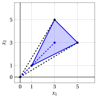
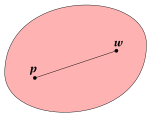
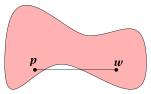
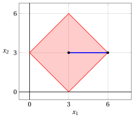
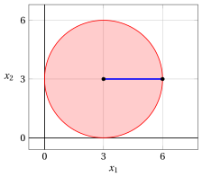
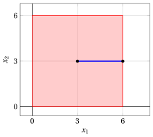
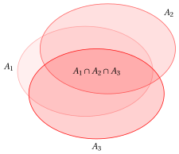

# Convex sets

**Part 1 · Preliminaries · Chapter 1** · [:material-file-pdf-box: Lecture notes, volume 1 (PDF)](../pdf/lecture-notes-1-preliminaries.pdf) · [:material-presentation: Slides](../pdf/slides-01-convex-sets.pdf) · [:material-pencil: Exercises](../exercises/ex-01-convex-sets.md)

## 1.1 Convex combination

!!! definizione "Definition 1.1: convex combination"

    Given two points

    $$
    \underbrace{
    \begin{pmatrix}
    p_1 \\
    p_2 \\
    \vdots \\
    p_n
    \end{pmatrix}
    }_{{\boldsymbol p}} \in \mathbb{R}^{n}
    \qquad \text{and} \qquad
    \underbrace{
    \begin{pmatrix}
    w_1 \\
    w_2 \\
    \vdots \\
    w_n
    \end{pmatrix}
    }_{{\boldsymbol w}} \in \mathbb{R}^{n}
    $$

    their <strong>convex combination</strong> with a scalar $\lambda \in [0,1]$ is the point

    $$
    \underbrace{
    \begin{pmatrix}
    \lambda p_1 + (1-\lambda) w_1 \\
    \lambda p_2 + (1-\lambda) w_2 \\
    \vdots \\
    \lambda p_n + (1-\lambda) w_n
    \end{pmatrix}
    }_{\;\lambda {\boldsymbol p} + (1-\lambda){\boldsymbol w}}
    $$

- The convex combinations for all values $\lambda \in [0,1]$ are the points on the segment connecting the two points ${\boldsymbol p}$ and ${\boldsymbol w}$. In $\R^2$, the blue segment of the following figure:

    { .fig .ovale loading=lazy style="width:82%" }

!!! esempio "Example 1.1: convex combination"

    Let us consider the points $\begin{pmatrix}2 \\[0.3ex] 5\end{pmatrix}$ and $\begin{pmatrix}5 \\[0.3ex] 2\end{pmatrix}$ in $\mathbb{R}^2$. Their convex combination with $\lambda = \tfrac{1}{3}$ is the point:

    $$
    \begin{pmatrix}
    \tfrac{1}{3}\cdot 2 + \!\left(1-\tfrac{1}{3}\right)\!5 \\[1.2ex]
    \tfrac{1}{3}\cdot 5 + \!\left(1-\tfrac{1}{3}\right)\!2
    \end{pmatrix}
    =\;\begin{pmatrix}4 \\[0.3ex] 3\end{pmatrix}
    $$

    { .fig .ovale loading=lazy style="width:71%" }

!!! definizione "Definition 1.2: convex combination of $m$ points"

    Given $m$ points

    $$
    \underbrace{
    \begin{pmatrix}
    p^{(1)}_1 \\
    p^{(1)}_2 \\
    \vdots \\
    p^{(1)}_n
    \end{pmatrix}
    }_{{\boldsymbol p}^{(1)}} \in \mathbb{R}^{n}
    \qquad
    \underbrace{
    \begin{pmatrix}
    p^{(2)}_1 \\
    p^{(2)}_2 \\
    \vdots \\
    p^{(2)}_n
    \end{pmatrix}
    }_{{\boldsymbol p}^{(2)}} \in \mathbb{R}^{n}
    \qquad \cdots \qquad
    \underbrace{
    \begin{pmatrix}
    p^{(m)}_1 \\
    p^{(m)}_2 \\
    \vdots \\
    p^{(m)}_n
    \end{pmatrix}
    }_{{\boldsymbol p}^{(m)}} \in \mathbb{R}^{n}
    $$

    their <strong>convex combination</strong> with scalars $\lambda_1, \lambda_2, \ldots, \lambda_m \ge 0$ satisfying

    $$
    \sum_{k=1}^{m} \lambda_k = 1
    $$

    is the point

    $$
    \underbrace{
    \begin{pmatrix}
    \lambda_1\, p^{(1)}_1 + \lambda_2\, p^{(2)}_1 + \cdots + \lambda_m\, p^{(m)}_1 \\[0.5ex]
    \lambda_1\, p^{(1)}_2 + \lambda_2\, p^{(2)}_2 + \cdots + \lambda_m\, p^{(m)}_2 \\[0.5ex]
    \vdots \\[0.5ex]
    \lambda_1\, p^{(1)}_n + \lambda_2\, p^{(2)}_n + \cdots + \lambda_m\, p^{(m)}_n
    \end{pmatrix}
    }_{{\displaystyle\sum_{k=1}^{m} \lambda_k\, {\boldsymbol p}^{(k)}}}
    $$

- The convex combinations for all valid scalars $\lambda_1, \lambda_2, \ldots, \lambda_m \ge 0$ are the points in the <strong>convex hull</strong> of the $m$ points.

- In $\R^2$ with $m=3$ points, the convex hull is the set of all the points inside (and on the boundary of) the triangle connecting the three points: the blue filled region of the following figure, where the blue point is the convex combination with $\lambda_1=\frac{1}{3}$, $\lambda_2=\frac{1}{2}$ and $\lambda_3=\frac{1}{6}$:

    { .fig .ovale loading=lazy style="width:82%" }

!!! esempio "Example 1.2: convex combination of $3$ points"

    Let us consider the three points $\begin{pmatrix}1 \\[0.3ex] 1\end{pmatrix}$, $\begin{pmatrix}5 \\[0.3ex] 3\end{pmatrix}$ and $\begin{pmatrix}3 \\[0.3ex] 5\end{pmatrix}$ in $\mathbb{R}^2$. Their convex combination with $\lambda_1 = \lambda_2 = \lambda_3 = \tfrac{1}{3}$ is the point:

    $$
    \begin{pmatrix}
    \tfrac{1}{3}\cdot 1 \;+\; \tfrac{1}{3}\cdot 5 \;+\; \tfrac{1}{3}\cdot 3 \\[1.2ex]
    \tfrac{1}{3}\cdot 1 \;+\; \tfrac{1}{3}\cdot 3 \;+\; \tfrac{1}{3}\cdot 5
    \end{pmatrix}
    =\;\begin{pmatrix}3 \\[0.3ex] 3\end{pmatrix}
    $$

    { .fig .ovale loading=lazy style="width:71%" }

## 1.2 Convex sets

!!! definizione "Definition 1.3: convex set"

    A set $A \subseteq \R^n$  is  <strong>convex</strong> if

    $$
    \forall {\boldsymbol p}, {\boldsymbol w} \in A \text{  and  } \forall \lambda \in [0,1] \text{   we have   } \underbrace{\lambda\; {\boldsymbol p} + (1-\lambda)\: {\boldsymbol w}}_{\text{convex combination}} \in A
    $$

!!! chiave ""

    A subset of the $n$-dimensional space is  convex if for any of its two points,  any convex combination of the two points belongs to the subset. In other words, if all points on the segment that joins any two points of the subset  belong to the subset.

- In $\R^2$ (the 2-dimensional space), an example of a convex set and an example of a non-convex set are given by the following picture, first with curved boundaries:

{ .fig .ovale loading=lazy style="width:82%" }

{ .fig .ovale loading=lazy style="width:82%" }

- The same with straight-edged sets: on the left a convex polygon, on the right a non-convex one.

{ .fig .ovale loading=lazy style="width:82%" }

{ .fig .ovale loading=lazy style="width:82%" }

## 1.3 Examples of convex sets

!!! teorema "Observation 1.4"

    For every vector $\boldsymbol c \in \mathbb{R}^{n}$ and every scalar $r \in \mathbb{R}_{>0}$, the set

    $$
    \left\{~
    \boldsymbol x
    \in \mathbb{R}^n :
    \|\boldsymbol x-\boldsymbol c\|_1 \le r
    ~\right\}
    $$

    is convex.

!!! chiave ""

    It is the set of points in $\mathbb{R}^n$ whose sum of absolute deviations from $\boldsymbol c$ is at most $r$. In $\mathbb{R}^2$ this is a diamond (a square rotated by $45^\circ$), and in $\mathbb{R}^3$ it is a regular octahedron.

??? dimostrazione "Proof"

    For every pair of points ${\boldsymbol p}, {\boldsymbol w}$ in the set and every $\lambda \in [0,1]$, we have:

    \begin{align*}
    \| \lambda {\boldsymbol p} + (1-\lambda){\boldsymbol w} - {\boldsymbol c} \|_1
    &= \| \lambda ({\boldsymbol p}-{\boldsymbol c}) + (1-\lambda)({\boldsymbol w}-{\boldsymbol c})\|_1 \\[2ex]
    & \le \|\lambda ({\boldsymbol p}-{\boldsymbol c}) \|_1 + \| (1-\lambda)({\boldsymbol w}-{\boldsymbol c}) \|_1\\[1ex]
    & \qquad \text{(by the triangle inequality)}\\[2ex]
    &= |\lambda| \; \| {\boldsymbol p} - {\boldsymbol c} \|_1 + |1-\lambda|\; \|  {\boldsymbol w} - {\boldsymbol c} \|_1\\[1ex]
    & \qquad \text{(by the absolute homogeneity)}\\[2ex]
    & = \lambda \; \| {\boldsymbol p} - {\boldsymbol c} \|_1 + (1-\lambda)\; \|  {\boldsymbol w} - {\boldsymbol c} \|_1\\[1ex]
    &\qquad \text{(since } \lambda \ge 0,~ 1-\lambda \ge 0)\\[2ex]
    &\le \lambda r + (1-\lambda) r\\[1ex]
    &\qquad \text{(since } \| {\boldsymbol p} - {\boldsymbol c} \|_1 \le r \text{ and } \| {\boldsymbol w} - {\boldsymbol c} \|_1 \le r)\\[2ex]
    & = r
    \end{align*}

    Therefore, $\lambda {\boldsymbol p} + (1-\lambda){\boldsymbol w}$ belongs to the set, and the set is convex. □

!!! esempio "Example 1.3: diamond in $\R^2$"

    For example, in $\mathbb{R}^2$, with $r = 3$ and ${\boldsymbol c} = \begin{pmatrix} 3 \\[0.3ex] 3 \end{pmatrix}$, we have the following convex set:

    $$
    \left\{~
    \begin{pmatrix}
    x_1 \\[0.3ex]
    x_2
    \end{pmatrix}
    \in \mathbb{R}^2 :~
    {|x_1 - 3| + |x_2 - 3|} \le 3
    ~\right\}
    $$

    The points of this set are all those lying inside (and on) the diamond (rotated square) centered at  $\begin{pmatrix} 3 \\[0.3ex] 3 \end{pmatrix}$, with vertices at $\begin{pmatrix}0\\3\end{pmatrix}$, $\begin{pmatrix}3\\0\end{pmatrix}$, $\begin{pmatrix}6\\3\end{pmatrix}$, $\begin{pmatrix}3\\6\end{pmatrix}$, shown as the red shaded region in the figure below.

    { .fig .ovale loading=lazy style="width:59%" }

!!! teorema "Observation 1.5"

    For every vector $\boldsymbol c \in \mathbb{R}^{n}$ and every scalar $r \in \mathbb{R}_{>0}$, the set

    $$
    \left\{~
    \boldsymbol x
    \in \mathbb{R}^n :
    \|\boldsymbol x-\boldsymbol c\|_2 \le r
    ~\right\}
    $$

    is convex.

!!! chiave ""

    It is the set of points in $\mathbb{R}^n$ contained in the closed ball of radius $r$ centered at $\boldsymbol c$. In $\mathbb{R}^2$ this is a disk, and in $\mathbb{R}^3$ it is a solid ball.

??? dimostrazione "Proof"

    For every pair of points ${\boldsymbol p}, {\boldsymbol w}$ in the set and every $\lambda \in [0,1]$, we have:

    \begin{align*}
    \| \lambda {\boldsymbol p} + (1-\lambda){\boldsymbol w} - {\boldsymbol c} \|_2
    &= \| \lambda ({\boldsymbol p}-{\boldsymbol c}) + (1-\lambda)({\boldsymbol w}-{\boldsymbol c})\|_2 \\[2ex]
    & \le \|\lambda ({\boldsymbol p}-{\boldsymbol c}) \|_2 + \| (1-\lambda)({\boldsymbol w}-{\boldsymbol c}) \|_2\\[1ex]
    & \qquad \text{(by the triangle inequality)}\\[2ex]
    &= |\lambda| \; \| {\boldsymbol p} - {\boldsymbol c} \|_2 + |1-\lambda|\; \|  {\boldsymbol w} - {\boldsymbol c} \|_2\\[1ex]
    & \qquad \text{(by the absolute homogeneity)}\\[2ex]
    & = \lambda \; \| {\boldsymbol p} - {\boldsymbol c} \|_2 + (1-\lambda)\; \|  {\boldsymbol w} - {\boldsymbol c} \|_2\\[1ex]
    &\qquad \text{(since } \lambda \ge 0,~ 1-\lambda \ge 0)\\[2ex]
    &\le \lambda r + (1-\lambda) r\\[1ex]
    &\qquad \text{(since } \| {\boldsymbol p} - {\boldsymbol c} \|_2 \le r \text{ and } \| {\boldsymbol w} - {\boldsymbol c} \|_2 \le r)\\[2ex]
    & = r
    \end{align*}

    Therefore, $\lambda {\boldsymbol p} + (1-\lambda){\boldsymbol w}$ belongs to the set, and the set is convex. □

!!! esempio "Example 1.4: closed ball in $\R^2$"

    For example, in $\mathbb{R}^2$, with $r = 3$ and ${\boldsymbol c} = \begin{pmatrix} 3 \\[0.3ex] 3 \end{pmatrix}$, we have the following convex set:

    $$
    \left\{~
    \begin{pmatrix}
    x_1 \\[0.3ex]
    x_2
    \end{pmatrix}
    \in \mathbb{R}^2 :~
    \sqrt{(x_1 - 3)^2 + (x_2 - 3)^2} \le 3
    ~\right\}
    $$

    The points of this set are all those lying inside (and on the boundary of) the disk of radius $3$ centered at  $\begin{pmatrix} 3 \\[0.3ex] 3 \end{pmatrix}$, shown as the red shaded region in the figure below.

    { .fig .ovale loading=lazy style="width:59%" }

!!! teorema "Observation 1.6"

    For every  vector $\boldsymbol c \in \mathbb{R}^{n}$ and every scalar $r \in \mathbb{R}_{>0}$, the set

    $$
    \left\{~
    \boldsymbol x
    \in \mathbb{R}^n :
    \|\boldsymbol x-\boldsymbol c\|_\infty
    \le r
    ~\right\}
    $$

    is convex.

!!! chiave ""

    It is the set of points in $\mathbb{R}^n$ whose maximum absolute deviation from $\boldsymbol c$ is at most $r$. In $\mathbb{R}^2$ this is an axis-aligned square of side $2r$ centered at $\boldsymbol c$, and in $\mathbb{R}^3$ it is a cube.

??? dimostrazione "Proof"

    For every pair of points ${\boldsymbol p}, {\boldsymbol w}$ in the set and every $\lambda \in [0,1]$, we have:

    \begin{align*}
    \| \lambda {\boldsymbol p} + (1-\lambda){\boldsymbol w} - {\boldsymbol c} \|_\infty
    &= \| \lambda ({\boldsymbol p}-{\boldsymbol c}) + (1-\lambda)({\boldsymbol w}-{\boldsymbol c})\|_\infty \\[2ex]
    & \le \|\lambda ({\boldsymbol p}-{\boldsymbol c}) \|_\infty + \| (1-\lambda)({\boldsymbol w}-{\boldsymbol c}) \|_\infty\\[1ex]
    & \qquad \text{(by the triangle inequality)}\\[2ex]
    &= |\lambda| \; \| {\boldsymbol p} - {\boldsymbol c} \|_\infty + |1-\lambda|\; \|  {\boldsymbol w} - {\boldsymbol c} \|_\infty\\[1ex]
    & \qquad \text{(by the absolute homogeneity)}\\[2ex]
    & = \lambda \; \| {\boldsymbol p} - {\boldsymbol c} \|_\infty + (1-\lambda)\; \|  {\boldsymbol w} - {\boldsymbol c} \|_\infty\\[1ex]
    &\qquad \text{(since } \lambda \ge 0,~ 1-\lambda \ge 0)\\[2ex]
    &\le \lambda r + (1-\lambda) r\\[1ex]
    &\qquad \text{(since } \| {\boldsymbol p} - {\boldsymbol c} \|_\infty \le r \text{ and } \| {\boldsymbol w} - {\boldsymbol c} \|_\infty \le r)\\[2ex]
    & = r
    \end{align*}

    Therefore, $\lambda {\boldsymbol p} + (1-\lambda){\boldsymbol w}$ belongs to the set, and the set is convex. □

!!! esempio "Example 1.5: square in $\R^2$"

    For example, in $\mathbb{R}^2$, with $r = 3$ and ${\boldsymbol c} = \begin{pmatrix} 3 \\[0.3ex] 3 \end{pmatrix}$, we have the following convex set:

    $$
    \left\{~
    \begin{pmatrix}
    x_1 \\[0.3ex]
    x_2
    \end{pmatrix}
    \in \mathbb{R}^2 :~
    \max\big\{|x_1 - 3|,\, |x_2 - 3|\big\} \le 3
    ~\right\}
    $$

    The points of this set are all those lying inside (and on) the axis-aligned square of side $6$ centered at  $\begin{pmatrix} 3 \\[0.3ex] 3 \end{pmatrix}$, with vertices at $\begin{pmatrix}0\\0\end{pmatrix}$, $\begin{pmatrix}6\\0\end{pmatrix}$, $\begin{pmatrix}6\\6\end{pmatrix}$, $\begin{pmatrix}0\\6\end{pmatrix}$, shown as the red shaded region in the figure below.

    { .fig .ovale loading=lazy style="width:59%" }

## 1.4 Properties of convex sets

!!! teorema "Observation 1.7"

    For every $m$ convex sets $A_i \subseteq \mathbb{R}^n$ with $i \in \{1,2,\dots,m\}$, the set

    $$
    \bigcap_{i=1}^m A_i
    $$

    is convex.

!!! chiave ""

    It is the set of points in $\mathbb{R}^n$ that belong to all the sets $A_1,A_2,\dots,A_m$ at the same time.

??? dimostrazione "Proof"

    For every pair of points ${\boldsymbol p}, {\boldsymbol w} \in \bigcap_{i=1}^m A_i$ and every $\lambda \in [0,1]$, we have:

    \begin{align*}
    {\boldsymbol p},\,{\boldsymbol w} \in \bigcap_{i=1}^m A_i
    &\Longrightarrow {\boldsymbol p} \in A_i \text{ and } {\boldsymbol w} \in A_i,\quad \forall i \in \{1,2,\dots,m\} \\
    &\phantom{\Longrightarrow}~~ \text{(by definition of intersection)}\\[2ex]
    &\Longrightarrow \lambda\,{\boldsymbol p}+(1-\lambda)\,{\boldsymbol w} \in A_i,\quad \forall i \in \{1,2,\dots,m\} \\
    &\phantom{\Longrightarrow}~~ \text{(since each }A_i\text{ is convex)}\\[2ex]
    &\Longrightarrow \lambda\,{\boldsymbol p}+(1-\lambda)\,{\boldsymbol w} \in \bigcap_{i=1}^m A_i  \\
    &\phantom{\Longrightarrow}~~ \text{(by definition of intersection)}
    \end{align*}

    Therefore, $\lambda\,{\boldsymbol p}+(1-\lambda)\,{\boldsymbol w} \in \bigcap_{i=1}^m A_i$, and the set is convex. □

- In $\R^2$ (the 2-dimensional space),  examples of intersection of three convex sets $A_1,A_2$ and $A_3$ are given by the following pictures, first with three ellipses:

{ .fig .ovale loading=lazy style="width:37%" }

{ .fig .ovale loading=lazy style="width:37%" }

- The same with three convex quadrilaterals (straight edges, like the polyhedra of linear programming, which are all convex):

{ .fig .ovale loading=lazy style="width:37%" }

{ .fig .ovale loading=lazy style="width:37%" }

