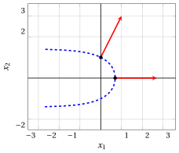

# Functions of several variables

**Part 1 · Preliminaries · Chapter 2** · [:material-file-pdf-box: Lecture notes, volume 1 (PDF)](../pdf/lecture-notes-1-preliminaries.pdf) · [:material-presentation: Slides](../pdf/slides-02-functions-several-variables.pdf) · [:material-pencil: Exercises](../exercises/ex-02-functions-several-variables.md)

## 2.1 Functions of several variables

!!! definizione "Definition 2.1: function of several real variables"

    The function:

    \begin{equation*}
    f: D \subseteq \R^n \rightarrow \mathbb{R},~~~ f:
    \underbrace{
    \begin{pmatrix}
    x_1 \\
    x_2 \\
    \vdots \\
    x_n
    \end{pmatrix}
    }_{{\boldsymbol x}}
    \mapsto f({\boldsymbol x})
    \end{equation*}

    is called a (scalar) <strong>function of $n$ real variables</strong> and $D \subseteq \R^n$ is its <strong>domain</strong>.

- A function, commonly denoted $f$, of $n$ real variables takes as input a vector of $n$ real numbers, commonly represented by the (column) variable vector ${\boldsymbol x}$, and produces a real number, the value of the function, commonly denoted $f({\boldsymbol x})$.

- Vectors are written in bold and are column vectors; the transpose of a vector ${\boldsymbol x}$ is the row vector ${\boldsymbol x}' = \begin{pmatrix} x_1 & x_2 & \dots & x_n \end{pmatrix}$.

!!! esempio "Example 2.1: a function of three variables"

    Consider the function:

    $$
    f: \R^3 \rightarrow \R,~~ f: \begin{pmatrix} x_1 \\ x_2 \\ x_3 \end{pmatrix} \mapsto x_1\,x_2 + x_3^2
    $$

    At the point $\begin{pmatrix} 2 \\ -1 \\ 3 \end{pmatrix}$ the value of the function is:

    $$
    f\left(\begin{pmatrix} 2 \\ -1 \\ 3 \end{pmatrix}\right) = 2 \cdot (-1) + 3^2 = -2 + 9 = 7
    $$

## 2.2 Gradient, Hessian and level sets

!!! definizione "Definition 2.2: gradient"

    Given $f:D\subseteq \R^n \to \R$, the <strong>gradient</strong> $\nabla f(\boldsymbol x)$ of $f$ at $\boldsymbol x$ is the (column) vector of first-order partial derivatives:

    $$
    \nabla f(\boldsymbol x) :=
    \begin{pmatrix}
    \frac{\partial f(\boldsymbol x)}{\partial x_1}\\[1ex]
    \frac{\partial f(\boldsymbol x)}{\partial x_2}\\[1ex]
    \vdots\\[1ex]
    \frac{\partial f(\boldsymbol x)}{\partial x_n}
    \end{pmatrix}
    $$

!!! chiave ""

    The gradient $\nabla f(\boldsymbol x)$ (if it is nonzero) gives the direction of steepest ascent (maximum directional derivative among unit directions), while $-\nabla f(\boldsymbol x)$ gives the direction of steepest descent.

!!! definizione "Definition 2.3: Hessian"

    Given a function $f:D\subseteq \R^n \to \R$, the <strong>Hessian</strong> $\nabla^2 f(\boldsymbol x)$ of $f$ at $\boldsymbol x$ is the matrix of second-order partial derivatives:

    $$
    \nabla^2 f(\boldsymbol x) :=
    \begin{pmatrix}
    \frac{\partial^2 f(\boldsymbol x)}{\partial x_1^2} & \frac{\partial^2 f(\boldsymbol x)}{\partial x_1\partial x_2} & \dots & \frac{\partial^2 f(\boldsymbol x)}{\partial x_1\partial x_n}\\[2ex]
    \frac{\partial^2 f(\boldsymbol x)}{\partial x_2\partial x_1} & \frac{\partial^2 f(\boldsymbol x)}{\partial x_2^2} & \dots & \frac{\partial^2 f(\boldsymbol x)}{\partial x_2\partial x_n}\\[2ex]
    \vdots & \vdots & \ddots & \vdots\\[2ex]
    \frac{\partial^2 f(\boldsymbol x)}{\partial x_n\partial x_1} & \frac{\partial^2 f(\boldsymbol x)}{\partial x_n\partial x_2} & \dots & \frac{\partial^2 f(\boldsymbol x)}{\partial x_n^2}
    \end{pmatrix}
    $$

- The entry in row $i$ and column $j$ of the Hessian is obtained by differentiating $\frac{\partial f(\boldsymbol x)}{\partial x_j}$ with respect to $x_i$.

- If the second-order partial derivatives of $f$ are continuous (as for all the functions of these notes), the order of differentiation does not matter, $\frac{\partial^2 f(\boldsymbol x)}{\partial x_i\partial x_j} = \frac{\partial^2 f(\boldsymbol x)}{\partial x_j\partial x_i}$, and the Hessian is a <strong>symmetric</strong> matrix.

!!! chiave ""

    The Hessian $\nabla^2 f(\boldsymbol x)$ describes the local curvature of $f$ around $\boldsymbol x$, that is, how the gradient changes when moving away from $\boldsymbol x$.

!!! definizione "Definition 2.4: level set"

    Given a function $f:D\subseteq \R^n \to \R$ and a constant $k\in\R$, the <strong>level set</strong> $L(k)$ of $f$ at level $k$ is:

    $$
    L(k) := \{\, \boldsymbol x \in D : f(\boldsymbol x)=k \,\}
    $$

!!! chiave ""

    A level set $L(k)$ is the set of points where the function has a constant value $k$. The gradient $\nabla f(\boldsymbol x)$ (if nonzero) is perpendicular to the level set passing through $\boldsymbol x$ and points toward increasing values of $f$.

!!! esempio "Example 2.2: gradient, Hessian and level sets of a quadratic function"

    Consider the quadratic function:

    $$
    f: \R^2 \rightarrow \R,~~f: \begin{pmatrix}
    x_1 \\
    x_2
    \end{pmatrix} \mapsto (x_1-2)^2 + (x_2-2)^2 +1
    $$

    - The <strong>gradient</strong> of the function is:

        $$
        \nabla f\left(\begin{pmatrix}
        x_1 \\
        x_2
        \end{pmatrix}\right) =
        \begin{pmatrix}
        \frac{ \partial f}{ \partial x_1} \\[2ex]
        \frac{ \partial f}{ \partial x_2}
        \end{pmatrix}
        =
        \begin{pmatrix}
        2(x_1-2) \\[1ex]
        2(x_2-2)
        \end{pmatrix}
        $$

        For example:

        - at the point $\begin{pmatrix} 3 \\ 2 \end{pmatrix}$, we have

            $$
            \nabla f\left(\begin{pmatrix} 3 \\ 2 \end{pmatrix}\right) = \begin{pmatrix} 2(3-2) \\ 2(2-2) \end{pmatrix} = \begin{pmatrix} 2 \\ 0 \end{pmatrix}
            $$

        - at the point $\begin{pmatrix} 2 \\ 3 \end{pmatrix}$, we have

            $$
            \nabla f\left(\begin{pmatrix} 2 \\ 3 \end{pmatrix}\right) = \begin{pmatrix} 2(2-2) \\ 2(3-2) \end{pmatrix} = \begin{pmatrix} 0 \\ 2 \end{pmatrix}
            $$

    - The <strong>Hessian</strong> of the function is:

        $$
        \nabla^2 f\left(\begin{pmatrix}
        x_1 \\
        x_2
        \end{pmatrix}\right) =
        \begin{pmatrix}
        \frac{ \partial^2 f}{ \partial x_1^2} & \frac{ \partial^2 f}{ \partial x_1 \partial x_2} \\[2ex]
        \frac{ \partial^2 f}{ \partial x_2 \partial x_1} & \frac{ \partial^2 f}{ \partial x_2^2}
        \end{pmatrix}
        =
        \begin{pmatrix}
        2 & 0 \\[1ex]
        0 & 2
        \end{pmatrix}
        $$

        Note that the Hessian is constant (it does not depend on the point).

    - The <strong>level sets</strong> of the function are:

        $$
        L(k) = \left\{~\begin{pmatrix} x_1 \\ x_2 \end{pmatrix} \in \R^2:~ (x_1-2)^2 + (x_2-2)^2 +1= k ~\right\} , \qquad \forall k \in \mathbb{R}
        $$

        which are circles centered at $\begin{pmatrix} 2 \\ 2 \end{pmatrix}$ with radius $\sqrt{k-1}$ for $k > 1$; the level set $L(1)$ is the single point $\begin{pmatrix} 2 \\ 2 \end{pmatrix}$ and the level sets with $k<1$ are empty.

!!! esempio "Example 2.3: graph, level sets and gradients of a quadratic function"

    For the function of the previous example, this is the graph in the domain $[-4,4]\times[-4,4]$; its lowest point is at $\begin{pmatrix} 2 \\ 2 \end{pmatrix}$, where $f = 1$, and its highest point is at $\begin{pmatrix} -4 \\ -4 \end{pmatrix}$, where $f = 73$:

    { .fig .ovale loading=lazy style="width:59%" }

    The following figure shows the level sets $L(2)$ (circle of radius $1$, in blue) and $L(17)$ (circle of radius $4$, in orange), and the two gradients of the previous example (in red), drawn from the points $\begin{pmatrix} 3 \\ 2 \end{pmatrix}$ and $\begin{pmatrix} 2 \\ 3 \end{pmatrix}$ of the level set $L(2)$:

    { .fig .ovale loading=lazy style="width:50%" }

    The gradient vectors are perpendicular to the level sets and point in the direction of maximum increase of the function (away from the center).

## 2.3 Examples of functions that are not quadratic

- For a quadratic function the Hessian is constant (chapter «Quadratic functions»). In general, the Hessian depends on the point, as in the following two examples.

!!! esempio "Example 2.4: gradient and Hessian of a cubic function"

    Consider the function:

    $$
    f: \R^2 \rightarrow \R,~~f: \begin{pmatrix} x_1 \\ x_2 \end{pmatrix} \mapsto x_1^2\,x_2
    $$

    - The <strong>gradient</strong> and the <strong>Hessian</strong> of the function are:

        $$
        \nabla f\left(\begin{pmatrix} x_1 \\ x_2 \end{pmatrix}\right) =
        \begin{pmatrix} 2\,x_1 x_2 \\[1ex] x_1^2 \end{pmatrix},
        \qquad
        \nabla^2 f\left(\begin{pmatrix} x_1 \\ x_2 \end{pmatrix}\right) =
        \begin{pmatrix} 2\,x_2 & 2\,x_1 \\[1ex] 2\,x_1 & 0 \end{pmatrix}
        $$

    - At the point $\begin{pmatrix} 1 \\ 2 \end{pmatrix}$, we have:

        $$
        \nabla f\left(\begin{pmatrix} 1 \\ 2 \end{pmatrix}\right) = \begin{pmatrix} 2 \cdot 1 \cdot 2 \\[0.5ex] 1^2 \end{pmatrix} = \begin{pmatrix} 4 \\ 1 \end{pmatrix},
        \qquad
        \nabla^2 f\left(\begin{pmatrix} 1 \\ 2 \end{pmatrix}\right) = \begin{pmatrix} 4 & 2 \\ 2 & 0 \end{pmatrix}
        $$

    - At the point $\begin{pmatrix} -1 \\ 3 \end{pmatrix}$, we have:

        $$
        \nabla f\left(\begin{pmatrix} -1 \\ 3 \end{pmatrix}\right) = \begin{pmatrix} 2 \cdot (-1) \cdot 3 \\[0.5ex] (-1)^2 \end{pmatrix} = \begin{pmatrix} -6 \\ 1 \end{pmatrix},
        \qquad
        \nabla^2 f\left(\begin{pmatrix} -1 \\ 3 \end{pmatrix}\right) = \begin{pmatrix} 6 & -2 \\ -2 & 0 \end{pmatrix}
        $$

    The Hessian changes from point to point and, as expected, it is symmetric at every point.

!!! esempio "Example 2.5: gradient, Hessian and a level set of an exponential function"

    Consider the function:

    $$
    f: \R^2 \rightarrow \R,~~f: \begin{pmatrix} x_1 \\ x_2 \end{pmatrix} \mapsto e^{x_1} + x_2^2
    $$

    - The <strong>gradient</strong> and the <strong>Hessian</strong> of the function are:

        $$
        \nabla f\left(\begin{pmatrix} x_1 \\ x_2 \end{pmatrix}\right) =
        \begin{pmatrix} e^{x_1} \\[1ex] 2\,x_2 \end{pmatrix},
        \qquad
        \nabla^2 f\left(\begin{pmatrix} x_1 \\ x_2 \end{pmatrix}\right) =
        \begin{pmatrix} e^{x_1} & 0 \\[1ex] 0 & 2 \end{pmatrix}
        $$

    - The level set $L(2)$ is the curve $e^{x_1} + x_2^2 = 2$, that is, $x_1 = \ln(2 - x_2^2)$ for $|x_2| < \sqrt{2}$. It contains the points $\begin{pmatrix} 0 \\ 1 \end{pmatrix}$ and $\begin{pmatrix} \ln 2 \\ 0 \end{pmatrix}$, since $e^0 + 1^2 = 2$ and $e^{\ln 2} + 0^2 = 2$. At these points:

        $$
        \nabla f\left(\begin{pmatrix} 0 \\ 1 \end{pmatrix}\right) = \begin{pmatrix} 1 \\ 2 \end{pmatrix},
        \qquad
        \nabla f\left(\begin{pmatrix} \ln 2 \\ 0 \end{pmatrix}\right) = \begin{pmatrix} 2 \\ 0 \end{pmatrix}
        $$

        and

        $$
        \nabla^2 f\left(\begin{pmatrix} 0 \\ 1 \end{pmatrix}\right) = \begin{pmatrix} 1 & 0 \\ 0 & 2 \end{pmatrix},
        \qquad
        \nabla^2 f\left(\begin{pmatrix} \ln 2 \\ 0 \end{pmatrix}\right) = \begin{pmatrix} 2 & 0 \\ 0 & 2 \end{pmatrix}
        $$

    The following figure shows the level set $L(2)$ (in blue) and the two gradient vectors (in red):

    { .fig .ovale loading=lazy style="width:50%" }

    The tangent direction of the level set at $\begin{pmatrix} 0 \\ 1 \end{pmatrix}$ is $\begin{pmatrix} -2 \\ 1 \end{pmatrix}$ (the derivative of $x_1 = \ln(2-x_2^2)$ with respect to $x_2$ is $\frac{-2\,x_2}{2-x_2^2}$, equal to $-2$ at $x_2=1$), and indeed:

    $$
    \begin{pmatrix} 1 & 2 \end{pmatrix} \begin{pmatrix} -2 \\ 1 \end{pmatrix} = -2 + 2 = 0
    $$

    so the gradient is perpendicular to the level set also when the level set is not a circle.

!!! chiave ""

    The gradient $\nabla f(\boldsymbol x)$ is the column vector of first-order partial derivatives: it points in the direction of steepest ascent and is perpendicular to the level set through $\boldsymbol x$. The Hessian $\nabla^2 f(\boldsymbol x)$ is the (symmetric) matrix of second-order partial derivatives and describes the local curvature of $f$.
