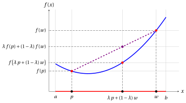
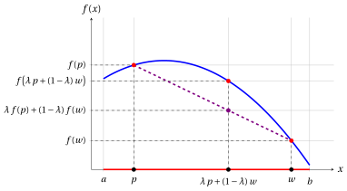
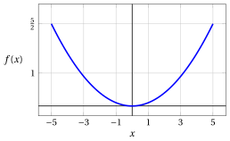
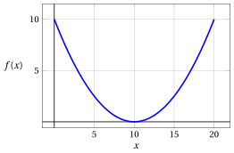
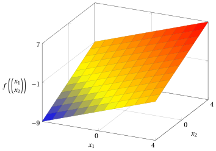
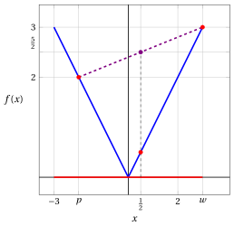
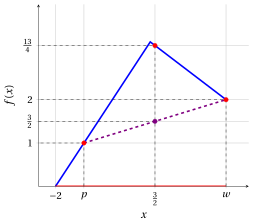
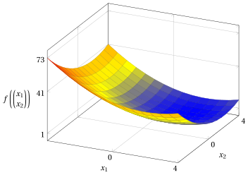
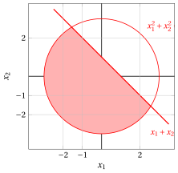

# Convex and concave functions

**Part 1 · Preliminaries · Chapter 3** · [:material-file-pdf-box: Lecture notes, volume 1 (PDF)](../pdf/lecture-notes-1-preliminaries.pdf) · [:material-pencil: Exercises](../exercises/ex-03-convex-concave-functions.md)

## 3.1 Convex functions

!!! definizione "Definition 3.1: convex function"

    A function $f: D \subseteq \R^n \rightarrow \R$ is <strong>convex</strong> in its domain $D$ if:

    \begin{equation*}
    \label{CONVEX}
    \forall {\boldsymbol p}, {\boldsymbol w} \in D \text{  and  } \forall \lambda \in [0,1]  \text{   we have   } ~ f\big(\lambda \; {\boldsymbol p} + (1-\lambda)\;{\boldsymbol w}\big)~~ {\le}~~ \lambda \; f({\boldsymbol p}) + (1-\lambda)\; f({\boldsymbol w}) \tag{3.1}
    \end{equation*}

    and the domain $D$ of the function $f$ is a convex set.

!!! chiave ""

    A function is convex in its domain if, for any two points in its convex domain, the value at any convex combination of the two points is smaller than or equal to the convex combination of the values at those two points.

- If $D=[a,b] \subseteq \R$ (an interval which is by nature a convex set), the graph of a convex function is given by the following picture:

{ .fig .ovale loading=lazy style="width:71%" }

## 3.2 Concave functions

!!! definizione "Definition 3.2: concave function"

    A function $f: D \subseteq \R^n \rightarrow \R$ is <strong>concave</strong> in its domain $D$ if:

    \begin{equation*}
    \label{CONCAVE}
    \forall {\boldsymbol p}, {\boldsymbol w} \in D \text{  and  } \forall \lambda \in [0,1]  \text{   we have   } ~ f\big(\lambda \; {\boldsymbol p} + (1-\lambda)\;{\boldsymbol w}\big)~~ {\ge}~~ \lambda \; f({\boldsymbol p}) + (1-\lambda)\; f({\boldsymbol w}) \tag{3.2}
    \end{equation*}

    and the domain $D$ of the function $f$ is a convex set.

!!! chiave ""

    A function is concave in its domain if, for any two points in its convex domain, the value at any convex combination of the two points is greater than or equal to the convex combination of the values at those two points.

- If $D=[a,b] \subseteq \R$ (an interval which is by nature a convex set), the graph of a concave function is given by the following picture:

{ .fig .ovale loading=lazy style="width:71%" }

## 3.3 Examples of convex and concave functions

- In this chapter we also consider nonlinear functions. The convexity of a function is always proved by checking the definition: for arbitrary points ${\boldsymbol p}, {\boldsymbol w}$ of the domain and an arbitrary $\lambda \in [0,1]$, we verify the inequality of the definition. For the quadratic functions of the first examples, we use the following inequality.

!!! teorema "Observation 3.3"

    For every $a, b \in \R$ and every $\lambda \in [0,1]$, we have

    \begin{equation*}
    \label{eq:squares}
    \big(\lambda a+(1-\lambda)b\big)^2 \le \lambda a^2+(1-\lambda)b^2 . \tag{3.3}
    \end{equation*}

??? dimostrazione "Proof"

    For every $a, b \in \R$ and every $\lambda \in [0,1]$, we have:

    \begin{align*}
    \big(\lambda a+(1-\lambda)b\big)^2
    &= \lambda^2 a^2+2\lambda(1-\lambda)ab+(1-\lambda)^2b^2 \\[2ex]
    &= \lambda a^2+(1-\lambda)b^2-\lambda(1-\lambda)a^2+2\lambda(1-\lambda)ab-\lambda(1-\lambda)b^2 \\[2ex]
    &= \lambda a^2+(1-\lambda)b^2-\lambda(1-\lambda)(a^2-2ab+b^2) \\[2ex]
    &= \lambda a^2+(1-\lambda)b^2-\underbrace {\lambda(1-\lambda)(a-b)^2}_{\ge 0} \\[2ex]
    &\le \lambda a^2+(1-\lambda)b^2 \quad (\text{since } \lambda \ge 0,~ 1-\lambda \ge 0 \text{ and } (a-b)^2 \ge 0)
    \end{align*}

    
□

!!! esempio "Example 3.1: a convex quadratic function"

    Consider the following function:

    $$
    f: \R \rightarrow \R, ~~  f:x \mapsto  \frac{x^2}{10}
    $$

    { .fig .ovale loading=lazy style="width:50%" }

    To prove that the function is convex in its domain, we observe that for every pair of points $p,w\in\R$ and every $\lambda\in[0,1]$, we have:

    \begin{align*}
    f\big(\lambda p+(1-\lambda)w\big)
    &= \frac{1}{10}\big(\lambda p+(1-\lambda)w\big)^2 \\[2ex]
    &\le \frac{1}{10}\Big(\lambda p^2+(1-\lambda)w^2\Big)
    \quad \text{(by inequality \eqref{eq:squares})} \\[2ex]
    &= \lambda\,\frac{p^2}{10}+(1-\lambda)\,\frac{w^2}{10} \\[2ex]
    &= \lambda f(p)+(1-\lambda)f(w)
    \end{align*}

    Therefore,

    $$
    f\big(\lambda p + (1-\lambda) w\big) \le \lambda f(p) + (1-\lambda) f(w)
    $$

    By nature, the domain $\R$ is a convex set. Accordingly, the function is convex in its domain.

!!! esempio "Example 3.2: a translated convex quadratic function"

    Consider the following function:

    $$
    f: \R \rightarrow \R, ~~  f:x \mapsto  \frac{1}{10}(x-10)^2
    $$

    { .fig .ovale loading=lazy style="width:50%" }

    To prove that the function is convex in its domain, we observe that for every pair of points $p,w\in\R$ and every $\lambda\in[0,1]$, we have:

    \begin{align*}
    f\big(\lambda p+(1-\lambda)w\big)
    &= \frac{1}{10}\big(\lambda p+(1-\lambda)w-10\big)^2 \\[2ex]
    &= \frac{1}{10}\big(\lambda (p-10)+(1-\lambda)(w-10)\big)^2
    \quad (\text{since } \lambda + (1-\lambda) = 1) \\[2ex]
    &\le \frac{1}{10}\Big(\lambda (p-10)^2+(1-\lambda)(w-10)^2\Big)
    \quad \text{(by inequality \eqref{eq:squares})} \\[2ex]
    &= \lambda\,\frac{(p-10)^2}{10}+(1-\lambda)\,\frac{(w-10)^2}{10} \\[2ex]
    &= \lambda f(p)+(1-\lambda)f(w)
    \end{align*}

    Therefore,

    $$
    f\big(\lambda p + (1-\lambda) w\big) \le \lambda f(p) + (1-\lambda) f(w)
    $$

    By nature, the domain $\R$ is a convex set. Accordingly, the function is convex in its domain.

!!! esempio "Example 3.3: a linear function of two variables"

    Consider the following function:

    $$
    f: \R^2 \to \R,~~ f: \begin{pmatrix}
    x_1 \\
    x_2
    \end{pmatrix} \mapsto x_1 + x_2 - 1
    $$

    { .fig .ovale loading=lazy style="width:62%" }

    To prove that the function is convex in its domain, we observe that for every pair of points ${\boldsymbol p} = \begin{pmatrix} p_1 \\ p_2 \end{pmatrix}, {\boldsymbol w} = \begin{pmatrix} w_1 \\ w_2 \end{pmatrix} \in \R^2$ and every $\lambda \in [0,1]$, we have:

    \begin{align*}
    f\big(\lambda {\boldsymbol p} + (1-\lambda){\boldsymbol w}\big)
    &= \bigl(\lambda p_1+(1-\lambda)w_1\bigr)+\bigl(\lambda p_2+(1-\lambda)w_2\bigr)-1 \\[2ex]
    &= \lambda(p_1+p_2)+(1-\lambda)(w_1+w_2)-\lambda-(1-\lambda)\\[1ex]
    &\qquad (\text{since } \lambda + (1-\lambda) = 1) \\[2ex]
    &= \lambda(p_1+p_2-1)+(1-\lambda)(w_1+w_2-1) \\[2ex]
    &= \lambda f({\boldsymbol p}) + (1-\lambda) f({\boldsymbol w})
    \end{align*}

    Therefore,

    $$
    f\big(\lambda {\boldsymbol p} + (1-\lambda){\boldsymbol w}\big) \le \lambda f({\boldsymbol p}) + (1-\lambda) f({\boldsymbol w})
    $$

    (with equality). By nature, the domain $\R^2$ is a convex set. Accordingly, the function is convex in its domain. Since the equality holds, also the inequality with $\ge$ holds: the function is also concave in its domain.

!!! esempio "Example 3.4: a convex quadratic function of two variables"

    Consider the following function:

    $$
    f: \R^2 \to \R,~~ f:\begin{pmatrix}
    x_1 \\
    x_2
    \end{pmatrix} \mapsto x_1^2 + x_2^2 - 9
    $$

    { .fig .ovale loading=lazy style="width:62%" }

    To prove that the function is convex in its domain, we observe that for every pair of points ${\boldsymbol p} = \begin{pmatrix} p_1 \\ p_2 \end{pmatrix}, {\boldsymbol w} = \begin{pmatrix} w_1 \\ w_2 \end{pmatrix} \in \R^2$ and every $\lambda \in [0,1]$, we have:

    \begin{align*}
    f\big(\lambda {\boldsymbol p} + (1-\lambda){\boldsymbol w}\big)
    &= (\lambda p_1+(1-\lambda)w_1)^2+(\lambda p_2+(1-\lambda)w_2)^2-9 \\[2ex]
    &\le \lambda p_1^2+(1-\lambda)w_1^2+\lambda p_2^2+(1-\lambda)w_2^2-9 \\[2ex]
    &\hspace{1cm} \text{(by inequality \eqref{eq:squares}, twice)} \\[2ex]
    &= \lambda(p_1^2+p_2^2-9)+(1-\lambda)(w_1^2+w_2^2-9) \\[2ex]
    &\hspace{1cm} (\text{since } \lambda + (1-\lambda) = 1) \\[2ex]
    &= \lambda f({\boldsymbol p}) + (1-\lambda) f({\boldsymbol w})
    \end{align*}

    Therefore,

    $$
    f\big(\lambda {\boldsymbol p} + (1-\lambda){\boldsymbol w}\big) \le \lambda f({\boldsymbol p}) + (1-\lambda) f({\boldsymbol w})
    $$

    By nature, the domain $\R^2$ is a convex set. Accordingly, the function is convex in its domain.

- The following two examples are functions of one variable whose graph is made of two segments.

!!! esempio "Example 3.5: the absolute value is a convex function"

    Consider the function $f: \R \rightarrow \R$, $f(x) = |x|$. To prove that the function is convex in its domain, we observe that for every pair of points $p, w \in \R$ and every $\lambda \in [0,1]$, we have:

    \begin{align*}
    f\big(\lambda p + (1-\lambda) w\big)
    &= \big|\lambda p + (1-\lambda) w\big| \\[2ex]
    &\le |\lambda p| + |(1-\lambda) w| \quad \text{(by the triangle inequality)} \\[2ex]
    &= |\lambda| \; |p| + |1-\lambda| \; |w| \quad \text{(by the absolute homogeneity)} \\[2ex]
    &= \lambda \; |p| + (1-\lambda) \; |w| \quad (\text{since } \lambda \ge 0 \text{ and } 1-\lambda \ge 0) \\[2ex]
    &= \lambda f(p) + (1-\lambda) f(w)
    \end{align*}

    Therefore,

    $$
    f\big(\lambda p + (1-\lambda) w\big) \le \lambda f(p) + (1-\lambda) f(w)
    $$

    By nature, the domain $\R$ is a convex set. Accordingly, the function is convex in its domain.

    For example, with $p=-2$, $w=3$ and $\lambda=\frac{1}{2}$ we obtain $\lambda \, p + (1-\lambda)\, w = \frac{1}{2}$ and

    $$
    f\Big(\frac{1}{2}\Big) = \frac{1}{2} \;\le\; \frac{1}{2}\; f(-2) + \frac{1}{2}\; f(3) = \frac{1}{2}\cdot 2 + \frac{1}{2} \cdot 3 = \frac{5}{2} .
    $$

    In the figure, the segment joining $(p, f(p))$ and $(w, f(w))$ (violet) lies above the graph of $f$ (blue).

    { .fig .ovale loading=lazy style="width:50%" }

!!! esempio "Example 3.6: the minimum of two linear functions is a concave function"

    Consider the function $f: [-2,4] \rightarrow \R$, $f(x) = \min\{\, x+2, \; 4-\frac{1}{2}x \,\}$. To prove that the function is concave in its domain, we observe that for every pair of points $p, w \in [-2,4]$ and every $\lambda \in [0,1]$, we have:

    \begin{align*}
    f\big(\lambda p + (1-\lambda) w\big)
    &= \min\Big\{\, \lambda p + (1-\lambda) w + 2, \; 4 - \tfrac{1}{2}\big(\lambda p + (1-\lambda) w\big) \,\Big\} \\[2ex]
    &= \min\Big\{\, \lambda (p+2) + (1-\lambda)(w+2), \; \lambda \big(4-\tfrac{1}{2}p\big) + (1-\lambda)\big(4-\tfrac{1}{2}w\big) \,\Big\} \\[2ex]
    &\hspace{1cm} (\text{since } \lambda + (1-\lambda) = 1) \\[2ex]
    &\ge \min\Big\{\, \lambda f(p) + (1-\lambda) f(w), \; \lambda f(p) + (1-\lambda) f(w) \,\Big\} \\[2ex]
    &\hspace{1cm} (\text{since } f(p) \le p+2,~ f(p) \le 4-\tfrac{1}{2}p,~ f(w) \le w+2, \\
    &\hspace{1.3cm} f(w) \le 4-\tfrac{1}{2}w,~ \lambda \ge 0 \text{ and } 1-\lambda \ge 0) \\[2ex]
    &= \lambda f(p) + (1-\lambda) f(w)
    \end{align*}

    Therefore,

    $$
    f\big(\lambda p + (1-\lambda) w\big) \ge \lambda f(p) + (1-\lambda) f(w)
    $$

    The domain $[-2,4]$ is an interval, hence a convex set. Accordingly, the function is concave in its domain.

    The two lines meet at $x=\frac{4}{3}$, where $f(\frac{4}{3}) = \frac{10}{3}$. For example, with $p=-1$, $w=4$ and $\lambda=\frac{1}{2}$ we obtain $\lambda \, p + (1-\lambda)\, w = \frac{3}{2}$ and

    $$
    f\Big(\frac{3}{2}\Big) = \min\Big\{\frac{7}{2},\, \frac{13}{4}\Big\} = \frac{13}{4} \;\ge\; \frac{1}{2}\; f(-1) + \frac{1}{2}\; f(4) = \frac{1}{2}\cdot 1 + \frac{1}{2} \cdot 2 = \frac{3}{2} .
    $$

    In the figure, the segment joining $(p, f(p))$ and $(w, f(w))$ (violet) lies below the graph of $f$ (blue).

    { .fig .ovale loading=lazy style="width:50%" }

## 3.4 Convex functions defined by norms

!!! definizione "Definition 3.4: norm"

    A <strong>norm</strong> on $\R^n$ is a function $\|\cdot\|: \R^n \rightarrow \R$ such that, for every ${\boldsymbol p}, {\boldsymbol w} \in \R^n$ and every $\alpha \in \R$:

    - $\|{\boldsymbol p}\| \ge 0$, and $\|{\boldsymbol p}\| = 0$ if and only if ${\boldsymbol p} = {\boldsymbol 0}$ (positivity);

    - $\|\alpha \, {\boldsymbol p}\| = |\alpha| \; \|{\boldsymbol p}\|$ (absolute homogeneity);

    - $\|{\boldsymbol p} + {\boldsymbol w}\| \le \|{\boldsymbol p}\| + \|{\boldsymbol w}\|$ (triangle inequality).

!!! definizione "Definition 3.5: the norms $1$, $2$, $q$ and $\infty$"

    For every ${\boldsymbol x} \in \R^n$:

    \begin{align*}
    \|{\boldsymbol x}\|_1 &= \sum_{j=1}^{n} |x_j| && \text{(norm $1$, or Manhattan norm)}\\[2ex]
    \|{\boldsymbol x}\|_2 &= \sqrt{\sum_{j=1}^{n} x_j^2} && \text{(norm $2$, or Euclidean norm)}\\[2ex]
    \|{\boldsymbol x}\|_q &= \Big(\sum_{j=1}^{n} |x_j|^q\Big)^{\frac{1}{q}}, \quad q \ge 1 && \text{(norm $q$)}\\[2ex]
    \|{\boldsymbol x}\|_\infty &= \max_{j=1,\ldots,n} |x_j| && \text{(norm $\infty$, or maximum norm)}
    \end{align*}

    The norms $1$ and $2$ are the norm $q$ with $q=1$ and $q=2$, and $\|{\boldsymbol x}\|_\infty = \lim_{q \to \infty} \|{\boldsymbol x}\|_q$.

!!! esempio "Example 3.7: the four norms of a vector"

    For ${\boldsymbol x} = \begin{pmatrix} 3 \\ -4 \end{pmatrix}$ we have:

    \begin{align*}
    \|{\boldsymbol x}\|_1 &= |3| + |{-4}| = 7, &
    \|{\boldsymbol x}\|_2 &= \sqrt{3^2 + (-4)^2} = 5,\\[2ex]
    \|{\boldsymbol x}\|_3 &= \big(|3|^3 + |{-4}|^3\big)^{\frac{1}{3}} = \sqrt[3]{91}, &
    \|{\boldsymbol x}\|_\infty &= \max\{|3|, |{-4}|\} = 4.
    \end{align*}

!!! teorema "Observation 3.6: convexity of the Euclidean norm"

    The function

    $$
    f:\, \mathbb{R}^{n} \to \mathbb{R}, \qquad
    f: {\boldsymbol{x}} \mapsto
    \|\boldsymbol{x} \|_2
    $$

    is convex in its domain.

??? dimostrazione "Proof"

    For every pair of points $\boldsymbol{p}, \boldsymbol{w} \in \mathbb{R}^n$ and every $\lambda \in [0,1]$, we have:

    \begin{align*}
    f\big(\lambda {\boldsymbol p} + (1-\lambda){\boldsymbol w}\big)
    &= \|\lambda \boldsymbol{p} + (1 - \lambda) \boldsymbol{w} \|_2 \\[2ex]
    & \le \|\lambda \boldsymbol{p}\|_2 + \|(1 - \lambda) \boldsymbol{w}\|_2 \quad \text{(by the triangle inequality)} \\[2ex]
    &= |\lambda| \; \|\boldsymbol{p}\|_2 + |1 - \lambda| \; \|\boldsymbol{w}\|_2 \quad \text{(by the absolute homogeneity)} \\[2ex]
    &= \lambda \; \|\boldsymbol{p}\|_2 + (1 - \lambda) \; \|\boldsymbol{w}\|_2 \quad (\text{since } \lambda \ge 0 \text{ and } 1-\lambda \ge 0) \\[2ex]
    &= \lambda f({\boldsymbol p}) + (1-\lambda) f({\boldsymbol w})
    \end{align*}

    Therefore,

    $$
    f(\lambda {\boldsymbol p} + (1-\lambda){\boldsymbol w})
    \le
    \lambda f({\boldsymbol p}) + (1-\lambda) f({\boldsymbol w})
    $$

    By nature, the domain $\mathbb{R}^{n}$ is a convex set. Accordingly, the function is convex in its domain. □

!!! teorema "Observation 3.7: convexity of every norm"

    For every norm $\|\cdot\|$ on $\R^n$ (in particular $\|\cdot\|_1$, $\|\cdot\|_2$, $\|\cdot\|_q$ with $q \ge 1$, and $\|\cdot\|_\infty$), the function

    $$
    f:\, \mathbb{R}^{n} \to \mathbb{R}, \qquad
    f: {\boldsymbol{x}} \mapsto \|\boldsymbol{x}\|
    $$

    is convex in its domain.

??? dimostrazione "Proof"

    For every pair of points $\boldsymbol{p}, \boldsymbol{w} \in \mathbb{R}^n$ and every $\lambda \in [0,1]$, we have:

    \begin{align*}
    f\big(\lambda {\boldsymbol p} + (1-\lambda){\boldsymbol w}\big)
    &= \|\lambda \boldsymbol{p} + (1 - \lambda) \boldsymbol{w} \| \\[2ex]
    & \le \|\lambda \boldsymbol{p}\| + \|(1 - \lambda) \boldsymbol{w}\| \quad \text{(by the triangle inequality)} \\[2ex]
    &= |\lambda| \; \|\boldsymbol{p}\| + |1 - \lambda| \; \|\boldsymbol{w}\| \quad \text{(by the absolute homogeneity)} \\[2ex]
    &= \lambda \; \|\boldsymbol{p}\| + (1 - \lambda) \; \|\boldsymbol{w}\| \quad (\text{since } \lambda \ge 0 \text{ and } 1-\lambda \ge 0) \\[2ex]
    &= \lambda f({\boldsymbol p}) + (1-\lambda) f({\boldsymbol w})
    \end{align*}

    Therefore,

    $$
    f(\lambda {\boldsymbol p} + (1-\lambda){\boldsymbol w})
    \le
    \lambda f({\boldsymbol p}) + (1-\lambda) f({\boldsymbol w})
    $$

    By nature, the domain $\mathbb{R}^{n}$ is a convex set. Accordingly, the function is convex in its domain. □

!!! teorema "Corollary 3.8"

    For every pair of points $\boldsymbol{p}, \boldsymbol{w} \in \mathbb{R}^n$ and every $\lambda \in [0,1]$, we have

    \begin{equation*}
    \label{eq:normineq}
    \|\lambda \boldsymbol{p} + (1 - \lambda) \boldsymbol{w} \|_2  \le \lambda \; \|\boldsymbol{p}\|_2 + (1 - \lambda) \; \|\boldsymbol{w}\|_2 \tag{3.4}
    \end{equation*}

!!! esempio "Example 3.8: the distance from a point"

    Let us consider the vector ${\boldsymbol c} = \begin{pmatrix} 2 \\ 2 \end{pmatrix}$ and the function:

    \begin{equation*}
    f: \mathbb{R}^2 \to \mathbb{R}, \quad f: \begin{pmatrix}
    x_1 \\
    x_2 \\
    \end{pmatrix} \mapsto \left\| \begin{pmatrix}
    x_1 \\
    x_2 \\
    \end{pmatrix} - \begin{pmatrix}
    2 \\
    2 \\
    \end{pmatrix}  \right\|_2 + 1
    \end{equation*}

    { .fig .ovale loading=lazy style="width:62%" }

    To prove that the function is convex in its domain, we observe that for every pair of points ${\boldsymbol p}, {\boldsymbol w} \in \R^2$ and every $\lambda \in [0,1]$, we have:

    \begin{align*}
    f\big(\lambda {\boldsymbol p} + (1-\lambda){\boldsymbol w}\big)
    &= \big\| \lambda {\boldsymbol p} + (1 - \lambda){\boldsymbol w} - {\boldsymbol c} \big\|_2 + 1 \\[2ex]
    &= \big\| \lambda ({\boldsymbol p} - {\boldsymbol c}) + (1 - \lambda)({\boldsymbol w} - {\boldsymbol c}) \big\|_2 + 1
    \quad (\text{since } \lambda + (1-\lambda) = 1) \\[2ex]
    &\le \lambda \, \|{\boldsymbol p} - {\boldsymbol c}\|_2 + (1 - \lambda)\, \|{\boldsymbol w} - {\boldsymbol c}\|_2 + 1
    \quad \text{(by inequality \eqref{eq:normineq})}\\[2ex]
    &= \lambda \big( \|{\boldsymbol p} - {\boldsymbol c}\|_2 + 1 \big) + (1-\lambda) \big( \|{\boldsymbol w} - {\boldsymbol c}\|_2 + 1 \big) \\[2ex]
    &= \lambda f({\boldsymbol p}) + (1-\lambda) f({\boldsymbol w})
    \end{align*}

    Therefore,

    $$
    f\big(\lambda {\boldsymbol p} + (1-\lambda){\boldsymbol w}\big) \le \lambda f({\boldsymbol p}) + (1-\lambda) f({\boldsymbol w})
    $$

    By nature, the domain $\R^2$ is a convex set. Accordingly, the function is convex in its domain.

!!! teorema "Observation 3.9: convexity of the squared Euclidean norm"

    The function

    $$
    f:\, \mathbb{R}^{n} \to \mathbb{R}, \qquad
    f: {\boldsymbol{x}} \mapsto
    \|\boldsymbol{x} \|_2^2
    $$

    is convex in its domain.

??? dimostrazione "Proof"

    For every pair of points $\boldsymbol{p}, \boldsymbol{w} \in \mathbb{R}^n$ and every $\lambda \in [0,1]$, we have:

    \begin{align*}
    f\big(\lambda {\boldsymbol p} + (1-\lambda){\boldsymbol w}\big)
    &= \|\lambda \boldsymbol{p} + (1 - \lambda) \boldsymbol{w} \|_2^2 \\[2ex]
    &= \big(\lambda \boldsymbol{p} + (1 - \lambda) \boldsymbol{w}\big)' \;
    \big(\lambda \boldsymbol{p} + (1 - \lambda) \boldsymbol{w}\big) \\[2ex]
    &= \lambda^2 \|\boldsymbol{p}\|_2^2 + (1 - \lambda)^2 \|\boldsymbol{w}\|_2^2
    + 2\lambda(1 - \lambda)\,(\boldsymbol{p}' \; \boldsymbol{w}) \\[2ex]
    &\le \lambda^2 \|\boldsymbol{p}\|_2^2 + (1 - \lambda)^2 \|\boldsymbol{w}\|_2^2
    + 2\lambda(1 - \lambda)\,\|\boldsymbol{p}\|_2\,\|\boldsymbol{w}\|_2  \\[2ex]
    &\hspace{1cm}  \text{(by the Cauchy--Schwarz inequality)} \\[2ex]
    &\le \lambda^2 \|\boldsymbol{p}\|_2^2 + (1 - \lambda)^2 \|\boldsymbol{w}\|_2^2
    + \lambda(1 - \lambda)\|\boldsymbol{p}\|_2^2 + \lambda(1 - \lambda)\|\boldsymbol{w}\|_2^2 \\[2ex]
    &\hspace{1cm}\text{(since $2ab\le a^2+b^2$ for all $a,b \in \R$,} \\
    &\hspace{1.3cm}\text{with $a=\|\boldsymbol{p}\|_2$ and $b=\|\boldsymbol{w}\|_2$)} \\[2ex]
    &= \big(\lambda^2+\lambda(1-\lambda)\big)\|\boldsymbol{p}\|_2^2
    + \big((1-\lambda)^2+\lambda(1-\lambda)\big)\|\boldsymbol{w}\|_2^2 \\[2ex]
    &= \lambda\|\boldsymbol{p}\|_2^2 + (1 - \lambda)\|\boldsymbol{w}\|_2^2 \\[2ex]
    &= \lambda f({\boldsymbol p}) + (1-\lambda) f({\boldsymbol w})
    \end{align*}

    Therefore,

    $$
    f(\lambda {\boldsymbol p} + (1-\lambda){\boldsymbol w})
    \le
    \lambda f({\boldsymbol p}) + (1-\lambda) f({\boldsymbol w})
    $$

    By nature, the domain $\mathbb{R}^{n}$ is a convex set. Accordingly, the function is convex in its domain. □

- The next proof is more direct and does not require the use of the Cauchy–Schwarz inequality and the inequality $2ab \le a^2 + b^2$ for every $a,b \in \mathbb{R}$.

??? dimostrazione "Proof"

    For every pair of points $\boldsymbol{p}, \boldsymbol{w} \in \mathbb{R}^n$ and every $\lambda \in [0,1]$, we have:

    \begin{align*}
    f\big(\lambda {\boldsymbol p} + (1-\lambda){\boldsymbol w}\big)
    &= \big(\lambda \boldsymbol{p} + (1 - \lambda) \boldsymbol{w}\big)' \big(\lambda \boldsymbol{p} + (1 - \lambda) \boldsymbol{w}\big) \\[2ex]
    &= \lambda^2 \|\boldsymbol{p}\|_2^2 + (1 - \lambda)^2 \|\boldsymbol{w}\|_2^2 + 2\lambda(1 - \lambda)\,(\boldsymbol{p}' \boldsymbol{w}) \\[2ex]
    &= \lambda^2 \|\boldsymbol{p}\|_2^2 + (1 - \lambda)^2 \|\boldsymbol{w}\|_2^2 \\
    &\qquad + \lambda(1 - \lambda)\bigl(\|\boldsymbol{p}\|_2^2 + \|\boldsymbol{w}\|_2^2 - \|\boldsymbol{p}-\boldsymbol{w}\|_2^2\bigr) \\[2ex]
    &\hspace{1cm}\text{(since } \|\boldsymbol{p}-\boldsymbol{w}\|_2^2 = \|\boldsymbol{p}\|_2^2+\|\boldsymbol{w}\|_2^2-2\boldsymbol{p}'\boldsymbol{w}\text{)} \\[2ex]
    &= \big(\lambda^2+\lambda(1-\lambda)\big)\|\boldsymbol{p}\|_2^2 + \big((1-\lambda)^2+\lambda(1-\lambda)\big)\|\boldsymbol{w}\|_2^2 \\
    &\qquad - \lambda(1-\lambda)\|\boldsymbol{p}-\boldsymbol{w}\|_2^2 \\[2ex]
    &= \lambda\|\boldsymbol{p}\|_2^2 + (1 - \lambda)\|\boldsymbol{w}\|_2^2 - \lambda(1-\lambda)\|\boldsymbol{p}-\boldsymbol{w}\|_2^2 \\[2ex]
    &\le \lambda\|\boldsymbol{p}\|_2^2 + (1 - \lambda)\|\boldsymbol{w}\|_2^2 \quad \text{(since } \lambda(1-\lambda)\|\boldsymbol{p}-\boldsymbol{w}\|_2^2 \ge 0\text{)} \\[2ex]
    &= \lambda f({\boldsymbol p}) + (1-\lambda) f({\boldsymbol w})
    \end{align*}

    Therefore,

    $$
    f(\lambda {\boldsymbol p} + (1-\lambda){\boldsymbol w})
    \le
    \lambda f({\boldsymbol p}) + (1-\lambda) f({\boldsymbol w})
    $$

    By nature, the domain $\mathbb{R}^{n}$ is a convex set. Accordingly, the function is convex in its domain. □

!!! teorema "Corollary 3.10"

    For every pair of points $\boldsymbol{p}, \boldsymbol{w} \in \mathbb{R}^n$ and every $\lambda \in [0,1]$, we have

    \begin{equation*}
    \label{eq:sqnormineq}
    \|\lambda \boldsymbol{p} + (1 - \lambda) \boldsymbol{w} \|_2^2  \le \lambda \; \|\boldsymbol{p}\|_2^2 + (1 - \lambda) \; \|\boldsymbol{w}\|_2^2 \tag{3.5}
    \end{equation*}

!!! esempio "Example 3.9: the squared distance from a point"

    Let us consider the vector ${\boldsymbol c} = \begin{pmatrix} 2 \\ 2 \end{pmatrix}$ and the function:

    \begin{equation*}
    f: \R^2 \rightarrow \R,~~f: \begin{pmatrix}
    x_1 \\
    x_2 \\
    \end{pmatrix} \mapsto \left\| \begin{pmatrix}
    x_1 \\
    x_2 \\
    \end{pmatrix} - \begin{pmatrix}
    2 \\
    2 \\
    \end{pmatrix}  \right\|_2^2 +1
    \end{equation*}

    { .fig .ovale loading=lazy style="width:62%" }

    To prove that the function is convex in its domain, we observe that for every pair of points ${\boldsymbol p}, {\boldsymbol w} \in \R^2$ and every $\lambda \in [0,1]$, we have:

    \begin{align*}
    f\big(\lambda {\boldsymbol p} + (1-\lambda){\boldsymbol w}\big)
    &= \big\| \lambda {\boldsymbol p} + (1 - \lambda){\boldsymbol w} - {\boldsymbol c} \big\|_2^2 + 1 \\[2ex]
    &= \big\| \lambda ({\boldsymbol p} - {\boldsymbol c}) + (1 - \lambda)({\boldsymbol w} - {\boldsymbol c}) \big\|_2^2 + 1
    \quad (\text{since } \lambda + (1-\lambda) = 1) \\[2ex]
    &\le \lambda \, \|{\boldsymbol p} - {\boldsymbol c}\|_2^2 + (1 - \lambda)\, \|{\boldsymbol w} - {\boldsymbol c}\|_2^2 + 1
    \quad \text{(by inequality \eqref{eq:sqnormineq})}\\[2ex]
    &= \lambda \big( \|{\boldsymbol p} - {\boldsymbol c}\|_2^2 + 1 \big) + (1-\lambda) \big( \|{\boldsymbol w} - {\boldsymbol c}\|_2^2 + 1 \big) \\[2ex]
    &= \lambda f({\boldsymbol p}) + (1-\lambda) f({\boldsymbol w})
    \end{align*}

    Therefore,

    $$
    f\big(\lambda {\boldsymbol p} + (1-\lambda){\boldsymbol w}\big) \le \lambda f({\boldsymbol p}) + (1-\lambda) f({\boldsymbol w})
    $$

    By nature, the domain $\R^2$ is a convex set. Accordingly, the function is convex in its domain.

## 3.5 Properties of convex and concave functions

!!! teorema "Observation 3.11"

    A function $f: D \subseteq \R^n \rightarrow \R$ is convex in $D$ if and only if the function $-f$ is concave in $D$.

??? dimostrazione "Proof"

    Let $f$ be convex in $D$. For every pair of points ${\boldsymbol p}, {\boldsymbol w} \in D$ and every $\lambda \in [0,1]$, we have:

    \begin{align*}
    (-f)\big(\lambda {\boldsymbol p} + (1-\lambda){\boldsymbol w}\big)
    &= -f\big(\lambda {\boldsymbol p} + (1-\lambda){\boldsymbol w}\big) \\[2ex]
    &\ge -\big(\lambda f({\boldsymbol p}) + (1-\lambda) f({\boldsymbol w})\big) \\[2ex]
    &\hspace{1cm} \text{(since $f$ is convex, and $-1$ reverses the inequality)} \\[2ex]
    &= \lambda \, (-f)({\boldsymbol p}) + (1-\lambda) \, (-f)({\boldsymbol w})
    \end{align*}

    Therefore,

    $$
    (-f)\big(\lambda {\boldsymbol p} + (1-\lambda){\boldsymbol w}\big) \ge \lambda \, (-f)({\boldsymbol p}) + (1-\lambda) \, (-f)({\boldsymbol w})
    $$

    The domain $D$ is a convex set, since $f$ is convex in $D$. Accordingly, the function $-f$ is concave in its domain. The converse is proved in the same way, starting from the inequality of the concave function $-f$ and multiplying it by $-1$. □

!!! teorema "Observation 3.12"

    Let $f, g: D \subseteq \R^n \rightarrow \R$ be convex in $D$ and let $\alpha, \beta \ge 0$. Then the function $\alpha \, f + \beta \, g$ is convex in $D$. The same holds for concave functions.

??? dimostrazione "Proof"

    For every pair of points ${\boldsymbol p}, {\boldsymbol w} \in D$ and every $\lambda \in [0,1]$, we have:

    \begin{align*}
    (\alpha f + \beta g)\big(\lambda {\boldsymbol p} + (1-\lambda){\boldsymbol w}\big)
    &= \alpha f\big(\lambda {\boldsymbol p} + (1-\lambda){\boldsymbol w}\big) + \beta g\big(\lambda {\boldsymbol p} + (1-\lambda){\boldsymbol w}\big) \\[2ex]
    &\le \alpha \big(\lambda f({\boldsymbol p}) + (1-\lambda) f({\boldsymbol w})\big) + \beta \big(\lambda g({\boldsymbol p}) + (1-\lambda) g({\boldsymbol w})\big) \\[2ex]
    &\hspace{1cm} \text{(since $f$ and $g$ are convex, and $\alpha \ge 0$, $\beta \ge 0$)} \\[2ex]
    &= \lambda \big(\alpha f({\boldsymbol p}) + \beta g({\boldsymbol p})\big) + (1-\lambda)\big(\alpha f({\boldsymbol w}) + \beta g({\boldsymbol w})\big) \\[2ex]
    &= \lambda \, (\alpha f + \beta g)({\boldsymbol p}) + (1-\lambda) \, (\alpha f + \beta g)({\boldsymbol w})
    \end{align*}

    Therefore,

    $$
    (\alpha f + \beta g)\big(\lambda {\boldsymbol p} + (1-\lambda){\boldsymbol w}\big) \le \lambda \, (\alpha f + \beta g)({\boldsymbol p}) + (1-\lambda) \, (\alpha f + \beta g)({\boldsymbol w})
    $$

    The domain $D$ is a convex set, since $f$ is convex in $D$. Accordingly, the function $\alpha f + \beta g$ is convex in its domain. For concave functions the same argument holds with $\ge$. □

- The point-wise maximum of convex functions is itself a convex function: this allows us to combine multiple convex functions into a single one while preserving convexity.

!!! teorema "Observation 3.13"

    For every $m$ functions $f_i : D_i \subseteq \R^n \rightarrow \R$ convex in their domains, with $i \in \{1,2,\dots,m\}$, the function

    $$
    f: \bigcap_{i=1}^m D_i \subseteq \R^n \rightarrow \R, \qquad {\boldsymbol x} \mapsto \max\big\{\, f_i({\boldsymbol x}) : i \in \{1,2,\dots,m\} \,\big\}
    $$

    is convex in its domain. Similarly, the minimum of $m$ concave functions is concave in its domain.

??? dimostrazione "Proof"

    For every pair of points ${\boldsymbol p},{\boldsymbol w} \in \bigcap_{i=1}^m D_i$ and every $\lambda \in [0,1]$, since each domain $D_i$ is convex, we have $\lambda {\boldsymbol p} + (1-\lambda){\boldsymbol w} \in \bigcap_{i=1}^m D_i$. Let $k \in \{1,2,\dots,m\}$ be such that $f(\lambda {\boldsymbol p} + (1-\lambda){\boldsymbol w}) = f_k(\lambda {\boldsymbol p} + (1-\lambda){\boldsymbol w})$. We have:

    \begin{align*}
    f\big(\lambda {\boldsymbol p} + (1-\lambda){\boldsymbol w}\big)
    &= \max \big\{ f_i(\lambda {\boldsymbol p} + (1-\lambda){\boldsymbol w}) : i \in \{1,2,\dots,m\} \big\} \\[2ex]
    &= f_k\big(\lambda {\boldsymbol p} + (1-\lambda){\boldsymbol w}\big) \\[2ex]
    &\le \lambda f_k({\boldsymbol p}) + (1-\lambda) f_k({\boldsymbol w})
    \quad \text{(since $f_k$ is convex)} \\[2ex]
    &\le \lambda \max \big\{ f_i({\boldsymbol p}) : i \in \{1,2,\dots,m\} \big\} \\
    &\qquad + (1-\lambda) \max \big\{ f_i({\boldsymbol w}) : i \in \{1,2,\dots,m\} \big\} \\[2ex]
    &\hspace{1cm} (\text{since } \lambda \ge 0 \text{ and } 1-\lambda \ge 0) \\[2ex]
    &= \lambda f({\boldsymbol p}) + (1-\lambda) f({\boldsymbol w})
    \end{align*}

    Therefore,

    $$
    f(\lambda {\boldsymbol p} + (1-\lambda){\boldsymbol w})
    \le
    \lambda f({\boldsymbol p}) + (1-\lambda) f({\boldsymbol w})
    $$

    The domain $\bigcap_{i=1}^m D_i$ is a convex set, since it is the intersection of convex sets. Accordingly, the function $f$ is convex in its domain. The statement for the minimum of concave functions follows by applying this one to $-f_1, \dots, -f_m$. □

- The absolute value $|x| = \max\{x, -x\}$ of [Example 3.5](#box-8-exAbsConvex) is the maximum of the two functions $x$ and $-x$, which are convex (and concave), since the definition holds with equality: $-\big(\lambda p + (1-\lambda) w\big) = \lambda (-p) + (1-\lambda)(-w)$. The function of [Example 3.6](#box-9-exMinConcave) is the minimum of the two functions $x+2$ and $4-\frac{1}{2}x$, which are concave for the same reason: $\big(\lambda p + (1-\lambda) w\big) + 2 = \lambda (p+2) + (1-\lambda)(w+2)$ and $4-\frac{1}{2}\big(\lambda p + (1-\lambda) w\big) = \lambda \big(4-\frac{1}{2}p\big) + (1-\lambda)\big(4-\frac{1}{2}w\big)$. By the previous observation, we find again that the two functions are convex and concave, respectively.

!!! esempio "Example 3.10: maximum of convex functions"

    Consider the following two convex functions (Examples [3.2](#box-5-exSquareTen) and [Example 3.1](#box-4-exSquare)):

    $$
    f_1: \R \rightarrow \R, ~~  f_1:x \mapsto  \frac{1}{10}(x-10)^2  \qquad {~~\rm and ~~}  \qquad  f_2: \R \rightarrow \R, ~~  f_2:x \mapsto \frac{1}{10}\;x^2
    $$

    According to the previous observation, the following function is convex in its domain:

    $$
    f: \R \rightarrow \R, ~~  f:x \mapsto  \max \left\{~\frac{1}{10}(x-10)^2,~ \frac{1}{10}\;x^2 ~\right\}
    $$

    In the figure, the graph of $f$ is the solid blue line; the dashed parts of the two parabolas lie below it.

    { .fig .ovale loading=lazy style="width:50%" }

!!! teorema "Observation 3.14"

    For every $m$ functions $f_i : D_i \subseteq \R^n \rightarrow \R$ convex in their domains, with $i \in \{1,2,\dots,m\}$, the set

    $$
    \Big\{\, {\boldsymbol x} \in \bigcap_{i=1}^m D_i : \; f_i({\boldsymbol x}) \le 0, \; \forall i \in \{1,2,\dots,m\} \,\Big\}
    $$

    is convex.

??? dimostrazione "Proof"

    For every pair of points ${\boldsymbol p}$ and ${\boldsymbol w}$ in the set and every $\lambda \in [0,1]$, since ${\boldsymbol p},{\boldsymbol w} \in D_i$ and each domain $D_i$ is convex, we have $\lambda {\boldsymbol p} + (1-\lambda){\boldsymbol w} \in \bigcap_{i=1}^m D_i$. Moreover, for every $i \in \{1,2,\dots,m\}$, we have:

    \begin{align*}
    f_i\big(\lambda {\boldsymbol p} + (1-\lambda){\boldsymbol w}\big)
    &\le \lambda f_i({\boldsymbol p}) + (1-\lambda) f_i({\boldsymbol w}) \quad \text{(since $f_i$ is convex)} \\[2ex]
    &\le \lambda \, 0 + (1-\lambda) \, 0 \quad \text{(since $f_i({\boldsymbol p}) \le 0$, $f_i({\boldsymbol w}) \le 0$, $\lambda \ge 0$ and $1-\lambda \ge 0$)} \\[2ex]
    &= 0
    \end{align*}

    Then $\lambda {\boldsymbol p} + (1-\lambda){\boldsymbol w}$ belongs to the set and, therefore, the set is convex. □

!!! esempio "Example 3.11: convex set from convex functions"

    Consider the following two convex functions (Examples [3.4](#box-7-exParaboloid) and [Example 3.3](#box-6-exPlane)):

    $$
    f_1: \R^2 \to \R,~~ f_1:\begin{pmatrix}
    x_1 \\
    x_2
    \end{pmatrix} \mapsto x_1^2 + x_2^2 - 9 \qquad \text{and} \qquad
    f_2: \R^2 \to \R,~~ f_2: \begin{pmatrix}
    x_1 \\
    x_2
    \end{pmatrix} \mapsto x_1 + x_2 - 1
    $$

    According to the previous observation, the following is a convex set:

    $$
    \left\{~ \begin{pmatrix}
    x_1 \\
    x_2
    \end{pmatrix} \in \R^2 :~ x_1^2 + x_2^2 -9 \le 0 \text{ and } x_1 + x_2 -1 \le 0 ~\right\}
    $$

    It is the disk of radius $3$ centered at the origin (red circle) cut by the half-plane $x_1 + x_2 \le 1$ (red line), shaded in red.

    { .fig .ovale loading=lazy style="width:50%" }

!!! esempio "Example 3.12: convex set from convex functions"

    Consider the following two convex functions:

    $$
    f_1: \R^2 \rightarrow \R, ~~ f_1: \begin{pmatrix} x_1 \\ x_2 \end{pmatrix} \mapsto |x_1| + |x_2| - 2
    \qquad \text{and} \qquad
    f_2: \R^2 \rightarrow \R, ~~ f_2: \begin{pmatrix} x_1 \\ x_2 \end{pmatrix} \mapsto x_1 + x_2 - 1 .
    $$

    The function $f_1$ is convex because $|x_1| = \max\{x_1, -x_1\}$ and $|x_2| = \max\{x_2, -x_2\}$ are maxima of convex functions (as $|x| = \max\{x,-x\}$ above), and the sum of convex functions is convex; $f_2$ is convex by [Example 3.3](#box-6-exPlane). Also in this case, according to the same observation, the following is a convex set:

    $$
    \left\{ \begin{pmatrix} x_1 \\ x_2 \end{pmatrix} \in \R^2 : \; |x_1| + |x_2| - 2 \le 0 ~~\text{and}~~ x_1 + x_2 - 1 \le 0 \right\} .
    $$

    It is the square with vertices $(\pm 2, 0)$ and $(0, \pm 2)$ (dashed) cut by the half-plane $x_1 + x_2 \le 1$ (red line): the quadrilateral with vertices $(-2,0)$, $(0,-2)$, $(\frac{3}{2},-\frac{1}{2})$ and $(-\frac{1}{2},\frac{3}{2})$ shaded in red.

    { .fig .ovale loading=lazy style="width:50%" }

!!! chiave ""

    The points that satisfy a finite number of constraints $f_i({\boldsymbol x}) \le 0$ with convex functions $f_i$ form a convex set. For instance, every half-space $\{{\boldsymbol x} \in \R^n : {\boldsymbol a}'{\boldsymbol x} \le b\}$, with ${\boldsymbol a} \in \R^n$ and $b \in \R$, is a convex set of this kind, since the linear function ${\boldsymbol a}'{\boldsymbol x} - b$ is convex; so is every intersection of finitely many half-spaces, as the polyhedra of linear programming.
