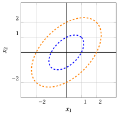
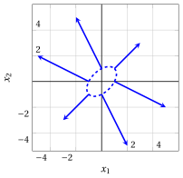
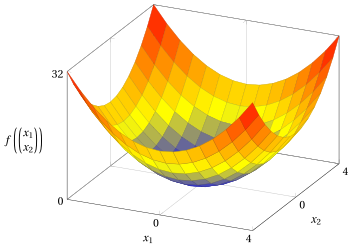

# Quadratic functions

**Part 1 · Preliminaries · Chapter 4** · [:material-file-pdf-box: Lecture notes, volume 1 (PDF)](../pdf/lecture-notes-1-preliminaries.pdf) · [:material-presentation: Slides](../pdf/slides-04-quadratic-functions.pdf) · [:material-pencil: Exercises](../exercises/ex-04-quadratic-functions.md)

## 4.1 Quadratic functions

!!! definizione "Definition 4.1: quadratic function"

    Given a square symmetric matrix

    $$
    \underbrace{
    \begin{pmatrix}
    q_{11} & q_{12} & \dots & q_{1n} \\
    q_{21} & q_{22} & \dots & q_{2n} \\
    \vdots  & \vdots  & \ddots & \vdots \\
    q_{n1} & q_{n2} & \dots & q_{nn}
    \end{pmatrix}}_{\boldsymbol{Q}} \in \mathbb{R}^{n \times n}
    $$

    the associated (scalar) function

    \begin{equation*}
    \label{eq:quadratic}
    f:\, \mathbb{R}^{n} \to \mathbb{R}, \qquad
    f:\underbrace{\begin{pmatrix}
    x_1 \\
    x_2 \\
    \vdots \\
    x_n
    \end{pmatrix}}_{\boldsymbol{x}} \mapsto
    \underbrace{\sum_{i=1}^n \sum_{j=1}^n q_{ij} x_i x_j}_{\boldsymbol{x}' \boldsymbol{Q}\,\boldsymbol{x}} \tag{4.1}
    \end{equation*}

    is called a <strong>quadratic function</strong>.

- If the square matrix of a quadratic function is not symmetric, it can be made symmetric by replacing each off-diagonal pair with its average:

    $$
    q_{ij} \leftarrow \frac{q_{ij}+q_{ji}}{2},~~~
    q_{ji} \leftarrow \frac{q_{ij}+q_{ji}}{2},
    \qquad \forall\, i,j \in \{1,2,\dots,n\},~ i<j
    $$

    This is valid because for every $i,j \in \{1,2,\dots,n\}$ with $i<j,$ we have:

    \begin{align*}
    q_{ij}\,x_i x_j + q_{ji}\,x_j x_i
    &= q_{ij}\,x_i x_j + q_{ji}\,x_i x_j \\[2ex]
    &= (q_{ij}+q_{ji})\,x_i x_j \\[2ex]
    &= \tfrac12(q_{ij}+q_{ji})\,x_i x_j + \tfrac12(q_{ij}+q_{ji})\,x_i x_j \\[2ex]
    &= \frac{q_{ij}+q_{ji}}{2}\,x_i x_j
    + \frac{q_{ij}+q_{ji}}{2}\,x_j x_i
    \end{align*}

    Therefore, the quadratic functions defined by $\boldsymbol{Q}$ and $\tfrac{1}{2}(\boldsymbol{Q}+\boldsymbol{Q}')$ are equivalent, since they yield the same value for every $\boldsymbol{x} \in \mathbb{R}^n$.

!!! chiave ""

    Without loss of generality, we can assume that the matrix $\boldsymbol{Q}$ of a quadratic function is symmetric.

!!! esempio "Example 4.1: equivalent matrices for quadratic functions"

    Consider the following non-symmetric $3\times 3$ matrix:

    $$
    \begin{pmatrix}
    2 & -4 & 0 \\
    2 & 2 & 6 \\
    0 & -8 & 2
    \end{pmatrix}
    $$

    An equivalent quadratic function is obtained by using the following symmetric matrix:

    $$
    \begin{pmatrix}
    2 & \frac{2+(-4)}{2} & 0 \\[1ex]
    \frac{2+(-4)}{2} & 2 & \frac{-8+6}{2} \\[1ex]
    0 & \frac{-8+6}{2} & 2
    \end{pmatrix}
    =
    \begin{pmatrix}
    2 & -1 & 0 \\
    -1 & 2 & -1 \\
    0 & -1 & 2
    \end{pmatrix}
    $$

    Indeed, both matrices define the same function:

    \begin{align*}
    f\left(\begin{pmatrix} x_1 \\ x_2 \\ x_3 \end{pmatrix}\right)
    &= 2x_1^2 - 4x_1x_2 + 2x_2x_1 + 2x_2^2 + 6x_2x_3 - 8x_3x_2 + 2x_3^2 \\[2ex]
    &= 2x_1^2 - x_1x_2 - x_2x_1 + 2x_2^2 - x_2x_3 - x_3x_2 + 2x_3^2 \\[2ex]
    &= 2x_1^2 + 2x_2^2 + 2x_3^2 - 2x_1x_2 - 2x_2x_3
    \end{align*}

## 4.2 Gradient, Hessian and level sets

!!! teorema "Observation 4.2: gradient of a quadratic function"

    The <strong>gradient</strong> (vector of partial derivatives) of a quadratic function is:

    \begin{align*}
    \nabla f({\boldsymbol x}) =
    \begin{pmatrix}
    \frac{ \partial f({\boldsymbol x})}{ \partial x_1} \\[1ex] \frac{ \partial f({\boldsymbol x})}{ \partial x_2} \\[1ex] \vdots \\[1ex]
    \frac{ \partial f({\boldsymbol x})}{ \partial x_n}
    \end{pmatrix} =
    \begin{pmatrix}
    \sum_{j=1}^n (q_{1j} + q_{j1}) x_j \\[1ex]
    \sum_{j=1}^n (q_{2j} + q_{j2}) x_j \\[1ex]
    \vdots \\[1ex]
    \sum_{j=1}^n (q_{nj} + q_{jn}) x_j
    \end{pmatrix}  =
    \underbrace{\begin{pmatrix}
    2 \sum_{j=1}^n q_{1j} x_j \\[1ex]
    2 \sum_{j=1}^n q_{2j} x_j \\[1ex]
    \vdots \\[1ex]
    2 \sum_{j=1}^n q_{nj} x_j
    \end{pmatrix}}_{   2 \; \boldsymbol{Q} \; {\boldsymbol x}}
    \end{align*}

??? dimostrazione "Proof"

    For every $k \in \{1,2,\dots,n\}$, only the terms of the double sum with $i=k$ or $j=k$ contain the variable $x_k$: the terms $q_{kj}\,x_k x_j$ contribute $q_{kj}\,x_j$ to the derivative and the terms $q_{ik}\,x_i x_k$ contribute $q_{ik}\,x_i$ (the term $q_{kk}\,x_k^2$, with $i=j=k$, contributes $2\,q_{kk}\,x_k$, once in each sum). Therefore:

    $$
    \frac{ \partial f({\boldsymbol x})}{ \partial x_k} = \sum_{j=1}^n q_{kj}\, x_j + \sum_{i=1}^n q_{ik}\, x_i = \sum_{j=1}^n (q_{kj} + q_{jk})\, x_j = 2 \sum_{j=1}^n q_{kj}\, x_j
    $$

    where the last equality holds since the matrix ${\boldsymbol Q}$ is symmetric ($q_{jk} = q_{kj}$). □

!!! teorema "Observation 4.3: Hessian of a quadratic function"

    The <strong>Hessian</strong> (matrix of second-order partial derivatives) of a quadratic function is:

    \begin{align*}
    \nabla^2 f({\boldsymbol x}) &=
    \begin{pmatrix}
    \frac{ \partial^2 f({\boldsymbol x})}{ \partial x_1^2} & \frac{ \partial^2 f({\boldsymbol x})}{ \partial x_1 \partial x_2} & \dots & \frac{ \partial^2 f({\boldsymbol x})}{ \partial x_1 \partial x_n} \\[2ex]
    \frac{ \partial^2 f({\boldsymbol x})}{ \partial x_2 \partial x_1} & \frac{ \partial^2 f({\boldsymbol x})}{ \partial x_2^2} & \dots & \frac{ \partial^2 f({\boldsymbol x})}{ \partial x_2 \partial x_n} \\[2ex]
    \vdots & \vdots & \ddots & \vdots \\[2ex]
    \frac{ \partial^2 f({\boldsymbol x})}{ \partial x_n \partial x_1} & \frac{ \partial^2 f({\boldsymbol x})}{ \partial x_n \partial x_2} & \dots & \frac{ \partial^2 f({\boldsymbol x})}{ \partial x_n^2}
    \end{pmatrix} \\[3ex]
    &= \underbrace{2
    \begin{pmatrix}
    q_{11} & q_{12} & \dots & q_{1n} \\
    q_{12} & q_{22} & \dots & q_{2n} \\
    \vdots & \vdots & \ddots & \vdots \\
    q_{1n} & q_{2n} & \dots & q_{nn}
    \end{pmatrix}}_{  2  \; \boldsymbol{Q}}
    \end{align*}

??? dimostrazione "Proof"

    By the previous observation, for every $k \in \{1,2,\dots,n\}$ we have $\frac{ \partial f({\boldsymbol x})}{ \partial x_k} = 2 \sum_{j=1}^n q_{kj}\, x_j$, whose derivative with respect to $x_h$ is $2\,q_{kh}$, for every $h \in \{1,2,\dots,n\}$. □

!!! definizione "Definition 4.4: level sets of a quadratic function"

    The <strong>level sets</strong> of a quadratic function (the sets of points in which the function is <strong>constant</strong>) are:

    \begin{align*}
    \left\{~~{\boldsymbol x} \in \R^{n}:~~ {\boldsymbol x}' \; {\boldsymbol Q} \; {\boldsymbol x}= k  ~~\right\} , \qquad \forall k \in \mathbb{R}
    \end{align*}

- Depending on the matrix $\boldsymbol Q$, the nonempty level sets can be <strong>ellipsoids</strong> (ellipses in $\R^2$), <strong>hyperboloids</strong> (hyperbolas in $\R^2$) or, when some directions do not change the value of the function, <strong>cylinders</strong> (pairs of parallel lines in $\R^2$). For $k=0$ there are also degenerate cases: the single point ${\boldsymbol 0}$ in place of an ellipsoid, two lines crossing at the origin in $\R^2$ (a cone in $\R^n$) in place of a hyperboloid, and a single line through the origin in $\R^2$ (a linear subspace in $\R^n$) in place of a cylinder. The graph of the quadratic functions of the following examples is a <strong>paraboloid</strong>.

!!! chiave ""

    For a quadratic function with symmetric matrix ${\boldsymbol Q}$, the gradient is $\nabla f({\boldsymbol x}) = 2\,{\boldsymbol Q}\,{\boldsymbol x}$ and the Hessian is the constant matrix $\nabla^2 f({\boldsymbol x}) = 2\,{\boldsymbol Q}$. At every point where the gradient is nonzero, the gradient is perpendicular to the level set through that point.

!!! esempio "Example 4.2: level sets of quadratic functions"

    With ${\boldsymbol Q}=\begin{pmatrix} 1 & 0\\ 0 & 1 \end{pmatrix}$, the associated quadratic function is:

    $$
    f: \mathbb{R}^{2} \rightarrow \mathbb{R},~~ f: \begin{pmatrix}
    x_1 \\
    x_2 \\
    \end{pmatrix} \mapsto
    \begin{pmatrix}
    x_{1} &
    x_{2}
    \end{pmatrix}
    \begin{pmatrix}
    1 & 0\\
    0 & 1
    \end{pmatrix}
    \;
    \begin{pmatrix}
    x_{1} \\
    x_{2} \\
    \end{pmatrix}= x_1^2 + x_2^2
    $$

    { .fig .ovale loading=lazy style="width:65%" }

    The figure shows:

    - Blue circle: level set $x_1^2+x_2^2=1$ (radius $1$)

    - Orange circle: level set $x_1^2+x_2^2=4$ (radius $2$)

    - Green circle: level set $x_1^2+x_2^2=8$ (radius $\sqrt{8}$)

!!! esempio "Example 4.3: level sets of quadratic functions"

    With ${\boldsymbol Q}=\begin{pmatrix} 2 & -1\\ -1 & 2 \end{pmatrix}$, the associated quadratic function is:

    \begin{align*}
    f: \mathbb{R}^{2} \rightarrow \mathbb{R},~~ f: \begin{pmatrix}
    x_1 \\
    x_2 \\
    \end{pmatrix} \mapsto {}&
    \begin{pmatrix}
    x_{1} &
    x_{2}
    \end{pmatrix}
    \begin{pmatrix}
    2 & -1\\
    -1 & 2
    \end{pmatrix}
    \;
    \begin{pmatrix}
    x_{1} \\
    x_{2} \\
    \end{pmatrix} \\[2ex]
    &= 2\;x_1^2 - \;x_1\;x_2  - \;x_2\;x_1  + 2\;x_2^2 \\[2ex]
    &= 2\;x_1^2 - 2\;x_1\;x_2  + 2\;x_2^2
    \end{align*}

    { .fig .ovale loading=lazy style="width:65%" }

    The figure shows:

    - Blue ellipse: level set $2\;x_1^2 - 2\;x_1\;x_2 + 2\;x_2^2=2$

    - Orange ellipse: level set $2\;x_1^2 - 2\;x_1\;x_2 + 2\;x_2^2=8$

!!! esempio "Example 4.4: gradients of quadratic functions"

    With ${\boldsymbol Q}=\begin{pmatrix} 1 & 0\\ 0 & 1 \end{pmatrix}$, the gradient of the quadratic function is:

    $$
    \nabla f\left(\begin{pmatrix}
    x_1 \\
    x_2 \\
    \end{pmatrix}\right) =
    \begin{pmatrix}
    2\;x_1 \\[0.5ex] 2\;x_2
    \end{pmatrix}
    $$

    { .fig .ovale loading=lazy style="width:65%" }

    The figure shows:

    - Blue vectors (gradients with norm $2$ on level set $x_1^2+x_2^2=1$):

        \begin{align*}
        \nabla f\left(\begin{pmatrix} -1 \\ 0 \end{pmatrix}\right) &= \begin{pmatrix} -2 \\ 0 \end{pmatrix}, &
        \nabla f\left(\begin{pmatrix} 0 \\ -1 \end{pmatrix}\right) &= \begin{pmatrix} 0 \\ -2 \end{pmatrix}, \\[1ex]
        \nabla f\left(\begin{pmatrix} 0 \\ 1 \end{pmatrix}\right) &= \begin{pmatrix} 0 \\ 2 \end{pmatrix}, &
        \nabla f\left(\begin{pmatrix} 1 \\ 0 \end{pmatrix}\right) &= \begin{pmatrix} 2 \\ 0 \end{pmatrix}
        \end{align*}

    - Orange vectors (gradients with norm $4$ on level set $x_1^2+x_2^2=4$):

        \begin{align*}
        \nabla f\left(\begin{pmatrix} -2 \\ 0 \end{pmatrix}\right) &= \begin{pmatrix} -4 \\ 0 \end{pmatrix}, &
        \nabla f\left(\begin{pmatrix} 0 \\ -2 \end{pmatrix}\right) &= \begin{pmatrix} 0 \\ -4 \end{pmatrix}, \\[1ex]
        \nabla f\left(\begin{pmatrix} 0 \\ 2 \end{pmatrix}\right) &= \begin{pmatrix} 0 \\ 4 \end{pmatrix}, &
        \nabla f\left(\begin{pmatrix} 2 \\ 0 \end{pmatrix}\right) &= \begin{pmatrix} 4 \\ 0 \end{pmatrix}
        \end{align*}

    - Green vectors (gradients with norm $4\sqrt{2}$ on level set $x_1^2+x_2^2=8$):

        \begin{align*}
        \nabla f\left(\begin{pmatrix} 2 \\ 2 \end{pmatrix}\right) &= \begin{pmatrix} 4 \\ 4 \end{pmatrix}, &
        \nabla f\left(\begin{pmatrix} -2 \\ -2 \end{pmatrix}\right) &= \begin{pmatrix} -4 \\ -4 \end{pmatrix}, \\[1ex]
        \nabla f\left(\begin{pmatrix} -2 \\ 2 \end{pmatrix}\right) &= \begin{pmatrix} -4 \\ 4 \end{pmatrix}, &
        \nabla f\left(\begin{pmatrix} 2 \\ -2 \end{pmatrix}\right) &= \begin{pmatrix} 4 \\ -4 \end{pmatrix}
        \end{align*}

    Each gradient is perpendicular to the level set through its point.

!!! esempio "Example 4.5: gradients of quadratic functions"

    With ${\boldsymbol Q}=\begin{pmatrix} 2 & -1\\ -1 & 2 \end{pmatrix}$, the gradient of the quadratic function is:

    $$
    \nabla f\left(\begin{pmatrix}
    x_1 \\
    x_2 \\
    \end{pmatrix}\right) =
    \begin{pmatrix}
    4\;x_1-2\;x_2 \\[0.5ex] -2\;x_1+4\;x_2
    \end{pmatrix}
    $$

    { .fig .ovale loading=lazy style="width:65%" }

    The figure shows:

    - Blue ellipse: level set $2\;x_1^2 - 2\;x_1\;x_2  + 2\;x_2^2=2$

    - Blue vectors (gradients on the level set with norm $2\sqrt{2}$ at diagonal points and norm $2\sqrt{5}$ at axis points):

        \begin{align*}
        \nabla f\left(\begin{pmatrix} 1 \\ 1 \end{pmatrix}\right) &= \begin{pmatrix} 2 \\ 2 \end{pmatrix}, &
        \nabla f\left(\begin{pmatrix} -1 \\ -1 \end{pmatrix}\right) &= \begin{pmatrix} -2 \\ -2 \end{pmatrix}, \\[1ex]
        \nabla f\left(\begin{pmatrix} 1 \\ 0 \end{pmatrix}\right) &= \begin{pmatrix} 4 \\ -2 \end{pmatrix}, &
        \nabla f\left(\begin{pmatrix} -1 \\ 0 \end{pmatrix}\right) &= \begin{pmatrix} -4 \\ 2 \end{pmatrix}, \\[1ex]
        \nabla f\left(\begin{pmatrix} 0 \\ 1 \end{pmatrix}\right) &= \begin{pmatrix} -2 \\ 4 \end{pmatrix}, &
        \nabla f\left(\begin{pmatrix} 0 \\ -1 \end{pmatrix}\right) &= \begin{pmatrix} 2 \\ -4 \end{pmatrix}
        \end{align*}

    Also in this case, each gradient is perpendicular to the level set through its point.

!!! esempio "Example 4.6: graphs of quadratic functions"

    With ${\boldsymbol Q}=\begin{pmatrix} 1 & 0\\[1ex] 0 & 1 \\ \end{pmatrix}$, we have $f\left(\begin{pmatrix} x_1 \\ x_2 \\ \end{pmatrix}\right)=x_1^2+x_2^2$. Its graph is:

    { .fig .ovale loading=lazy style="width:62%" }

!!! esempio "Example 4.7: graphs of quadratic functions"

    With ${\boldsymbol Q}=\begin{pmatrix} 2 & -1\\[1ex] -1 & 2 \\ \end{pmatrix}$, we have $f\left(\begin{pmatrix} x_1 \\ x_2 \\ \end{pmatrix}\right) = 2\;x_1^2 - 2 \;x_1\;x_2  + 2\;x_2^2$. Its graph is:

    { .fig .ovale loading=lazy style="width:62%" }

## 4.3 Convexity of quadratic functions

!!! definizione "Definition 4.5: positive semidefinite matrix"

    A square symmetric matrix ${\boldsymbol Q} \in \R^{n \times n}$ is <strong>positive semidefinite</strong> if:

    $$
    {\boldsymbol x}' {\boldsymbol Q} \; {\boldsymbol x} \ge 0, \qquad \forall {\boldsymbol x} \in \R^n
    $$

!!! teorema "Proposition 4.6"

    For every square matrix  ${\boldsymbol Q}$, if ${\boldsymbol Q}$ is positive semidefinite then the associated quadratic function is  convex in its domain.

??? dimostrazione "Proof"

    If the matrix ${\boldsymbol Q}$ is positive semidefinite, for every pair of points ${\boldsymbol p}, {\boldsymbol w} \in \R^n$ and every $\lambda \in [0,1]$, we have:

    \begin{align*}
    & f\big(\lambda \; {\boldsymbol p} + (1-\lambda)\;{\boldsymbol w}\big) \\[2ex]
    &\quad = (\lambda \;{\boldsymbol p} + (1-\lambda)\; {\boldsymbol w} )' ~{\boldsymbol Q} \; (\lambda \;{\boldsymbol p} + (1-\lambda)\; {\boldsymbol w} ) \\[2ex]
    &\quad = \lambda^2 \; {\boldsymbol p}' {\boldsymbol Q} \; {\boldsymbol p} + (1-\lambda)^2\; {\boldsymbol w}' {\boldsymbol Q} \; {\boldsymbol w} \\[1ex]
    &\qquad + \lambda\;(1-\lambda)\; {\boldsymbol p}' {\boldsymbol Q} \; {\boldsymbol w} + \lambda\;(1-\lambda) \;{\boldsymbol w}' {\boldsymbol Q} \; {\boldsymbol p} \\[2ex]
    &\quad = \lambda \; {\boldsymbol p}' {\boldsymbol Q} \; {\boldsymbol p} + (1-\lambda)\;{\boldsymbol w}' {\boldsymbol Q} \; {\boldsymbol w} \\[1ex]
    &\qquad - \lambda\;(1-\lambda) \; \big( {\boldsymbol p}' {\boldsymbol Q} \; {\boldsymbol p} + {\boldsymbol w}' {\boldsymbol Q} \; {\boldsymbol w} - {\boldsymbol p}' {\boldsymbol Q} \; {\boldsymbol w} - {\boldsymbol w}' {\boldsymbol Q} \; {\boldsymbol p} \big) \\[1ex]
    &\qquad \text{(since $\lambda^2 = \lambda - \lambda\;(1-\lambda)$ and $(1-\lambda)^2 = (1-\lambda) - \lambda\;(1-\lambda)$)} \\[2ex]
    &\quad = \lambda \; {\boldsymbol p}' {\boldsymbol Q} \; {\boldsymbol p} + (1-\lambda)\;{\boldsymbol w}' {\boldsymbol Q} \; {\boldsymbol w} - \lambda\;(1-\lambda) \; ({\boldsymbol p}-{\boldsymbol w})' {\boldsymbol Q} \;  ({\boldsymbol p}-{\boldsymbol w}) \\[2ex]
    &\quad \le \lambda \; {\boldsymbol p}' {\boldsymbol Q} \; {\boldsymbol p} + (1-\lambda)\;{\boldsymbol w}' {\boldsymbol Q} \; {\boldsymbol w} \\[1ex]
    &\qquad \text{(since ${\boldsymbol Q}$ is positive semidefinite and $\lambda\;(1-\lambda) \ge 0$)} \\[2ex]
    &\quad = \lambda \; f({\boldsymbol p}) + (1-\lambda)\; f({\boldsymbol w})
    \end{align*}

    Therefore,

    $$
    f\big(\lambda \; {\boldsymbol p} + (1-\lambda)\;{\boldsymbol w}\big)  \le \lambda \; f({\boldsymbol p}) + (1-\lambda)\; f({\boldsymbol w})
    $$

    By nature, the domain $\mathbb{R}^{n}$ is a convex set. Accordingly, the function is convex in its domain. □

- We have shown that:

    \begin{equation*}
    {\boldsymbol Q} \text{  positive semidefinite} ~~~\Longrightarrow~~~ \text{  convex quadratic function}
    \end{equation*}

    so “${\boldsymbol Q}$ positive semidefinite” is a sufficient condition for “convex quadratic function” and “convex quadratic function” is a necessary condition for “${\boldsymbol Q}$ positive semidefinite”.

- The implication works also in the other direction, as stated by the following proposition.

!!! teorema "Proposition 4.7"

    For every quadratic function, if the function  is convex in its domain then  the associated square matrix ${\boldsymbol Q}$ is positive semidefinite.

??? dimostrazione "Proof"

    If the quadratic function is convex, for every pair of column vectors ${\boldsymbol p},{\boldsymbol w} \in \R^{n}$ and every scalar $\lambda \in (0,1)$, we  have:

    $$
    {(\lambda \;{\boldsymbol p} + (1-\lambda)\; {\boldsymbol w} )}' ~{\boldsymbol Q} \; (\lambda \;{\boldsymbol p} + (1-\lambda)\; {\boldsymbol w} )
    \le \lambda \; {\boldsymbol p}' {\boldsymbol Q} \; {\boldsymbol p} + (1-\lambda)\;{\boldsymbol w}' {\boldsymbol Q} \; {\boldsymbol w}
    $$

    where the left-hand side is:

    \begin{align*}
    & {(\lambda \;{\boldsymbol p} + (1-\lambda)\; {\boldsymbol w} )}' ~{\boldsymbol Q} \; (\lambda \;{\boldsymbol p} + (1-\lambda)\; {\boldsymbol w} ) \\[1ex]
    & \qquad = \lambda^2 \; {\boldsymbol p}' {\boldsymbol Q} \; {\boldsymbol p} + (1-\lambda)^2\; {\boldsymbol w}' {\boldsymbol Q} \; {\boldsymbol w} + \lambda\;(1-\lambda)\; {\boldsymbol p}' {\boldsymbol Q} \; {\boldsymbol w} + \lambda\;(1-\lambda) \;{\boldsymbol w}' {\boldsymbol Q} \; {\boldsymbol p}
    \end{align*}

    This implies, rearranging and simplifying, that:

    \begin{align*}
    & \lambda\;(1-\lambda) \; {\boldsymbol p}' {\boldsymbol Q} \; {\boldsymbol p} + \lambda\;(1-\lambda)\; {\boldsymbol w}' {\boldsymbol Q} \; {\boldsymbol w} \\[1ex]
    & \qquad - \lambda\;(1-\lambda) \; {\boldsymbol p}' {\boldsymbol Q} \; {\boldsymbol w} - \lambda\;(1-\lambda)\; {\boldsymbol w}' {\boldsymbol Q} \; {\boldsymbol p} \ge 0
    \end{align*}

    which, since $\lambda\;(1-\lambda) >0$, implies:

    $$
    \underbrace{
    {\boldsymbol p}' {\boldsymbol Q} \; {\boldsymbol p} +  {\boldsymbol w}' {\boldsymbol Q} \; {\boldsymbol w} -  {\boldsymbol p}' {\boldsymbol Q} \; {\boldsymbol w} -  {\boldsymbol w}' {\boldsymbol Q} \; {\boldsymbol p}}_{=({\boldsymbol p}-{\boldsymbol w})' {\boldsymbol Q} \;  ({\boldsymbol p}-{\boldsymbol w})}
    \ge 0
    $$

    Every vector ${\boldsymbol x} \in \R^n$ can be written as ${\boldsymbol x} = {\boldsymbol p} - {\boldsymbol w}$ (for instance, with ${\boldsymbol p} = {\boldsymbol x}$ and ${\boldsymbol w} = {\boldsymbol 0}$). Therefore, ${\boldsymbol x}' {\boldsymbol Q} \; {\boldsymbol x} \ge 0$ for every ${\boldsymbol x} \in \R^n$, and the square matrix ${\boldsymbol Q}$ is positive semidefinite. □

- We have shown that:

    \begin{equation*}
    \text{  convex quadratic function}  ~~~\Longrightarrow~~~ {\boldsymbol Q} \text{  positive semidefinite}
    \end{equation*}

    so “convex quadratic function” is a sufficient condition for “${\boldsymbol Q}$ positive semidefinite” and “${\boldsymbol Q}$ positive semidefinite” is a necessary condition for “convex quadratic function”.

- So we finally have:

    \begin{equation*}
    {\boldsymbol Q} \text{  positive semidefinite} ~~~\Longleftrightarrow~~~ \text{  convex quadratic function}
    \end{equation*}

    so “${\boldsymbol Q}$ positive semidefinite” is a necessary and sufficient condition for “convex quadratic function” and vice versa.

!!! teorema "Corollary 4.8"

    For every square matrix  ${\boldsymbol Q}$,  the associated  quadratic function is  convex in its domain if and only if  ${\boldsymbol Q}$ is positive semidefinite.

- With ${\boldsymbol Q}$ equal to the identity matrix, the quadratic function is $f({\boldsymbol x}) = {\boldsymbol x}'{\boldsymbol x} = \|{\boldsymbol x}\|_2^2$, the squared Euclidean norm, whose convexity is proved in the chapter «Convex and concave functions» directly from the definition. The identity matrix is positive semidefinite, since ${\boldsymbol x}'{\boldsymbol x} = x_1^2 + x_2^2 + \dots + x_n^2 \ge 0$, in agreement with the corollary.

- When ${\boldsymbol x}' {\boldsymbol Q} \; {\boldsymbol x}$ can be written as a sum of squares of linear functions, as in the following example, the matrix ${\boldsymbol Q}$ is positive semidefinite, and the convexity can also be proved directly from the definition, with the inequality $\big(\lambda a+(1-\lambda)b\big)^2 \le \lambda a^2+(1-\lambda)b^2$ of the chapter «Convex and concave functions».

!!! esempio "Example 4.8: a convex quadratic function"

    With ${\boldsymbol Q}=\begin{pmatrix} 2 & -1\\ -1 & 2 \end{pmatrix}$, for every ${\boldsymbol x} \in \R^2$ we have:

    $$
    {\boldsymbol x}' {\boldsymbol Q} \; {\boldsymbol x} = 2\;x_1^2 - 2\;x_1\;x_2  + 2\;x_2^2 = x_1^2 + x_2^2 + (x_1 - x_2)^2 \ge 0
    $$

    Therefore, the matrix ${\boldsymbol Q}$ is positive semidefinite and, by the corollary, the quadratic function of the previous examples is convex in its domain.

    The same conclusion follows from the definition: for every pair of points ${\boldsymbol p}, {\boldsymbol w} \in \R^2$ and every $\lambda \in [0,1]$, we have:

    \begin{align*}
    & f\big(\lambda {\boldsymbol p} + (1-\lambda){\boldsymbol w}\big) \\[2ex]
    &\quad = \big(\lambda p_1+(1-\lambda)w_1\big)^2 + \big(\lambda p_2+(1-\lambda)w_2\big)^2 \\[1ex]
    &\qquad + \big(\lambda (p_1-p_2)+(1-\lambda)(w_1-w_2)\big)^2 \\[2ex]
    &\quad \le \lambda p_1^2+(1-\lambda)w_1^2 + \lambda p_2^2+(1-\lambda)w_2^2 \\[1ex]
    &\qquad + \lambda (p_1-p_2)^2+(1-\lambda)(w_1-w_2)^2 \\[1ex]
    &\qquad \text{(by the inequality of the chapter «Convex and concave functions»,} \\
    &\qquad \text{three times)} \\[2ex]
    &\quad = \lambda\big(p_1^2+p_2^2+(p_1-p_2)^2\big) \\[1ex]
    &\qquad +(1-\lambda)\big(w_1^2+w_2^2+(w_1-w_2)^2\big) \\[2ex]
    &\quad = \lambda f({\boldsymbol p}) + (1-\lambda) f({\boldsymbol w})
    \end{align*}

    Therefore,

    $$
    f\big(\lambda {\boldsymbol p} + (1-\lambda){\boldsymbol w}\big) \le \lambda f({\boldsymbol p}) + (1-\lambda) f({\boldsymbol w})
    $$

    By nature, the domain $\R^2$ is a convex set. Accordingly, the function is convex in its domain.

!!! esempio "Example 4.9: a quadratic function that is not convex"

    With ${\boldsymbol Q}=\begin{pmatrix} 1 & 0\\ 0 & -1 \end{pmatrix}$, the quadratic function is

    $$
    f\left(\begin{pmatrix} x_1 \\ x_2 \end{pmatrix}\right) = x_1^2 - x_2^2
    $$

    and its nonempty level sets with $k \neq 0$ are hyperbolas. The matrix ${\boldsymbol Q}$ is not positive semidefinite, since:

    $$
    \begin{pmatrix} 0 & 1 \end{pmatrix}
    \begin{pmatrix}
    1 & 0\\
    0 & -1
    \end{pmatrix}
    \begin{pmatrix} 0 \\ 1 \end{pmatrix} = -1 < 0
    $$

    By the corollary, the function is not convex in its domain. Indeed, with

    $$
    {\boldsymbol p} = \begin{pmatrix} 0 \\ 1 \end{pmatrix}, \qquad {\boldsymbol w} = \begin{pmatrix} 0 \\ -1 \end{pmatrix}, \qquad \lambda = \frac{1}{2}
    $$

    the inequality of the definition of convex function does not hold:

    $$
    f\left(\frac{1}{2}\,{\boldsymbol p} + \frac{1}{2}\,{\boldsymbol w}\right) = f\left(\begin{pmatrix} 0 \\ 0 \end{pmatrix}\right) = 0 ~>~ -1 = \frac{1}{2}\,f({\boldsymbol p}) + \frac{1}{2}\,f({\boldsymbol w})
    $$

## 4.4 Quadratic functions with a linear part

- In optimization problems we often find functions that are the sum of a quadratic function, a linear function and a constant: given a square symmetric matrix ${\boldsymbol Q} \in \R^{n \times n}$, a vector ${\boldsymbol c} \in \R^n$ and a scalar $d \in \R$,

    $$
    g:\, \mathbb{R}^{n} \to \mathbb{R}, \qquad
    g: {\boldsymbol x} \mapsto {\boldsymbol x}' {\boldsymbol Q} \; {\boldsymbol x} + {\boldsymbol c}' {\boldsymbol x} + d = \sum_{i=1}^n \sum_{j=1}^n q_{ij} x_i x_j + \sum_{j=1}^n c_j x_j + d
    $$

- Since the derivative of ${\boldsymbol c}' {\boldsymbol x} + d$ with respect to $x_k$ is $c_k$, the gradient and the Hessian are:

    $$
    \nabla g({\boldsymbol x}) = 2\,{\boldsymbol Q}\,{\boldsymbol x} + {\boldsymbol c}, \qquad \nabla^2 g({\boldsymbol x}) = 2\,{\boldsymbol Q}
    $$

- The function $h({\boldsymbol x}) = {\boldsymbol c}' {\boldsymbol x} + d$ is convex (and concave) in its domain, since the definition holds with equality: for every pair of points ${\boldsymbol p}, {\boldsymbol w} \in \R^n$ and every $\lambda \in [0,1]$, we have:

    \begin{align*}
    & h\big(\lambda {\boldsymbol p} + (1-\lambda){\boldsymbol w}\big) \\[2ex]
    &\quad = {\boldsymbol c}'\big(\lambda {\boldsymbol p} + (1-\lambda){\boldsymbol w}\big) + d \\[2ex]
    &\quad = \lambda\, {\boldsymbol c}'{\boldsymbol p} + (1-\lambda)\, {\boldsymbol c}'{\boldsymbol w} + \lambda d + (1-\lambda) d \\[1ex]
    &\qquad \text{(since $\lambda + (1-\lambda) = 1$)} \\[2ex]
    &\quad = \lambda h({\boldsymbol p}) + (1-\lambda) h({\boldsymbol w})
    \end{align*}

    Therefore, both inequalities of the definitions of convex and concave function hold with equality. By nature, the domain $\R^n$ is a convex set. Accordingly, the function $h$ is convex and concave in its domain. Since the sum of convex functions is convex (chapter «Convex and concave functions»), if the matrix ${\boldsymbol Q}$ is positive semidefinite, the function $g$ is convex in its domain. Conversely, if $g$ is convex, the quadratic function ${\boldsymbol x}' {\boldsymbol Q} \; {\boldsymbol x} = g({\boldsymbol x}) + \big(-{\boldsymbol c}' {\boldsymbol x} - d\big)$ is convex, as the sum of two convex functions, and the matrix ${\boldsymbol Q}$ is positive semidefinite by the corollary.

!!! chiave ""

    A quadratic function ${\boldsymbol x}' {\boldsymbol Q} \; {\boldsymbol x}$ is convex in its domain if and only if the matrix ${\boldsymbol Q}$ is positive semidefinite. Adding a linear function and a constant does not change its convexity.
