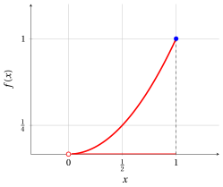
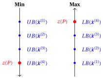
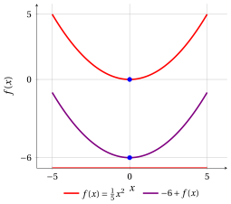
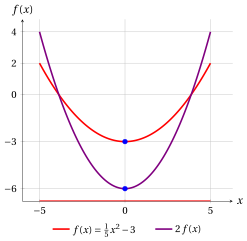
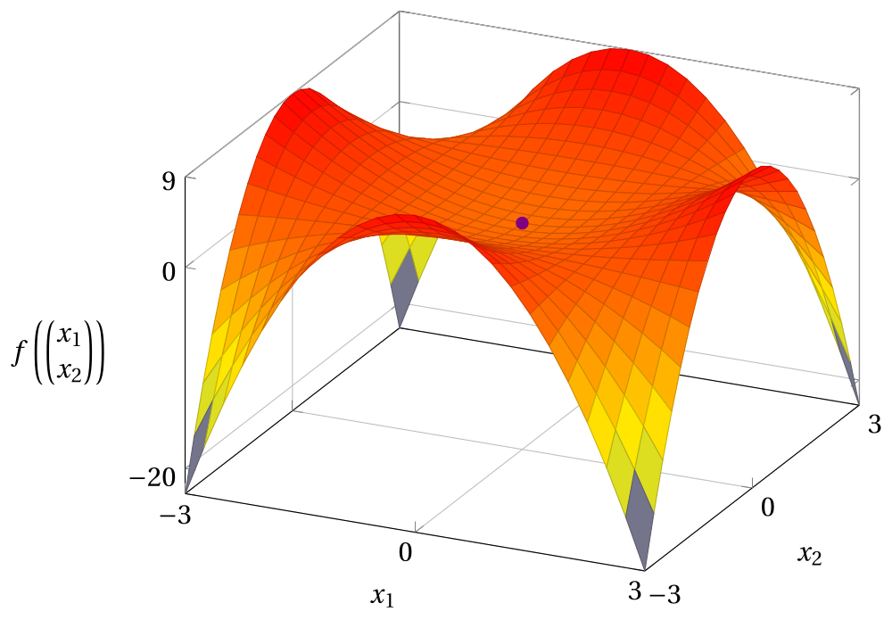
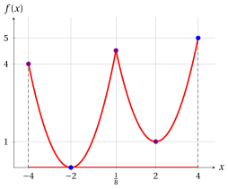

# Optimization problems

**Part 2 · Optimization problems · Chapter 5** · [:material-file-pdf-box: Lecture notes, volume 2 (PDF)](../pdf/lecture-notes-2-optimization-problems.pdf) · [:material-presentation: Slides](../pdf/slides-05-optimization-problems.pdf) · [:material-pencil: Exercises](../exercises/ex-05-optimization-problems.md)

## 5.1 Optimization problems

!!! definizione "Definition 5.1: optimization problem in minimization and maximization form"

    Given a set $F \subseteq \mathbb{R}^n$ and a function $f : D \subseteq \mathbb{R}^n \to \mathbb{R}$, with $F \subseteq D$, the associated <strong>optimization problem</strong> $P$ consists of:

    - in the <strong>minimization form</strong>, finding a point $\tilde{\boldsymbol{x}}(P) \in F$ such that

        $$
        f(\tilde{\boldsymbol{x}}(P)) \le f(\boldsymbol{x}), \qquad \forall \boldsymbol{x} \in F;
        $$

    - in the <strong>maximization form</strong>, finding a point $\tilde{\boldsymbol{x}}(P) \in F$ such that

        $$
        f(\tilde{\boldsymbol{x}}(P)) \ge f(\boldsymbol{x}), \qquad \forall \boldsymbol{x} \in F.
        $$

### 5.1.1 Feasible region and objective function

- The set $F$ is called the <strong>feasible region</strong> of the optimization problem; its points $\boldsymbol{x} \in F$ are called the <strong>feasible solutions</strong> of the optimization problem.

- The function $f$ is the <strong>objective function</strong> of the optimization problem; it assigns an objective value to each feasible solution.

!!! definizione "Definition 5.2: optimal solution and optimal value"

    - A point $\tilde{\boldsymbol{x}}(P) \in F$ is called an <strong>optimal solution</strong> of the optimization problem.

        1. In the minimization form,

            $$
            \tilde{\boldsymbol{x}}(P) \in
            \argmin \{\, f(\boldsymbol{x}) \;\text{subject to}\; \boldsymbol{x} \in F \,\}.
            $$

        2. In the maximization form,

            $$
            \tilde{\boldsymbol{x}}(P) \in
            \argmax \{\, f(\boldsymbol{x}) \;\text{subject to}\; \boldsymbol{x} \in F \,\}.
            $$

    - The value $f(\tilde{\boldsymbol{x}}(P))$ is called the <strong>optimal value</strong> of the optimization problem,  and it is denoted by $z(P)$.

        1. In the minimization form,

            $$
            z(P) =
            \underbrace{\min \{\, f(\boldsymbol{x}) \;\text{subject to}\; \boldsymbol{x} \in F \,\}}_{ =f(\tilde{\boldsymbol{x}}(P))}.
            $$

        2. In the maximization form,

            $$
            z(P) =
            \underbrace{\max \{\, f(\boldsymbol{x}) \;\text{subject to}\; \boldsymbol{x} \in F \,\}}_{ =f(\tilde{\boldsymbol{x}}(P))}.
            $$

- An optimization problem may admit multiple (possibly infinitely many) optimal solutions, or none at all. In such cases, the operators $\argmin$ and $\argmax$ return the full set of optimal solutions when they exist, and return the empty set otherwise.

- With a slight abuse of notation:

    1. In the <strong>minimization form</strong>, we write the optimization problem as

        $$
        \min \{\, f(\boldsymbol{x}) \;\text{subject to}\; \boldsymbol{x} \in F \,\}.
        $$

    2. In the <strong>maximization form</strong>, we write the optimization problem as

        $$
        \max \{\, f(\boldsymbol{x}) \;\text{subject to}\; \boldsymbol{x} \in F \,\}.
        $$

    !!! chiave ""

        Although we use the symbols “$\min$” and “$\max$”, the goal of an optimization problem is to <strong>find an optimal solution</strong> $\tilde{\boldsymbol{x}}(P)$, whenever it exists, rather than merely determining the optimal value $z(P)$.

- In the figures of this chapter, the graph of the objective function over the feasible region is red, the feasible region is the red part of the $x$-axis and the optimal solutions are blue. An empty circle marks an endpoint that does not belong to the feasible region.

!!! esempio "Example 5.1: an optimization problem with a quadratic objective function"

    Consider the following objective function and feasible region:

    $$
    f:\R \to \R,~ f: x \mapsto x^2
    \qquad \text{and} \qquad
    F=\{\, x \in \R : -1 \le x \le 2 \,\} = [-1,2].
    $$

    The associated optimization problems in minimization and maximization forms are:

    \begin{equation*}
    \min \bigg\{\, x^2 \ \text{ subject to } -1 \le x \le 2 \,\bigg\}
    \qquad \text{and} \qquad
    \max \bigg\{\, x^2 \ \text{ subject to } -1 \le x \le 2 \,\bigg\}
    \end{equation*}

    { .fig .ovale loading=lazy style="width:50%" }

    - For the minimization form, since $f(x) = x^2 \ge 0 = f(0)$ for every feasible $x$, and $x^2 = 0$ only for $x=0$, the unique optimal solution and the optimal value are:

        $$
        \tilde{\boldsymbol x}(P) = (0)
        \quad \text{and} \quad
        z(P) = 0.
        $$

    - For the maximization form, for every feasible $x$ we have $|x| \le 2$ and then $f(x) = |x|^2 \le 4 = f(2)$, with $x^2 = 4$ only for $x=-2$ and $x=2$; since $-2 \notin F$, the unique optimal solution and the optimal value are:

        $$
        \tilde{\boldsymbol x}(P) = (2)
        \quad \text{and} \quad
        z(P) = 4.
        $$

    The optimal solutions are found directly from the definition: we compare the value of the objective function at a candidate point with its value at every feasible solution.

!!! esempio "Example 5.2: an optimization problem with infinitely many optimal solutions"

    Consider the following objective function and feasible region:

    $$
    f:\R \to \R,~ f: x \mapsto \max\{\, 0,\; |x|-1 \,\}
    \qquad \text{and} \qquad
    F=[-3,3].
    $$

    The objective function is $f(x) = 0$ for $-1 \le x \le 1$ and $f(x) = |x|-1$ otherwise: its graph is made of three segments.

    { .fig .ovale loading=lazy style="width:50%" }

    - For the minimization form, $f(x) \ge 0$ for every feasible $x$, and $f(x) = 0$ exactly for $-1 \le x \le 1$. The problem has <strong>infinitely many</strong> optimal solutions (the blue segment) and the optimal value is:

        $$
        \argmin \big\{\, \max\{0,|x|-1\} \ \text{ subject to } -3 \le x \le 3 \,\big\} = [-1,1]
        \quad \text{and} \quad
        z(P) = 0.
        $$

    - For the maximization form, for every feasible $x$ we have $|x| \le 3$ and then $f(x) \le \max\{0,\, 3-1\} = 2$, with $f(x) = 2$ only for $x=-3$ and $x=3$. The problem has <strong>two</strong> optimal solutions and the optimal value is:

        $$
        \argmax \big\{\, \max\{0,|x|-1\} \ \text{ subject to } -3 \le x \le 3 \,\big\} = \{-3,\,3\}
        \quad \text{and} \quad
        z(P) = 2.
        $$

- An optimal solution of an optimization problem may not exist for one of the following three reasons:

    1. If the objective function decreases indefinitely in a minimization problem or increases indefinitely in a maximization problem, the optimization problem is said to be <strong>unbounded</strong>. In these cases, $z(P) = -\infty$ and $z(P) = +\infty$, respectively.

    2. If the feasible region is empty, meaning that no solutions exist, the optimization problem is said to be <strong>infeasible</strong>. In these cases, $z(P)$ is not defined.

    3. If the infimum (or supremum) of the objective function exists but is not attained within the feasible region, the optimization problem is said to have an <strong>unattainable infimum (or supremum)</strong>, as in Examples [5.5](#box-7-exOptUnattainable) and [Example 5.6](#box-8-exOptUnattainableInf). In these cases, $z(P)$ is not defined.

- In the <strong>minimization form</strong>, an optimal solution is a <strong>point of minimum</strong>, and the corresponding optimal value is the <strong>minimum</strong> of the objective function over the feasible region.

    Similarly, in the <strong>maximization form</strong>, an optimal solution is a <strong>point of maximum</strong>, and the corresponding optimal value is the <strong>maximum</strong> of the objective function over the feasible region.

!!! esempio "Example 5.3: an unbounded optimization problem"

    Consider the following objective function and feasible region:

    $$
    f:\R \to \R,~ f: x \mapsto (x-2)^2
    \qquad \text{and} \qquad
    F=\R.
    $$

    The feasible region is the whole real line: the graph continues upward on both sides of the figure.

    { .fig .ovale loading=lazy style="width:50%" }

    - For the minimization form, since $f(x) = (x-2)^2 \ge 0 = f(2)$ for every $x \in \R$, and $(x-2)^2 = 0$ only for $x=2$, the unique optimal solution and the optimal value are:

        $$
        \tilde{\boldsymbol x}(P) = (2)
        \quad \text{and} \quad
        z(P) = 0.
        $$

    - For the maximization form, the objective function increases indefinitely: for every value $M \ge 0$, the feasible solution $x = M+3$ has

        $$
        f(M+3) = (M+1)^2 \ge M+1 > M.
        $$

        No feasible solution can be optimal and the problem is <strong>unbounded</strong>: $z(P) = +\infty$.

!!! esempio "Example 5.4: an infeasible optimization problem"

    Consider the following objective function and feasible region:

    $$
    f:\R \to \R,~ f: x \mapsto x^2
    \qquad \text{and} \qquad
    F=\{\, x \in \R : x^2 \le -1 \,\}.
    $$

    Since $x^2 \ge 0 > -1$ for every $x \in \R$, no point satisfies the constraint and the feasible region is empty: $F = \emptyset$. Both the minimization and the maximization form are <strong>infeasible</strong>: they have no feasible solution, hence no optimal solution, and $z(P)$ is not defined.

!!! esempio "Example 5.5: an optimization problem with an unattainable infimum"

    Consider the following objective function and feasible region:

    $$
    f:\R \to \R,~ f: x \mapsto x^2
    \qquad \text{and} \qquad
    F=\{\, x \in \R : 0 < x \le 1 \,\} = (0,1].
    $$

    The point $x=0$ does not belong to the feasible region (empty circle in the figure).

    { .fig .ovale loading=lazy style="width:50%" }

    - For the minimization form, $f(x) = x^2 > 0$ for every feasible $x$, and the values of $f$ get as close to $0$ as we want: the infimum of $f$ over $F$ is $0$. However, no feasible solution is optimal: for every $x \in F$, the point $\frac{x}{2}$ is feasible and

        $$
        f\Big(\frac{x}{2}\Big) = \frac{x^2}{4} < x^2 = f(x).
        $$

        The problem has an <strong>unattainable infimum</strong>: there is no optimal solution and $z(P)$ is not defined.

    - For the maximization form, for every feasible $x$ we have $0 < x \le 1$ and then $f(x) = x^2 \le 1 = f(1)$, with $x^2 = 1$ only for $x=1$ in $F$. The unique optimal solution and the optimal value are:

        $$
        \tilde{\boldsymbol x}(P) = (1)
        \quad \text{and} \quad
        z(P) = 1.
        $$

!!! esempio "Example 5.6: an unattainable infimum at infinity"

    Consider the following objective function and feasible region:

    $$
    f:\R \setminus \{0\} \to \R,~ f: x \mapsto \frac{1}{x}
    \qquad \text{and} \qquad
    F=\{\, x \in \R : x > 0 \,\} = (0,+\infty).
    $$

    The associated optimization problems in minimization and maximization forms are:

    \begin{equation*}
    \min \bigg\{\, \frac{1}{x} \ \text{ subject to } x > 0 \,\bigg\}
    \qquad \text{and} \qquad
    \max \bigg\{\, \frac{1}{x} \ \text{ subject to } x > 0 \,\bigg\}
    \end{equation*}

    The point $x=0$ does not belong to the feasible region (empty circle in the figure). The graph continues on the right, approaching the $x$-axis, and upward, approaching the dashed line $x=0$.

    { .fig .ovale loading=lazy style="width:50%" }

    - For the minimization form, $f(x) = \frac{1}{x} > 0$ for every feasible $x$, and the values of $f$ get as close to $0$ as we want as $x \to +\infty$: the infimum of $f$ over $F$ is $0$. However, no feasible solution is optimal: for every $x \in F$, the point $2x$ is feasible and

        $$
        f(2x) = \frac{1}{2x} < \frac{1}{x} = f(x).
        $$

        The problem has an <strong>unattainable infimum</strong>: there is no optimal solution and

        $$
        \inf \bigg\{\, \frac{1}{x} \ \text{ subject to } x > 0 \,\bigg\} = 0,
        \qquad z(P) \ \text{is not defined}.
        $$

    - For the maximization form, the objective function increases indefinitely as $x \to 0^+$: for every value $M > 0$, the feasible solution $x = \frac{1}{M+1}$ has

        $$
        f\Big(\frac{1}{M+1}\Big) = M+1 > M.
        $$

        No feasible solution can be optimal and the problem is <strong>unbounded</strong>:

        $$
        \sup \bigg\{\, \frac{1}{x} \ \text{ subject to } x > 0 \,\bigg\} = +\infty
        \qquad \text{and} \qquad
        z(P) = +\infty.
        $$

### 5.1.2 Feasible solutions and bounds on the optimal value

- Given

    $$
    \underbrace{
    \begin{pmatrix}
    \bar x_1 \\
    \bar x_2 \\
    \vdots \\
    \bar x_n
    \end{pmatrix}
    }_{\bar{\boldsymbol x}(P)}
    \in F
    $$

    a <strong>feasible solution</strong> of an optimization problem, we have

    1. in <strong>minimization</strong> form, the following <strong>upper bound</strong>:

        $$
        z(P) \le
        \underbrace{f(\bar{\boldsymbol{x}}(P))}_{UB(\bar{\boldsymbol x})} .
        $$

    2. in <strong>maximization</strong> form, the following <strong>lower bound</strong>:

        $$
        \underbrace{f(\bar{\boldsymbol{x}}(P))}_{LB(\bar{\boldsymbol x})}
        \le z(P) .
        $$

    As an illustrative example, the figure below considers four feasible solutions

    $$
    \bar{\boldsymbol x}^{(1)}, \bar{\boldsymbol x}^{(2)}, \bar{\boldsymbol x}^{(3)}, \bar{\boldsymbol x}^{(4)} \in F
    $$

    and shows how they provide lower bounds in the maximization case and upper bounds in the minimization case for the optimal value $z(P)$ (the fourth one attains the optimal value).

    { .fig .cornice loading=lazy style="width:62%" }

!!! esempio "Example 5.7: bounds from feasible solutions"

    Consider again the objective function $f(x) = x^2$ and the feasible region $F=[-1,2]$ of the example with a quadratic objective function, where $z(P) = 0$ in minimization form and $z(P) = 4$ in maximization form. The feasible solutions

    $$
    \bar{\boldsymbol x}^{(1)} = (-1), \qquad \bar{\boldsymbol x}^{(2)} = \Big(\frac{1}{2}\Big), \qquad \bar{\boldsymbol x}^{(3)} = (1)
    $$

    have objective values $1$, $\frac{1}{4}$ and $1$. Therefore:

    - in minimization form, they give the upper bounds $UB(\bar{\boldsymbol x}^{(1)}) = 1$, $UB(\bar{\boldsymbol x}^{(2)}) = \frac{1}{4}$ and $UB(\bar{\boldsymbol x}^{(3)}) = 1$ on $z(P) = 0$; the best one is $\frac{1}{4}$, the smallest;

    - in maximization form, they give the lower bounds $LB(\bar{\boldsymbol x}^{(1)}) = 1$, $LB(\bar{\boldsymbol x}^{(2)}) = \frac{1}{4}$ and $LB(\bar{\boldsymbol x}^{(3)}) = 1$ on $z(P) = 4$; the best one is $1$, the largest.

    None of these bounds is equal to the optimal value: a bound tells us how far the optimal value can be from the value of a known feasible solution, without computing it.

## 5.2 Properties of optimization problems

- The following properties hold for every optimization problem.

- In the following, we state properties using $\min$ and $\max$ only in the case where the minimum and maximum exist (i.e., they are attained on the feasible region); otherwise, the analogous statements hold by replacing $\min/\max$ with $\inf/\sup$.

- For every objective function $f$ and every feasible region $F$, we have:

    \begin{align*}
    \label{PropMinMax}
    \min \bigg\{\, f(\boldsymbol{x}) \text{ subject to } \boldsymbol{x}\in F \,\bigg\}
    &= -\,\max \bigg\{\, -f(\boldsymbol{x}) \text{ subject to } \boldsymbol{x}\in F \,\bigg\} \tag{5.1}
    \end{align*}

- The optimal solutions do not change: a point minimizes $f$ over $F$ if and only if it maximizes $-f$ over $F$. In the figures of this section, the original objective function is red, the transformed one is violet, the feasible region is the red part of the $x$-axis and the optimal solutions are blue.

!!! esempio "Example 5.8: property: minimum and maximum"

    $$
    \begin{aligned}
    &\underbrace{\min \left\{\, \frac{1}{5}x^2+1 \text{ subject to } -5 \le x \le 5 \,\right\}}_{=1}\\[1ex]
    &\qquad = -\,\underbrace{\max \left\{\, -\left( \frac{1}{5}x^2+1 \right) \text{ subject to } -5 \le x \le 5 \,\right\}}_{=-1}
    \end{aligned}
    $$

    Indeed, $\frac{1}{5}x^2+1 \ge 1$ and $-\left(\frac{1}{5}x^2+1\right) \le -1$ for every $x$, with equality only for $x=0$: both optima are attained at $x=0$.

    { .fig .ovale loading=lazy style="width:50%" }

- For every objective function, every feasible region, and every $a \in \R$, we have:

    \begin{align*}
    \min \bigg\{\, a + f(\boldsymbol{x}) \text{ subject to } \boldsymbol{x}\in F \,\bigg\}
    &= a + \min \bigg\{\, f(\boldsymbol{x}) \text{ subject to } \boldsymbol{x}\in F \,\bigg\} \tag{5.2}
    \end{align*}

- Adding a constant moves the graph of the objective function up or down: the optimal solutions do not change.

!!! esempio "Example 5.9: property: constant addition"

    $$
    \begin{aligned}
    &\underbrace{\min \left\{\, \frac{1}{5}x^2-6 \text{ subject to } -5 \le x \le 5 \,\right\}}_{=-6}\\[1ex]
    &\qquad = -6 + \underbrace{\min \left\{\, \frac{1}{5}x^2 \text{ subject to } -5 \le x \le 5 \,\right\}}_{=0}
    \end{aligned}
    $$

    Both minima are attained at $x=0$, since $\frac{1}{5}x^2 \ge 0$ for every $x$, with equality only for $x=0$.

    { .fig .ovale loading=lazy style="width:50%" }

- For every objective function, every feasible region, and every $a \in \R_{>0}$, we have:

    \begin{align*}
    \min \bigg\{\, a\, f(\boldsymbol{x}) \text{ subject to } \boldsymbol{x}\in F \,\bigg\}
    &= a \; \min \bigg\{\, f(\boldsymbol{x}) \text{ subject to } \boldsymbol{x}\in F \,\bigg\} \tag{5.3}
    \end{align*}

- Multiplying by a positive constant stretches (or compresses) the graph vertically: the optimal solutions do not change.

!!! esempio "Example 5.10: property: multiplication by a positive constant"

    $$
    \begin{aligned}
    &\underbrace{\min \left\{\, 2\left(\frac{1}{5}x^2-3\right) \text{ subject to } -5 \le x \le 5 \,\right\}}_{=-6}\\[1ex]
    &\qquad = 2\,\underbrace{\min \left\{\, \frac{1}{5}x^2-3 \text{ subject to } -5 \le x \le 5 \,\right\}}_{=-3}
    \end{aligned}
    $$

    Both minima are attained at $x=0$, since $\frac{1}{5}x^2-3 \ge -3$ for every $x$, with equality only for $x=0$.

    { .fig .ovale loading=lazy style="width:50%" }

- For every objective function, every feasible region, and every $a \in \R_{<0}$, we have:

    \begin{align*}
    \min \bigg\{\, a\, f(\boldsymbol{x}) \text{ subject to } \boldsymbol{x}\in F \,\bigg\}
    &= a \; \max \bigg\{\, f(\boldsymbol{x}) \text{ subject to } \boldsymbol{x}\in F \,\bigg\} \tag{5.4}
    \end{align*}

- Multiplying by a negative constant turns the graph upside down: the points of minimum of $a\,f$ are the points of maximum of $f$.

!!! esempio "Example 5.11: property: multiplication by a negative constant"

    $$
    \begin{aligned}
    &\underbrace{\min \left\{\, -2\left(\frac{1}{5}x^2-3\right) \text{ subject to } -5 \le x \le 5 \,\right\}}_{=-4}\\[1ex]
    &\qquad = -2\,\underbrace{\max \left\{\, \frac{1}{5}x^2-3 \text{ subject to } -5 \le x \le 5 \,\right\}}_{=2}
    \end{aligned}
    $$

    For every feasible $x$ we have $|x| \le 5$ and then $\frac{1}{5}x^2-3 \le \frac{25}{5}-3 = 2$, with equality only for $x=-5$ and $x=5$: both problems have the <strong>two</strong> optimal solutions $x=-5$ and $x=5$.

    { .fig .ovale loading=lazy style="width:50%" }

## 5.3 Local and global optimal solutions

!!! definizione "Definition 5.3: point of minimum/maximum and minimum/maximum"

    Given a function $f:D\subseteq \R^n \rightarrow \R$, a point $\tilde{\boldsymbol x} \in D$ is

    - a <strong>point of minimum</strong> (<strong>global minimum point</strong>) of $f$ in $D$ if

        \begin{equation*}
        f(\tilde{\boldsymbol x}) ~\le~ f({\boldsymbol x}),~~~~ \forall {\boldsymbol x} \in D
        \end{equation*}

        and $f(\tilde{\boldsymbol x})$ is the <strong>minimum</strong> of $f$ in $D$;

    - a <strong>point of maximum</strong> (<strong>global maximum point</strong>) of $f$ in $D$ if

        \begin{equation*}
        f(\tilde{\boldsymbol x}) ~\ge~ f({\boldsymbol x}),~~~~ \forall {\boldsymbol x} \in D
        \end{equation*}

        and $f(\tilde{\boldsymbol x})$ is the <strong>maximum</strong> of $f$ in $D$.

- A point of minimum (maximum) is also called a <strong>minimizer</strong> (<strong>maximizer</strong>) of $f$ in $D$.

- There can exist multiple points of minimum (maximum), possibly infinitely many, as in [Example 5.2](#box-4-exOptMultiple).

- The optimal solutions of a minimization (maximization) problem with objective function $f$ and feasible region $F$ are the points of minimum (maximum) of $f$ in $F$: they are its <strong>global optima</strong>.

!!! definizione "Definition 5.4: spherical $\delta$-neighborhood"

    Given a point $\bar{\boldsymbol x} \in \R^n$ and a value $\delta \in \R_{>0}$, the associated <strong>spherical $\delta$-neighborhood</strong> is:

    $$
    N(\bar{\boldsymbol x},\delta)=\bigg\{ ~~{\boldsymbol x} \in \R^n:~ ||\bar{\boldsymbol x}-{\boldsymbol x}|| < \delta~\bigg\}
    $$

- The value $||\bar{\boldsymbol x}-{\boldsymbol x}||$ is the <strong>Euclidean distance</strong> between a generic point ${\boldsymbol x} \in \R^n$ and the point $\bar{\boldsymbol x} \in \R^n$, the <strong>center</strong> of the neighborhood:

    $$
    ||\bar{\boldsymbol x}-{\boldsymbol x}|| = \sqrt{\sum_{j=1}^n (\bar x_j - x_j)^2}.
    $$

    The neighborhood $N(\bar{\boldsymbol x},\delta)$ contains the points whose distance from the center is smaller than the <strong>radius</strong> $\delta$: in $\R$ it is the open interval $(\bar x-\delta,\, \bar x+\delta)$, in $\R^2$ it is the open disk of center $\bar{\boldsymbol x}$ and radius $\delta$, without its boundary circle.

!!! esempio "Example 5.12: spherical neighborhoods"

    Consider the point $\bar{\boldsymbol x} = \begin{pmatrix} 4 \\ 4 \end{pmatrix} \in \R^2$ and the radii $\delta_1=1$ and $\delta_2=2$. The associated spherical $\delta$-neighborhoods

    $$
    N\left(\begin{pmatrix} 4 \\ 4 \end{pmatrix},1\right)
    = \left\{ {\boldsymbol x} \in \R^2 : \sqrt{(4-x_1)^2+(4-x_2)^2} < 1 \right\}
    $$

    and

    $$
    N\left(\begin{pmatrix} 4 \\ 4 \end{pmatrix},2\right)
    = \left\{ {\boldsymbol x} \in \R^2 : \sqrt{(4-x_1)^2+(4-x_2)^2} < 2 \right\}
    $$

    are the red disks in the figure: the darker disk is $N\big(\bar{\boldsymbol x},1\big)$, which is contained in $N\big(\bar{\boldsymbol x},2\big)$. The boundary circles are dashed because they do not belong to the neighborhoods: for instance, the points $\begin{pmatrix} 4 \\ 5 \end{pmatrix}$ and $\begin{pmatrix} 6 \\ 4 \end{pmatrix}$ (empty circles) have distance exactly $1$ and $2$ from the center, respectively.

    { .fig .ovale loading=lazy style="width:50%" }

!!! definizione "Definition 5.5: point of local minimum/maximum and local minimum/maximum"

    Given a function $f:D\subseteq \R^n \rightarrow \R$, a point $\bar{\boldsymbol x} \in D$ is

    - a <strong>point of local minimum</strong> of $f$ in $D$ if there exists a spherical neighborhood $N(\bar{\boldsymbol x},\delta)$ with $\delta \in \R_{>0}$ such that:

        $$
        f(\bar{\boldsymbol x}) ~\le~ f({\boldsymbol x}),~~~~ \forall {\boldsymbol x} \in N(\bar{\boldsymbol x},\delta) \cap D
        $$

        and $f(\bar{\boldsymbol x})$ is a <strong>local minimum</strong> of $f$ in $D$;

    - a <strong>point of local maximum</strong> of $f$ in $D$ if there exists a spherical neighborhood $N(\bar{\boldsymbol x},\delta)$ with $\delta \in \R_{>0}$ such that:

        $$
        f(\bar{\boldsymbol x}) ~\ge~ f({\boldsymbol x}),~~~~ \forall {\boldsymbol x} \in N(\bar{\boldsymbol x},\delta) \cap D
        $$

        and $f(\bar{\boldsymbol x})$ is a <strong>local maximum</strong> of $f$ in $D$.

- There can exist multiple points of local minimum (maximum), possibly infinitely many.

- To prove that a point is a point of local minimum (maximum) with the definition, it is enough to exhibit <strong>one</strong> radius $\delta$ for which the inequality holds in $N(\bar{\boldsymbol x},\delta) \cap D$; any smaller radius also works.

!!! esempio "Example 5.13: points of local minimum"

    Consider the following function:

    \begin{equation*}
    f: \R^2 \rightarrow \R,~~f: \begin{pmatrix}
    x_1 \\
    x_2
    \end{pmatrix} \mapsto x_1^2 + x_2^2 - \frac{1}{2}x_1^2 x_2^2.
    \end{equation*}

    This is the graph of the function in $[-3,3]\times[-3,3]$; the violet point is $\big(0,0,f(0,0)\big) = (0,0,0)$.

    { .fig .ovale loading=lazy style="width:62%" }

    To prove that the point $\begin{pmatrix}0\\0\end{pmatrix}$ is a point of local minimum, we use the spherical $\delta$-neighborhood $N\!\left(\begin{pmatrix}0\\0\end{pmatrix},1\right)$. For every $\begin{pmatrix}x_1\\x_2\end{pmatrix}\in N\!\left(\begin{pmatrix}0\\0\end{pmatrix},1\right)$ we have $x_2^2 \le x_1^2+x_2^2<1$, hence $1-\dfrac{x_2^2}{2} > \dfrac{1}{2}$, and then:

    $$
    f\!\left(\begin{pmatrix}x_1\\x_2\end{pmatrix}\right)-f\!\left(\begin{pmatrix}0\\0\end{pmatrix}\right)
    = x_1^2 + x_2^2 - \frac{1}{2}x_1^2x_2^2
    = x_1^2\!\left(1-\frac{x_2^2}{2}\right)+x_2^2
    \ge \frac{1}{2}x_1^2 + x_2^2 \ge 0,
    $$

    with equality only for $x_1=x_2=0$. It follows that

    $$
    f\!\left(\begin{pmatrix}0\\0\end{pmatrix}\right)\le
    f\!\left(\begin{pmatrix}x_1\\x_2\end{pmatrix}\right),
    \qquad
    \forall \begin{pmatrix}x_1\\x_2\end{pmatrix}\in N\!\left(\begin{pmatrix}0\\0\end{pmatrix},1\right),
    $$

    and $\begin{pmatrix}0\\0\end{pmatrix}$ is a point of local minimum of $f$ in $\R^2$, with local minimum $0$. It is not a point of (global) minimum, since

    $$
    f\!\left(\begin{pmatrix}3\\3\end{pmatrix}\right) = 9 + 9 - \frac{81}{2} = -\frac{45}{2} < 0 = f\!\left(\begin{pmatrix}0\\0\end{pmatrix}\right).
    $$

- Every point of (global) minimum is a point of local minimum (with any $\delta$), and every point of (global) maximum is a point of local maximum. The converse is false: a point of local minimum may not be a point of minimum, as the previous example and the following one show.

!!! esempio "Example 5.14: a local minimum that is not a global minimum"

    Consider the following function:

    $$
    f: [-4,4] \to \R,~ f: x \mapsto \min\big\{\, (x+2)^2,\; (x-2)^2+1 \,\big\}.
    $$

    Since $(x+2)^2 \le (x-2)^2+1$ if and only if $8x \le 1$, we have

    $$
    f(x) = \begin{cases} (x+2)^2 & \text{if } -4 \le x \le \frac{1}{8},\\[1ex] (x-2)^2+1 & \text{if } \frac{1}{8} \le x \le 4. \end{cases}
    $$

    In the figure, the points of global minimum and maximum are blue and the other points of local minimum and maximum are violet.

    { .fig .ovale loading=lazy style="width:50%" }

    - <strong>Global minimum.</strong> Both $(x+2)^2$ and $(x-2)^2+1$ are nonnegative, so $f(x) \ge 0 = f(-2)$ for every $x \in [-4,4]$; since $(x-2)^2+1 \ge 1$, $f(x) = 0$ only for $x=-2$. The point $x=-2$ is the unique point of minimum and the minimum is $0$.

    - <strong>Local minimum that is not global.</strong> In the neighborhood $N\big((2),1\big) = (1,3)$ we have $x \ge \frac{1}{8}$, and then

        $$
        f(x) = (x-2)^2+1 \ge 1 = f(2), \qquad \forall x \in N\big((2),1\big) \cap [-4,4] = (1,3).
        $$

        The point $x=2$ is a point of local minimum and $1$ is a local minimum; it is not a point of (global) minimum, since $f(-2) = 0 < 1 = f(2)$.

    - <strong>Global maximum.</strong> For $-4 \le x \le \frac{1}{8}$ we have $-2 \le x+2 \le \frac{17}{8}$ and then $f(x) = (x+2)^2 \le \big(\frac{17}{8}\big)^2 = \frac{289}{64} < 5$. For $\frac{1}{8} \le x \le 4$ we have $-\frac{15}{8} \le x-2 \le 2$ and then $f(x) = (x-2)^2+1 \le 4+1 = 5$, with equality only for $x=4$. The point $x=4$ is the unique point of maximum and the maximum is $5$.

    - <strong>Local maxima that are not global.</strong> In $N\big((-4),1\big) \cap [-4,4] = [-4,-3)$ we have $-2 \le x+2 < -1$ and then $f(x) = (x+2)^2 \le 4 = f(-4)$: the point $x=-4$ is a point of local maximum. In $N\big((\frac{1}{8}),1\big) = (-\frac{7}{8},\frac{9}{8})$ we have $0 < x+2 \le \frac{17}{8}$ when $x \le \frac{1}{8}$, so that $f(x) = (x+2)^2 \le \frac{289}{64}$, and $-\frac{15}{8} \le x-2 < 0$ when $x \ge \frac{1}{8}$, so that $f(x) = (x-2)^2+1 \le \frac{225}{64}+1 = \frac{289}{64}$; in both cases $f(x) \le f(\frac{1}{8})$: the point $x=\frac{1}{8}$ is a point of local maximum. Neither of them is a point of (global) maximum, since $f(-4) = 4 < 5$ and $f(\frac{1}{8}) = \frac{289}{64} < 5$.

    Consider the optimization problem $\min \{\, f(x) \text{ subject to } -4 \le x \le 4 \,\}$: a method that only looks at the points close to $x=2$ finds the local minimum $1$, but the optimal value is $z(P) = 0$, attained at $\tilde{\boldsymbol x}(P) = (-2)$.
