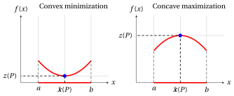
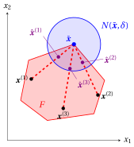
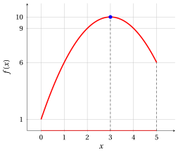

# Convex and concave optimization problems

**Part 2 · Optimization problems · Chapter 6** · [:material-file-pdf-box: Lecture notes, volume 2 (PDF)](../pdf/lecture-notes-2-optimization-problems.pdf) · [:material-presentation: Slides](../pdf/slides-06-convex-concave-problems.pdf) · [:material-pencil: Exercises: Convex and concave optimization problems](../exercises/ex-06-convex-concave-problems.md) · [:material-gesture-tap: App: Descent to a local optimum](../interactive/local-descent.md)

## 6.1 Convex and concave optimization problems

!!! definizione "Definition 6.1: convex and concave optimization problems"

    Given an optimization problem with a <strong>convex feasible region</strong>,

    - if the objective function is convex over the feasible region, then the problem is called a <strong>convex optimization problem</strong>;

    - if the objective function is concave over the feasible region, then the problem is called a <strong>concave optimization problem</strong>.

- In the figures of this chapter, as in the chapter «Optimization problems», the graph of the objective function over the feasible region is red, the feasible region is the red part of the $x$-axis and the optimal solutions are blue. Examples of a convex minimization problem and of a concave maximization problem with the feasible region $[a,b] \subseteq \R$:

{ .fig .ovale loading=lazy style="width:88%" }

- The definitions of convex and concave function of the chapter «Convex and concave functions» require a convex domain: if the objective function is convex or concave over the feasible region, then the feasible region is a convex set.

- The feasible region is often described by a finite number of constraints, $F = \{\, {\boldsymbol x} \in \R^n : g_i({\boldsymbol x}) \le 0, ~ i \in \{1,2,\dots,m\} \,\}$. If every function $g_i$ is convex, then $F$ is a convex set, by the property of the sets defined by convex functions of the chapter «Convex and concave functions». For instance, the interval $[a,b] = \{\, x \in \R : a - x \le 0, ~ x - b \le 0 \,\}$ is defined by two linear, hence convex, functions.

## 6.2 Local optima of convex and concave problems

- Every point of minimum is also a point of local minimum. The following proposition states that, in a convex minimization problem, the converse also holds.

!!! teorema "Proposition 6.2: local minima of convex minimization problems"

    In a convex minimization problem, with objective function $f$ convex over the convex feasible region $F$, if a point $\bar{\boldsymbol x} \in F$ is a point of local minimum of $f$ in $F$, then it is a point of minimum of $f$ in $F$, that is, an optimal solution.

??? dimostrazione "Proof"

    If $\bar{\boldsymbol x} \in F$ is a point of local minimum, then there exists a spherical neighborhood $N(\bar{\boldsymbol x}, \delta)$ with $\delta > 0$ such that:

    $$
    f(\bar{\boldsymbol x}) \le f(\boldsymbol x), \quad \forall\, \boldsymbol x \in N(\bar{\boldsymbol x}, \delta) \cap F
    $$

    For every $\boldsymbol x \in F \setminus \{\bar{\boldsymbol x} \}$, since $F$ is convex, all points of the form $\hat{\boldsymbol x} = \lambda\, \boldsymbol x + (1 - \lambda)\, \bar{\boldsymbol x}$ with $\lambda \in (0,1]$ also belong to $F$. Moreover, for $\lambda$ sufficiently small, we have $\hat{\boldsymbol x} \in N(\bar{\boldsymbol x}, \delta) \cap F$, and therefore:

    $$
    f(\bar{\boldsymbol x}) \le f(\hat{\boldsymbol x})
    $$

    Since $f$ is convex, it also holds that:

    $$
    f(\hat{\boldsymbol x}) \le \lambda\, f(\boldsymbol x) + (1 - \lambda)\, f(\bar{\boldsymbol x})
    $$

    Combining the two inequalities, we obtain:

    $$
    \begin{array}{c}
    f(\bar{\boldsymbol x}) \le \lambda\, f(\boldsymbol x) + (1 - \lambda)\, f(\bar{\boldsymbol x}) \\[4pt]
    \Downarrow \\[4pt]
    \lambda\, f(\bar{\boldsymbol x}) \le \lambda\, f(\boldsymbol x) \\[4pt]
    \Downarrow \\[4pt]
    f(\bar{\boldsymbol x}) \le f(\boldsymbol x) \quad \text{(since $\lambda \in (0,1]$)}
    \end{array}
    $$

    Hence,

    $$
    f(\bar{\boldsymbol x}) \le f(\boldsymbol x), \quad \forall\, \boldsymbol x \in F
    $$

    and $\bar{\boldsymbol x}$ is a point of minimum. □

- In $\R^2$, the idea of the proof is given by the following picture, with three points ${\boldsymbol x}^{(1)},{\boldsymbol x}^{(2)},{\boldsymbol x}^{(3)}$ in $F$ and three points $\hat{\boldsymbol x}^{(1)},\hat{\boldsymbol x}^{(2)},\hat{\boldsymbol x}^{(3)}$ in $N(\bar{\boldsymbol x},\delta) \cap F$, each lying on the segment that joins $\bar{\boldsymbol x}$ to the corresponding ${\boldsymbol x}^{(i)}$.

{ .fig .ovale loading=lazy style="width:44%" }

- In a convex minimization problem we have shown that:

    \begin{equation*}
    \text{point of local minimum} \quad \Longrightarrow \quad \text{point of minimum}
    \end{equation*}

    and the implication also holds in the other direction, because a point of minimum satisfies the defining condition at every point of $F$, and therefore in particular at every point of a neighborhood. The two notions are equivalent.

!!! teorema "Corollary 6.3: local maxima of concave maximization problems"

    In a concave maximization problem, with objective function $f$ concave over the convex feasible region $F$, a point $\bar{\boldsymbol x} \in F$ is a point of local maximum of $f$ in $F$ if and only if it is a point of maximum of $f$ in $F$, that is, an optimal solution.

??? dimostrazione "Proof"

    If $f$ is concave over $F$, then $-f$ is convex over $F$, and $\bar{\boldsymbol x}$ is a point of local maximum of $f$ if and only if it is a point of local minimum of $-f$. By the previous proposition, it is a point of minimum of $-f$ in $F$, that is, a point of maximum of $f$ in $F$, since $\max\{f({\boldsymbol x}) \text{ subject to } {\boldsymbol x} \in F\} = -\min\{-f({\boldsymbol x}) \text{ subject to } {\boldsymbol x} \in F\}$. □

!!! chiave ""

    - In a convex minimization problem, every <strong>point of local minimum</strong> is also a <strong>point of minimum</strong>: every point of local minimum in the feasible region is an optimal solution.

    - In a concave maximization problem, every <strong>point of local maximum</strong> is also a <strong>point of maximum</strong>: every point of local maximum in the feasible region is an optimal solution.

## 6.3 Examples of convex and concave optimization problems

- In the following examples, we first check that the feasible region is a convex set and that the objective function is convex (or concave) over it, with the definition of the chapter «Convex and concave functions». Then we find a point of local minimum (or maximum), comparing the value of the objective function at a candidate point with its values at the feasible points of a neighborhood. By the proposition and the corollary of the previous section, this point is an optimal solution.

- The candidate point is the point where the derivative of the objective function vanishes. The derivative only suggests the candidate: the local optimality is checked directly with the definition of the chapter «Optimization problems».

!!! esempio "Example 6.1: a convex minimization problem"

    Consider the following objective function and feasible region:

    $$
    f:\R \to \R,~ f: x \mapsto (x - 2)^2 + 1
    \qquad \text{and} \qquad
    F=[0,5].
    $$

    The associated optimization problem in minimization form is:

    $$
    \min \bigg\{\, (x - 2)^2 + 1 \ \text{ subject to } \ 0 \le x \le 5 \,\bigg\}
    $$

    { .fig .ovale loading=lazy style="width:50%" }

    - <strong>Feasible region.</strong> The feasible region $F=[0,5]$ is an interval, hence a convex set.

    - <strong>Objective function.</strong> For every pair of points $p,w \in F$ and every $\lambda \in [0,1]$, we have:

        \begin{align*}
        f\big(\lambda p+(1-\lambda)w\big)
        &= \big(\lambda p+(1-\lambda)w-2\big)^2 + 1 \\[2ex]
        &= \big(\lambda (p-2)+(1-\lambda)(w-2)\big)^2 + \lambda + (1-\lambda) \\[1ex]
        &\qquad (\text{since } \lambda + (1-\lambda) = 1) \\[2ex]
        &\le \lambda (p-2)^2+(1-\lambda)(w-2)^2 + \lambda + (1-\lambda) \\[1ex]
        &\qquad \text{(since } \big(\lambda a+(1-\lambda)b\big)^2\le \lambda a^2+(1-\lambda)b^2 \text{,} \\
        &\qquad \phantom{\text{(}}\text{chapter «Convex and concave functions»)} \\[2ex]
        &= \lambda \big((p-2)^2+1\big)+(1-\lambda)\big((w-2)^2+1\big) \\[2ex]
        &= \lambda f(p)+(1-\lambda)f(w)
        \end{align*}

        Therefore,

        $$
        f\big(\lambda p + (1-\lambda) w\big) \le \lambda f(p) + (1-\lambda) f(w)
        $$

        The objective function is convex over the convex feasible region $F$, and the problem is a <strong>convex minimization problem</strong>.

    - <strong>Point of local minimum.</strong> The derivative $f'(x) = 2x-4 = 2\,(x-2)$ vanishes at $x=2$. In the neighborhood $N\big((2),1\big) = (1,3)$, all points are feasible and

        $$
        f(x) = (x-2)^2+1 \ge 1 = f(2), \qquad \forall x \in N\big((2),1\big) \cap F = (1,3).
        $$

        The point $x=2$ is a point of local minimum.

    - <strong>Optimal solution.</strong> By the proposition «local minima of convex minimization problems», the point $x=2$ is also a point of minimum, and the optimal solution and the optimal value are:

        $$
        \tilde{\boldsymbol x}(P) = (2)
        \qquad \text{and} \qquad
        z(P) = f(2) = 1.
        $$

!!! esempio "Example 6.2: a concave maximization problem"

    Consider the following objective function and feasible region:

    $$
    f:\R \to \R,~ f: x \mapsto -(x - 3)^2 + 10
    \qquad \text{and} \qquad
    F=[0,5].
    $$

    The associated optimization problem in maximization form is:

    $$
    \max \bigg\{\, -(x - 3)^2 + 10 \ \text{ subject to } \ 0 \le x \le 5 \,\bigg\}
    $$

    { .fig .ovale loading=lazy style="width:50%" }

    - <strong>Feasible region.</strong> The feasible region $F=[0,5]$ is an interval, hence a convex set.

    - <strong>Objective function.</strong> For every pair of points $p,w \in F$ and every $\lambda \in [0,1]$, we have:

        \begin{align*}
        f\big(\lambda p+(1-\lambda)w\big)
        &= -\big(\lambda (p-3)+(1-\lambda)(w-3)\big)^2 + \lambda\,10 + (1-\lambda)\,10 \\[1ex]
        &\qquad (\text{since } \lambda + (1-\lambda) = 1) \\[2ex]
        &\ge -\lambda (p-3)^2-(1-\lambda)(w-3)^2 + \lambda\,10 + (1-\lambda)\,10 \\[1ex]
        &\qquad \text{(since } \big(\lambda a+(1-\lambda)b\big)^2\le \lambda a^2+(1-\lambda)b^2 \text{,} \\
        &\qquad \phantom{\text{(}}\text{and $-1$ reverses the inequality)} \\[2ex]
        &= \lambda \big(-(p-3)^2+10\big)+(1-\lambda)\big(-(w-3)^2+10\big) \\[2ex]
        &= \lambda f(p)+(1-\lambda)f(w)
        \end{align*}

        Therefore,

        $$
        f\big(\lambda p + (1-\lambda) w\big) \ge \lambda f(p) + (1-\lambda) f(w)
        $$

        The objective function is concave over the convex feasible region $F$, and the problem is a <strong>concave maximization problem</strong>.

    - <strong>Point of local maximum.</strong> The derivative $f'(x) = -2x+6 = -2\,(x-3)$ vanishes at $x=3$. In the neighborhood $N\big((3),1\big) = (2,4)$, all points are feasible and

        $$
        f(x) = -(x-3)^2+10 \le 10 = f(3), \qquad \forall x \in N\big((3),1\big) \cap F = (2,4).
        $$

        The point $x=3$ is a point of local maximum.

    - <strong>Optimal solution.</strong> By the corollary «local maxima of concave maximization problems», the point $x=3$ is also a point of maximum, and the optimal solution and the optimal value are:

        $$
        \tilde{\boldsymbol x}(P) = (3)
        \qquad \text{and} \qquad
        z(P) = f(3) = 10.
        $$

- In the last two examples, the objective function is the same cubic polynomial

    $$
    f:\R \to \R,~ f: x \mapsto 2 + 9x - 6x^2 + x^3 = (x-2)^3 - 3\,(x-2) + 4,
    $$

    which is neither convex nor concave in $\R$: with $p=0$, $w=2$ and $\lambda=\frac{1}{2}$ we have $f(1) = 6 > 3 = \frac{1}{2}\,f(0)+\frac{1}{2}\,f(2)$, and with $p=2$, $w=4$ and $\lambda=\frac{1}{2}$ we have $f(3) = 2 < 5 = \frac{1}{2}\,f(2)+\frac{1}{2}\,f(4)$. It is convex over $[2,4]$ and concave over $[0,2]$: the definition of convex (concave) optimization problem only concerns the values of the objective function over the feasible region. To prove it, we use the following inequality.

!!! teorema "Observation 6.4"

    For every $\lambda \in [0,1]$ and every $a,b \in \R$, we have

    $$
    \lambda a^3+(1-\lambda)b^3-\big(\lambda a+(1-\lambda)b\big)^3 = \lambda(1-\lambda)(a-b)^2\big((1+\lambda)\,a+(2-\lambda)\,b\big)
    $$

    and, therefore,

    \begin{align*}
    \big(\lambda a+(1-\lambda)b\big)^3 &\le \lambda a^3+(1-\lambda)b^3 \qquad \text{if } a,b \ge 0, \\[1ex]
    \big(\lambda a+(1-\lambda)b\big)^3 &\ge \lambda a^3+(1-\lambda)b^3 \qquad \text{if } a,b \le 0.
    \end{align*}

??? dimostrazione "Proof"

    Let $\mu = 1-\lambda$, so that $1-\lambda^2 = (1-\lambda)(1+\lambda) = \mu(1+\lambda)$ and $1-\mu^2 = \lambda(1+\mu)$. Expanding the cube, we have:

    \begin{align*}
    & \lambda a^3+\mu b^3-\big(\lambda a+\mu b\big)^3 \\[1ex]
    &\quad = \lambda(1-\lambda^2)\,a^3+\mu(1-\mu^2)\,b^3-3\lambda^2\mu\,a^2b-3\lambda\mu^2\,ab^2 \\[2ex]
    &\quad = \lambda\mu\,\big((1+\lambda)\,a^3+(1+\mu)\,b^3-3\lambda\,a^2b-3\mu\,ab^2\big) \\[2ex]
    &\quad = \lambda\mu\,(a^2-2ab+b^2)\,\big((1+\lambda)\,a+(1+\mu)\,b\big) \\[1ex]
    &\qquad \text{(since $(1+\mu)-2(1+\lambda) = -3\lambda$ and $(1+\lambda)-2(1+\mu) = -3\mu$)} \\[2ex]
    &\quad = \lambda(1-\lambda)(a-b)^2\big((1+\lambda)\,a+(2-\lambda)\,b\big)
    \end{align*}

    Since $\lambda(1-\lambda)(a-b)^2 \ge 0$, $1+\lambda > 0$ and $2-\lambda > 0$, the right-hand side is nonnegative if $a,b \ge 0$, and nonpositive if $a,b \le 0$. □

!!! esempio "Example 6.3: a convex minimization problem with a cubic objective function"

    Consider the following objective function and feasible region:

    $$
    f:\R \to \R,~ f: x \mapsto 2 + 9x - 6x^2 + x^3
    \qquad \text{and} \qquad
    F=[2,4].
    $$

    The associated optimization problem in minimization form is:

    $$
    \min \bigg\{\, 2 + 9x - 6x^2 + x^3 \ \text{ subject to } \ 2 \le x \le 4 \,\bigg\}
    $$

    In the figure, the graph of the objective function outside the feasible region is dashed.

    { .fig .ovale loading=lazy style="width:50%" }

    - <strong>Feasible region.</strong> The feasible region $F=[2,4]$ is an interval, hence a convex set.

    - <strong>Objective function.</strong> For every pair of points $p,w \in F$ and every $\lambda \in [0,1]$, with $a = p-2 \ge 0$ and $b = w-2 \ge 0$, we have:

        \begin{align*}
        f\big(\lambda p+(1-\lambda)w\big)
        &= \big(\lambda p+(1-\lambda)w-2\big)^3 - 3\big(\lambda p+(1-\lambda)w-2\big) + 4 \\[1ex]
        &\qquad \text{(since } f(x) = (x-2)^3 - 3\,(x-2) + 4 \text{)} \\[2ex]
        &= \big(\lambda a+(1-\lambda)b\big)^3 - 3\big(\lambda a+(1-\lambda)b\big) + \lambda\,4 + (1-\lambda)\,4 \\[1ex]
        &\qquad \text{(since } \lambda p+(1-\lambda)w - 2 = \lambda a + (1-\lambda) b \text{,} \\
        &\qquad \phantom{\text{(}}\text{and } \lambda + (1-\lambda) = 1 \text{)} \\[2ex]
        &\le \lambda a^3+(1-\lambda)b^3 - 3\big(\lambda a+(1-\lambda)b\big) + \lambda\,4 + (1-\lambda)\,4 \\[1ex]
        &\qquad \text{(by the previous observation, since } a \ge 0 \text{ and } b \ge 0) \\[2ex]
        &= \lambda \big(a^3-3a+4\big)+(1-\lambda)\big(b^3-3b+4\big) \\[2ex]
        &= \lambda f(p)+(1-\lambda)f(w) \\[1ex]
        &\qquad \text{(since } f(p) = a^3-3a+4 \text{ and } f(w) = b^3-3b+4 \text{)}
        \end{align*}

        Therefore,

        $$
        f\big(\lambda p + (1-\lambda) w\big) \le \lambda f(p) + (1-\lambda) f(w)
        $$

        The objective function is convex over the convex feasible region $F$, and the problem is a <strong>convex minimization problem</strong>.

    - <strong>Point of local minimum.</strong> The derivative $f'(x) = 9 - 12x + 3x^2 = 3\,(x-1)\,(x-3)$ vanishes at $x=1$ and at $x=3$, and only $x=3$ is feasible. For every $x \in \R$ we have $f(x) - 2 = x\,(x-3)^2$. In the neighborhood $N\big((3),1\big) = (2,4)$, all points are feasible and positive, and then

        $$
        f(x) = 2 + x\,(x-3)^2 \ge 2 = f(3), \qquad \forall x \in N\big((3),1\big) \cap F = (2,4).
        $$

        The point $x=3$ is a point of local minimum.

    - <strong>Optimal solution.</strong> By the proposition «local minima of convex minimization problems», the point $x=3$ is also a point of minimum, and the optimal solution and the optimal value are:

        $$
        \tilde{\boldsymbol x}(P) = (3)
        \qquad \text{and} \qquad
        z(P) = f(3) = 2.
        $$

!!! esempio "Example 6.4: a concave maximization problem with a cubic objective function"

    Consider the same objective function with a different feasible region:

    $$
    f:\R \to \R,~ f: x \mapsto 2 + 9x - 6x^2 + x^3
    \qquad \text{and} \qquad
    F=[0,2].
    $$

    The associated optimization problem in maximization form is:

    $$
    \max \bigg\{\, 2 + 9x - 6x^2 + x^3 \ \text{ subject to } \ 0 \le x \le 2 \,\bigg\}
    $$

    In the figure, the graph of the objective function outside the feasible region is dashed.

    { .fig .ovale loading=lazy style="width:50%" }

    - <strong>Feasible region.</strong> The feasible region $F=[0,2]$ is an interval, hence a convex set.

    - <strong>Objective function.</strong> For every pair of points $p,w \in F$ and every $\lambda \in [0,1]$, with $a = p-2 \le 0$ and $b = w-2 \le 0$, we have:

        \begin{align*}
        f\big(\lambda p+(1-\lambda)w\big)
        &= \big(\lambda p+(1-\lambda)w-2\big)^3 - 3\big(\lambda p+(1-\lambda)w-2\big) + 4 \\[1ex]
        &\qquad \text{(since } f(x) = (x-2)^3 - 3\,(x-2) + 4 \text{)} \\[2ex]
        &= \big(\lambda a+(1-\lambda)b\big)^3 - 3\big(\lambda a+(1-\lambda)b\big) + \lambda\,4 + (1-\lambda)\,4 \\[1ex]
        &\qquad \text{(since } \lambda p+(1-\lambda)w - 2 = \lambda a + (1-\lambda) b \text{,} \\
        &\qquad \phantom{\text{(}}\text{and } \lambda + (1-\lambda) = 1 \text{)} \\[2ex]
        &\ge \lambda a^3+(1-\lambda)b^3 - 3\big(\lambda a+(1-\lambda)b\big) + \lambda\,4 + (1-\lambda)\,4 \\[1ex]
        &\qquad \text{(by the previous observation, since } a \le 0 \text{ and } b \le 0) \\[2ex]
        &= \lambda \big(a^3-3a+4\big)+(1-\lambda)\big(b^3-3b+4\big) \\[2ex]
        &= \lambda f(p)+(1-\lambda)f(w) \\[1ex]
        &\qquad \text{(since } f(p) = a^3-3a+4 \text{ and } f(w) = b^3-3b+4 \text{)}
        \end{align*}

        Therefore,

        $$
        f\big(\lambda p + (1-\lambda) w\big) \ge \lambda f(p) + (1-\lambda) f(w)
        $$

        The objective function is concave over the convex feasible region $F$, and the problem is a <strong>concave maximization problem</strong>.

    - <strong>Point of local maximum.</strong> The derivative $f'(x) = 3\,(x-1)\,(x-3)$ vanishes at $x=1$ and at $x=3$, and only $x=1$ is feasible. For every $x \in \R$ we have $6 - f(x) = (x-1)^2\,(4-x)$. In the neighborhood $N\big((1),1\big) = (0,2)$, all points are feasible and smaller than $4$, and then

        $$
        f(x) = 6 - (x-1)^2\,(4-x) \le 6 = f(1), \qquad \forall x \in N\big((1),1\big) \cap F = (0,2).
        $$

        The point $x=1$ is a point of local maximum.

    - <strong>Optimal solution.</strong> By the corollary «local maxima of concave maximization problems», the point $x=1$ is also a point of maximum, and the optimal solution and the optimal value are:

        $$
        \tilde{\boldsymbol x}(P) = (1)
        \qquad \text{and} \qquad
        z(P) = f(1) = 6.
        $$

---

**Exercises on this chapter:** [:material-pencil: Convex and concave optimization problems](../exercises/ex-06-convex-concave-problems.md)

<!-- laboratorio-interattivo: sezione generata da interattivi.py -->

## Interactive lab { #interactive-lab }

The ideas of the chapter, hands on: move the sliders and drag the points.
All the graphs of the course are in the [interactive lab](../interactive/index.md#cap-6).

